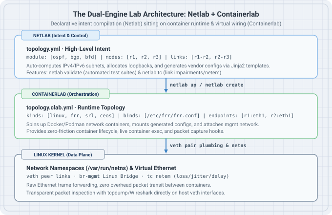

# Netlab Fundamentals

While [Containerlab](https://containerlab.dev/) excels at spinning up containers and wiring virtual Ethernet pairs, running real multi-node routing topologies requires hundreds of lines of boilerplate device configurations, IP address spreadsheets, and manual routing daemon setup. 

[Netlab](https://netlab.tools/) (developed by Ivan Pepelnjak) solves this problem by providing a **declarative network intent and configuration compiler**. Rather than replacing Containerlab, Netlab uses Containerlab as its primary virtualization provider (`provider: clab`). You describe *what* you want in a high-level YAML topology; Netlab automatically plans IP subnets, assigns loopback and transit addresses, generates vendor-specific configurations (FRR, Arista cEOS, Nokia SR Linux, Cisco XRd), and instructs Containerlab to deploy the lab.

{fig-alt="Netlab and Containerlab Layered Architecture"}

## Learning goals

By the end of this chapter, you will be able to:

- Articulate the distinction between the orchestration layer (Containerlab) and the intent/configuration layer (Netlab).
- Install and configure Netlab with Containerlab on a Linux system.
- Write concise declarative topology files (`topology.yml`) with automated module activation (OSPF, BGP, BFD, VLANs).
- Inspect compiled artifacts (`netlab create`) to understand the underlying Containerlab topology and generated NOS configuration files.
- Operate the full lifecycle: `netlab up`, `netlab connect`, `netlab inspect`, and `netlab down`.
- Run automated verification test suites using `netlab validate`.
- Inject realistic network impairments (latency, jitter, packet loss) using `netlab tc`.
- Swap network operating systems (e.g., FRR to Arista cEOS or Nokia SR Linux) with a single configuration parameter.

---

## The Dual-Engine Model: Why Both Tools Matter

When learning networking from scratch, choosing between Containerlab and Netlab is not an either/or dilemma. They serve distinct, complementary purposes across your learning journey:

| Capability | Containerlab Direct (`*.clab.yml`) | Netlab with Containerlab (`topology.yml`) |
| :--- | :--- | :--- |
| **Mental Model** | Physical / Virtual link plumbing (`veth` pairs & namespaces) | Network architecture & protocol intent |
| **IP Addressing** | Completely manual; you must assign every IP on every interface | Fully automated IPAM; computes /30, /31, or /24 transit and /32 loopbacks |
| **Protocol Config** | Manual; you author and mount `/etc/frr/frr.conf` or vendor configs | Automated; Jinja2 templates render native NOS configs from modules |
| **Ideal For** | L1/L2 mechanics, raw ARP, custom bridges, packet crafts | OSPF, BGP, EVPN-VXLAN, multi-area fabrics, failure drills |
| **Validation** | Manual CLI checks and `docker exec` commands | Automated testing assertions with `netlab validate` |
| **NOS Portability** | Low; changing NOS requires rewriting all config files | High; change `device: frr` to `device: eos` or `device: srlinux` |

**Curriculum Rule of Thumb:**  
Use **raw Containerlab** for visceral wire-level understanding in early foundation chapters (inspecting ARP frames, Linux bridges, MTU fragmentation). Transition to **Netlab** when studying dynamic routing protocols, transit policies, and data center fabrics to eliminate syntax fatigue and focus on architectural principles.

---

## Installation & Setup

Netlab is distributed as a Python package (`network-lab`) that interacts directly with Docker and Containerlab.

### Prerequisites

Netlab requires Python 3.9+, Docker (or Podman), and Containerlab. On Ubuntu/Debian:

```bash
# Ensure Python virtual environment tools and Ansible core are installed
sudo apt update
sudo apt install -y python3-pip python3-venv git

# Create a dedicated virtual environment or install via pipx / pip
python3 -m pip install --upgrade network-lab
```

### Automated Platform Provisioning

Netlab includes a self-bootstrapping command that verifies system requirements, installs Containerlab, configures Docker, and sets the required user groups (`docker` and `clab_admins`):

```bash
# Verify installation prerequisites and dependencies
netlab check

# Automatically install or update Containerlab and dependencies
sudo netlab install containerlab
```

Verify your active environment:

```bash
netlab test clab
```

This command deploys a two-node lightweight container lab, validates bidirectional connectivity over a virtual link, and tears down the lab cleanly.

---

## The Anatomy of a Netlab Topology

A Netlab topology is saved by default as `topology.yml` in your working directory. 

### Minimal Triangle Topology with OSPF

Here is the exact equivalent of the three-router OSPF triangle that required three separate configuration files and complex volume binds in raw Containerlab:

```yaml
# topology.yml
---
provider: clab
defaults.device: frr

module: [ ospf ]

nodes:
  r1:
  r2:
  r3:

links:
  - r1:
    r2:
  - r2:
    r3:
  - r3:
    r1:
```

### What Happens Behind the Scenes?

When you run `netlab up`, the Netlab compiler executes a multi-step pipeline:

```text
topology.yml
    │
    ▼
1. Topology Transformation (Assign IP subnets, loopbacks, router IDs, interface names)
    │
    ▼
2. Jinja2 Config Generation (Render /etc/frr/frr.conf and daemons for r1, r2, r3)
    │
    ▼
3. Containerlab File Generation (Emit clab.yml with nodes, kinds, mounts, and links)
    │
    ▼
4. Containerlab Orchestration (sudo containerlab deploy -t clab.yml)
    │
    ▼
5. Initial Configuration Push (Mount configs or apply via daemon sockets)
```

To see the compiled Containerlab YAML without starting containers, run:

```bash
netlab create
```

Inspect the generated artifacts in the current directory:
- `clab.yml`: The generated Containerlab topology.
- `hosts.yml` / `ansible.cfg`: Automation inventory for Ansible and Python scripts.
- `config/`: The auto-generated initial configurations for each device (e.g., `config/r1/frr.conf`).

---

## Operating Netlab Labs

Netlab abstracts away container naming conventions (`clab-<labname>-<nodename>`) and provides uniform commands across any operating system.

### 1. Starting and Stopping Labs

```bash
# Create configuration, deploy containers, and configure devices in one step
netlab up

# Inspect running nodes, interfaces, and IPv4/IPv6 address assignments
netlab inspect

# Cleanly stop and destroy containers, veth pairs, and management links
netlab down
```

### 2. Connecting to Devices

You do not need to run `docker exec -it clab-... vtysh`. Netlab connects directly to the device CLI:

```bash
# Open an interactive CLI session on router r1 (starts vtysh on FRR)
netlab connect r1

# Run a non-interactive show command across a node
netlab connect r1 vtysh -c "show ip ospf neighbor"
```

### 3. Graphing Topologies

Netlab can automatically render visual diagrams of your topology in SVG or ASCII format:

```bash
# Generate a graphical visualization of the lab topology
netlab graph -o topology.png
```

---

## Automated Verification with `netlab validate`

In enterprise NetOps, verifying that a network functions according to specification is done through automated tests rather than manual pings. Netlab provides an automated validation engine built directly into the topology file.

You can declare expected states under the `validate` key:

```yaml
# topology.yml with validation rules
---
provider: clab
defaults.device: frr
module: [ ospf ]

nodes:
  r1:
  r2:
  r3:

links:
  - r1:
    r2:
  - r2:
    r3:
  - r3:
    r1:

validate:
  ospf_neighbors:
    description: "Verify all routers reach Full OSPF adjacency"
    nodes: [ r1, r2, r3 ]
    plugin: ospf_neighbor(count=2, state='Full')

  loopback_reachability:
    description: "Verify end-to-end routing between loopbacks"
    nodes: [ r1 ]
    exec:
      r1: ping -c 2 10.0.0.2
      r1_to_r3: ping -c 2 10.0.0.3
```

Execute the test suite with a single command:

```bash
netlab validate
```

If an adjacency is stuck in `ExStart` due to an MTU mismatch or a broken link, `netlab validate` reports a red failure with actionable diagnostic outputs.

---

## Simulating Real-World Links with `netlab tc`

Production networks suffer from latency, jitter, packet reordering, and drop rates. Netlab integrates Linux Traffic Control (`tc` / `netem`) directly into links.

You can define impairments declaratively in `topology.yml`:

```yaml
links:
  - r1:
    r2:
    # Emulate an intercontinental WAN link
    bandwidth: 100mbps
    latency: 45ms
    jitter: 5ms
    loss: 0.5%
```

Or inject impairments dynamically during a live lab drill using the `netlab tc` CLI tool:

```bash
# Add 50ms latency to the link between r1 and r2
netlab tc set r1 eth1 --delay 50ms

# Inject 10% packet drop to observe BFD or OSPF dead timer behavior
netlab tc set r2 eth1 --loss 10%

# Clear all impairments
netlab tc clear r1 eth1
```

---

## Multi-NOS Portability: The Ultimate Learning Superpower

One of the greatest advantages of Netlab is device abstraction. Dynamic routing protocols are vendor-agnostic standards, but vendor CLIs differ dramatically.

In Netlab, changing your entire lab from FRR to Arista EOS, Cisco IOS-XR, or Nokia SR Linux requires modifying one line:

```yaml
# Change default device from FRR to Arista cEOS
defaults.device: eos
```

Or mixing different operating systems in the same topology:

```yaml
nodes:
  r1:
    device: frr       # Linux FRR routing daemon
  r2:
    device: eos       # Arista cEOS
  r3:
    device: srlinux   # Nokia SR Linux
```

When you execute `netlab up`, Netlab applies standard OSPF configurations across all three distinct operating systems automatically. This enables you to focus on protocol interoperability, RFC compliance, and packet behavior without getting derailed by syntax differences.

---

## Summary & What Comes Next

- **Containerlab** is your runtime foundation: it wires containers, creates Linux bridges, and provisions network namespaces.
- **Netlab** is your network compiler: it automates IP addressing, configures routing protocols, conducts automated testing, and simulates link conditions.
- Throughout this book:
  - Early chapters (Ethernet, ARP, VLANs, static routes) use **raw Containerlab and Linux containers** so you understand the raw kernel plumbing.
  - Advanced routing chapters (OSPF, BGP, EVPN-VXLAN, Clos fabrics) provide **Netlab topologies** as the primary recipe, alongside the compiled Containerlab configurations for complete architectural clarity.
