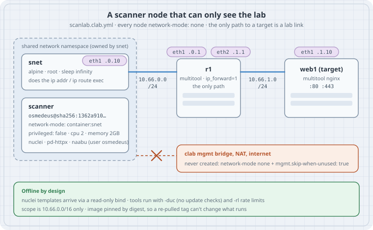

# A Scanner Node in Containerlab

A lab is a good place to learn what a vulnerability scanner sees: you own every target, you can break them on purpose, and you can run the scan again after every change. But a scanner is still a scanner. Put one in a containerlab topology with the defaults and it gets a management interface on a Docker bridge with NAT to the internet, a privileged container, and whatever image the tag pointed to on the day you pulled it. This chapter builds a **recon node that can only reach the lab**. It uses containerlab's `network-mode: none`, an unprivileged container that shares a small helper's network namespace, an image pinned by digest, and tools that run offline. Then it looks inside the image, because a security toolbox is a pile of Go binaries, and each one carries its own copy of the Go standard library and its own vulnerabilities.

The example image is `mablanco/osmedeus`: Osmedeus v5.1.2 plus the ProjectDiscovery tools (nuclei, httpx, naabu, and others) in one Kali-based image. Any image of this kind works the same way.

## Learning goals

- Explain what a default containerlab `linux` node gets that a scanner should not have: the management network, its NAT path out, and privileged mode
- Build a topology where every node uses `network-mode: none` and `mgmt.skip-when-unused: true`, so the only routes to a target are lab links
- Run tools as an unprivileged node that joins a helper's network namespace with `network-mode: container:<node>`
- Pin an image by digest, and prove what a digest refers to
- Provision nuclei templates offline and run nuclei, httpx and naabu with update checks off and rate limits on
- Audit Go binaries inside an image with `go version -m` and `govulncheck -mode=binary`, and read the difference between "0 critical CVEs" and "0 reachable vulnerabilities"

Lab platform: the topology was checked against containerlab's own JSON schema (`schemas/clab.schema.json`, containerlab `main` at commit `76c45d7`, 2026-10-24; latest release **v0.82.0**). The image analysis ran on this box, unprivileged: anonymous registry reads, two image layers downloaded and unpacked as plain tar files, then Go **1.27.2** `go version -m` and **govulncheck v1.9.0** (vulnerability database updated 2026-10-27). Deploying the lab needs root and a container runtime, so that part was **not run here**. It is written from the containerlab and ProjectDiscovery documentation and marked where it applies.

## Thesis

A scanner in a lab should be the **least connected** node in the topology, not the most. Containerlab's defaults are built for convenience: every node gets `eth0` on a management bridge that can reach the outside world, and `linux` nodes run privileged unless you say otherwise. Turn both off. Give the scanner one lab interface, through a helper that owns the namespace, so the tools themselves never need root. Pin the image by digest so you know which binaries ran, and audit those binaries yourself instead of trusting a scanner badge. A Go tool rebuilt with a current toolchain clears dozens of findings at once, and within two days new ones appear. A clean result is only true on the day you check.

## Mental model

{fig-alt="Containerlab scanner-node lab. On the left, a dashed box labelled shared network namespace holds two nodes: snet, an alpine container that owns the namespace and has eth1 at 10.66.0.10/24, and scanner, the mablanco/osmedeus image pinned by sha256 digest, privileged false, capped at 2 CPUs and 2 GB, joined with network-mode container:snet. A link runs from snet eth1 to router r1 eth1 at 10.66.0.1/24; r1 eth2 at 10.66.1.1/24 links to target web1 eth1 at 10.66.1.10/24 serving ports 80 and 443. Below, a crossed-out path shows the containerlab management bridge and NAT to the internet, which this lab never creates because every node uses network-mode none and mgmt skip-when-unused is true. Footer: nuclei templates arrive by read-only bind mount, tools run with update checks off and rate limits on, and only 10.66.0.0/16 is in scope."}

```text
  default linux node                         scanner node in this chapter
  eth0 on clab mgmt bridge  ──► NAT ──► ?    no eth0, no mgmt bridge (network-mode: none)
  privileged: true (default)                 privileged: false
  image: repo:tag (moves)                    image: repo@sha256:… (doesn't)
  tools phone home for updates               -duc, templates from a read-only bind
  scope: whatever resolves                   scope: 10.66.0.0/16, written down
```

| Piece | Containerlab / tool setting | What it buys |
|---|---|---|
| No management network | `network-mode: none` on every node, `mgmt.skip-when-unused: true` | No `eth0`, no Docker bridge, no NAT. The only interfaces are the lab links |
| Helper owns the namespace | `snet` (root, tiny) runs `ip addr` / `ip route` in `exec` | The scanner needs no `CAP_NET_ADMIN` to get an address |
| Scanner joins it | `network-mode: container:snet` + `startup-delay` | Same interfaces and routes as `snet`, none of its privileges |
| Unprivileged | `privileged: false` | Turns off containerlab's default of privileged `linux` nodes |
| Pinned | `image: repo@sha256:…` | The bytes that ran are the bytes you audited |
| Bounded | `cpu`, `memory`, tool `-rl` rate limits | A scan can't starve the routers it is testing |

## Concepts

### What a `linux` node gets by default

Three containerlab defaults matter here, all from the [nodes](https://containerlab.dev/manual/nodes/) and [network](https://containerlab.dev/manual/network/) pages:

- **Management network.** Every node gets `eth0` on the lab's management network, a Docker bridge (`clab` unless you rename it). With Docker, containerlab also sets up iptables rules so nodes can reach outside (`mgmt.external-access`, default on). That path is what makes `apt install` work inside a node, and also what lets a scanner reach a real address when you mistype a target.
- **Privileged.** `privileged` "defaults to `true` when unset, to preserve containerlab's historical behavior." A privileged container has every capability and the host's devices, and you have to set `privileged: false` yourself.
- **Restart policy.** `linux` nodes get Docker's `on-failure` restart policy, and "when restarted, the container will loose all non-`eth0` interfaces" ([linux kind](https://containerlab.dev/manual/kinds/linux/)). A scanner that crashes and restarts comes back with no lab interface. That fails safe here, but it is also why a crashed scan never resumes by itself.

### `network-mode: none` and `skip-when-unused`

`network-mode: none` starts the container with only a loopback. Containerlab still adds the `links:` you declare, so `eth1`, `eth2`, … appear as usual, and `eth0` simply does not exist. If every node runs this way, the default management network is "created but never used". With `mgmt.skip-when-unused: true` containerlab does not create it at all, and leaves no `CLAB-<lab>` block in `/etc/hosts`. The flag works per network, so it also works with multiple management networks (`mgmt-net` per node).

`mgmt.external-access: false` is the gentler option, for labs where nodes need management access but no route out. Containerlab then leaves iptables alone, which "on most docker installations … will result in restricted external access". "Most" is not a guarantee. `network-mode: none` takes away the path itself, which is easier to reason about.

### Sharing a namespace instead of granting root

In this image the tools run as user `osmedeus` (uid 1000; the image config sets `User: osmedeus`), and `docker exec` runs them as that user. Containerlab's own `exec:` commands run as root (`User: "0"` in its Docker runtime), but root in an **unprivileged** container still lacks `CAP_NET_ADMIN`, so `ip addr add` fails there. You could put `cap-add: [NET_ADMIN]` on the scanner, which leaves a network-admin capability in the container that runs the third-party binaries. A helper is cleaner:

- `snet` is a tiny `alpine` container, root and privileged by default, that does nothing but own the network namespace. Its `exec` sets `eth1`'s address and a route.
- `scanner` uses `network-mode: container:snet`. Docker puts it in `snet`'s namespace: same `eth1`, same routes, its own (unprivileged) process space. The containerlab docs say `startup-delay` "is required in this case in order to properly initialize the namespace of a parent container."

The tools then run without root, with only the network that `snet` was given.

### Tools without root, without the internet

- **naabu** scans ports. Its `-scan-type` defaults to `c` (CONNECT): it opens a normal TCP connection to each port, which needs no root. SYN scanning needs raw sockets (root or `CAP_NET_RAW`), which this scanner doesn't get, so connect scans are what you use here.
- **httpx** (`pd-httpx` in this image, renamed because Kali ships a different `httpx`) probes HTTP: status code, title, server header, technology.
- **nuclei** runs YAML templates. By default it checks for updates and downloads templates on first run, and many templates call an out-of-band server (interactsh) on the internet. In a closed lab you give it a template directory with `-t`, turn off the update check with `-duc`, and turn off interactsh with `-ni`.

nuclei and httpx default to 150 requests per second (`-rl`), naabu to 1000 packets per second (`-rate`). A container router with a 2-CPU budget notices that. Set limits that match the lab, not the internet.

### Digests, tags and what "updated" means

A tag is a name the publisher can move; a digest is the SHA-256 of the image manifest, so it can't be moved. Containerlab's docs don't mention digests, but its image-name handling passes them through to the runtime unchanged (Lab 3 shows the output). With the default `image-pull-policy: IfNotPresent`, a tag you already have is never pulled again, so two people with "the same" topology can run different binaries. `Always` fixes that and gives up reproducibility. A digest gives you both.

The example shows why. The tag `5.1.2-20261025` looks like a date stamp. The image it points to today was created on **2026-10-27 12:07 UTC** (17:37 IST): the config blob's `created` field says so, and its build history shows `trivy` added to the `apt-get install` line. That is the upstream change of 27 October. The name says the 25th and the bytes say the 27th.

### Go binaries carry their own vulnerabilities

A Go program is statically linked: the standard library (`net/http`, `crypto/tls`, …) and every module are compiled into the binary. Patching the base image's packages does nothing for them. The only fix is to rebuild with a newer Go toolchain and newer modules. Go embeds the build information, so you can read it back from the binary:

- `go version -m <binary>` prints the Go version, the main module, every dependency with its version, and build flags.
- `govulncheck -mode=binary <binary>` matches that against the Go vulnerability database and, from the symbol table, reports which vulnerable **functions** are actually in the binary. Stripping with `-ldflags="-s -w"` doesn't stop it.

Image scanners (Docker Scout, Trivy, Grype) read the same build info and match on module versions. They don't check reachability, and they grade by CVSS severity, so "critical: 0" and "govulncheck: 3" can both be true for one binary.

## Lab 1: the topology (validated here, not deployed)

```text
scanlab/
├── scanlab.clab.yml
├── nuclei-templates/      # cloned on the host, read-only inside the lab
└── results/               # writable by uid 1000 (the image's osmedeus user)
```

```yaml
# scanlab.clab.yml — a recon node that can only see the lab
name: scanlab
mgmt:
  skip-when-unused: true          # no node uses the mgmt network, so don't create it
topology:
  defaults:
    kind: linux
    network-mode: none            # no eth0, no docker bridge, no NAT to the internet
  nodes:
    r1:                           # the only path between scanner and targets
      image: ghcr.io/srl-labs/network-multitool
      sysctls:
        net.ipv4.ip_forward: 1
      exec:
        - ip addr add 10.66.0.1/24 dev eth1
        - ip addr add 10.66.1.1/24 dev eth2
    web1:                         # target: nginx on 80/443 from the multitool image
      image: ghcr.io/srl-labs/network-multitool
      exec:
        - ip addr add 10.66.1.10/24 dev eth1
        - ip route add 10.66.0.0/24 via 10.66.1.1
    snet:                         # owns the scanner's network namespace (root, small)
      image: alpine:3.22
      cmd: sleep infinity
      exec:
        - ip addr add 10.66.0.10/24 dev eth1
        - ip route add 10.66.1.0/24 via 10.66.0.1
    scanner:                      # the tools: unprivileged, pinned, capped
      image: mablanco/osmedeus@sha256:1362a910f28195124b2166a2aad0b2727decd54c3c6953f24788a17286c00926
      network-mode: container:snet
      startup-delay: 5
      privileged: false
      cmd: sleep infinity
      memory: 2GB
      cpu: 2
      binds:
        - ./nuclei-templates:/home/osmedeus/nuclei-templates:ro
        - ./results:/home/osmedeus/results
  links:
    - endpoints: ["snet:eth1", "r1:eth1"]
    - endpoints: ["r1:eth2", "web1:eth1"]
```

Notes on the choices:

- `network-multitool` runs nginx on 80 and 443 (with a self-signed certificate) and has `iproute2`, so it serves as both router and target.
- `cmd: sleep infinity` replaces the image's `CMD ["osmedeus"]`, which would start the Osmedeus CLI and exit. You run tools with `docker exec`.
- The scanner has no `links:`. It has no interfaces of its own, only the ones it shares through `snet`.
- `10.66.0.0/16` is the whole scope. Nothing in the lab routes anywhere else, and the scope is in the file name of every result you save.

### Check the file against containerlab's schema (run here)

`containerlab validate` and `containerlab graph --offline` both need the Docker daemon, so the topology was checked against the JSON schema containerlab ships in its repository (`schemas/clab.schema.json`):

```python
# validate_schema.py — check a topology against containerlab's own JSON schema
import json, sys, yaml, jsonschema
schema = json.load(open(sys.argv[1]))
topo = yaml.safe_load(open(sys.argv[2]))
errs = sorted(jsonschema.Draft7Validator(schema).iter_errors(topo), key=lambda e: list(e.path))
for e in errs:
    print("/".join(map(str, e.path)) or "<root>", "->", e.message)
print(f"{sys.argv[2]}: {len(errs)} schema error(s)")
```

```text
$ python validate_schema.py clab.schema.json scanlab.clab.yml
scanlab.clab.yml: 0 schema error(s)
```

To make sure the check can fail, here is a copy with `network-mode: nope` and a misspelled `memroy`:

```text
$ python validate_schema.py clab.schema.json bad.clab.yml
topology/defaults/network-mode -> 'nope' does not match '^(host)|(container:\\S+)|(none)$'
topology/nodes/scanner -> {'image': 'mablanco/osmedeus@sha256:1362a910f28195124b2166a2aad0b2727decd54c3c6953f24788a17286c00926', 'network-mode': 'container:snet', 'startup-delay': 5, 'privileged': False, 'cmd': 'sleep infinity', 'memroy': '2GB', 'cpu': 2, 'binds': ['./nuclei-templates:/home/osmedeus/nuclei-templates:ro', './results:/home/osmedeus/results']} is not valid under any of the given schemas
bad.clab.yml: 2 schema error(s)
```

The schema catches structure and spelling, not semantics: it can't tell you that `snet` must start before `scanner`. That is what `startup-delay` is for.

### Deploy and scan (not run here)

On a Linux host with containerlab and Docker (the [Linux lab host](02-lab-host-linux.qmd) chapter):

```bash
cd scanlab
git clone --depth 1 https://github.com/projectdiscovery/nuclei-templates nuclei-templates
mkdir -p results && sudo chown 1000:1000 results
sudo containerlab deploy -t scanlab.clab.yml
```

Check the isolation first. `scanner` should have only `lo` and `eth1`, and no default route:

```bash
docker exec clab-scanlab-scanner ip -br addr
docker exec clab-scanlab-scanner ip route
docker inspect clab-scanlab-scanner --format '{{.HostConfig.NetworkMode}} privileged={{.HostConfig.Privileged}}'
```

Expected, per the docs: `lo` and `eth1` with `10.66.0.10/24`; a connected route for `10.66.0.0/24` and one for `10.66.1.0/24` via `10.66.0.1`, and no default route; `container:<snet's id> privileged=false`.

Then scan, slowly, and save results with the scope in the name:

```bash
S=clab-scanlab-scanner
docker exec $S naabu -host 10.66.1.10 -p 22,80,443,8080 -scan-type c -rate 50 -duc -silent
docker exec $S pd-httpx -u http://10.66.1.10,https://10.66.1.10 -sc -title -server -td -rl 20 -duc -silent
docker exec $S nuclei -u https://10.66.1.10 \
    -t /home/osmedeus/nuclei-templates/http/technologies,/home/osmedeus/nuclei-templates/ssl \
    -duc -ni -rl 20 -c 5 -jsonl -o /home/osmedeus/results/10.66.1.10-nuclei.jsonl
```

What you should see: naabu reports 22, 80 and 443 open (the multitool runs sshd and nginx); httpx reports `nginx` with the default page; nuclei's `ssl` templates flag the self-signed certificate, and `technologies` identifies nginx. Then test the fence: `docker exec $S pd-httpx -u https://example.com -duc` should fail to resolve or connect. If it succeeds, something in your lab has a path out, and you fix that before scanning anything else.

`sudo containerlab destroy -t scanlab.clab.yml --cleanup` removes the lab and its lab directory. v0.82.0 fixed a case where `destroy --cleanup` on a lab with no containers left removed unrelated directories, so update before you rely on it on a shared host. `results/` is a bind source on the host, so it survives.

### Why not Osmedeus's own flows?

Osmedeus chains these tools into workflows built for internet recon: subdomain enumeration (subfinder, amass), passive DNS, certificate transparency. In a lab with no internet those steps return nothing or time out, and pointed at a real domain they leave the lab. Run the individual tools against lab addresses, and read a workflow before you run it.

## Lab 2: what is inside the image (run here)

The image's layers are gzip'd tar files, and a registry serves them to anonymous readers. No Docker daemon is needed to look inside. Two tags were compared:

| Tag | Manifest digest | Created |
|---|---|---|
| `5.1.1-20260924` (old) | `sha256:c44f09b5…` | (not checked) |
| `5.1.2-20261025` = `latest` (new) | `sha256:1362a910…` | 2026-10-27 12:07 UTC |

A digest is the SHA-256 of the manifest bytes. Hashing the manifest the registry served gives back the name it was requested by:

```text
$ sha256sum new-manifest.json
1362a910f28195124b2166a2aad0b2727decd54c3c6953f24788a17286c00926  new-manifest.json
```

The manifest is a single-platform `application/vnd.docker.distribution.manifest.v2+json` for `linux/amd64`, not a multi-arch index. On an Apple Silicon Mac it runs under emulation (see [the macOS lab host](01-lab-host-macos.qmd)), slowly.

Each layer is addressed the same way. The two big tool layers are `sha256:063a041f…` (502 MB, new) and `sha256:4a724305…` (477 MB, old), and the downloaded files hash to their names:

```text
$ sha256sum new.tgz old.tgz | cut -c1-20
063a041f7526dd0a8ca5
4a724305e3f6a3d8fba9
```

Then three tools were unpacked from each and checked with this script:

```bash
#!/usr/bin/env bash
# audit.sh <rootfs-dir>... — Go toolchain, x/net version and reachable vulns per binary
set -euo pipefail
printf '%-4s %-9s %-9s %-8s %6s %7s %8s\n' tag binary go x/net vulns stdlib modules
for root in "$@"; do
  for b in nuclei pd-httpx naabu; do
    f="$root/home/osmedeus/osmedeus-base/external-binaries/$b"
    gov=$(go version "$f" | awk '{print $2}')
    xnet=$(go version -m "$f" | awk '$1=="dep" && $2=="golang.org/x/net" {print $3}')
    govulncheck -mode=binary -format=json "$f" > /tmp/gv.json
    read -r total std mods < <(python3 "$(dirname "$0")/gvsum.py" /tmp/gv.json)
    printf '%-4s %-9s %-9s %-8s %6s %7s %8s\n' "$(basename "$root")" "$b" "$gov" "$xnet" "$total" "$std" "$mods"
  done
done
```

`gvsum.py` counts distinct vulnerability IDs that govulncheck reports at **symbol** level (a vulnerable function is in the binary), and splits them by where the code lives. One ID can count in both columns: an HTTP/2 bug can be in `net/http` and in `golang.org/x/net/http2`.

```python
# gvsum.py — count reachable vulns in `govulncheck -mode=binary -format=json` output
import json, sys
def objs(path):
    dec, s, i = json.JSONDecoder(), open(path).read(), 0
    while i < len(s):
        while i < len(s) and s[i].isspace(): i += 1
        if i >= len(s): break
        o, i = dec.raw_decode(s, i); yield o
for path in sys.argv[1:]:
    std, mods = set(), set()   # an OSV entry can hit both (e.g. net/http and x/net/http2)
    for o in objs(path):
        f = o.get("finding")
        if f and f["trace"][0].get("function"):          # symbol-level: code is reachable
            (std if f["trace"][0]["module"] == "stdlib" else mods).add(f["osv"])
    print(f"{len(std | mods)} {len(std)} {len(mods)}")
```

```text
$ ./audit.sh old new
tag  binary    go        x/net     vulns  stdlib  modules
old  nuclei    go1.26.2  v0.52.0      85      34       59
old  pd-httpx  go1.25.7  v0.51.0      71      42       36
old  naabu     go1.24.0  v0.48.0      94      65       36
new  nuclei    go1.27.3  v0.60.0       3       0        3
new  pd-httpx  go1.27.3  v0.60.0       3       0        3
new  naabu     go1.27.3  v0.60.0       3       0        3
```

How to read it:

- **Old:** each tool shipped with whatever Go its upstream release was built with, so one image held Go 1.24, 1.25 and 1.26. naabu on Go 1.24.0 has 65 standard-library vulnerabilities in reachable code. Kali's package updates can't fix any of these.
- **New:** every tool was rebuilt from source with `golang:1.27.3` and a list of minimum module versions (`golang.org/x/net v0.60.0`, `x/crypto v0.56.0`, …), using `-trimpath`. Standard-library findings drop to zero.
- **Still three.** All three new binaries report the same IDs:

```text
GO-2026-5932 ('golang.org/x/crypto', 'v0.57.0', None)    The golang.org/x/crypto/openpgp package is unmaintained, unsafe by des…
GO-2026-6860 ('golang.org/x/net', 'v0.60.0', 'v0.62.0') Avoid quadratic complexity when coalescing text nodes in html in golan…
GO-2026-6866 ('golang.org/x/net', 'v0.60.0', 'v0.62.0') Check all ancestor namespace transitions when rendering raw text in ht…
```

(module, version in the binary, fixed version). Two are fixed in `x/net v0.62.0`, which the build's minimum list didn't ask for. The `openpgp` one has no fix: the package is frozen, and the only remedy is to stop using it. The post announcing the rebuild reported 0 critical CVEs in Docker Scout. That can be true for Scout's severity grading on that day, and it is not the same claim as "nothing reachable". The database these results came from was updated on 2026-10-27, the day after the post.

One more thing `go version -m` showed: the old naabu's main module was `command-line-arguments` (built from a file path, no module version), while the new one is `github.com/projectdiscovery/naabu/v2/cmd/naabu` with `-trimpath=true` and `CGO_ENABLED=0`. A binary that records where it came from is one you can audit next time.

## Lab 3: does containerlab keep the digest? (run here)

Containerlab's [image docs](https://containerlab.dev/manual/nodes/#image) talk about tags. A short Go program called containerlab's own `GetCanonicalImageName` (the function that turns `image:` into the reference given to the runtime), built against containerlab `main` at `76c45d7`:

```go
// canon.go — what image reference does containerlab hand to Docker?
package main

import (
	"fmt"

	clabutils "github.com/srl-labs/containerlab/utils"
)

func main() {
	for _, img := range []string{
		"mablanco/osmedeus",
		"mablanco/osmedeus:5.1.2-20261025",
		"mablanco/osmedeus@sha256:1362a910f28195124b2166a2aad0b2727decd54c3c6953f24788a17286c00926",
	} {
		fmt.Printf("%-40.40s -> %s\n", img, clabutils.GetCanonicalImageName(img))
	}
}
```

```text
mablanco/osmedeus                        -> docker.io/mablanco/osmedeus:latest
mablanco/osmedeus:5.1.2-20261025         -> docker.io/mablanco/osmedeus:5.1.2-20261025
mablanco/osmedeus@sha256:1362a910f281951 -> docker.io/mablanco/osmedeus@sha256:1362a910f28195124b2166a2aad0b2727decd54c3c6953f24788a17286c00926
```

A bare name becomes `:latest`, a tag stays a tag, and a digest goes through untouched.

## Case: a security lab for a team

| Situation | Design |
|---|---|
| Learning what nuclei/httpx report | This chapter's lab. One scanner, one router, targets you can break. All `network-mode: none` |
| Scanner needs to update templates | Update on the host (`git -C nuclei-templates pull`), never from inside the lab. The bind stays `:ro` |
| Targets need package installs during build | Build the target images outside the lab. Don't give the lab a NAT path "just for setup" |
| Several people share one lab host | One lab per person (`name:` differs), `cpu`/`memory` caps on every scanner, results under each lab directory |
| You must scan something outside the lab | Then it isn't a lab exercise. Get written scope and authorization first, and use a different setup |
| Image refresh | Pick a new digest on purpose: read its build history, run Lab 2 on it, then change the topology in a commit |

## The trap

**Trap: "it's only a lab, the scanner can't hurt anything."** With the default management network it can reach anything your host can reach. A typo in `-u` (`10.6.1.10` instead of `10.66.1.10`) leaves the lab through NAT. `network-mode: none` makes the typo fail instead.

**Trap: "`external-access: false` means no internet."** It means containerlab doesn't touch iptables. What happens then depends on the host's firewall and Docker's defaults. Take away the interface, not the rule.

**Trap: "`linux` nodes are just containers."** They are privileged containers unless you set `privileged: false`. A privileged container running a few hundred megabytes of third-party binaries has the host's devices and every capability.

**Trap: "the tag has a date in it, so it's fixed."** `5.1.2-20261025` points at an image created on 27 October. Tags are labels; only digests are names.

**Trap: "0 critical CVEs."** That number is one scanner's severity filter on one day. A day after the post, govulncheck's database lists three reachable vulnerabilities in the same binaries, two with fixes available. Re-check on a schedule, and look at reachability as well as severity.

**Trap: "patch the base image."** Kali's `apt upgrade` doesn't touch Go binaries in `external-binaries/`. Their standard library and modules only change when they are rebuilt.

## The boring rule

Scanner nodes run with `network-mode: none` and `privileged: false`, and get their single lab interface from a helper's namespace. The image is pinned by digest, and you have read `go version -m` for the tools you rely on. Templates come from a read-only bind, every tool runs with `-duc` and a rate limit, and the scope is a CIDR written in the topology file. If the fence test reaches the internet, stop and fix the lab.

## Try this

1. Remove `network-mode: none` from `defaults` and set only `mgmt.external-access: false`. Deploy, then try the fence test from the scanner. What happens on your host, and why does the result depend on the host?
2. Drop `snet` and give `scanner` its own `links:` endpoint and `exec`. What does `ip addr add` report, and why? Make it work with `cap-add: [NET_ADMIN]` instead of `privileged: true`, then list what the scanner container can now do that it couldn't before.
3. Run Lab 2 on today's `latest`. Has the digest changed since `1362a910…`? If it has, read the config history and list what changed.
4. Add `golang.org/x/net v0.62.0` to a copy of the upstream build's minimum-version list, rebuild one tool, and run `audit.sh` again. Which IDs remain, and why can't a version bump remove the last one?
5. Add a second target with a deliberately old web server image, and compare what `-t http/technologies` and `-t http/cves` report. Which findings need the internet (interactsh) and are skipped with `-ni`?

## Next

- [Free Image Matrix & Resources](04-free-image-matrix.qmd)
- [Lab Hygiene](06-lab-hygiene.qmd)

## Verification

- **Run here:** schema validation of `scanlab.clab.yml` against containerlab's `schemas/clab.schema.json` (containerlab `main` at `76c45d7`, 2026-10-24) with Python `jsonschema`; 0 errors, and the deliberately broken copy gave 2. Output pasted from the run.
- **Run here:** `canon.go` against containerlab's `utils.GetCanonicalImageName` at the same commit, built with Go 1.27.2. Output pasted.
- **Run here:** anonymous, read-only registry reads of `mablanco/osmedeus` (manifests, config blob, two layers). `sha256sum` of the manifest and of both layers matched their digests. Three binaries per layer were unpacked with `tar` (no Docker), then checked with `go version`/`go version -m` (Go 1.27.2) and `govulncheck -mode=binary` v1.9.0, database updated 2026-10-27 21:16 UTC (2026-10-28 02:46 IST). `audit.sh` ran twice with identical output.
- **Checked in source:** containerlab's Docker runtime creates `exec:` commands with `User: "0"` (`runtime/docker/docker.go`, commit `76c45d7`).
- **Run here:** `-h`/`-version` of the unpacked binaries, to check every flag used in the scan commands (nuclei v3.11.1, httpx v1.12.0, naabu 2.6.1). No scan was run.
- **Not run:** `containerlab deploy`, `docker exec`, any scan, the fence test, and `destroy`. They need root and a container runtime. The expected results above are expectations from the containerlab and ProjectDiscovery documentation, not output.
- Current versions on 2026-10-29: containerlab v0.82.0, Osmedeus v5.1.2, nuclei v3.11.1, httpx v1.12.0, naabu v2.6.1, Go 1.27.3 (image builder).
- No `sudo`, no system packages, no containers started.

## Sources

- containerlab — [Nodes](https://containerlab.dev/manual/nodes/) (`network-mode`, `startup-delay`, `privileged`, `cap-add`, `image`, `image-pull-policy`, `exec`, `binds`, `cpu`, `memory`, `cmd`), [Network wiring and management network](https://containerlab.dev/manual/network/) (`external-access`, `skip-when-unused`, multiple management networks), [linux kind](https://containerlab.dev/manual/kinds/linux/) (restart policy), [v0.82.0 release notes](https://github.com/srl-labs/containerlab/releases/tag/v0.82.0), [JSON schema](https://github.com/srl-labs/containerlab/blob/main/schemas/clab.schema.json)
- srl-labs — [network-multitool](https://github.com/srl-labs/network-multitool) (Dockerfile, `nginx.conf`: ports 80 and 443)
- ProjectDiscovery — [nuclei](https://docs.projectdiscovery.io/tools/nuclei/running) (`-t`, `-duc`, `-ni`, `-rl`, `-jsonl`), [nuclei-templates](https://github.com/projectdiscovery/nuclei-templates), [httpx](https://docs.projectdiscovery.io/tools/httpx/running), [naabu](https://docs.projectdiscovery.io/tools/naabu/running) (`-scan-type`, connect vs SYN)
- Go — [`go version -m`](https://pkg.go.dev/cmd/go#hdr-Print_Go_version), [govulncheck](https://go.dev/doc/tutorial/govulncheck) and [`-mode=binary`](https://pkg.go.dev/golang.org/x/vuln/cmd/govulncheck), [Go vulnerability database](https://vuln.go.dev)
- Docker — [Docker Scout](https://docs.docker.com/scout/), [image digests](https://docs.docker.com/reference/cli/docker/image/pull/#pull-an-image-by-digest-immutable-identifier)
- OCI — [Image manifest specification](https://github.com/opencontainers/image-spec/blob/main/manifest.md) (content-addressed manifests and layers)
- mablanco/docker-osmedeus — [repository](https://github.com/mablanco/docker-osmedeus) (Dockerfile, `build/build-go-tools.sh`, `go-tools.txt`) and [Docker Hub page](https://hub.docker.com/r/mablanco/osmedeus); Osmedeus — [j3ssie/osmedeus](https://github.com/j3ssie/osmedeus)
- Inspiration: [Marco Antonio Blanco on X](https://x.com/mablanconav/status/2114789772531053034) (the Osmedeus image's Go tools rebuilt from source, 124 critical CVEs to 0 in Docker Scout)
