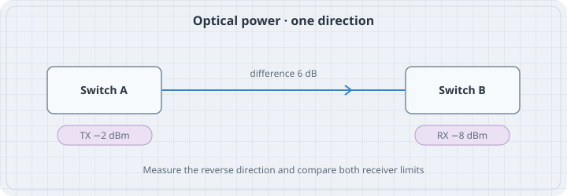

# Physical Ethernet: Media, Optics, PoE and Fault Isolation

A routing protocol cannot repair a damaged fiber, an incompatible transceiver or a powered device that never starts. Conversely, a physical link can be up while a VLAN or route is wrong. Diagnose from measured symptoms at both ends and keep physical status separate from forwarding and application reachability.

## Choose a compatible link

Twisted-pair copper carries electrical signals over balanced pairs. Fiber carries light and offers electrical isolation; **single-mode** and **multimode** are different fiber systems with different optical characteristics. A connector that fits does not prove that the transceivers, wavelengths, fiber type, strand count, polarity, reach and host port modes match. A multimode optic and a single-mode optic cannot be treated as interchangeable merely because they have the same nominal line rate. Some optics use two fibers, others use wavelength multiplexing or multiple lanes; follow the exact transceiver specifications and cable plant documentation.

Copper link distance and supported speed depend on the Ethernet PHY, cable category, installation and channel quality. Do not assume every copper Ethernet link supports the same speed or 100-meter reach. Terminations, patch panels, pair integrity and interference matter as well as patch-cord length. A cable that lights a link at a lower speed may still fail the required channel test at the intended speed.

At both ends compare the configured and operational speed, duplex, supported and advertised modes, autonegotiation, link status and error counters. Some media and speeds require particular negotiation behavior; do not force settings blindly or assume all devices behave alike. A duplex mismatch on a link capable of half-duplex can cause poor performance and errors even when link is up. Modern full-duplex switched links do not normally experience classic shared-medium collisions.

## Read counters as a time series

Collect interface and transceiver state at both ends, note time and traffic load, and compare **deltas** over a known interval. Counters may reset on reboot, interface reset or hardware rollover; names and meanings are platform-specific. Correlation is a lead, not proof of a particular cable defect.

| Observation | Candidate causes and next evidence |
|---|---|
| No physical link | Administrative state, remote power, cable, optic type, polarity, mode or negotiation |
| Link up but CRC/FCS errors rise | Corruption on the receive path: inspect both ends, cable, optics and test results |
| Link flaps | Power, cable movement, optical levels, transceiver, negotiation or hardware logs |
| Drops without physical errors | Queue congestion, policing, buffer pressure or software processing; inspect drop reason and direction |
| Link healthy but no service | VLAN, STP, aggregation, addressing, filtering and return path |

A receive error on one end does not uniquely identify the bad component: the transmitter, channel or receiver can all contribute. Compare both directions and change one component at a time. Corrected forward-error-correction (FEC) counters can reveal margin degradation before uncorrectable errors, but FEC reporting and thresholds depend on the PHY and device. A rising corrected count is not itself proof of packet loss. Match FEC configuration and supported modes on both ends where required.

{fig-alt="Switch A transmits at minus 2 dBm and switch B receives minus 8 dBm: a six decibel difference."}

## Optical power and loss budget

Optical power is commonly shown in dBm, an absolute logarithmic power level; loss and margin are differences in dB. Suppose, for one direction and wavelength, the measured transmitter output is `-2 dBm` and the far-end receiver reports `-8 dBm`. The approximate measured difference is `-2 - (-8) = 6 dB`. If that receiver's specified minimum sensitivity is `-10 dBm`, its received level is 2 dB above that lower limit. This is a simplified reading, not a certification: verify the receiver's **upper and lower** allowed power limits, wavelength, calibration, measurement method, connector and splice loss, and the transceiver's specified operating range. Too much received power can also be a problem.

Repeat in the opposite direction; each direction has its own transmitter, receive level and fiber path. Use the correct optical power meter, source and reference procedure when certifying a link. Module digital diagnostics are useful operational clues but can have tolerance and reporting limits. Never look into a fiber end or optical port; follow the site's optical safety and inspection procedures. Clean and inspect connectors using appropriate equipment and approved procedures.

## Power over Ethernet

Power sourcing equipment (PSE), such as a switch port or compatible injector, supplies power to a powered device (PD), such as an access point or phone. Standards-based PoE performs detection and classification before supplying operating power. Check the endpoint's required power and supported standard or mode against the port's capabilities, the switch's **remaining power budget**, cabling and any injector in the path. PSE power and delivered PD power are not identical because cable loss consumes power. LLDP power negotiation may affect an implementation's allocation, but support and behavior vary.

A device can power on with limited function, reboot under load, or negotiate a lower operating mode when power is insufficient. A data-link LED does not prove that the powered device has its requested budget, and a powered endpoint does not prove the data VLAN is correct. Do not assume a passive injector provides standards-based detection; use equipment and procedures approved for the endpoint.

## Worked fault-isolation exercise

Use a spare, authorized link and record device models, port names, optics/cable labels, speed, duplex, counters, transceiver diagnostics and timestamps at **both ends**. Hardware behavior and commands vary; this exercise is a procedure and has not been run on a specific physical switch.

1. **Baseline:** establish bidirectional traffic between known test endpoints. Record counters before and after a fixed interval. Confirm the application and both paths work; a link LED alone is insufficient.
2. **Cable path:** using a known-good compatible patch cable on a spare link, change one cable at a time. Record which counters rise, whether link speed changes, and the actual repair. Do not unplug a production link without its change procedure.
3. **Optics:** given TX `-2 dBm`, RX `-8 dBm`, and minimum RX sensitivity `-10 dBm`, calculate 6 dB measured difference and 2 dB lower-limit margin. Then inspect the opposite direction and the receiver's maximum rating before accepting the link. Distinguish a transceiver reading from a calibrated channel certification.
4. **PoE:** attach an approved test PD to a PoE-capable spare port. Record detection/classification, allocated and measured power, switch-wide budget, link state and device function. Compare a known-compatible power source if power is denied. Do not exceed device or injector ratings.
5. **Service path:** with physical link stable, introduce a VLAN mismatch only in the isolated lab. Observe that the link can remain up while traffic fails. Restore the VLAN and verify counters, neighbor discovery and end-to-end traffic.

On Linux, where the driver and tool are available, `ip -s link show dev IFACE` and `ethtool IFACE` provide complementary views; `ethtool -S IFACE` may expose driver-specific counters. Replace `IFACE` with the actual interface. Unsupported fields or counters are not proof of zero errors. The [kernel's twisted-pair diagnostic guide](https://docs.kernel.org/networking/diagnostic/twisted_pair_layer1_diagnostics.html) describes additional tests and cautions.

## Review

Why can a link be up but unusable? Which direction should you investigate when receive CRC errors rise? Why is a 6 dB loss figure alone insufficient to approve an optical path? Why can a powered endpoint still fail to pass data? What does a PoE budget describe that a port link-state indicator does not?

Further reading: [IEEE 802.3 material on PoE detection](https://www.ieee802.org/3/ad_hoc/PDCC/public/2024/IEEE_802d3_feedback_091224.pdf) and the [Linux Ethernet diagnostic guide](https://docs.kernel.org/networking/diagnostic/twisted_pair_layer1_diagnostics.html). Use the actual equipment and transceiver specifications for supported modes, power and optical limits.
