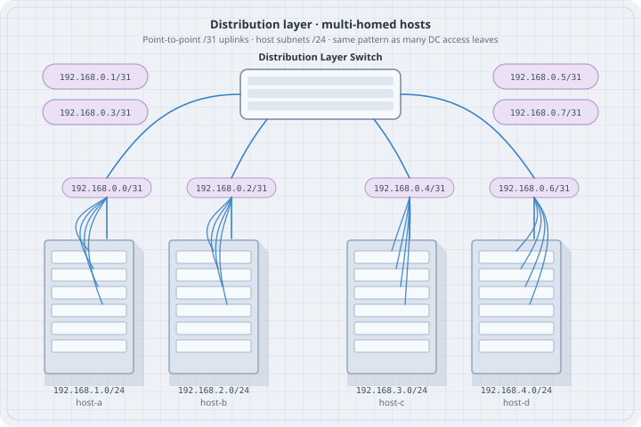

# IPv4 Addressing and Subnetting

IPv4 addressing is the daily language of lab design: **prefixes**, **masks**, **subnets**, and **who is on-link**. Master this before multi-router labs.

## Learning goals

- Read and write CIDR prefixes (`a.b.c.d/nn`) fluently  
- Convert between prefix length and dotted masks  
- Design non-overlapping lab subnets and point-to-point links  
- Identify special-use and documentation ranges  
- Configure addresses on Linux and verify with `ip`  

## IPv4 structure

- **32 bits**, usually dotted decimal (four 0–255 octets)  
- **Prefix length** `/N` = number of network bits; host bits = `32 − N`  
- **Network address**: host bits zero  
- **Broadcast address** (classical Ethernet/IPv4): host bits one (except special cases like /31)  

| Prefix | Mask | Usable addresses in the stated use | Common use |
|--------|------|------------------------|------------|
| /32 | 255.255.255.255 | 1 address | Host route, loopback |
| /31 | 255.255.255.254 | 2 endpoints on a suitable point-to-point link | Point-to-point (RFC 3021) |
| /30 | 255.255.255.252 | 2 | Classic P2P |
| /29 | 255.255.255.248 | 6 | Small segment |
| /24 | 255.255.255.0 | 254 | Common LAN |
| /16 | 255.255.0.0 | many | Summaries / big labs |
| /8 | 255.0.0.0 | huge | Rare in labs |

## CIDR and masks

```text
192.168.10.0/24
network: 192.168.10.0
mask:    255.255.255.0
hosts:   192.168.10.1 – 192.168.10.254
bcast:   192.168.10.255
```

The following command changes an interface; run it only on a disposable lab node with a suitable `eth1`, with the privileges needed to configure it. It is not a command to paste into a production host:

```bash
ip addr add 192.168.10.10/24 dev eth1
ip -br addr
```

### On-link decision

A host first performs a routing lookup. Assigning an address normally installs a connected route, so a destination in that prefix will often use that interface directly; a more-specific route or a policy-selected table can change the result. For a selected unicast Ethernet route, ARP resolves the **next hop**: the destination for a direct route, or the gateway for a route with `via`. Local, broadcast, multicast, and other route types need different handling. `ip route get` asks the kernel for a lookup; it does not itself prove that a packet reaches the destination.

```bash
ip route get 192.168.10.50
ip route get 8.8.8.8
```

## Private and documentation ranges

| Range | Role |
|-------|------|
| `10.0.0.0/8`, `172.16.0.0/12`, `192.168.0.0/16` | Private (RFC 1918)—default lab space |
| `192.0.2.0/24`, `198.51.100.0/24`, `203.0.113.0/24` | Documentation (TEST-NET)—use in examples or isolated labs, not on the public Internet |
| `127.0.0.0/8` | Loopback |
| `169.254.0.0/16` | Link-local (APIPA) |
| `224.0.0.0/4` | Multicast |

**Lab hygiene:** pick a documented plan (`10.20.0.0/16` etc.) and never invent overlapping subnets “for now.”

## Subnetting for multi-tier labs

Example allocation from `10.20.0.0/16`:

| Use | Block |
|-----|-------|
| Access / users A | `10.20.1.0/24` |
| Access / users B | `10.20.2.0/24` |
| Servers | `10.20.10.0/24` |
| P2P core | `10.20.255.0/24` carved as `/31` or `/30` |
| Loopbacks | `10.20.254.0/24` as `/32`s |

**Rules:**

1. No accidental overlap  
2. Leave growth room  
3. Write the plan **before** deploy  
4. Align future summaries with real topology  

### Point-to-point links

A `/31` is not a generic replacement for a multi-access LAN: RFC 3021 applies the two addresses as endpoints on point-to-point links. Confirm support and link semantics on both devices. A `/32` identifies one address and is often used as a host route or loopback; it is not a two-endpoint subnet.

| Style | Example | Notes |
|-------|---------|--------|
| /31 | `10.20.255.0/31` → `.0` and `.1` | Preferred in modern designs |
| /30 | `10.20.255.0/30` → `.1` and `.2` usable | Classic textbooks |

{fig-alt="Distribution switch with /31 uplinks and host /24s"}

## Summarization (intro)

The aligned aggregate `10.20.0.0/22` covers `10.20.0.0/24` through `10.20.3.0/24`. Advertise an aggregate only with appropriate authority for the range and a deliberate forwarding plan. Merely controlling the range is not enough: if an included subnet is unreachable, the aggregate may still attract traffic and discard it or route it incorrectly. A discard route can intentionally prevent loops for unused portions, but it also means those destinations are unreachable.

| Action | Risk |
|--------|------|
| Summary too broad | Blackholes |
| No aggregation ever | Table growth later (IGP/BGP scale) |

Layer 3 part continues summarization drills; foundations need the danger signal.

## VLSM

**Variable Length Subnet Masking:** different prefix lengths in one design (`/24` LAN + `/31` core). Required for efficient labs—do not force everything to /24.

## Host configuration checklist

1. Address + prefix on the correct interface  
2. Up state (`ip link set eth1 up`)  
3. Gateway if leaving the subnet  
4. DNS only if apps need names (separate from pure L3 reachability)  

The following mutating commands are for a disposable lab node only. They require privileges and may disrupt a real host:

```bash
ip addr add 10.20.1.10/24 dev eth1
ip link set eth1 up
ip route add default via 10.20.1.1
ip -br a
ip route
```

## Worked subnet: `/26` from a `/24`

Parent: `192.168.10.0/24` (256 addresses). Split into four `/26`s (64 addresses each):

| Block | Network | Usable hosts | Broadcast |
|-------|---------|--------------|-----------|
| 0 | `192.168.10.0/26` | `.1`–`.62` | `.63` |
| 1 | `192.168.10.64/26` | `.65`–`.126` | `.127` |
| 2 | `192.168.10.128/26` | `.129`–`.190` | `.191` |
| 3 | `192.168.10.192/26` | `.193`–`.254` | `.255` |

**Host bits:** `/26` → 6 host bits → $2^6 = 64$ addresses → 62 usable (reserve network + broadcast) on Ethernet-style LANs. Point-to-point often uses `/31` (RFC 3021) or `/30`.

**Longest-prefix match:** if a router has both `10.1.0.0/16` and `10.1.2.0/24`, a packet to `10.1.2.5` uses the `/24`. More specific wins—plan summarization so you do not punch accidental holes.

## Private vs public (RFC 1918)

| Range | Typical use |
|-------|-------------|
| `10.0.0.0/8` | Large private / DC |
| `172.16.0.0/12` | Mid private |
| `192.168.0.0/16` | Home/lab LANs |
| `100.64.0.0/10` | CGNAT (ISP shared) — not “your” private LAN plan |

Lab rule: pick one private block for the whole topology and **document** the plan before cabling Containerlab.

## Work the mask by hand

For `192.0.2.130/26`, the last mask octet is `192` or `11000000` in binary. A bitwise **AND** keeps a bit only where both inputs have a 1:

```text
address:  192.0.2.130   last octet 10000010
mask:     255.255.255.192          11000000
network:  192.0.2.128              10000000
```

The six host bits can vary from `000000` to `111111`, giving `.128` through `.191`. On a conventional broadcast subnet, `.128` is the network address and `.191` the directed broadcast, leaving `.129`–`.190` for hosts. Equivalently, a `/26` has blocks of 64 addresses; 130 falls in the block beginning at 128. This shortcut works because 64 divides the last octet. For a prefix that crosses an earlier octet, apply the same mask to all four octets.

A prefix describes a range of addresses; `192.0.2.130/26` is a host address **with** a prefix, while `192.0.2.128/26` names its network. A router may also hold a more-specific route inside an aggregate; that is deliberate route overlap. Address assignments to separate links should not accidentally overlap.

## Lab: calculate and check without changing interfaces

Python's standard `ipaddress` module checks arithmetic locally; it sends no packets and needs no administrator privilege. Save this as `subnet_check.py` and run `python3 subnet_check.py`:

```python
from ipaddress import ip_interface, ip_network

host = ip_interface("192.0.2.130/26")
net = host.network
print("address:", host.ip)
print("network:", net)
print("mask:", net.netmask)
print("broadcast:", net.broadcast_address)
print("count:", net.num_addresses)
print("last host:", net.broadcast_address - 1)

for subnet in ip_network("198.51.100.0/24").subnets(new_prefix=26):
    print(subnet)
```

Expected output:

```text
address: 192.0.2.130
network: 192.0.2.128/26
mask: 255.255.255.192
broadcast: 192.0.2.191
count: 64
last host: 192.0.2.190
198.51.100.0/26
198.51.100.64/26
198.51.100.128/26
198.51.100.192/26
```

`broadcast_address - 1` here is a shortcut for this conventional `/26`, not a universal usable-host rule. For `/31` and `/32`, use the special semantics above. To inspect a real Linux routing decision separately, run `ip route get DESTINATION` with a destination appropriate for your environment; the lookup is observational, but a later `ping` or application connection sends traffic.

## Paper drills

1. Network, first host, last host, broadcast for `172.16.5.0/26`  
2. How many /24s fit in `10.0.0.0/16`?  
3. Can `10.0.1.0/24` and `10.0.1.128/25` coexist without overlap?  
4. From `10.50.0.0/16`, carve three `/24`s and one `/28` for a mgmt VLAN without overlap  

## A worked longest-prefix example

Suppose a host has `192.0.2.130/26`. A `/26` mask is `255.255.255.192`: the first 26 bits identify the prefix, leaving six host bits. Each block has 64 addresses. The blocks in the last octet start at 0, 64, 128, and 192, so the host belongs to `192.0.2.128/26`, with network address `.128` and directed broadcast `.191`. In a conventional subnet the usable host range is `.129` through `.190`; point-to-point `/31` and host `/32` have special purposes, so do not apply the ordinary host-count rule mechanically.

Now compare routing entries `0.0.0.0/0 via A`, `192.0.2.0/24 via B`, and `192.0.2.128/26 via C`. Destination `192.0.2.130` matches all three; `/26` wins because it is the most specific matching prefix. Destination `192.0.2.70` uses `/24`. A default route matches anything not matched more specifically. Within the forwarding table selected for a lookup, route preferences or metrics choose among suitable alternatives for the same prefix; a less-specific forwarding entry does not override a more-specific one. Policy routing can select a different table first; see the [policy lookup lab](../09-lab-workbook/40-policy-lookup-and-throw.qmd). See [RFC 1812](https://www.rfc-editor.org/rfc/rfc1812.html).

CIDR aggregation advertises a larger prefix covering several smaller ones. Aggregation saves state but can attract traffic for a destination that is not actually reachable inside the aggregate. Design the internal routes and failure behavior before advertising a summary.


## Checkpoint

Design addresses for: two LANs (/24 each), one router-router link (/31), two router loopbacks (/32). No overlaps; list every interface IP.

## Next

- [IPv6 Essentials](06-ipv6-essentials.qmd)  

## Practice: calculate before configuring

1. Split `198.51.100.0/24` into four equal subnets. What prefix length and network addresses result?
2. A router has `198.51.100.0/24` via R1 and `198.51.100.128/25` via R2. Where does `198.51.100.200` go? What about `198.51.100.20`?
3. Two hosts are in the same VLAN, but one has `192.0.2.10/24` and the other `192.0.2.130/25`. Why can their on-link decisions differ?

**Answers:** (1) Four `/26` networks: `.0`, `.64`, `.128`, `.192`. (2) `.200` matches the more-specific `/25` via R2; `.20` uses the `/24` via R1. (3) The first host considers the entire `/24` on-link. The second considers only `.128`–`.255` on-link and sends traffic to `.10` through a gateway if it has a suitable route. Shared Ethernet membership does not make their subnet masks agree.

## References

- [RFC 3021: `/31` prefixes on point-to-point links](https://www.rfc-editor.org/rfc/rfc3021)
- [RFC 1918: private IPv4 address space](https://www.rfc-editor.org/rfc/rfc1918) and [RFC 5737: documentation ranges](https://www.rfc-editor.org/rfc/rfc5737)
- [Python `ipaddress`](https://docs.python.org/3/library/ipaddress.html) and [Linux `ip route`](https://man7.org/linux/man-pages/man8/ip-route.8.html)
