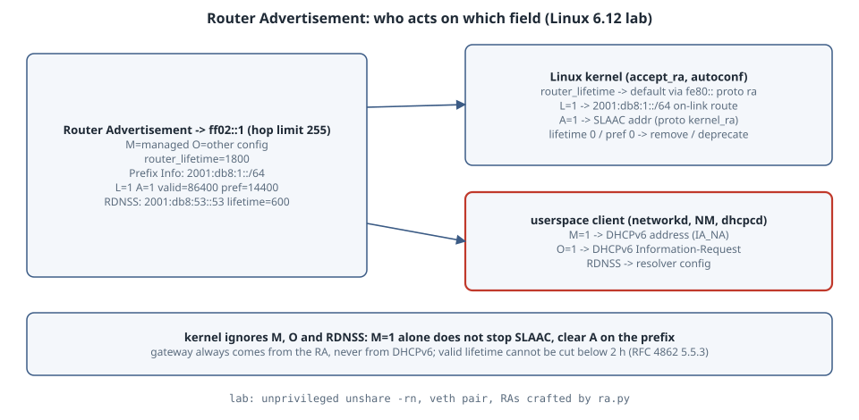

# SLAAC, the RA M/O Flags and DHCPv6: What a Linux Host Actually Does

## Learning goals

- Read a Router Advertisement (RA): the M and O flags, router lifetime, and the A and L flags plus lifetimes in each Prefix Information option.
- Know which parts the **Linux kernel** acts on (default route, on-link prefix, SLAAC address) and which it leaves to a **userspace client** (M, O, RDNSS → DHCPv6 and DNS).
- Predict what happens when a router deprecates a prefix or retires itself, including RFC 4862's two-hour rule.

Version note: run on Linux **6.12** inside an unprivileged user and network namespace (`unshare -rn`), with a veth pair between a "router" namespace and a "host" namespace. RAs were crafted with a 30-line Python script. There is no DHCPv6 server or client in the lab. The output is pasted verbatim.

{fig-alt="On the left is a router sending a Router Advertisement to ff02::1, with the M and O flags, a router lifetime, Prefix Information options carrying the A and L flags and valid and preferred lifetimes, and an RDNSS option. On the right are the three consumers on the host. The Linux kernel acts on the router lifetime by installing a default route via the router's link-local address, acts on L by installing the on-link prefix route, and acts on A by forming a SLAAC address. The kernel does not act on M, O or RDNSS. Those go to a userspace client such as systemd-networkd, NetworkManager or dhcpcd, which starts DHCPv6 when M or O is set and writes DNS servers from RDNSS. A note says that M=1 does not remove a SLAAC address, so A=0 is what disables SLAAC for a prefix."}

## The three ways an IPv6 host gets an address

| RA says | Meaning (RFC 4861 §4.2, RFC 4862) | Typical client behaviour |
|---|---|---|
| prefix `A=1`, `M=0 O=0` | SLAAC only | kernel forms address; DNS from RDNSS (RFC 8106) |
| prefix `A=1`, `M=0 O=1` | SLAAC + stateless DHCPv6 | address via SLAAC, DNS/NTP etc. via DHCPv6 Information-Request |
| `M=1` (prefix `A=0` or no prefix) | stateful DHCPv6 | address from DHCPv6 IA_NA. [RFC 4861](https://www.rfc-editor.org/rfc/rfc4861#section-4.2): "If the M flag is set, the O flag is redundant" |

Two facts trip people up. First, the default gateway **never** comes from DHCPv6. It only comes from the RA router lifetime, so a "DHCPv6-only" network still needs RAs. Second, the M and O flags are hints to a userspace process. The kernel does not read them, and setting `M=1` does not stop SLAAC. Only `A=0` on the prefix does that.

## Lab

`ra.py` sends one RA from the router side, with hop limit 255 as RFC 4861 requires:

```python
# Send one Router Advertisement (RFC 4861 4.2) out of IFACE to ff02::1.
# usage: ra.py IFACE M O router_lifetime prefix/len A valid preferred [rdnss]
import socket, struct, sys, ipaddress
ifc, M, O, rl, pfx, A, vl, pl = sys.argv[1:9]; rdnss = sys.argv[9] if len(sys.argv) > 9 else None
s = socket.socket(socket.AF_INET6, socket.SOCK_RAW, socket.IPPROTO_ICMPV6)
s.setsockopt(socket.IPPROTO_IPV6, socket.IPV6_MULTICAST_HOPS, 255)
s.setsockopt(socket.SOL_SOCKET, socket.SO_BINDTODEVICE, ifc.encode())
flags = (int(M) << 7) | (int(O) << 6)
msg = struct.pack("!BBHBBHII", 134, 0, 0, 64, flags, int(rl), 0, 0)
net = ipaddress.ip_network(pfx)
msg += struct.pack("!BBBBIII", 3, 4, net.prefixlen, 0x80 | (int(A) << 6), int(vl), int(pl), 0) + net.network_address.packed
if rdnss:
    msg += struct.pack("!BBHI", 25, 3, 0, 600) + ipaddress.ip_address(rdnss).packed
s.sendto(msg, ("ff02::1", 0, 0, socket.if_nametoindex(ifc)))
```

`rdisc.py` runs on the host and decodes every RA it receives, which is what systemd-networkd, NetworkManager or dhcpcd see:

```python
# What a userspace client (NetworkManager, systemd-networkd, dhcpcd) sees: decode RAs.
import socket, struct, sys, ipaddress, select
s = socket.socket(socket.AF_INET6, socket.SOCK_RAW, socket.IPPROTO_ICMPV6)
s.setsockopt(socket.SOL_SOCKET, socket.SO_BINDTODEVICE, sys.argv[1].encode())
n = int(sys.argv[2])
while n:
    if not select.select([s], [], [], 8)[0]: break
    d, a = s.recvfrom(2000)
    if d[0] != 134: continue
    n -= 1
    _, _, _, hl, fl, rl, _, _ = struct.unpack("!BBHBBHII", d[:16])
    out = [f"RA from {a[0].split('%')[0]}: M={fl>>7&1} O={fl>>6&1} router_lifetime={rl}"]
    o = d[16:]
    while o:
        t, ln = o[0], o[1] * 8
        if t == 3:
            plen, pf, vl, pl = o[2], o[3], *struct.unpack("!II", o[4:12])
            out.append(f"prefix {ipaddress.ip_address(o[16:32])}/{plen} L={pf>>7&1} A={pf>>6&1} valid={vl} pref={pl}")
        elif t == 25:
            out.append("RDNSS " + " ".join(str(ipaddress.ip_address(o[i:i+16])) for i in range(8, ln, 16)) + f" lifetime={struct.unpack('!I', o[4:8])[0]}")
        o = o[ln:]
    print("   client sees: " + "; ".join(out), flush=True)
```

`lab.sh` wires the namespaces together and sends three RAs. In the host namespace it sets `forwarding=0`, `accept_ra=1` and `autoconf=1` (the defaults), plus `accept_dad=0` to make it faster:

```sh
#!/bin/sh
# Run as: unshare -rn ./lab.sh   (unprivileged: user + net namespace, no sudo)
set -e
unshare -n sleep 60 >/dev/null 2>&1 & H=$!; sleep 0.2
inH() { nsenter -t $H -n --preserve-credentials "$@"; }
ip link set lo up; inH ip link set lo up
ip link add r0 type veth peer name h0; ip link set h0 netns /proc/$H/ns/net
sc() { echo $2 > /proc/sys/net/ipv6/conf/$1; }
for kv in h0/accept_dad:0 h0/forwarding:0 h0/accept_ra:1 h0/autoconf:1; do inH sh -c "echo ${kv#*:} > /proc/sys/net/ipv6/conf/${kv%:*}"; done
sc r0/accept_dad 0
ip link set r0 up; inH ip link set h0 up; sleep 1
echo "== host h0 before any RA"; inH ip -6 addr show dev h0 | grep inet6; inH ip -6 route show dev h0
inH python3 rdisc.py h0 3 & C=$!; sleep 0.3
show() { sleep 0.5; inH ip -6 addr show dev h0 | grep -A1 'inet6 2001' | sed 's/^/   /'; inH ip -6 route | grep -v '^fe80\|^multicast' | sed 's/^/   /'; }
echo "-- 1) SLAAC only: M=0 O=0, prefix A=1, RDNSS 2001:db8:53::53"
python3 ra.py r0 0 0 1800 2001:db8:1::/64 1 86400 14400 2001:db8:53::53; show
echo "-- 2) stateful DHCPv6 signalled: M=1 O=1, new prefix 2001:db8:2::/64 with A=0 (on-link only)"
python3 ra.py r0 1 1 1800 2001:db8:2::/64 0 86400 14400; show
echo "-- 3) router retires itself: router_lifetime=0, prefix 2001:db8:1::/64 valid=7200 pref=0 (deprecate)"
python3 ra.py r0 0 0 0 2001:db8:1::/64 1 7200 0; show
echo "== resolv.conf inside host netns is untouched by the kernel:"; inH grep -c 2001:db8:53 /etc/resolv.conf || true
wait $C; kill $H
```

Output of `unshare -rn ./lab.sh`:

```text
== host h0 before any RA
    inet6 fe80::181a:3cff:fe93:9810/64 scope link proto kernel_ll 
fe80::/64 proto kernel metric 256 pref medium
-- 1) SLAAC only: M=0 O=0, prefix A=1, RDNSS 2001:db8:53::53
   client sees: RA from fe80::4873:c0ff:feb0:3069: M=0 O=0 router_lifetime=1800; prefix 2001:db8:1::/64 L=1 A=1 valid=86400 pref=14400; RDNSS 2001:db8:53::53 lifetime=600
       inet6 2001:db8:1:0:181a:3cff:fe93:9810/64 scope global dynamic mngtmpaddr proto kernel_ra 
          valid_lft 86400sec preferred_lft 14400sec
   2001:db8:1::/64 dev h0 proto kernel metric 256 expires 86399sec pref medium
   default via fe80::4873:c0ff:feb0:3069 dev h0 proto ra metric 1024 expires 1799sec hoplimit 64 pref medium
-- 2) stateful DHCPv6 signalled: M=1 O=1, new prefix 2001:db8:2::/64 with A=0 (on-link only)
   client sees: RA from fe80::4873:c0ff:feb0:3069: M=1 O=1 router_lifetime=1800; prefix 2001:db8:2::/64 L=1 A=0 valid=86400 pref=14400
       inet6 2001:db8:1:0:181a:3cff:fe93:9810/64 scope global dynamic mngtmpaddr proto kernel_ra 
          valid_lft 86399sec preferred_lft 14399sec
   2001:db8:1::/64 dev h0 proto kernel metric 256 expires 86398sec pref medium
   2001:db8:2::/64 dev h0 proto kernel metric 256 expires 86399sec pref medium
   default via fe80::4873:c0ff:feb0:3069 dev h0 proto ra metric 1024 expires 1799sec hoplimit 64 pref medium
-- 3) router retires itself: router_lifetime=0, prefix 2001:db8:1::/64 valid=7200 pref=0 (deprecate)
   client sees: RA from fe80::4873:c0ff:feb0:3069: M=0 O=0 router_lifetime=0; prefix 2001:db8:1::/64 L=1 A=1 valid=7200 pref=0
       inet6 2001:db8:1:0:181a:3cff:fe93:9810/64 scope global deprecated dynamic mngtmpaddr proto kernel_ra 
          valid_lft 7200sec preferred_lft 0sec
   2001:db8:1::/64 dev h0 proto kernel metric 256 expires 7199sec pref medium
   2001:db8:2::/64 dev h0 proto kernel metric 256 expires 86398sec pref medium
== resolv.conf inside host netns is untouched by the kernel:
0
```

## Reading the output

- **RA 1 (SLAAC).** The kernel did three things, each tagged with its origin. It formed `2001:db8:1:0:181a:3cff:fe93:9810` (`proto kernel_ra`, `mngtmpaddr`) from the prefix plus a modified EUI-64 interface ID. That is the `ff:fe` in the middle, because `addr_gen_mode` defaults to 0 in a fresh namespace. It added the on-link route `2001:db8:1::/64` from `L=1`, and it added `default via fe80::… proto ra expires 1799sec` from the router lifetime. Lifetimes are copied straight across (`valid_lft 86400sec preferred_lft 14400sec`).
- **The kernel ignored RDNSS.** The client decoded `RDNSS 2001:db8:53::53 lifetime=600`, but the host's `/etc/resolv.conf` has zero mentions of it. DNS from RAs is entirely a userspace job ([RFC 8106](https://www.rfc-editor.org/rfc/rfc8106)), so a minimal system with no RA-aware daemon has IPv6 addresses and routes but no IPv6 DNS servers.
- **RA 2 (M=1 O=1).** No address was formed for `2001:db8:2::/64` (`A=0`), but its on-link route was installed (`L=1`). The existing SLAAC address stayed. Nothing in the kernel reacted to `M=1`. Starting DHCPv6 is up to the client daemon, which saw `M=1 O=1`.
- **RA 3 (retire and deprecate).** `router_lifetime=0` removed the default route immediately: it is missing from the last listing. `pref=0` made the address `deprecated` (`preferred_lft 0sec`). It still works for existing connections but is not chosen for new ones. The valid lifetime went to `7200sec`. That matches [RFC 4862 §5.5.3](https://www.rfc-editor.org/rfc/rfc4862#section-5.5.3)(e): an unauthenticated RA cannot cut a remaining valid lifetime below **2 hours**. A received value above 2 h, or above the time remaining, is taken as-is. Otherwise the valid lifetime is set to 2 hours. This is what stops a single forged RA from wiping addresses.

## What the kernel knobs mean

From the [kernel ip-sysctl documentation](https://docs.kernel.org/networking/ip-sysctl.html):

- `accept_ra`: "Accept Router Advertisements; autoconfigure using them." With 1, RAs are accepted only if forwarding is disabled. With 2, they are accepted even if forwarding is on, which is what a router that also learns its upstream prefix from an RA needs.
- `autoconf`: "Autoconfigure addresses using Prefix Information in Router Advertisements." Turning it off stops SLAAC addresses but keeps the RA default route.
- `addr_gen_mode`, `use_tempaddr`: choose EUI-64, stable-privacy (RFC 7217) or temporary (RFC 8981) interface IDs. Most distributions set stable-privacy through their network manager.

## Practical rules

- When debugging "no IPv6", check the RA first. Run `ip -6 route show default` and look for `proto ra`: if it is missing, no RA arrived or `accept_ra` is off (forwarding enabled?).
- When debugging "IPv6 address but no IPv6 DNS", check whether an RDNSS-aware daemon is running. The kernel will not help.
- To get DHCPv6-only addressing, send `M=1` **and** clear `A` on the prefix, and keep RAs with a non-zero router lifetime for the gateway.
- When renumbering, send `preferred=0` for the old prefix and expect it to linger for up to 2 hours, by design.

## Try this

1. Re-run with `echo 2 > /proc/sys/net/ipv6/conf/h0/accept_ra` and `forwarding` set to 1 in the host namespace, then compare with `accept_ra=1`.
2. Set `addr_gen_mode` to 2 (stable-privacy, which needs `stable_secret`) or 3 (random) on `h0` before the RA. How does the interface ID change?
3. Send RA 3 with `valid=60` instead of 7200. What valid lifetime does the address end up with, and why?

## Sources

- RFC 4861, Neighbor Discovery for IPv6, §4.2 Router Advertisement: <https://www.rfc-editor.org/rfc/rfc4861#section-4.2>
- RFC 4862, IPv6 Stateless Address Autoconfiguration, §5.5.3: <https://www.rfc-editor.org/rfc/rfc4862#section-5.5.3>
- RFC 8106, IPv6 RA Options for DNS Configuration (RDNSS): <https://www.rfc-editor.org/rfc/rfc8106>
- RFC 8415, DHCPv6: <https://www.rfc-editor.org/rfc/rfc8415>
- Linux kernel documentation, IP sysctl (`accept_ra`, `autoconf`, `addr_gen_mode`): <https://docs.kernel.org/networking/ip-sysctl.html>
