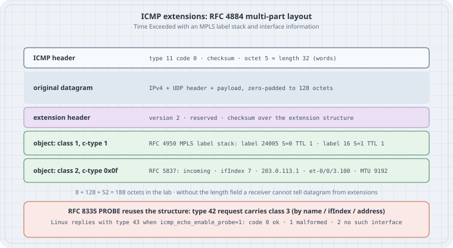

# ICMP Extensions: Multi-Part Messages, MPLS Label Stacks, Interface Information and PROBE

Classic ICMP error messages—Destination Unreachable, Time Exceeded, Parameter Problem—were designed in an era when a router's job was simply to bounce the failing packet's header back to the sender. In modern networks, that minimal quote leaves operators blind at the exact points where diagnostics matter most. When a packet traverses an MPLS core, a traceroute hop reports an IP address that may belong to a loopback or a provider edge router, hiding the label stack that actually steered the packet. When a router has unnumbered point-to-point links, RFC 1918 transit addresses, or asymmetric return paths, the source IP of an ICMP Time Exceeded message does not tell you which physical or logical interface received the packet.

RFC 4884 solved the framing problem by turning those three ICMP error types into multi-part messages that carry structured extension objects after the quoted datagram. Once a standard container existed, subsequent specifications filled it with operational telemetry: RFC 4950 added incoming MPLS label stacks, and RFC 5837 added interface names, interface indices, IP addresses, and MTUs. A decade later, RFC 8335 took a different angle with PROBE (Extended Echo), letting an operator query a proxy node about the status of a specific local or neighbouring interface—even when that interface has no IP address or no route back to the probing host.

On Linux, these mechanisms are not just packet-capture curiosities. The kernel exposes RFC 4884 extensions directly to unprivileged sockets through `IP_RECVERR_RFC4884`, answers RFC 8335 PROBE queries natively when `net.ipv4.icmp_echo_enable_probe` is enabled, and in recent kernels can even append RFC 5837 interface information to locally generated ICMP errors. Understanding the wire format and the kernel's exact validation and state rules lets you read `traceroute -e` output accurately and diagnose why a probe succeeds or fails on the wire.

## Learning goals

- Explain how RFC 4884 adds a length field and 128-octet padding to ICMPv4 and ICMPv6 error messages so compliant receivers and legacy parsers can coexist.
- Decode the RFC 4884 extension header and object framing, including version, checksum coverage, `Class-Num`, and `C-Type`.
- Interpret RFC 4950 MPLS label stack entries (label, Traffic Class, bottom-of-stack `S`, and TTL) and RFC 5837 Interface Information sub-objects.
- Use `IP_RECVERR` together with `IP_RECVERR_RFC4884` on a Linux UDP socket to extract extension offsets and detect corrupted extension checksums via `SO_EE_RFC4884_FLAG_INVALID`.
- Construct and interpret RFC 8335 PROBE requests and replies, and distinguish administrative state (`IFF_UP` / `A` bit) from IPv4/IPv6 address presence (`4` and `6` bits) in Linux.

## Version note

The lab in this chapter was executed on Linux `6.12.94+` with Python `3.13.5` inside an unprivileged user and network namespace (`unshare -rn`). `IP_RECVERR_RFC4884` (socket option `26`) was introduced in Linux 5.9, and RFC 8335 PROBE support was introduced in Linux 5.13. Linux 6.19 added the `net.ipv4.icmp_errors_extension_mask` sysctl to append RFC 5837 incoming-interface objects to kernel-generated ICMPv4 errors; because the lab host runs Linux 6.12, that sysctl is documented here for reference rather than run live.

## RFC 4884: Multi-Part ICMP Messages

In classic ICMPv4 (RFC 792), Destination Unreachable (type 3), Time Exceeded (type 11), and Parameter Problem (type 12) share a 4-octet fixed header followed by 4 unused octets (except Parameter Problem, which uses the first of those 4 octets as a pointer) and then a variable-length quote of the offending datagram. Because there was no length field for the quoted datagram, a receiver had no reliable way to know where the original packet ended and any trailing data began.

RFC 4884 (April 2007) retrofitted a `length` field into octet 5 (index 4) of the ICMPv4 header—the second octet of the previously unused 4-octet word—for Destination Unreachable, Time Exceeded, and Parameter Problem. For ICMPv4, this `length` field counts the quoted original datagram in **32-bit words**. For ICMPv6 (Destination Unreachable type 1, Time Exceeded type 3), the `length` field occupies octet 5 as well, but counts in **64-bit words**.

```text
 0                   1                   2                   3
 0 1 2 3 4 5 6 7 8 9 0 1 2 3 4 5 6 7 8 9 0 1 2 3 4 5 6 7 8 9 0 1
+-+-+-+-+-+-+-+-+-+-+-+-+-+-+-+-+-+-+-+-+-+-+-+-+-+-+-+-+-+-+-+-+
|     Type      |     Code      |           Checksum            |
+-+-+-+-+-+-+-+-+-+-+-+-+-+-+-+-+-+-+-+-+-+-+-+-+-+-+-+-+-+-+-+-+
|   Pointer*    |    Length     |            Unused             |
+-+-+-+-+-+-+-+-+-+-+-+-+-+-+-+-+-+-+-+-+-+-+-+-+-+-+-+-+-+-+-+-+
|                                                               |
~         Original Datagram (zero-padded to >= 128 octets       ~
|                     when extensions present)                  |
+-+-+-+-+-+-+-+-+-+-+-+-+-+-+-+-+-+-+-+-+-+-+-+-+-+-+-+-+-+-+-+-+
|  Ver  | Resvd |           Extension Checksum                  |
+-+-+-+-+-+-+-+-+-+-+-+-+-+-+-+-+-+-+-+-+-+-+-+-+-+-+-+-+-+-+-+-+
|             Length            |   Class-Num   |    C-Type     |
+-+-+-+-+-+-+-+-+-+-+-+-+-+-+-+-+-+-+-+-+-+-+-+-+-+-+-+-+-+-+-+-+
|                        Object Payload                         |
~                              ...                              ~
+-+-+-+-+-+-+-+-+-+-+-+-+-+-+-+-+-+-+-+-+-+-+-+-+-+-+-+-+-+-+-+-+
* Pointer is used only for ICMPv4 Parameter Problem (type 12);
  it is 0 for Destination Unreachable (3) and Time Exceeded (11).
```

When an ICMP message carries **no** extensions, the `length` field is set to `0`, and the sender quotes as much of the original datagram as it chooses (often just the IP header plus 8 octets of transport header, or up to the full packet). When extensions **are** present, RFC 4884 requires the sender to zero-pad the original datagram field to **at least 128 octets** (or longer if more of the original datagram is included, rounded up to a 32-bit boundary for ICMPv4 or 64-bit boundary for ICMPv6).

Why 128 octets? Legacy applications written before RFC 4884 sometimes appended extensions anyway and hardcoded a 128-octet offset into the ICMP payload to find them. By padding the quoted datagram to at least 128 octets and setting `length` to `32` (since `32 * 4 = 128`), RFC 4884 ensures that compliant parsers use `length * 4` while legacy parsers that hardcode offset 128 still land on the extension header.

### Extension Header and Object Framing

{fig-alt="ICMP header with length 32 words, original datagram padded to 128 octets, extension header version 2 with checksum, an RFC 4950 MPLS label stack object (class 1) and an RFC 5837 interface information object (class 2, c-type 0x0f): 188 octets in total. RFC 8335 PROBE reuses the structure with a class 3 object; Linux answers with type 43 when icmp_echo_enable_probe is 1."}

Immediately following the padded original datagram sits the RFC 4884 Extension Structure:

1. **Extension Header (4 octets):**
   - `Version` (4 bits): always `2` (`0x20` in the first octet).
   - `Reserved` (12 bits): must be `0`.
   - `Checksum` (16 bits): standard ones'-complement Internet checksum computed over the entire Extension Structure (the 4-octet extension header plus all extension objects), with the checksum field set to zero during calculation. This checksum is independent of the outer ICMP checksum.
2. **Extension Objects (one or more):**
   - `Length` (16 bits): total length of this object in octets, **including** the 4-octet object header.
   - `Class-Num` (8 bits): identifies the extension class (`1` for MPLS, `2` for Interface Information, `3` for Interface Identification in PROBE).
   - `C-Type` (8 bits): class-specific sub-type or flags.
   - `Object Payload`: `Length - 4` octets of class-specific data.

A single extension structure can hold multiple objects back-to-back. A receiver walks the objects by starting at offset `4` inside the extension structure and advancing by `Length` octets until it reaches the end of the packet.

## RFC 4950: MPLS Label Stack Extension

When an MPLS Label Switch Router (LSR) decrements an MPLS TTL to zero or encounters an unroutable packet inside an MPLS LSP, it cannot always deliver the ICMP Time Exceeded message directly to the original source IP—intermediate P routers often lack routes to customer prefixes. Instead, the LSR may forward the ICMP error along the LSP toward the egress PE, which then routes it back to the sender. Without extensions, `traceroute` sees only the responding router's IP address and has no visibility into the label stack that carried the probe.

RFC 4950 (August 2007) defines the MPLS Label Stack Object (`Class-Num = 1`, `C-Type = 1`), which records the **incoming** MPLS label stack of the packet that triggered the ICMP error. Each label stack entry in the object payload is 32 bits wide, matching the standard MPLS shim header format:

```text
 0                   1                   2                   3
 0 1 2 3 4 5 6 7 8 9 0 1 2 3 4 5 6 7 8 9 0 1 2 3 4 5 6 7 8 9 0 1
+-+-+-+-+-+-+-+-+-+-+-+-+-+-+-+-+-+-+-+-+-+-+-+-+-+-+-+-+-+-+-+-+
|                Label                  | TC  |S|      TTL      |
+-+-+-+-+-+-+-+-+-+-+-+-+-+-+-+-+-+-+-+-+-+-+-+-+-+-+-+-+-+-+-+-+
```

| Field | Bits | Description |
| :--- | :--- | :--- |
| `Label` | 20 | MPLS label value. Labels `0`–`15` are reserved (for example, `0` is IPv4 Explicit Null); `16` and above are normal assignable labels. |
| `TC` | 3 | Traffic Class (formerly `EXP`, renamed by RFC 5462). |
| `S` | 1 | Bottom-of-Stack bit (`1` on the innermost label entry, `0` on outer entries). |
| `TTL` | 8 | MPLS Time-to-Live value at the time the error was generated. |

When `traceroute -e` or `mtr -e` shows MPLS labels next to a hop, it is decoding an RFC 4950 object like the one in the lab: two 32-bit entries, from the outer transport label (`24005`, `S=0`) down to the bottom-of-stack label (`16`, `S=1`). The exact print format differs between tools and versions.

## RFC 5837: Interface and Next-Hop Identification

In carrier and enterprise cores, transit links are frequently unnumbered, numbered from shared private space, or configured so that routers source ICMP errors from a loopback address. In all three cases, a classic ICMP Time Exceeded tells you *which router* dropped the packet, not *which interface* received it, which outgoing interface would have forwarded it, or what MTU was configured on that hop.

RFC 5837 (April 2010) defines the Interface Information Object (`Class-Num = 2`). Unlike MPLS, where `C-Type` is a simple version number, RFC 5837 packs both the **interface role** and **presence flags** into the 8-bit `C-Type` octet:

```text
 0   1   2   3   4   5   6   7
+---+---+---+---+---+---+---+---+
| Role  | Resvd | I | A | N | M |
+---+---+---+---+---+---+---+---+
```

- **Bits 0–1 (`Role`):**
  - `00` (0): Incoming IP interface (where the offending packet arrived).
  - `01` (1): Sub-IP component of the incoming IP interface (for example, a bundle member).
  - `10` (2): Outgoing IP interface.
  - `11` (3): IP next hop.
- **Bits 2–3 (`Resvd`):** Reserved, must be `0`.
- **Bits 4–7 (Presence flags):**
  - `I` (bit 4, `0x08`): `ifIndex` (32-bit unsigned integer) is present.
  - `A` (bit 5, `0x04`): IP Address sub-object (`16-bit AFI`, `16-bit Reserved`, followed by the address—4 octets for AFI 1 / IPv4, 16 octets for AFI 2 / IPv6) is present.
  - `N` (bit 6, `0x02`): Interface Name sub-object is present.
  - `M` (bit 7, `0x01`): MTU (32-bit unsigned integer) is present.

Sub-objects appear in the payload in the fixed order `ifIndex`, `IP Address`, `Interface Name`, `MTU`, omitting any whose presence bit is `0`. When all four presence bits are set for an incoming IP interface (`Role = 00`), `C-Type` is `0x0f`.

The Interface Name sub-object has its own internal framing: a **1-octet length** field (which must be a multiple of 4 and **includes** the length octet itself), followed by the ASCII interface name, zero-padded to that length. For example, the 12-character name `et-0/0/3.100` plus 1 length octet is 13 octets, which rounds up to `16` octets with 3 trailing `\x00` bytes.

## Linux Kernel Support for RFC 4884

### Receiving Extensions: `IP_RECVERR` and `IP_RECVERR_RFC4884`

Unprivileged diagnostic tools such as `traceroute` often use connected UDP sockets with `IP_RECVERR` (`ip(7)`) rather than raw ICMP sockets. When an ICMP error arrives for a socket with `IP_RECVERR` enabled, the kernel queues the error on the socket's error queue (`MSG_ERRQUEUE`) and strips the outer IPv4 header (20 octets without options) and UDP header (8 octets) from the quoted original datagram before returning the payload to `recvmsg()`.

Without `IP_RECVERR_RFC4884`, the kernel returns only the stripped UDP payload and gives no indication of where any RFC 4884 extensions start. Enabling `IP_RECVERR_RFC4884` (socket option `26` at `IPPROTO_IP`, added in Linux 5.9) tells the kernel—specifically `ip_icmp_error_rfc4884` in `net/ipv4/icmp.c`—to populate the `ee_rfc4884` fields inside `struct sock_extended_err`:

```text
struct sock_extended_err {
    uint32_t ee_errno;   /* 113 (EHOSTUNREACH) for Time Exceeded */
    uint8_t  ee_origin;  /* 2 (SO_EE_ORIGIN_ICMP) */
    uint8_t  ee_type;    /* 11 (ICMP Time Exceeded) */
    uint8_t  ee_code;    /* 0 */
    uint8_t  ee_pad;
    uint32_t ee_info;
    uint32_t ee_data;    /* union: ee_rfc4884 { uint16_t len; uint8_t flags; } */
};
```

In `ip_icmp_error_rfc4884`:

1. If the ICMPv4 `length` field is `0` or indicates fewer than 128 octets (`length * 4 < 128`), `ee_rfc4884.len` is set to `0` and only the original transport payload is returned.
2. When `length * 4 >= 128`, the kernel subtracts the stripped IPv4 and transport header lengths (`20 + 8 = 28` octets for standard IPv4/UDP) from `length * 4`. A 128-octet padded quote therefore yields `ee_rfc4884.len = 100`. The returned `recvmsg()` payload contains those `100` octets of padded quote followed immediately by the raw RFC 4884 extension structure.
3. The kernel validates the extension structure length and checksum; if validation fails, it sets `SO_EE_RFC4884_FLAG_INVALID` (`flags = 1`) while still passing `ee_rfc4884.len` and the payload so the user-space program can inspect or log the malformed packet.

### Generating Extensions: `net.ipv4.icmp_errors_extension_mask`

Linux 6.19 added the `net.ipv4.icmp_errors_extension_mask` sysctl (default `0x00`). Setting bit `0` (`0x01`) instructs the kernel to append an RFC 5837 Interface Information object describing the **incoming** interface to locally generated ICMPv4 Destination Unreachable, Time Exceeded, and Parameter Problem messages, padding or trimming the quoted original datagram to 128 octets. Because the lab host runs Linux 6.12, that sysctl is not present in this chapter's live output.

## RFC 8335: PROBE (Extended Echo)

Classic `ping` (ICMP Echo Request/Reply) tests whether a specific IP address is reachable and whether the host's IP stack responds. It cannot tell you the state of an **unnumbered** interface, an interface in a different VRF or with no return route to you, or an interface whose IP address is down while another address on the same router is reachable.

RFC 8335 (February 2018) introduces **PROBE**: ICMP Extended Echo Request (ICMPv4 type `42`, ICMPv6 type `160`) and Extended Echo Reply (ICMPv4 type `43`, ICMPv6 type `161`). Instead of pinging the target interface's IP, you send an Extended Echo Request to a reachable address on a **proxy node** (the router itself, or a router adjacent to the probed interface) and embed an **Interface Identification Object** (`Class-Num = 3`) inside an RFC 4884 extension structure naming the interface you want to inspect.

```text
Extended Echo Request (ICMPv4 Type 42, Code 0)
 0                   1                   2                   3
 0 1 2 3 4 5 6 7 8 9 0 1 2 3 4 5 6 7 8 9 0 1 2 3 4 5 6 7 8 9 0 1
+-+-+-+-+-+-+-+-+-+-+-+-+-+-+-+-+-+-+-+-+-+-+-+-+-+-+-+-+-+-+-+-+
|     Type 42   |    Code 0     |           Checksum            |
+-+-+-+-+-+-+-+-+-+-+-+-+-+-+-+-+-+-+-+-+-+-+-+-+-+-+-+-+-+-+-+-+
|           Identifier          |  Seq Num (8)  |  Reserved   |L|
+-+-+-+-+-+-+-+-+-+-+-+-+-+-+-+-+-+-+-+-+-+-+-+-+-+-+-+-+-+-+-+-+
|                     RFC 4884 Extension Structure              |
|               (Class-Num 3: Interface Identification)         |
+-+-+-+-+-+-+-+-+-+-+-+-+-+-+-+-+-+-+-+-+-+-+-+-+-+-+-+-+-+-+-+-+
```

The `L` (Local) bit in the request header is `1` when the probed interface resides on the proxy node itself, and `0` when probing an interface on a directly attached neighbour. The Interface Identification Object (`Class-Num = 3`) supports three `C-Type` values:

| `C-Type` | Lookup Method | Payload Format |
| :--- | :--- | :--- |
| `1` | By Name | UTF-8/ASCII interface name, zero-padded to a 4-octet boundary (no internal length octet, unlike RFC 5837) |
| `2` | By `ifIndex` | 32-bit unsigned interface index |
| `3` | By Address | 16-bit `AFI`, 8-bit `AddrLen`, 8-bit `Reserved`, followed by the IPv4/IPv6 address |

The Extended Echo Reply (ICMPv4 type `43`) echoes the Identifier and Sequence Number and uses the `Code` and trailing status octet to report the result:

```text
Extended Echo Reply (ICMPv4 Type 43)
 0                   1                   2                   3
 0 1 2 3 4 5 6 7 8 9 0 1 2 3 4 5 6 7 8 9 0 1 2 3 4 5 6 7 8 9 0 1
+-+-+-+-+-+-+-+-+-+-+-+-+-+-+-+-+-+-+-+-+-+-+-+-+-+-+-+-+-+-+-+-+
|     Type 43   |     Code      |           Checksum            |
+-+-+-+-+-+-+-+-+-+-+-+-+-+-+-+-+-+-+-+-+-+-+-+-+-+-+-+-+-+-+-+-+
|           Identifier          |  Seq Num (8)  |State|Res|A|4|6|
+-+-+-+-+-+-+-+-+-+-+-+-+-+-+-+-+-+-+-+-+-+-+-+-+-+-+-+-+-+-+-+-+
```

| Reply `Code` | Meaning |
| :--- | :--- |
| `0` | No Error |
| `1` | Malformed Query (for example, unknown `C-Type` or bad extension) |
| `2` | No Such Interface |
| `3` | No Such Table Entry |
| `4` | Multiple Interfaces Satisfy Query |

In the status octet (octet 7):

- `State` (3 bits): interface/neighbour reachability state (primarily meaningful for remote/neighbour queries when `L = 0`; `0` for local queries on Linux).
- `A` (bit 5, `0x04`): Active.
- `4` (bit 6, `0x02`): IPv4 running on the probed interface.
- `6` (bit 7, `0x01`): IPv6 running on the probed interface.

RFC 8335 Section 8 mandates that PROBE responders be **disabled by default** so nodes do not leak interface inventory to arbitrary senders. Linux 5.13 added PROBE support controlled by `net.ipv4.icmp_echo_enable_probe` (default `0`). In Linux `net/ipv4/icmp.c` (`icmp_build_probe`), the kernel sets:

- `A = 1` when the netdevice has `IFF_UP` (administratively up, **not** carrier/link-up).
- `4 = 1` when the netdevice has at least one IPv4 address configured.
- `6 = 1` when the netdevice has at least one IPv6 address configured.
- `Code = 2` (No Such Interface) when no matching netdevice is found.
- `Code = 1` (Malformed Query) when the object `C-Type` or length is invalid.

## The lab

The lab builds and parses RFC 4884, RFC 4950, RFC 5837, and RFC 8335 packets in Python inside an isolated network namespace (`unshare -rn`) so nothing touches the host's routing table or interfaces. It demonstrates four behaviours:

1. A classic 52-octet ICMPv4 Time Exceeded message with `length = 0`.
2. An RFC 4884 Time Exceeded message carrying an RFC 4950 MPLS label stack and an RFC 5837 Interface Information object.
3. A UDP socket using `IP_RECVERR` and `IP_RECVERR_RFC4884` receiving valid, unextended, and checksum-corrupted Time Exceeded messages from the kernel error queue.
4. Live RFC 8335 PROBE queries answered by the Linux `6.12` kernel against `veth-probe`, `lo`, a non-existent interface, an administratively downed interface, and an invalid `C-Type`.

### Lab files

`icmpx.py` constructs and parses the ICMP extension packets, tests `IP_RECVERR_RFC4884` on a UDP socket, and sends RFC 8335 PROBE requests to the local kernel.

```{.python filename="icmpx.py"}
"""ICMP extensions: RFC 4884 multi-part messages, RFC 4950 MPLS label stack,
RFC 5837 interface information, RFC 8335 PROBE against the Linux kernel.
Run inside `unshare -rn` (own network namespace, no real root)."""
import socket, struct, os, time, select

def csum(b):
    if len(b) % 2: b += b"\0"
    s = sum(struct.unpack("!%dH" % (len(b) // 2), b))
    while s >> 16: s = (s & 0xffff) + (s >> 16)
    return ~s & 0xffff

def ext_object(cls, ctype, payload):           # RFC 4884 sec. 7: length, class-num, c-type
    return struct.pack("!HBB", 4 + len(payload), cls, ctype) + payload

def ext_structure(objects):                     # version 2, checksum over whole structure
    body = b"".join(objects)
    hdr = struct.pack("!BBH", 2 << 4, 0, 0)
    c = csum(hdr + body)
    return struct.pack("!BBH", 2 << 4, 0, c) + body

def mpls_entry(label, tc, s, ttl):              # RFC 4950: 20-bit label, 3 TC, 1 S, 8 TTL
    return struct.pack("!I", label << 12 | tc << 9 | s << 8 | ttl)

def iface_info(role, ifindex, ip4, name, mtu):  # RFC 5837 sec. 4.1 C-Type bit layout
    ctype = role << 6 | 1 << 3 | 1 << 2 | 1 << 1 | 1   # ifIndex, IPAddr, name, MTU bits
    nm = name.encode()
    sub_name = bytes([((len(nm) + 1 + 3) // 4) * 4]) + nm
    sub_name += b"\0" * (sub_name[0] - len(sub_name))
    payload = struct.pack("!I", ifindex) + struct.pack("!HH", 1, 0) + socket.inet_aton(ip4) \
              + sub_name + struct.pack("!I", mtu)
    return ext_object(2, ctype, payload)

def ipv4_udp(src, dst, sport, dport, payload, ttl=1):
    udp = struct.pack("!HHHH", sport, dport, 8 + len(payload), 0) + payload
    hdr = struct.pack("!BBHHHBBH4s4s", 0x45, 0, 20 + len(udp), 0x1234, 0, ttl, 17, 0,
                      socket.inet_aton(src), socket.inet_aton(dst))
    hdr = hdr[:10] + struct.pack("!H", csum(hdr)) + hdr[12:]
    return hdr + udp

def time_exceeded(original, ext=None):
    if ext is None:                              # classic RFC 792 style, no length field
        quoted, length = original, 0
    else:                                        # RFC 4884: pad to >=128 octets, length in words
        quoted = original[:128].ljust(128, b"\0")
        length = len(quoted) // 4
    body = struct.pack("!BBHBBH", 11, 0, 0, 0, length, 0) + quoted + (ext or b"")
    return body[:2] + struct.pack("!H", csum(body)) + body[4:]

def parse_icmp_error(m):
    t, c, ck, _, length, _ = struct.unpack("!BBHBBH", m[:8])
    print(f"  type {t} code {c} checksum ok={csum(m) == 0} length field {length} ({length*4} octets quoted)")
    if length == 0:
        print("  no RFC 4884 length -> receiver cannot tell where extensions would start"); return
    ext = m[8 + length * 4:]
    ver, _, eck = struct.unpack("!BBH", ext[:4])
    print(f"  extension header version {ver >> 4}, checksum ok={csum(ext) == 0}, {len(ext)} octets")
    off = 4
    while off < len(ext):
        olen, cls, ct = struct.unpack("!HBB", ext[off:off + 4]); p = ext[off + 4:off + olen]
        if cls == 1:
            for i in range(0, len(p), 4):
                v = struct.unpack("!I", p[i:i + 4])[0]
                print(f"  MPLS entry: label {v >> 12} tc {v >> 9 & 7} S {v >> 8 & 1} ttl {v & 255}")
        elif cls == 2:
            role = ["incoming", "sub-IP", "outgoing", "next-hop"][ct >> 6]
            ifx = struct.unpack("!I", p[:4])[0]
            afi = struct.unpack("!H", p[4:6])[0]; ip = socket.inet_ntoa(p[8:12])
            nlen = p[12]; name = p[13:12 + nlen].rstrip(b"\0").decode()
            mtu = struct.unpack("!I", p[12 + nlen:16 + nlen])[0]
            print(f"  Interface Information: role {role} ifIndex {ifx} AFI {afi} addr {ip} name '{name}' mtu {mtu} (c-type 0x{ct:02x})")
        off += olen

orig = ipv4_udp("192.0.2.10", "198.51.100.7", 40000, 33434, b"traceroute-probe")
print("== 1. Classic Time Exceeded (no extensions) ==")
m = time_exceeded(orig); print(f"  {len(m)} octets on the wire"); parse_icmp_error(m)

print("\n== 2. RFC 4884 Time Exceeded with MPLS stack (RFC 4950) and interface info (RFC 5837) ==")
ext = ext_structure([ext_object(1, 1, mpls_entry(24005, 0, 0, 1) + mpls_entry(16, 0, 1, 1)),
                     iface_info(0, 7, "203.0.113.1", "et-0/0/3.100", 9192)])
m = time_exceeded(orig, ext); print(f"  {len(m)} octets on the wire (original {len(orig)} padded to 128)")
parse_icmp_error(m)

# ---------- 3. IP_RECVERR_RFC4884: the kernel tells a UDP socket where extensions start ----------
os.system("ip link set lo up")
IP_RECVERR, IP_RECVERR_RFC4884 = 11, 26
u = socket.socket(socket.AF_INET, socket.SOCK_DGRAM); u.bind(("127.0.0.1", 40001))
u.setsockopt(socket.IPPROTO_IP, IP_RECVERR, 1)
u.setsockopt(socket.IPPROTO_IP, IP_RECVERR_RFC4884, 1)
sink = socket.socket(socket.AF_INET, socket.SOCK_DGRAM); sink.bind(("127.0.0.1", 33435))  # listener: no port unreachable
u.connect(("127.0.0.1", 33435)); u.send(b"probe")
raw = socket.socket(socket.AF_INET, socket.SOCK_RAW, socket.IPPROTO_ICMP)
print("\n== 3. IP_RECVERR_RFC4884 on a UDP socket ==")
bad = ext[:2] + bytes([ext[2] ^ 0xff]) + ext[3:]           # corrupt the extension checksum
for label, e in (("with extensions", ext), ("without extensions", None), ("bad ext checksum", bad)):
    quoted = ipv4_udp("127.0.0.1", "127.0.0.1", 40001, 33435, b"probe", ttl=64)
    raw.sendto(time_exceeded(quoted, e), ("127.0.0.1", 0))
    time.sleep(0.1)
    data, anc, flags, _ = u.recvmsg(512, 512, socket.MSG_ERRQUEUE)
    for lvl, typ, d in anc:
        errno_, origin, t, c, pad, info, rlen, rflags, _r = struct.unpack("=IBBBBIHBB", d[:16])
        print(f"  {label}: ee_errno {errno_} ({os.strerror(errno_)}) origin {origin} type {t} code {c}"
              f" rfc4884.len {rlen} flags {rflags} payload {len(data)} octets")

# ---------- 4. RFC 8335 PROBE answered by the kernel ----------
def probe(dst, obj_ctype, payload, seq):
    o = ext_object(3, obj_ctype, payload)
    msg = struct.pack("!BBHHBB", 42, 0, 0, 0x4242, seq, 1)     # L bit = 1 (local query)
    msg += ext_structure([o])
    msg = msg[:2] + struct.pack("!H", csum(msg)) + msg[4:]
    s = socket.socket(socket.AF_INET, socket.SOCK_RAW, socket.IPPROTO_ICMP)
    s.sendto(msg, (dst, 0)); deadline = time.time() + 0.5
    while time.time() < deadline:
        r, _, _ = select.select([s], [], [], 0.2)
        if not r: continue
        pkt = s.recv(1500); ihl = (pkt[0] & 15) * 4; icmp = pkt[ihl:]
        if icmp[0] == 43 and icmp[6] == seq:
            st = icmp[7]
            return f"reply type 43 code {icmp[1]} state {st >> 5} A={st >> 2 & 1} 4={st >> 1 & 1} 6={st & 1}"
    return "no reply"

os.system("ip link add veth-probe type veth peer name veth-peer")
os.system("ip addr add 198.51.100.1/24 dev veth-probe; ip link set veth-probe up")
idx = socket.if_nametoindex("veth-probe")
print("\n== 4. RFC 8335 PROBE answered by Linux", os.uname().release, "==")
print("  icmp_echo_enable_probe =", open("/proc/sys/net/ipv4/icmp_echo_enable_probe").read().strip())
print("  by name, probe disabled :", probe("127.0.0.1", 1, b"veth-probe".ljust(12, b"\0"), 1))
open("/proc/sys/net/ipv4/icmp_echo_enable_probe", "w").write("1")
print("  icmp_echo_enable_probe =", open("/proc/sys/net/ipv4/icmp_echo_enable_probe").read().strip())
print("  by name 'veth-probe'    :", probe("127.0.0.1", 1, b"veth-probe".ljust(12, b"\0"), 2))
print(f"  by ifIndex {idx}          :", probe("127.0.0.1", 2, struct.pack("!I", idx), 3))
print("  by address 198.51.100.1 :", probe("127.0.0.1", 3, struct.pack("!HBB", 1, 4, 0) + socket.inet_aton("198.51.100.1"), 4))
print("  by name 'lo'            :", probe("127.0.0.1", 1, b"lo".ljust(4, b"\0"), 5))
print("  by name 'nope0'         :", probe("127.0.0.1", 1, b"nope0".ljust(8, b"\0"), 6))
os.system("ip link set veth-probe down")
print("  'veth-probe' after down :", probe("127.0.0.1", 1, b"veth-probe".ljust(12, b"\0"), 7))
print("  bad c-type 9            :", probe("127.0.0.1", 9, b"\0\0\0\0", 8))
```
`run.sh` launches `icmpx.py` inside a private user and network namespace with `unshare -rn`.

```{.bash filename="run.sh"}
#!/bin/sh
# own user + network namespace; no sudo, nothing touches the host's interfaces
unshare -rn python3 icmpx.py
```
Run the lab with `sh run.sh`. It uses `unshare -rn` to gain `CAP_NET_RAW` and `CAP_NET_ADMIN` inside an isolated namespace, so no `sudo` is required and no host interfaces are modified.

### Execution output

```text
== 1. Classic Time Exceeded (no extensions) ==
  52 octets on the wire
  type 11 code 0 checksum ok=True length field 0 (0 octets quoted)
  no RFC 4884 length -> receiver cannot tell where extensions would start

== 2. RFC 4884 Time Exceeded with MPLS stack (RFC 4950) and interface info (RFC 5837) ==
  188 octets on the wire (original 44 padded to 128)
  type 11 code 0 checksum ok=True length field 32 (128 octets quoted)
  extension header version 2, checksum ok=True, 52 octets
  MPLS entry: label 24005 tc 0 S 0 ttl 1
  MPLS entry: label 16 tc 0 S 1 ttl 1
  Interface Information: role incoming ifIndex 7 AFI 1 addr 203.0.113.1 name 'et-0/0/3.100' mtu 9192 (c-type 0x0f)

== 3. IP_RECVERR_RFC4884 on a UDP socket ==
  with extensions: ee_errno 113 (No route to host) origin 2 type 11 code 0 rfc4884.len 100 flags 0 payload 152 octets
  without extensions: ee_errno 113 (No route to host) origin 2 type 11 code 0 rfc4884.len 0 flags 0 payload 5 octets
  bad ext checksum: ee_errno 113 (No route to host) origin 2 type 11 code 0 rfc4884.len 100 flags 1 payload 152 octets

== 4. RFC 8335 PROBE answered by Linux 6.12.94+ ==
  icmp_echo_enable_probe = 0
  by name, probe disabled : no reply
  icmp_echo_enable_probe = 1
  by name 'veth-probe'    : reply type 43 code 0 state 0 A=1 4=1 6=0
  by ifIndex 3          : reply type 43 code 0 state 0 A=1 4=1 6=0
  by address 198.51.100.1 : reply type 43 code 0 state 0 A=1 4=1 6=0
  by name 'lo'            : reply type 43 code 0 state 0 A=1 4=1 6=1
  by name 'nope0'         : reply type 43 code 2 state 0 A=0 4=0 6=0
  'veth-probe' after down : reply type 43 code 0 state 0 A=0 4=1 6=0
  bad c-type 9            : reply type 43 code 1 state 0 A=0 4=0 6=0
```
## Reading the output

### 1. Classic Time Exceeded (no extensions)

- `52 octets on the wire`: The message consists of the 8-octet ICMPv4 Time Exceeded header plus the 44-octet original datagram (`20` octets IPv4 header + `8` octets UDP header + `16` octets `"traceroute-probe"` payload).
- `type 11 code 0 checksum ok=True length field 0 (0 octets quoted)`: `type 11` is Time Exceeded and `code 0` is TTL exceeded in transit. The `length` field in octet 5 is `0`, which tells the receiver that no RFC 4884 length is present. Even though `44` octets of the original packet are actually in the message, a parser cannot distinguish trailing padding or extensions from original payload.

### 2. RFC 4884 Time Exceeded with MPLS stack (RFC 4950) and interface info (RFC 5837)

- `188 octets on the wire (original 44 padded to 128)`: The 44-octet original datagram is zero-padded to `128` octets. Adding the 8-octet ICMPv4 header and the 52-octet extension structure gives `8 + 128 + 52 = 188` octets.
- `length field 32 (128 octets quoted)`: Because ICMPv4 expresses `length` in 32-bit words, `128 / 4 = 32`.
- `extension header version 2, checksum ok=True, 52 octets`: The extension structure starts at byte `8 + 128 = 136`. Its 52 octets break down as:
  - `4` octets for the RFC 4884 extension header (`version 2`, reserved `0`, 16-bit checksum).
  - `12` octets for the RFC 4950 MPLS object (`4`-octet object header + two `4`-octet label entries).
  - `36` octets for the RFC 5837 Interface Information object (`4`-octet object header + `4`-octet `ifIndex` + `8`-octet IPv4 address sub-object + `16`-octet padded name sub-object + `4`-octet MTU).
- `MPLS entry: label 24005 tc 0 S 0 ttl 1` and `label 16 tc 0 S 1 ttl 1`: The outer label is `24005` (`S=0`, not bottom of stack) and the inner label is `16` (`S=1`, bottom of stack). Label `16` is a regular assignable label—only labels `0`–`15` are reserved (with `0` being IPv4 Explicit Null).
- `Interface Information: role incoming ifIndex 7 AFI 1 addr 203.0.113.1 name 'et-0/0/3.100' mtu 9192 (c-type 0x0f)`: Role `00` (incoming IP interface) plus all four presence bits (`ifIndex`, `IPAddr`, `name`, `MTU`) gives `C-Type = 0x0f`. `AFI 1` indicates an IPv4 address.

### 3. `IP_RECVERR_RFC4884` on a UDP socket

Each test injects a raw ICMP Time Exceeded packet referencing the UDP socket's 5-tuple (`127.0.0.1:40001 -> 127.0.0.1:33435`) and reads the error from `MSG_ERRQUEUE`.

- `with extensions: ee_errno 113 (No route to host) origin 2 type 11 code 0 rfc4884.len 100 flags 0 payload 152 octets`:
  - `ee_errno 113` (`EHOSTUNREACH`) is the errno Linux maps to ICMP Time Exceeded; `origin 2` is `SO_EE_ORIGIN_ICMP`.
  - `rfc4884.len 100`: The kernel stripped the 20-octet IPv4 header and 8-octet UDP header (`28` octets total) from the 128-octet padded quote, leaving `128 - 28 = 100` octets before the extension structure begins.
  - `flags 0`: The extension structure and checksum validated cleanly.
  - `payload 152 octets`: `100` octets of remaining padded quote + `52` octets of extension structure = `152` octets.
- `without extensions: ... rfc4884.len 0 flags 0 payload 5 octets`: With `length = 0` in the ICMP header, `rfc4884.len` is `0` and `recvmsg()` returns only the `5`-octet UDP payload (`"probe"`).
- `bad ext checksum: ... rfc4884.len 100 flags 1 payload 152 octets`: Flipping a byte in the extension checksum causes the kernel to set `flags 1` (`SO_EE_RFC4884_FLAG_INVALID`), while still returning `rfc4884.len 100` and all `152` payload octets so the application can see where the corrupt extension begins.

### 4. RFC 8335 PROBE answered by Linux `6.12.94+`

- `icmp_echo_enable_probe = 0` -> `by name, probe disabled : no reply`: With the default sysctl value `0`, the kernel silently drops the Extended Echo Request, conforming to RFC 8335 Section 8.
- After writing `1` to `icmp_echo_enable_probe`:
  - `by name 'veth-probe'`, `by ifIndex 3`, and `by address 198.51.100.1` all return `reply type 43 code 0 state 0 A=1 4=1 6=0`. Notice that `veth-peer` was never brought up, so `veth-probe` has no carrier; `A=1` anyway because Linux's `icmp_build_probe` checks administrative `IFF_UP`, not link carrier. `4=1` reflects `198.51.100.1/24`, and `6=0` reflects that no IPv6 address is present on `veth-probe`.
  - `by name 'lo'` returns `A=1 4=1 6=1` because loopback has both `127.0.0.1` and `::1`.
  - `by name 'nope0'` returns `code 2` (No Such Interface) with `A=0 4=0 6=0`.
  - `'veth-probe' after down` (`ip link set veth-probe down`) returns `code 0` with `A=0 4=1 6=0`: clearing `IFF_UP` flips `A` to `0`, while the configured IPv4 address remains on the interface so `4` stays `1`.
  - `bad c-type 9` returns `code 1` (Malformed Query) with `A=0 4=0 6=0`.

## In production

In day-to-day operations, you do not craft raw RFC 4884 packets by hand. Standard `traceroute(8)` (from the `traceroute` package) and `mtr` decode MPLS and Interface Information extensions when passed `-e` (not run here):

```bash
# Decode RFC 4950 MPLS stacks and RFC 5837 interface info in traceroute (not run here)
traceroute -e 198.51.100.7

# Show MPLS extensions in mtr (not run here)
mtr -e -n 198.51.100.7
```

To capture extension-bearing ICMP errors or PROBE traffic on the wire with `tcpdump` (not run here):

```bash
# Capture ICMPv4 Time Exceeded (type 11) packets (not run here)
tcpdump -ni eth0 -vvv 'icmp[0] == 11'

# Capture ICMPv4 PROBE Extended Echo Requests (42) and Replies (43) (not run here)
tcpdump -ni eth0 -vvv 'icmp[0] == 42 or icmp[0] == 43'
```

On a Linux router running kernel 6.19 or newer, you can enable RFC 5837 incoming-interface reporting on locally generated ICMPv4 errors via `sysctl` (not run here):

```bash
# Append RFC 5837 incoming-interface objects to ICMPv4 errors (Linux >= 6.19, not run here)
sysctl -w net.ipv4.icmp_errors_extension_mask=1
```

To allow a Linux host (`>= 5.13`) to answer RFC 8335 PROBE queries (not run here):

```bash
# Enable RFC 8335 PROBE replies (disabled by default per RFC 8335) (not run here)
sysctl -w net.ipv4.icmp_echo_enable_probe=1
```

Client support for PROBE varies across distributions and network operating systems. Check whether your `ping` binary or router NOS supports RFC 8335 extended echo flags before relying on it in runbooks—for instance, in this lab we built the PROBE packets directly in Python rather than assuming a host `ping` flag exists.

## Gotchas

- **RFC 4884 length units differ between v4 and v6:** In ICMPv4, octet 5 counts **32-bit words** (`length * 4` octets); in ICMPv6, octet 5 counts **64-bit words** (`length * 8` octets). Mixing the two shifts the extension offset by a factor of two.
- **128-octet minimum padding is mandatory when extensions are present:** Senders must zero-pad the quoted original datagram to at least 128 octets (`length = 32` in ICMPv4). Linux's `ip_icmp_error_rfc4884` ignores extensions (`ee_rfc4884.len = 0`) if the quoted length is under 128 octets.
- **Two independent checksums:** An RFC 4884 packet has an outer ICMP checksum covering the entire ICMP message *and* an inner 16-bit extension checksum covering only the extension structure. A valid outer ICMP checksum does not guarantee a valid extension checksum (`SO_EE_RFC4884_FLAG_INVALID`).
- **`ee_rfc4884.len` is relative to the stripped payload, not the ICMP header:** On a UDP socket with `IP_RECVERR`, the kernel strips the 20-octet IPv4 header and 8-octet UDP header, so a 128-octet RFC 4884 quote produces `ee_rfc4884.len = 100`, not `128`.
- **PROBE `A=1` means `IFF_UP`, not physical carrier:** On Linux, `icmp_build_probe` sets the `A` (Active) bit based on administrative `IFF_UP`. A `veth` or physical port with no carrier still reports `A=1` until `ip link set ... down` is run.
- **PROBE `4=1` persists after `ip link set down`:** Removing `IFF_UP` clears `A` to `0`, but as long as an IPv4 address remains configured on the interface, Linux still sets `4=1`.
- **PROBE is disabled by default:** Both RFC 8335 Section 8 and Linux (`net.ipv4.icmp_echo_enable_probe = 0`) disable PROBE replies by default. Expect silence—not an ICMP error—when querying an unconfigured or non-supporting host.
- **Interface name framing differs between RFC 5837 and RFC 8335:** RFC 5837 prefixes the interface name with a 1-octet length (including the length octet, padded to a 4-octet multiple), whereas RFC 8335 `C-Type 1` puts the raw name directly in the object payload padded to a 4-octet boundary with no length octet.

## Exercises

1. Modify `icmpx.py` in a scratch copy to pad the original datagram to `64` octets (`length = 16`) instead of `128` octets and inject it into the `IP_RECVERR_RFC4884` test. Observe what `ee_rfc4884.len` and `payload` length the Linux kernel returns.
2. Add a third MPLS label entry (for example, Explicit Null label `0` at the bottom of the stack with `S=1`, changing label `16` to `S=0`) and verify how the total extension structure length and `traceroute`-style decoding change.
3. Construct an RFC 5837 Interface Information object with `Role = 2` (outgoing IP interface) that includes **only** `ifIndex` and `MTU` (no IP address, no name). Calculate the exact `C-Type` hex value and object length before running it.
4. In section 4 of the lab, add an IPv6 address to `veth-probe` (or bring `veth-peer` up so link-local IPv6 autoconfiguration completes) and confirm that the PROBE reply transitions from `6=0` to `6=1`.
5. Test an RFC 8335 PROBE query with the `L` bit set to `0` (remote/neighbour query) against the Linux kernel and observe how the reply code or state behaves compared to `L=1`.
6. Capture the traffic generated by `sh run.sh` inside the `unshare -rn` namespace using `tcpdump -i lo -w icmpx.pcap` and inspect the RFC 4884 and RFC 8335 dissectors in `tshark -r icmpx.pcap -V`.

## Verification

- **Executed live:** `sh run.sh` (`unshare -rn python3 icmpx.py`) on Linux `6.12.94+` with Python `3.13.5` as an unprivileged user. Verified all four sections: classic 52-octet Time Exceeded, 188-octet RFC 4884 Time Exceeded with RFC 4950 and RFC 5837 objects, `IP_RECVERR_RFC4884` (`len=100`, `len=0`, and `flags=1` on bad checksum), and Linux kernel RFC 8335 PROBE replies across `veth-probe`, `lo`, `nope0`, down state, and `C-Type 9`.
- **Not run here:** `traceroute -e`, `mtr -e`, `tcpdump` capture commands in the production section, and `net.ipv4.icmp_errors_extension_mask` (introduced in Linux 6.19, newer than the `6.12.94+` lab host).

## Sources

- [RFC 4884: Extended ICMP to Support Multi-Part Messages](https://www.rfc-editor.org/rfc/rfc4884)
- [RFC 4950: ICMP Extensions for Multiprotocol Label Switching](https://www.rfc-editor.org/rfc/rfc4950)
- [RFC 5462: Multiprotocol Label Switching (MPLS) Label Stack Entry: "EXP" Field Renamed to "Traffic Class" Field](https://www.rfc-editor.org/rfc/rfc5462)
- [RFC 5837: Extending ICMP for Interface and Next-Hop Identification](https://www.rfc-editor.org/rfc/rfc5837)
- [RFC 8335: PROBE: A Utility for Probing Interfaces](https://www.rfc-editor.org/rfc/rfc8335)
- [`ip(7)` — Linux manual page](https://man7.org/linux/man-pages/man7/ip.7.html)
- [Linux Kernel Networking IP Sysctl Documentation](https://docs.kernel.org/networking/ip-sysctl.html)
