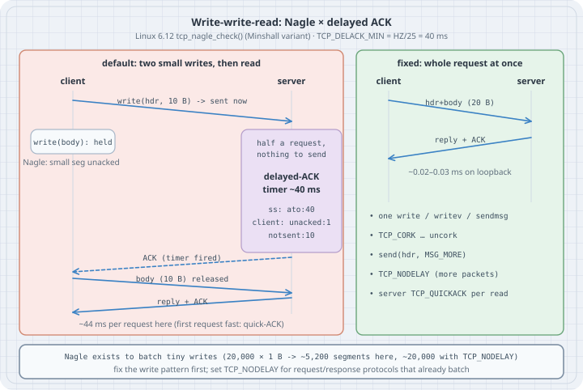

# Small Writes in TCP: Nagle's Algorithm, Delayed ACKs, and the 40 ms Stall

Two TCP features that each save packets can together add a fixed **40 ms** to every request. **Nagle's algorithm** (sender side) holds a small segment while an earlier small segment is still unacknowledged. **Delayed ACK** (receiver side) waits, up to a timer, before acknowledging, hoping to piggyback the ACK on a reply. When a client sends one request as *two* small writes and then waits for the answer, the server cannot reply (it has only half the request), so it delays its ACK; the client cannot send the second half until that ACK arrives. Both sides wait for the timer. Nothing is lost, nothing is retransmitted, CPU is idle, and p50 latency is 40 ms on a link with a 20 µs RTT. This chapter reproduces the stall on loopback, catches it in `ss`, and measures every fix, including the one people reach for first (`TCP_NODELAY`) and what it costs.

## Learning goals

- State Nagle's rule (RFC 896, RFC 9293 §3.7.4) and Linux's Minshall variant, and the delayed-ACK rule (RFC 9293 §3.8.6.3)
- Recognise the write-write-read pattern and predict the stall from it
- Read `ato`, `unacked` and `notsent` in `ss -ti` while the stall is happening
- Compare the fixes: one write (`writev`/`sendmsg`), `TCP_CORK`, `MSG_MORE`, `TCP_NODELAY` and `TCP_QUICKACK`, and say which side each one acts on
- Explain what Nagle protects against, and measure what `TCP_NODELAY` costs in segments

Lab platform: Linux 6.12, iproute2 6.15 (`ss`, `nstat`), Python 3.13.5, run as an unprivileged user over `127.0.0.1`. No namespaces, no `tc`, no root. Every listing output below is pasted from those runs. Kernel behaviour is quoted from `include/net/tcp.h` and `net/ipv4/tcp_output.c` in Linux 6.12; the same constants and `tcp_nagle_check()` are unchanged in Linux 7.2, the current stable series.

## Mental model

{fig-alt="Sequence diagram. Left panel, default: the client writes a 10-byte header, which is sent at once. It then writes a 10-byte body, which Nagle holds because a small segment is unacknowledged. The server has half a request and nothing to send, so it starts its delayed-ACK timer of about 40 ms; ss shows ato:40 on both sockets and unacked:1 notsent:10 on the client. When the timer fires, the server sends a bare ACK, the client releases the body, and the server replies with the reply plus ACK: about 44 ms per request here, with the first request fast because of quick-ACK mode. Right panel, fixed: the client sends header and body as one 20-byte segment, the server replies at once with the ACK piggybacked, about 0.02 to 0.03 ms on loopback. Listed fixes: one write, writev or sendmsg; TCP_CORK then uncork; send with MSG_MORE; TCP_NODELAY, which costs more packets; server-side TCP_QUICKACK before every read. Footer: Nagle exists to batch tiny writes, 20,000 one-byte writes became about 5,200 segments with Nagle and about 20,000 with TCP_NODELAY; fix the write pattern first."}

```text
 client                                       server
   │ write(hdr, 10 B) ── sent: nothing unacked ──►│  has half a request
   │ write(body, 10 B)                             │  nothing to send yet
   │   Nagle: a small segment is unacked → HOLD    │  delayed ACK: wait (ato 40 ms)
   │                     ... up to ~40 ms ...      │
   │◄──────────── bare ACK (delack timer) ─────────│
   │ body released ───────────────────────────────►│  full request → reply
   │◄──────────────── reply (+ ACK) ───────────────│
```

The two rules:

| Rule | Where | What it says | Linux |
|---|---|---|---|
| **Nagle** (RFC 896; RFC 9293 §3.7.4, SHLD-7, with a per-connection off switch, MUST-17) | Sender | While data is unacknowledged, buffer small writes until the ACK arrives or a full MSS is ready | `tcp_nagle_check()` with **Minshall's variant** (RFC 9293 App. A.3): hold a sub-MSS segment only while a previous *sub-MSS* segment is unacknowledged |
| **Delayed ACK** (RFC 1122 §4.2.3.2; RFC 9293 §3.8.6.3, SHLD-18/19, MUST-40) | Receiver | ACK at least every second full-sized segment; otherwise wait (less than 0.5 s) to piggyback the ACK on data | `TCP_DELACK_MIN` = `TCP_ATO_MIN` = `HZ/25` = **40 ms**, `TCP_DELACK_MAX` = `HZ/5` = 200 ms; a new connection starts in **quick-ACK** mode (up to `TCP_MAX_QUICKACKS` = 16 immediate ACKs) |

Neither rule is a bug. Together they deadlock until the timer fires, whenever all of these hold:

1. The sender writes one logical message as **two or more sub-MSS writes**.
2. The receiver **cannot respond** until it has the whole message.
3. The sender **waits for the response** before writing more.

HTTP/1.x clients that write headers and body separately, RPC frameworks that write a length prefix and then the payload, database drivers, Redis/memcached clients and SSH-like interactive protocols all fit this pattern unless they batch their writes or set `TCP_NODELAY`.

## Concepts — the knobs

| Knob | Side | Scope | Effect |
|---|---|---|---|
| One write: build the message in user space, or `writev()`/`sendmsg()` with an iovec | Sender | Per message | The message leaves as one segment; Nagle has nothing to hold. Portable. |
| `TCP_CORK` (Linux) | Sender | Until cleared | Hold partial segments; clearing it sends them now. 200 ms ceiling. Overrides `TCP_NODELAY`. |
| `MSG_MORE` flag on `send()` (Linux) | Sender | One call | Same as `TCP_CORK` for that call: "more is coming"; the next send without the flag pushes. |
| `TCP_NODELAY` | Sender | Socket | Disable Nagle: every write is sent as soon as cwnd/rwnd allow. Portable (RFC 9293 MUST-17). |
| `TCP_QUICKACK` (Linux) | Receiver | **Not sticky** | Enter quick-ACK mode now. The stack drops back to delayed ACKs on its own (`tcp(7)`: "This flag is not permanent"). |
| `net.ipv4.tcp_autocorking` (default 1) | Sender | Host | Coalesce small writes while an earlier packet is still queued in the host. Counter `TcpExtTCPAutoCorking`. |
| `ip route ... quickack 1` | Receiver | Route | Quick-ACK for every connection on that route (needs root; not run here). |

## Lab — reproduce the stall and measure the fixes

```python
# nagle_lab.py — write-write-read over loopback: the Nagle x delayed-ACK stall, and the ways out
# usage: python3 nagle_lab.py [REQUESTS]
import socket, statistics, struct, sys, threading, time

HDR, BODY = b"H" * 10, b"B" * 10          # one request, sent as two small writes
REQ, RESP = len(HDR) + len(BODY), b"R" * 20
N = int(sys.argv[1]) if len(sys.argv) > 1 else 50

def data_segs_out(s):                     # struct tcp_info -> tcpi_data_segs_out
    f = struct.unpack("8B24I4Q6I", s.getsockopt(socket.IPPROTO_TCP, socket.TCP_INFO, 160))
    return f[41]

def recv_exact(s, n):
    buf = b""
    while len(buf) < n:
        chunk = s.recv(n - len(buf))
        if not chunk:
            raise ConnectionError("peer closed")
        buf += chunk
    return buf

def server(lsock, quickack):
    c, _ = lsock.accept()
    if quickack == "once":
        c.setsockopt(socket.IPPROTO_TCP, socket.TCP_QUICKACK, 1)
    for _ in range(N):
        if quickack == "every read":      # not sticky: re-arm before every read
            c.setsockopt(socket.IPPROTO_TCP, socket.TCP_QUICKACK, 1)
        recv_exact(c, REQ)
        c.sendall(RESP)
    c.close()

def run(mode):
    lsock = socket.create_server(("127.0.0.1", 0))
    quickack = {"QUICKACK once": "once", "QUICKACK every read": "every read"}.get(mode)
    t = threading.Thread(target=server, args=(lsock, quickack))
    t.start()
    s = socket.create_connection(lsock.getsockname())
    if mode == "TCP_NODELAY":
        s.setsockopt(socket.IPPROTO_TCP, socket.TCP_NODELAY, 1)
    lat = []
    for _ in range(N):
        t0 = time.perf_counter()
        if mode == "one write":
            s.sendall(HDR + BODY)
        elif mode == "TCP_CORK":
            s.setsockopt(socket.IPPROTO_TCP, socket.TCP_CORK, 1)
            s.sendall(HDR); s.sendall(BODY)
            s.setsockopt(socket.IPPROTO_TCP, socket.TCP_CORK, 0)   # uncork = send now
        elif mode == "MSG_MORE":
            s.send(HDR, socket.MSG_MORE); s.sendall(BODY)
        else:                             # default, TCP_NODELAY, server-side QUICKACK
            s.sendall(HDR); s.sendall(BODY)
        recv_exact(s, len(RESP))
        lat.append((time.perf_counter() - t0) * 1e3)
    segs = data_segs_out(s)
    s.close(); t.join(); lsock.close()
    first = " ".join(f"{x:.2f}" for x in lat[:3])
    lat.sort()
    print(f"{mode:19} first3 [{first}]  median {statistics.median(lat):6.3f} ms"
          f"  p90 {lat[int(0.9 * N)]:6.3f} ms  total {sum(lat):6.1f} ms  data segs {segs:3}")

print(f"{N} requests of {REQ} bytes (two writes of 10), {len(RESP)}-byte reply, 127.0.0.1")
for mode in ("Nagle (default)", "TCP_NODELAY", "one write", "TCP_CORK", "MSG_MORE",
             "QUICKACK once", "QUICKACK every read"):
    run(mode)
```

```bash
nstat -n                  # reset the nstat history for this network namespace
python3 nagle_lab.py
nstat TcpExtDelayedACKs   # delayed ACKs sent since the reset
```

```text
50 requests of 20 bytes (two writes of 10), 20-byte reply, 127.0.0.1
Nagle (default)     first3 [0.26 42.26 44.12]  median 44.014 ms  p90 44.163 ms  total 2154.4 ms  data segs 100
TCP_NODELAY         first3 [0.43 0.38 0.49]  median  0.031 ms  p90  0.070 ms  total    2.9 ms  data segs 100
one write           first3 [0.25 0.04 0.06]  median  0.029 ms  p90  0.032 ms  total    1.7 ms  data segs  50
TCP_CORK            first3 [0.10 0.04 0.03]  median  0.031 ms  p90  0.034 ms  total    1.6 ms  data segs  50
MSG_MORE            first3 [0.08 0.04 0.03]  median  0.030 ms  p90  0.033 ms  total    1.6 ms  data segs  50
QUICKACK once       first3 [0.10 40.85 43.98]  median 43.990 ms  p90 44.201 ms  total 2152.9 ms  data segs 100
QUICKACK every read first3 [0.10 0.06 0.04]  median  0.036 ms  p90  0.039 ms  total    1.9 ms  data segs 100
#kernel
TcpExtDelayedACKs               134                0.0
```

Read it line by line:

- **Nagle (default):** the first request takes 0.26 ms: the connection is fresh and in quick-ACK mode, so the server ACKs the header at once. From the second request on, every request takes about **44 ms**: the 40 ms minimum delayed-ACK timeout plus a few milliseconds of timer granularity. Fifty requests take 2.15 s instead of 2 ms. The client sent 100 data segments: header and body separately.
- **TCP_NODELAY:** same two writes, same 100 segments, but the body is not held: median 31 µs.
- **one write / TCP_CORK / MSG_MORE:** the request leaves as **one** segment (50 data segments for 50 requests) and the stall is gone. This is the best result: fast *and* half the packets.
- **QUICKACK once:** setting `TCP_QUICKACK` on the server right after `accept()` does nothing useful. The connection is already in quick-ACK mode then, and it leaves that mode by itself after a few exchanges: the stall starts at request two, exactly like the default.
- **QUICKACK every read:** re-arming it before every `recv()` fixes the stall from the receiver side, with 100 segments. That works when you own the server but not the client; it is also Linux-only and costs a system call per read.
- `TcpExtDelayedACKs` counted 134: about 98 from the two stalling runs (49 stalled requests each), and the rest from other traffic in this shared network namespace. `nstat` counters are per network namespace, not per process.

## Lab — catch the stall in `ss`

```python
# catch_stall.py — freeze the moment of the stall and look at both sockets with ss -ti
import socket, subprocess, threading, time

lsock = socket.create_server(("127.0.0.1", 0))
port = lsock.getsockname()[1]
ready = threading.Event()

def server():
    c, _ = lsock.accept()
    for _ in range(3):                    # warm up: leave the initial quick-ACK phase
        c.recv(20); c.sendall(b"R" * 20)
    ready.set()
    c.recv(10)                            # got the header, still waiting for the body
    time.sleep(0.2); c.close()

t = threading.Thread(target=server); t.start()
s = socket.create_connection(("127.0.0.1", port))
for _ in range(3):
    s.sendall(b"Q" * 20); s.recv(20)
ready.wait()
s.sendall(b"H" * 10)                      # goes out at once: nothing unacknowledged
s.sendall(b"B" * 10)                      # Nagle holds this: a small segment is unacked
time.sleep(0.005)                         # 5 ms into the up-to-40 ms wait
out = subprocess.run(["ss", "-tniH", "state", "established", f"( sport = :{port} or dport = :{port} )"],
                     capture_output=True, text=True).stdout
keep = ("ato", "mss", "unacked", "notsent", "lastsnd", "lastack", "bytes_sent", "bytes_received")
lines = out.splitlines()
for addrs, info in zip(lines[0::2], lines[1::2]):
    local, peer = addrs.split()[2:4]
    who = "server" if local.endswith(f":{port}") else "client"
    print(f"{who}  {local} -> {peer}")
    print("        " + " ".join(w for w in info.split() if w.split(":")[0] in keep))
s.close(); t.join()
```

```bash
python3 catch_stall.py
```

```text
server  127.0.0.1:45499 -> 127.0.0.1:45560
        ato:40 mss:32768 bytes_sent:60 bytes_received:70 lastsnd:8 lastack:8
client  127.0.0.1:45560 -> 127.0.0.1:45499
        ato:40 mss:32768 bytes_sent:70 bytes_received:60 lastsnd:8 lastack:8 unacked:1 notsent:10
```

Eight milliseconds into the stall the evidence is in two fields. On the **client**: `unacked:1` (the header segment is in flight, unacknowledged) and **`notsent:10`** (the 10-byte body is in the send queue and Nagle has not sent it). On the **server**: `ato:40`, the delayed-ACK timeout, and nothing to send. `bytes_sent:70` on the client is three 20-byte warm-up requests plus the header; the body is not counted until it leaves. In production, `ss -tni` showing a small, persistent `notsent` on a request/response socket whose peer shows `ato:40` is the stall. A packet capture shows it as a 40 ms gap between a bare ACK from the server and the client's next small segment.

## Lab — what Nagle is for

```python
# tiny_writes.py — what Nagle is FOR: 20,000 one-byte writes, counted in segments on the wire
import socket, struct, threading, time

WRITES = 20_000

def data_segs_out(s):
    f = struct.unpack("8B24I4Q6I", s.getsockopt(socket.IPPROTO_TCP, socket.TCP_INFO, 160))
    return f[41]

def drain(lsock, got):
    c, _ = lsock.accept()
    n = 0
    while chunk := c.recv(65536):
        n += len(chunk)
    got.append(n); c.close()

for nodelay in (0, 1, 0, 1):
    lsock = socket.create_server(("127.0.0.1", 0)); got = []
    t = threading.Thread(target=drain, args=(lsock, got)); t.start()
    s = socket.create_connection(lsock.getsockname())
    s.setsockopt(socket.IPPROTO_TCP, socket.TCP_NODELAY, nodelay)
    t0 = time.perf_counter()
    for _ in range(WRITES):
        s.send(b"x")
    dt = time.perf_counter() - t0
    segs = data_segs_out(s)
    s.close(); t.join(); lsock.close()
    print(f"TCP_NODELAY={nodelay}  {WRITES} writes -> {segs:6} data segments"
          f"  ({WRITES / segs:5.1f} bytes/segment)  {dt * 1e3:6.1f} ms  received {got[0]}")
```

```bash
python3 tiny_writes.py
```

```text
TCP_NODELAY=0  20000 writes ->   5418 data segments  (  3.7 bytes/segment)    36.4 ms  received 20000
TCP_NODELAY=1  20000 writes ->  19135 data segments  (  1.0 bytes/segment)    79.1 ms  received 20000
TCP_NODELAY=0  20000 writes ->   5175 data segments  (  3.9 bytes/segment)    39.8 ms  received 20000
TCP_NODELAY=1  20000 writes ->  20000 data segments  (  1.0 bytes/segment)    81.4 ms  received 20000
```

An application that writes one byte at a time (unbuffered logging, keystrokes, a naive serializer) is what Nagle was designed for in 1984. With Nagle on, 20,000 writes left as about 5,200–5,400 segments; with `TCP_NODELAY` as 19,135–20,000 segments (the few merges come from autocorking). Each segment carries 40+ bytes of IP and TCP headers for 1 byte of data. On loopback the ACK comes back in microseconds, so Nagle can only batch about 4 bytes per segment. On a real path with a 20 ms RTT Nagle allows at most one small segment in flight per round trip, so the same loop (about 40 ms of writes) would leave as a handful of segments, each carrying everything written during one round trip (not run here: adding delay needs `tc netem`, see Try this). That is the cost of setting `TCP_NODELAY` everywhere without also batching writes: more packets, more interrupts, more per-packet CPU on every hop, and on lossy or metered links (cellular, satellite, IoT) a visible bill.

## Case — choosing the fix

| Situation | Fix |
|---|---|
| You own the sender code | Build the whole message and write it once (`writev`/`sendmsg`, a buffered writer you flush per message). Then decide on `TCP_NODELAY` separately. |
| Request/response protocol whose library already writes each message once (gRPC, HTTP/2, most modern RPC and DB drivers) | `TCP_NODELAY` on. Most such libraries already set it: Go's `net` package sets it on every TCP connection by default; Node.js `http.createServer` defaults to `noDelay: true` since v18, while a raw `net.Socket` still starts with Nagle on. Check yours. |
| Header + `sendfile()` body (static file servers) | `TCP_CORK` around the header write and the `sendfile()`, then uncork. Or `MSG_MORE` on the header. |
| Bulk transfer (backups, replication streams) | Nothing: writes are ≥ MSS, Nagle never holds them. |
| You own only the receiver and cannot change clients | `TCP_QUICKACK` before every read, or a `quickack 1` route for those clients' prefix. Treat it as a workaround. |
| Interactive byte streams (terminals) | Depends on what matters more: latency (SSH sets `TCP_NODELAY` for interactive sessions) or packet count. |

## The trap

**Trap: "it's the network."** The stall is entirely host-side: no loss, no retransmission, no queueing. Pings are fast, `ss` shows a tiny RTT (tens of microseconds on loopback), yet requests take 40 ms. The tell is latency that clusters at **~40 ms** (or ~200 ms on stacks whose delayed-ACK timer is 200 ms) regardless of path RTT or load.

**Trap: "`TCP_NODELAY` everywhere."** It removes the stall but not the cause, two writes per message. You now send twice the packets (100 vs 50 data segments in the first lab), and a chatty writer can send one packet per byte (third lab). Batch first; then `TCP_NODELAY` is cheap.

**Trap: "set `TCP_QUICKACK` once."** It is not a mode you turn on; it is a nudge. The first lab shows "QUICKACK once" stalls exactly like the default.

**Trap: "`TCP_CORK` and forget."** A corked socket holds partial data up to 200 ms. Forgetting to uncork turns a 40 ms stall into a 200 ms one. `MSG_MORE` cannot be forgotten: it applies to one call.

**Trap: "the first request was fast, so we're fine."** Quick-ACK mode at connection start hides the stall for the first exchange. Benchmarks that open a new connection per request never see it; connection pools see it on every request.

## The boring rule

Write each message with one system call. Then turn on `TCP_NODELAY` for request/response protocols, and leave Nagle on for streams of tiny writes you cannot batch. When latency clusters at 40 ms, look for `notsent` on the sender and `ato:40` on the receiver before you look at the network.

## Try this

1. Change `HDR` to 1,000 bytes and `BODY` to 70,000 bytes in `nagle_lab.py`. Does the default still stall? Why does a body larger than one MSS change the answer?
2. Make the server write its reply as two 10-byte writes too. Which side stalls now, and does client-side `TCP_NODELAY` still fix it?
3. Run `nagle_lab.py` with `N=200` and plot the latency of each request. How many fast requests do you get before the stall starts on this kernel?
4. With a capture tool (`tcpdump -ni lo port PORT`) where one is available, find the bare ACK and the body segment around each 40 ms gap.
5. On a machine you control, add a 20 ms delay to a test interface (`tc qdisc add dev IF root netem delay 20ms`, as root or in a network namespace) and re-run `tiny_writes.py`. How many bytes per segment does Nagle batch now?

## Next

- [Common Application Protocols](10-common-application-protocols.qmd)

## Verification

- Run unprivileged on this box: Debian 13, Linux **6.12.94+**, iproute2 **6.15.0** (`ss`, `nstat`), Python **3.13.5**, `tcp_congestion_control=cubic`, `tcp_autocorking=1`, loopback MTU 65536. All outputs above are pasted from those runs; timings vary by a few percent between runs.
- Kernel constants and logic checked in Linux 6.12 source: `TCP_DELACK_MIN`/`TCP_ATO_MIN` = `HZ/25`, `TCP_DELACK_MAX` = `HZ/5`, `TCP_MAX_QUICKACKS` = 16 (`include/net/tcp.h`); `tcp_nagle_check()` and `tcp_minshall_check()` (`net/ipv4/tcp_output.c`), and re-checked unchanged in the `linux-7.2.y` tree. Linux 7.2.11 is current stable (kernel.org, 2026-10-18).
- **Not run:** `tcpdump` (not installed; nothing was installed for this chapter), the `ip route ... quickack 1` route attribute and `tc netem` delay (both need root or a separate network namespace, which this run did not use). These are described from `ip-route(8)`, `tc-netem(8)` and the kernel source.
- `nstat` counters are per network namespace; the delta above includes unrelated traffic in a shared namespace, as noted.
- No packages installed, no `sudo`, no sysctl changed.

## Sources

- RFC 896 — [Congestion Control in IP/TCP Internetworks](https://www.rfc-editor.org/rfc/rfc896) (Nagle, 1984)
- RFC 9293 — [Transmission Control Protocol](https://www.rfc-editor.org/rfc/rfc9293): §3.7.4 Nagle Algorithm (SHLD-7, MUST-17), §3.8.6.3 Delayed Acknowledgments (SHLD-18, SHLD-19, MUST-40), Appendix A.3 Nagle Modification
- RFC 1122 — [Requirements for Internet Hosts](https://www.rfc-editor.org/rfc/rfc1122) §4.2.3.2 (delayed ACK), §4.2.3.4 (Nagle)
- RFC 5681 — [TCP Congestion Control](https://www.rfc-editor.org/rfc/rfc5681) §4.2 (generating acknowledgments)
- G. Minshall, *A Suggested Modification to Nagle's Algorithm* (Internet-Draft, 1998), reference [68] in RFC 9293
- Linux 6.12 `include/net/tcp.h` and `net/ipv4/tcp_output.c` (`tcp_nagle_check`, `tcp_minshall_check`): <https://git.kernel.org/pub/scm/linux/kernel/git/stable/linux.git/tree/net/ipv4/tcp_output.c?h=linux-6.12.y>
- Kernel docs — [IP sysctl: `tcp_autocorking`](https://docs.kernel.org/networking/ip-sysctl.html)
- man7 — [`tcp(7)`](https://man7.org/linux/man-pages/man7/tcp.7.html) (`TCP_NODELAY`, `TCP_CORK`, `TCP_QUICKACK`, `TCP_INFO`), [`send(2)`](https://man7.org/linux/man-pages/man2/send.2.html) (`MSG_MORE`), [`ss(8)`](https://man7.org/linux/man-pages/man8/ss.8.html), [`ip-route(8)`](https://man7.org/linux/man-pages/man8/ip-route.8.html) (`quickack`)
- Go — [`net.TCPConn.SetNoDelay`](https://pkg.go.dev/net#TCPConn.SetNoDelay) ("The default is true (no delay)"); Node.js — [`http.createServer` `noDelay`](https://nodejs.org/api/http.html), [`net.Socket` `noDelay`](https://nodejs.org/api/net.html)
