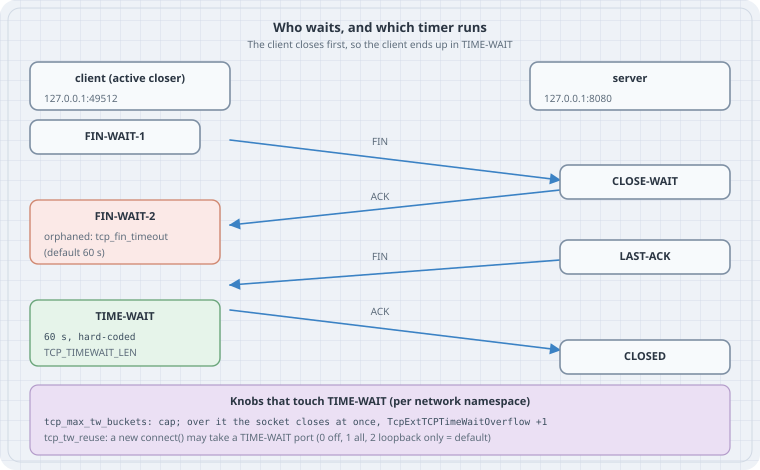

# TIME-WAIT on Linux: What the Timers Really Do

## Learning goals

- Say which end of a connection holds `TIME-WAIT`, and why
- Read the `timer:(timewait,…)` field in `ss -o` and tell `TIME-WAIT` from an orphaned `FIN-WAIT-2`
- Explain why `net.ipv4.tcp_fin_timeout` does **not** shorten `TIME-WAIT` on Linux
- Recognise source-port exhaustion (`EADDRNOTAVAIL`) and fix it in the right order: pooling first, then `tcp_tw_reuse`, never `tcp_max_tw_buckets`

## Thesis

`TIME-WAIT` is the price the **active closer** pays so that old segments of a connection die before the same four-tuple is used again. RFC 9293 asks for 2×MSL. Linux pays a fixed 60 seconds: `TCP_TIMEWAIT_LEN (60*HZ)` in `include/net/tcp.h`. No sysctl changes it. The sysctl most people reach for, `tcp_fin_timeout`, times a *different* state. If short connections run you out of ports, the fix is fewer connections (pooling, keep-alive), not a shorter wait.

## Mental model

{fig-alt="Sequence of a TCP close. The client calls close and sends FIN, entering FIN-WAIT-1. The server ACKs; the client moves to FIN-WAIT-2, which tcp_fin_timeout limits only if the application already closed the socket. The server, in CLOSE-WAIT, closes and sends FIN, entering LAST-ACK. The client ACKs and enters TIME-WAIT for TCP_TIMEWAIT_LEN, a fixed 60 seconds. The server reaches CLOSED when that ACK arrives. A note box lists tcp_max_tw_buckets, which caps the number of TIME-WAIT sockets, and tcp_tw_reuse, which lets a new outgoing connect reuse a TIME-WAIT port."}

Three facts carry the whole chapter:

1. **Whoever sends the first FIN waits.** It is a role, not "the client" or "the server". An HTTP server that closes idle keep-alive connections collects `TIME-WAIT` itself.
2. **`TIME-WAIT` costs a four-tuple, not much memory.** Linux swaps the full socket for a small `tcp_timewait_sock`. The scarce thing is the *local port* toward one destination `(dst IP, dst port)`.
3. **Two timers, two states.** `TIME-WAIT` is always 60 s. An *orphaned* `FIN-WAIT-2` (the app called `close()`, the peer never sent its FIN) is limited by `tcp_fin_timeout`.

## Why the wait exists (RFC 9293, §3.6)

- **Late duplicates.** A segment delayed in the network must not be accepted by a *new* connection that reuses the same four-tuple and happens to have an overlapping sequence space.
- **The last ACK can be lost.** If the final ACK is lost, the peer resends its FIN. The side in `TIME-WAIT` still has state and re-ACKs it. Without that state it would answer with RST, and the peer would log an error for a connection that actually closed cleanly.

RFC 9293 sets the wait at 2×MSL, with MSL "arbitrarily defined to be 2 minutes" (4 minutes in total). Linux chose 60 s long ago and wrote it as a compile-time constant.

## What the kernel source says

From Linux 6.12 (`include/net/tcp.h`):

```c
#define TCP_TIMEWAIT_LEN (60*HZ) /* how long to wait to destroy TIME-WAIT
				  * state, about 60 seconds	*/
#define TCP_FIN_TIMEOUT	TCP_TIMEWAIT_LEN
```

In `tcp_time_wait()` (`net/ipv4/tcp_minisocks.c`), a real `TIME-WAIT` socket always gets the constant:

```c
		if (state == TCP_TIME_WAIT)
			timeo = TCP_TIMEWAIT_LEN;
```

`tcp_close()` (`net/ipv4/tcp.c`) is where `tcp_fin_timeout` comes in. When an application closes a socket that is in `FIN-WAIT-2`, the kernel parks it as a time-wait mini-socket *in substate `FIN-WAIT-2`*, with the `tcp_fin_timeout` value as its timer:

```c
			const int tmo = tcp_fin_time(sk);

			if (tmo > TCP_TIMEWAIT_LEN) {
				inet_csk_reset_keepalive_timer(sk,
						tmo - TCP_TIMEWAIT_LEN);
			} else {
				tcp_time_wait(sk, TCP_FIN_WAIT2, tmo);
```

That explains the odd `ss` line you will see in Lab 1: state `fin-wait-2` with a `timewait` timer.

The ip-sysctl documentation says the same thing in prose: `tcp_fin_timeout` is "the length of time an orphaned (no longer referenced by any application) connection will remain in the FIN_WAIT_2 state before it is aborted at the local end."

## The knobs, and what each one really does

| Sysctl (per network namespace) | Default | Effect on `TIME-WAIT` |
|---|---|---|
| `net.ipv4.tcp_fin_timeout` | 60 | None. Limits orphaned `FIN-WAIT-2` only |
| `net.ipv4.tcp_max_tw_buckets` | depends on memory (65536 in the lab below) | A cap. Over it, a closing socket skips `TIME-WAIT` and is destroyed at once (`TcpExtTCPTimeWaitOverflow`). The docs: "you _must_ not lower the limit artificially" |
| `net.ipv4.tcp_tw_reuse` | 2 | A new **outgoing** `connect()` may take over a `TIME-WAIT` four-tuple if both ends used TCP timestamps and the newest timestamp is from an earlier second. 0 = off, 1 = all, 2 = loopback only |
| `net.ipv4.tcp_tw_recycle` | removed | Removed in Linux 4.12. It broke clients behind NAT. Old tuning guides that set it now just fail |
| `net.ipv4.ip_local_port_range` | 32768 60999 | How many source ports a client has per destination |

## Lab 1: watch the timers (run, no sudo)

Everything below runs inside `unshare -rn`: a private network namespace in which you are root, so its TCP sysctls are yours to change and the host is not affected. You need Python 3 and `ss`/`nstat` from iproute2. These are genuine outputs from Linux 6.12.

`tw.py` opens N connections on loopback and always closes the client side first:

```python
"""Make TCP connections on loopback and close them from the client side.

usage: python3 tw.py PORT N {both-close|server-holds} SECONDS
  both-close    the client closes first, the server closes on EOF  -> client in TIME-WAIT
  server-holds  the client closes, the server never does           -> client in FIN-WAIT-2
The server sockets stay alive for SECONDS so ss can look at them.
"""
import socket, sys, time

port, n, mode, hold = int(sys.argv[1]), int(sys.argv[2]), sys.argv[3], float(sys.argv[4])
srv = socket.socket(); srv.bind(("127.0.0.1", port)); srv.listen(64)
kept = []
for _ in range(n):
    c = socket.create_connection(("127.0.0.1", port))
    s, _ = srv.accept()
    c.close()                      # the client sends FIN first: the active closer
    if mode == "both-close":
        s.recv(1)                  # read the EOF
        s.close()                  # the server's FIN completes the close
    else:
        kept.append(s)             # never close: the client waits in FIN-WAIT-2
time.sleep(hold)
```

`lab.sh` drives it and reads the timers back with `ss -o`:

```sh
#!/bin/sh
# Run as: unshare -rn sh lab.sh   (a private network namespace; its TCP sysctls are its own)
ip link set lo up
P=/proc/sys/net/ipv4
show() { ss -tano state "$1" "( dport = :$2 )" | sed 1d | sed "s/^/$1  /"; }

echo "== 1. defaults in a fresh namespace"
for k in tcp_fin_timeout tcp_max_tw_buckets tcp_tw_reuse; do echo "$k = $(cat $P/$k)"; done

echo "== 2. client closes first: who holds TIME-WAIT, for how long?"
python3 tw.py 8001 3 both-close 0; show time-wait 8001
ss -tanH "( sport = :8001 )" | wc -l | sed 's/^/server-side sockets left: /'

echo "== 3. tcp_fin_timeout=5 does not shorten TIME-WAIT"
echo 5 > $P/tcp_fin_timeout
python3 tw.py 8002 2 both-close 0; show time-wait 8002

echo "== 4. ...it times FIN-WAIT-2 for sockets the app already closed"
python3 tw.py 8003 2 server-holds 7 & sleep 0.5; show fin-wait-2 8003
sleep 5; echo "after 5.5 s:"; ss -tanH "( dport = :8003 )" | wc -l | sed 's/^/client sockets left: /'; wait

echo "== 5. tcp_max_tw_buckets=2: the third socket skips TIME-WAIT"
echo 60 > $P/tcp_fin_timeout
sleep 75                                    # let every earlier TIME-WAIT socket be reaped
echo "TIME-WAIT sockets before: $(ss -tanH state time-wait | wc -l)"
echo 2 > $P/tcp_max_tw_buckets
before=$(nstat -az TcpExtTCPTimeWaitOverflow | awk '/Overflow/{print $2}')
python3 tw.py 8005 5 both-close 0; show time-wait 8005
after=$(nstat -az TcpExtTCPTimeWaitOverflow | awk '/Overflow/{print $2}')
echo "TcpExtTCPTimeWaitOverflow: $before -> $after"
```

```text
$ unshare -rn sh lab.sh
== 1. defaults in a fresh namespace
tcp_fin_timeout = 60
tcp_max_tw_buckets = 65536
tcp_tw_reuse = 2
== 2. client closes first: who holds TIME-WAIT, for how long?
time-wait  0      0          127.0.0.1:37370    127.0.0.1:8001 timer:(timewait,59sec,0)
time-wait  0      0          127.0.0.1:37366    127.0.0.1:8001 timer:(timewait,59sec,0)
time-wait  0      0          127.0.0.1:37386    127.0.0.1:8001 timer:(timewait,59sec,0)
server-side sockets left: 0
== 3. tcp_fin_timeout=5 does not shorten TIME-WAIT
time-wait  0      0          127.0.0.1:47914    127.0.0.1:8002 timer:(timewait,59sec,0)
time-wait  0      0          127.0.0.1:47930    127.0.0.1:8002 timer:(timewait,59sec,0)
== 4. ...it times FIN-WAIT-2 for sockets the app already closed
fin-wait-2  0      0          127.0.0.1:38132    127.0.0.1:8003 timer:(timewait,4.516sec,0)
fin-wait-2  0      0          127.0.0.1:38116    127.0.0.1:8003 timer:(timewait,4.516sec,0)
after 5.5 s:
client sockets left: 0
== 5. tcp_max_tw_buckets=2: the third socket skips TIME-WAIT
TIME-WAIT sockets before: 0
time-wait  0      0          127.0.0.1:56858    127.0.0.1:8005 timer:(timewait,59sec,0)
time-wait  0      0          127.0.0.1:56848    127.0.0.1:8005 timer:(timewait,59sec,0)
TcpExtTCPTimeWaitOverflow: 0 -> 3
```

Reading it:

- **Step 2.** Only the client's sockets (destination port 8001) are in `TIME-WAIT`, each with `timewait,59sec`. The server, the passive closer, kept nothing.
- **Step 3.** With `tcp_fin_timeout` at 5, new `TIME-WAIT` sockets still start at 59 s. The constant wins.
- **Step 4.** The server never closes, so the client (already closed by the app) sits in `FIN-WAIT-2`. *This* timer is ~4.5 s, the 5 s `tcp_fin_timeout`, and 5.5 s later the client side is gone. The kernel stores it as a time-wait mini-socket, which is why `ss` prints `timewait` as the timer name for a `fin-wait-2` row.
- **Step 5.** With the cap at 2, two sockets enter `TIME-WAIT` and three are destroyed on the spot, counted by `TcpExtTCPTimeWaitOverflow`. That is the lost-ACK protection gone for those three. The only trace is that counter (6.12 prints no log line), so this setting is a DoS brake, not a tuning knob.

A detail you will hit in your own experiments: a `TIME-WAIT` socket can linger a few seconds past 60 s, shown as `timer:(timewait,,0)`. That's because long kernel timers are batched on a coarse timer wheel. Wait about 70 s between runs, or use a new port each time as the scripts above do.

## Lab 2: port exhaustion and the fixes (run, no sudo)

Each `TIME-WAIT` socket holds one local port toward one `(dst IP, dst port)`. A client that opens a new connection per request to the same backend uses up `ip_local_port_range` within the 60 s. `exhaust.py` makes it quick by shrinking the range to four ports:

```python
"""Open-and-close short connections until connect() runs out of source ports.

usage: python3 exhaust.py ATTEMPTS [PAUSE]
Each round: connect, server closes on EOF after the client closes (client keeps TIME-WAIT).
"""
import errno, socket, sys, time

attempts = int(sys.argv[1]); pause = float(sys.argv[2]) if len(sys.argv) > 2 else 0
srv = socket.socket(); srv.bind(("127.0.0.1", 8080)); srv.listen(64)
for i in range(1, attempts + 1):
    try:
        c = socket.create_connection(("127.0.0.1", 8080))
    except OSError as e:
        print(f"connect {i}: {errno.errorcode[e.errno]} ({e.strerror})")
        continue
    port = c.getsockname()[1]
    s, _ = srv.accept(); c.close(); s.recv(1); s.close()
    print(f"connect {i}: ok, source port {port}")
    time.sleep(pause)
```

`pool.py` sends 1000 small requests, either with a new connection each or over one kept-open connection:

```python
"""The same 1000 requests, once with a new connection each, once over one kept connection."""
import socket, subprocess, sys

def tw():
    out = subprocess.run(["ss", "-tanH", "state", "time-wait", f"( dport = :{port} )"], capture_output=True, text=True).stdout
    return len(out.splitlines())

mode, port = sys.argv[1], int(sys.argv[2])
srv = socket.socket(); srv.bind(("127.0.0.1", port)); srv.listen(64)
if mode == "new-per-request":
    for _ in range(1000):
        c = socket.create_connection(("127.0.0.1", port)); s, _ = srv.accept()
        c.sendall(b"GET\n"); s.recv(4); s.sendall(b"OK\n"); c.recv(3)
        c.close(); s.recv(1); s.close()
else:  # pooled
    c = socket.create_connection(("127.0.0.1", port)); s, _ = srv.accept()
    for _ in range(1000):
        c.sendall(b"GET\n"); s.recv(4); s.sendall(b"OK\n"); c.recv(3)
    c.close(); s.recv(1); s.close()
print(f"{mode:16} 1000 requests -> {tw()} sockets in TIME-WAIT")
```

```sh
#!/bin/sh
# Run as: unshare -rn sh lab2.sh
ip link set lo up
P=/proc/sys/net/ipv4
echo 40000 40003 > $P/ip_local_port_range      # four source ports, to make exhaustion quick
echo "== 6. tcp_tw_reuse=0: four ports, six connections"
echo 0 > $P/tcp_tw_reuse
python3 exhaust.py 6
sleep 75
echo "== 7. tcp_tw_reuse=2 (loopback): same six, 1.1 s apart"
echo 2 > $P/tcp_tw_reuse
python3 exhaust.py 6 1.1
echo "== 8. one connection per request vs one pooled connection"
echo "32768 60999" > $P/ip_local_port_range
python3 pool.py new-per-request 9001
python3 pool.py pooled 9002
```

```text
$ unshare -rn sh lab2.sh
== 6. tcp_tw_reuse=0: four ports, six connections
connect 1: ok, source port 40002
connect 2: ok, source port 40000
connect 3: ok, source port 40001
connect 4: ok, source port 40003
connect 5: EADDRNOTAVAIL (Cannot assign requested address)
connect 6: EADDRNOTAVAIL (Cannot assign requested address)
== 7. tcp_tw_reuse=2 (loopback): same six, 1.1 s apart
connect 1: ok, source port 40000
connect 2: ok, source port 40002
connect 3: ok, source port 40002
connect 4: ok, source port 40002
connect 5: ok, source port 40002
connect 6: ok, source port 40000
== 8. one connection per request vs one pooled connection
new-per-request  1000 requests -> 1000 sockets in TIME-WAIT
pooled           1000 requests -> 1 sockets in TIME-WAIT
```

- **Step 6.** With reuse off, four connections fit and the fifth `connect()` fails with `EADDRNOTAVAIL`. That error, not "too many open files", is what port exhaustion looks like to the application.
- **Step 7.** With `tcp_tw_reuse=2` and loopback, all six work: the kernel takes over a `TIME-WAIT` port (40002 is used four times). It does this only because Linux sends TCP timestamps by default, which lets PAWS (RFC 7323) reject old duplicates. The source (`tcp_twsk_unique()` in `net/ipv4/tcp_ipv4.c`) also requires the last timestamp to be from an earlier second; that is why the script pauses 1.1 s.
- **Step 8.** The real fix. The same 1000 requests leave 1000 `TIME-WAIT` sockets, or 1 when they share a connection.

The default `2` explains a common surprise: reuse "works" in a laptop benchmark against `localhost` and does nothing against a remote backend. For non-loopback traffic you have to set `1` yourself.

## Case: the proxy that ran out of ports

A reverse proxy forwards to a single backend `10.0.0.5:8080` and opens a new upstream connection per request, closing it after the response. At 600 requests/s it holds about 600 × 60 = 36,000 `TIME-WAIT` sockets toward one destination. That is more than the 28,232 ports in the default range, so upstream `connect()` calls begin to fail with `EADDRNOTAVAIL`.

The fixes, in order:

1. **Keep upstream connections alive and pool them.** For nginx, use `keepalive` in the `upstream` block with `proxy_http_version 1.1` and an empty `Connection` header. For an HTTP client library, reuse the client object. This removes the problem instead of hiding it.
2. **Let the side that can afford it close.** If the backend closes, its `TIME-WAIT` is keyed on *its* listening port with many client ports, which never exhausts anything.
3. **Spread the four-tuple.** More backend IPs or ports, or more proxy source IPs (`proxy_bind`), each give a fresh 28k ports.
4. **Then, maybe, `tcp_tw_reuse=1`** on the client host, knowing it relies on timestamps on both ends.
5. **Widen `ip_local_port_range`** if you must, but avoid ports that local services listen on.

Never: lower `tcp_max_tw_buckets`, set the removed `tcp_tw_recycle`, or "fix" it with `SO_LINGER` timeout 0. That last one sends RST instead of FIN and throws away unsent data.

## Trap

Counting `TIME-WAIT` sockets and panicking. Thousands of them on a busy web server are normal and cheap. Measure the symptom instead: `EADDRNOTAVAIL` in client logs, or `TIME-WAIT` grouped by destination nearing your port range:

```sh
ss -tanH state time-wait | awk '{print $4}' | sort | uniq -c | sort -rn | head
```

## Boring rule

Leave the `TIME-WAIT` sysctls alone. Pool connections to the same destination, and only if a measured shortage remains, turn on `tcp_tw_reuse=1` on the side that connects.

## Try this

1. In Lab 1, make the *server* close first (call `s.close()` before `c.close()`) and check which port now shows up in `TIME-WAIT`.
2. Set `tcp_fin_timeout` to 90 and repeat step 4. `tcp_close()` now uses a keepalive timer for the first 30 s, so a `fin-wait-2` row should show a different timer name. Check it with `ss -o`.
3. Turn timestamps off (`echo 0 > /proc/sys/net/ipv4/tcp_timestamps` inside the namespace) and rerun step 7. Predict the result first.
4. Change `pool.py` so that the server closes each connection first, then count `TIME-WAIT` by local port instead of by destination port.

## Verification

- Both labs were run on Linux 6.12 with iproute2 `ss`/`nstat` and Python 3, inside `unshare -rn` as an unprivileged user. The outputs above are genuine and unedited.
- The kernel excerpts are from the v6.12 tag. `tcp_tw_reuse_delay` (a later addition for tuning the one-second rule) is not present on 6.12 and is not covered here.

## Sources

- RFC 9293, *Transmission Control Protocol*, §3.3.2 (state diagram) and §3.6 (closing a connection): <https://www.rfc-editor.org/rfc/rfc9293>
- RFC 7323, *TCP Extensions for High Performance* (timestamps, PAWS): <https://www.rfc-editor.org/rfc/rfc7323>
- Linux ip-sysctl documentation (`tcp_fin_timeout`, `tcp_max_tw_buckets`, `tcp_tw_reuse`): <https://docs.kernel.org/networking/ip-sysctl.html>
- Linux v6.12 source: `include/net/tcp.h`, `net/ipv4/tcp.c` (`tcp_close`), `net/ipv4/tcp_minisocks.c` (`tcp_time_wait`), `net/ipv4/tcp_ipv4.c` (`tcp_twsk_unique`): <https://github.com/torvalds/linux/tree/v6.12/net/ipv4>
- Removal of `tcp_tw_recycle` (Linux 4.12): <https://git.kernel.org/pub/scm/linux/kernel/git/torvalds/linux.git/commit/?id=4396e46187ca5070219b81773c4e65088dac50cc>
- nginx `upstream keepalive`: <https://nginx.org/en/docs/http/ngx_http_upstream_module.html#keepalive>
- ss(8): <https://man7.org/linux/man-pages/man8/ss.8.html>
