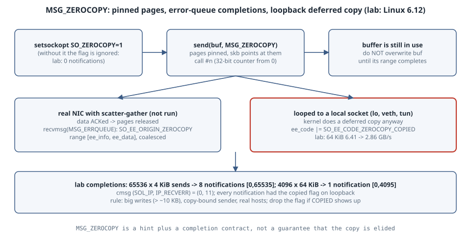

# Zero-Copy Sends with MSG_ZEROCOPY: Completions, Deferred Copies, and When It Loses

## Learning goals

- Explain what `MSG_ZEROCOPY` changes about `send()`. The kernel pins your pages instead of copying them, which means **you may not reuse the buffer until the kernel says so**.
- Turn the feature on correctly. `SO_ZEROCOPY` has to be set first, because without it the flag is silently ignored.
- Read completion notifications from the socket **error queue** (`MSG_ERRQUEUE`), including the coalesced ranges and the `SO_EE_CODE_ZEROCOPY_COPIED` flag.
- Predict when zero-copy is slower than copying (small writes, loopback and veth, NICs without scatter-gather), and measure it rather than assume.

Version note: the lab ran on Linux **6.12** with plain Python 3 sockets, with no root and no extra packages. The constants come from the kernel UAPI headers because Python's `socket` module does not export them. Every number below comes from the pasted run. Throughput on a shared box varies by tens of percent between runs, so read the shape of the results, not the digits.

{fig-alt="The application sets SO_ZEROCOPY on a TCP socket, then calls send with MSG_ZEROCOPY. Instead of copying the buffer into kernel memory, the kernel pins the user pages and builds packets that point at them, and each send call gets a sequence number counting from zero. When the data is acknowledged or otherwise no longer needed, the kernel queues a notification on the socket's error queue. The notification is a sock_extended_err with origin SO_EE_ORIGIN_ZEROCOPY and a range of sequence numbers, and consecutive notifications are coalesced into one range. Only then may the application reuse those buffers. A side path shows that when packets are looped to a local socket, including loopback, a veth pair to another namespace, tun devices and packet sockets, the kernel performs a deferred copy and sets SO_EE_CODE_ZEROCOPY_COPIED, so there is no saving, only extra cost. The lab measured exactly that on loopback: zero-copy was the same speed at 4 KiB and slower at 64 KiB and 1 MiB, and every notification carried the copied flag."}

## The contract

Per the kernel's [MSG_ZEROCOPY documentation](https://docs.kernel.org/networking/msg_zerocopy.html):

- **Socket setup.** `send()` ignores flags it does not know, so the kernel will not enable copy avoidance just because a legacy program happens to pass the bit. You must first set `setsockopt(fd, SOL_SOCKET, SO_ZEROCOPY, 1)`.
- **Transmission.** `send(fd, buf, len, MSG_ZEROCOPY)`. The call can fail with `ENOBUFS` if the socket exceeds its optmem limit or the user exceeds the locked-pages ulimit. Calls with and without the flag can be mixed on the same socket.
- **Completion.** Each successful zero-copy send call increments an unsigned 32-bit counter, starting at 0. It counts system calls, not bytes. When the kernel is done with the pages, it queues a `sock_extended_err` with `ee_origin = SO_EE_ORIGIN_ZEROCOPY`. `ee_info` holds the first number of the completed range and `ee_data` the last. Consecutive completions are **coalesced**, and for TCP there is usually at most one outstanding. The notification has a zero error code, so it does not block normal `send`/`recv`.
- **Deferred copies.** The flag is "a hint ... not a guarantee". If the kernel had to copy after all, it sets `SO_EE_CODE_ZEROCOPY_COPIED` in `ee_code`, and a program can then stop passing the flag.
- **Loopback.** All `MSG_ZEROCOPY` packets "looped to a local socket will incur a deferred copy", because a local receiver might never read and the pages would stay pinned indefinitely.
- **Size.** Page pinning and notification costs mean it is "generally only effective at writes over around 10 KB".

## Lab: measure it on loopback

```python
#!/usr/bin/env python3
"""MSG_ZEROCOPY over TCP: send, then read completions from the error queue."""
import socket, struct, sys, threading, time

SO_ZEROCOPY = 60          # asm-generic/socket.h
MSG_ZEROCOPY = 0x4000000  # linux/socket.h
SO_EE_ORIGIN_ZEROCOPY = 5
SO_EE_CODE_ZEROCOPY_COPIED = 1

def sink(srv):
    c, _ = srv.accept()
    while c.recv(1 << 20):
        pass

def run(addr, size, count, zc, flag_only=False):
    fam = socket.AF_INET6 if ':' in addr else socket.AF_INET
    srv = socket.socket(fam, socket.SOCK_STREAM); srv.bind((addr, 0)); srv.listen()
    threading.Thread(target=sink, args=(srv,), daemon=True).start()
    s = socket.socket(fam, socket.SOCK_STREAM)
    if zc and not flag_only:
        s.setsockopt(socket.SOL_SOCKET, SO_ZEROCOPY, 1)
    s.connect(srv.getsockname()[:2])
    buf = bytearray(size)
    t = time.perf_counter(); c0 = time.thread_time()
    for _ in range(count):
        s.sendall(buf, MSG_ZEROCOPY if zc else 0)
    # drain notifications
    lo = hi = None; copied = 0; notes = 0; first = None
    if zc:
        deadline = time.time() + (0.5 if flag_only else 2)
        while time.time() < deadline and (hi is None or hi < count - 1):
            try:
                _, anc, _, _ = s.recvmsg(0, 512, socket.MSG_ERRQUEUE | socket.MSG_DONTWAIT)
            except BlockingIOError:
                time.sleep(0.001); continue
            for lvl, typ, data in anc:
                first = first or (lvl, typ)
                errno_, origin, _t, code, _p, info, data_ = struct.unpack('IBBBBII', data[:16])
                if origin == SO_EE_ORIGIN_ZEROCOPY:
                    notes += 1
                    lo = info if lo is None else min(lo, info)
                    hi = data_ if hi is None else max(hi, data_)
                    copied += code & SO_EE_CODE_ZEROCOPY_COPIED
    el = time.perf_counter() - t; cpu = time.thread_time() - c0
    s.close()
    print(f"  {addr:9} size={size:>7} zc={int(zc)} sends={count} "
          f"{size*count/el/1e9:6.2f} GB/s sender_cpu={cpu:5.2f}s"
          + (f" notifications={notes} range=[{lo},{hi}] copied_flag={copied} cmsg={first}" if zc else "")
          + (" (MSG_ZEROCOPY without SO_ZEROCOPY)" if flag_only else ""))

print("== loopback TCP, 256 MiB per run (per-run sizes below)")
for addr in ('127.0.0.1',):
    for size in (4096, 65536, 1048576):
        cnt = max(200, (256 << 20) // size)
        run(addr, size, cnt, False); run(addr, size, cnt, True)
print("== flag passed but socket option not set")
run('127.0.0.1', 65536, 64, True, flag_only=True)
```

```text
$ python3 zc.py
== loopback TCP, 256 MiB per run (per-run sizes below)
  127.0.0.1 size=   4096 zc=0 sends=65536   2.46 GB/s sender_cpu= 0.10s
  127.0.0.1 size=   4096 zc=1 sends=65536   2.47 GB/s sender_cpu= 0.11s notifications=8 range=[0,65535] copied_flag=8 cmsg=(0, 11)
  127.0.0.1 size=  65536 zc=0 sends=4096   6.41 GB/s sender_cpu= 0.04s
  127.0.0.1 size=  65536 zc=1 sends=4096   2.86 GB/s sender_cpu= 0.08s notifications=1 range=[0,4095] copied_flag=1 cmsg=(0, 11)
  127.0.0.1 size=1048576 zc=0 sends=256   8.80 GB/s sender_cpu= 0.03s
  127.0.0.1 size=1048576 zc=1 sends=256   5.45 GB/s sender_cpu= 0.05s notifications=1 range=[0,255] copied_flag=1 cmsg=(0, 11)
== flag passed but socket option not set
  127.0.0.1 size=  65536 zc=1 sends=64   0.01 GB/s sender_cpu= 0.01s notifications=0 range=[None,None] copied_flag=0 cmsg=None (MSG_ZEROCOPY without SO_ZEROCOPY)
```

## Reading the numbers

- **The flag without the socket option does nothing.** There were no notifications and no error, so the last run behaved exactly like a normal copy. Its GB/s figure is meaningless because it includes the script's 0.5-second wait for notifications that never come. This is the documented legacy-safety behaviour, and it is also the most common bug: "we enabled zero-copy" when nothing changed.
- **Completions really are coalesced.** 65,536 sends of 4 KiB produced only **8** notifications covering `[0, 65535]`. The 64 KiB and 1 MiB runs produced a **single** notification for the whole run. Your reclaim loop must handle ranges, not one completion per send. The ranges end exactly at `sends − 1`, which confirms the counter counts calls: every Python `sendall()` here was satisfied by a single `send` syscall.
- **The control message is `(0, 11)`**, which is `SOL_IP`/`IP_RECVERR`. That matches the documentation (IPv6 sockets report `IPV6_RECVERR`).
- **Every notification carried `copied_flag`.** On loopback the kernel copied anyway, later. The result is no gain at 4 KiB, and **a loss** at 64 KiB (6.41 → 2.86 GB/s) and 1 MiB (8.80 → 5.45 GB/s), with more sender CPU. You pay for pinning, notifications **and** a copy that is now cold in cache.

## What changes on a real NIC (not run here)

The box has no physical NIC to test against. Between two hosts, the selftest `tools/testing/selftests/net/msg_zerocopy.c` (driven by `msg_zerocopy.sh`) is the reference measurement. The documentation warns that running it between namespaces over veth "will not show any improvement", for the same loopback reason seen above. Expect gains only when all of these hold:

- writes are large (well above about 10 KB) and the sender is CPU-bound on copies
- the NIC does scatter-gather, so the kernel can send headers and user pages together
- the application can afford to hold buffers until completion, which is easiest with a ring of buffers reclaimed on each notification range

`ss -tmi` and `perf top` (look for `copy_user_*` / `_copy_from_iter`) on the sender are the quickest ways to see whether copying was the bottleneck in the first place.

## The boring rule

- Default to copying. Try `MSG_ZEROCOPY` only for big writes on a sender proven to be copy-bound.
- Always set `SO_ZEROCOPY`, always drain `MSG_ERRQUEUE` (non-blocking, every few sends), and never touch a buffer before its range completes.
- Watch `SO_EE_CODE_ZEROCOPY_COPIED`. If it shows up on a path, turn the flag off for that socket.
- Benchmark between real hosts, never over loopback or veth.

## Try this

1. Change the address to `::1`. What `cmsg` level and type do you see now?
2. Drain the error queue after every 16 sends instead of at the end. Does the notification count go up?
3. Lower the locked-memory limit (`ulimit -l 64`) and try 1 MiB sends. Do you get `ENOBUFS`, or does the deferred-copy path on loopback avoid pinning altogether?

## Sources

- Linux kernel documentation, *MSG_ZEROCOPY*: <https://docs.kernel.org/networking/msg_zerocopy.html>
- Kernel selftest `tools/testing/selftests/net/msg_zerocopy.c`: <https://git.kernel.org/pub/scm/linux/kernel/git/torvalds/linux.git/tree/tools/testing/selftests/net/msg_zerocopy.c>
- UAPI constants: `include/uapi/asm-generic/socket.h` (`SO_ZEROCOPY` 60), `include/linux/socket.h` (`MSG_ZEROCOPY`), `include/uapi/linux/errqueue.h` (`sock_extended_err`, `SO_EE_ORIGIN_ZEROCOPY`, `SO_EE_CODE_ZEROCOPY_COPIED`)
- W. de Bruijn, *sendmsg copy avoidance with MSG_ZEROCOPY* (netdev 2.1, 2017; paper, slides, video): <https://netdevconf.org/2.1/session.html?debruijn>
- recvmsg(2) and ip(7), `MSG_ERRQUEUE` / `IP_RECVERR`: <https://man7.org/linux/man-pages/man7/ip.7.html>
