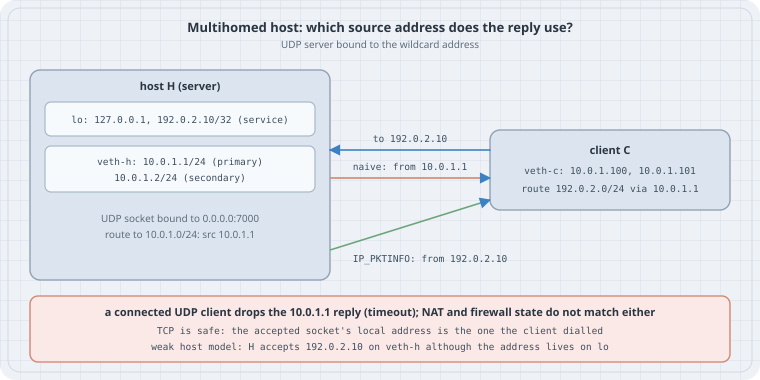

# Multihomed Linux Hosts: Source Address Selection, Binding and Replying from the Right Address

A host with a single network interface and a single IPv4 address rarely surprises you with its source address: there is only one address it can use. Production hosts are seldom that simple. A server often carries a management address on one NIC, a data-plane address on another, a virtual IP (VIP) managed by a failover daemon, or a `/32` service address on `lo` announced into the network with BGP or ECMP. The moment a host holds more than one IPv4 address, every outbound packet and every reply to an inbound request requires a decision: which local address goes into the IPv4 source field?

When that decision goes wrong, the symptoms look like network blackholes or flaky firewalls. A client sends a DNS or NTP query to a service VIP on `lo`, and the server's reply leaves with the primary IP of the outbound Ethernet interface instead. A connected UDP client drops the reply immediately because the source address does not match the peer it connected to. A stateful firewall or NAT gateway drops it because the 5-tuple does not match any open flow. On the client side, an application trying to pin outbound connections to a specific source IP can accidentally burn through its entire ephemeral port range, or fail to start altogether if its assigned VIP has not been added to the interface yet.

This chapter explains how the Linux IPv4 stack models local addresses, how it chooses a source address when a socket does not specify one, why TCP and UDP behave differently on wildcard binds, and which socket options and sysctls give an operator or application exact control. Everything is demonstrated in a rootless two-namespace lab so you can observe the routing decisions and packet behavior without touching a host interface.

## Learning goals

- Explain the difference between the weak end system model (Linux's default for IPv4) and the strong end system model from RFC 1122 section 3.3.4.
- Trace how the kernel selects a source IPv4 address for an unbound socket using the route's preferred source (`src`) and primary vs secondary interface addresses.
- Diagnose why a UDP server bound to `0.0.0.0` replies from the wrong source address on a multihomed host, and fix it with `IP_PKTINFO` (or per-address sockets).
- Contrast TCP's accepted-socket behavior with unconnected UDP sockets.
- Control client-side source selection with `bind()`, avoid ephemeral port exhaustion with `IP_BIND_ADDRESS_NO_PORT`, and allow early binds with `IP_FREEBIND` or `ip_nonlocal_bind`.
- Predict the on-link routing fallback triggered by `SO_BINDTODEVICE` when an interface has no matching route.
- Manage primary address deletion safely using `promote_secondaries`.

## Version note

The lab in this chapter was executed on Linux 6.12 with Python 3.13.5, running unprivileged inside user and network namespaces (`unshare -rn`). The socket options and sysctls discussed here are long-standing Linux IPv4 interfaces: `IP_PKTINFO` and `IP_FREEBIND` date back to Linux 2.2/2.4, `IP_BIND_ADDRESS_NO_PORT` was added in Linux 4.2. Production configuration snippets for `systemd-networkd` and Netplan are shown for reference and were not executed in the lab.

## The host model and local addresses

When you think about IP addresses on a host, it is natural to assume an address belongs to the physical or virtual interface you assigned it to. In RFC 1122 section 3.3.4, that mental model is called the **strong end system** model: an interface only accepts packets destined for addresses configured on that interface, and only sends packets sourced from an address configured on that interface.

Linux implements the **weak end system** model for IPv4 by default. In the weak model, IP addresses belong to the host as a whole, not to individual interfaces. When you add `192.0.2.10/32` to `lo` and `10.0.1.1/24` to `veth-h`, the kernel inserts both addresses as `local` routes into routing table `local` (table 255). When a packet arrives on `veth-h` addressed to `192.0.2.10`, the kernel looks up the destination in table `local`, sees that `192.0.2.10` is a local address of the host, and accepts the packet for local delivery—even though `192.0.2.10` is configured on `lo`, not `veth-h`.

```text
Inbound packet: dst = 192.0.2.10
       |
       v
  [ NIC: veth-h ]  (configured with 10.0.1.1/24)
       |
       v
  [ Routing lookup: table local ]
       |  matches: "local 192.0.2.10 dev lo scope host"
       v
  [ Local delivery ] ---> Socket bound to 0.0.0.0 or 192.0.2.10
```

This weak-host behavior is why loopback service addresses (anycast VIPs, BGP-announced `/32` addresses, and Kubernetes/LVS VIPs on `lo`) work on Linux without needing special forwarding rules between `eth0` and `lo`.

There are two important caveats to the weak end system model on Linux:

1. **Reverse path filtering (`rp_filter`)**: While the weak model accepts packets for any local address on any interface, `net.ipv4.conf.<if>.rp_filter` checks whether the source address of an inbound packet would be routed back out the same interface it arrived on. Under strict mode (`rp_filter=1`), asymmetric traffic—where a packet arrives on `eth0` but the return route to its source goes out `eth1`—is dropped before reaching local delivery. Loose mode (`rp_filter=2`) only checks that the source is reachable via *some* interface.
2. **ARP behavior**: Because addresses belong to the host, Linux by default will answer ARP requests for any local IP on any interface (`arp_ignore=0`) and may pick any local IP as the ARP sender (`arp_announce=0`). That behavior, known as ARP flux, is covered in *Neighbour Tables, Timers, Limits and ARP Flux*.

This chapter focuses strictly on IPv4 and socket-level source selection; IPv6 uses a distinct rule-based source address selection algorithm defined in RFC 6724, which is covered in the IPv6 essentials chapter.

## How the kernel picks a source address

When an application sends an IPv4 packet without having bound its socket to a specific local IP address (for example, an unbound client calling `sendto()` or `connect()`, or a server bound to the wildcard `0.0.0.0`), the kernel must choose a source IPv4 address during route lookup.

### Route preferred source (`src`)

Every route in the main routing table can carry a preferred source attribute (`src`), documented in `ip-route(8)` as "the source address to prefer when sending to the destinations covered by the route prefix."

When you add an IPv4 address with a prefix length to an interface—such as `10.0.1.1/24` on `veth-h`—the kernel automatically creates a connected route in the main table (`proto kernel scope link`) and sets its `src` attribute to that address (`10.0.1.1`). When the kernel looks up a route to `10.0.1.100`, it matches `10.0.1.0/24` and adopts the route's `src` (`10.0.1.1`) as the packet's source address.

You can override this preference on any route with `ip route replace ... src X` (or `ip route add ... src X`). The kernel requires `X` to be an existing local IPv4 address on the host (it does not have to belong to the outgoing interface, thanks to the weak end system model). For example, an operator running a management address on `eth0` and a `/32` loopback address on `lo` can set `src 192.0.2.10` on the default route so all unbound outbound connections originate from the loopback address.

If a route has no `src` attribute—or if a socket explicitly requests a source address with `ip route get <dst> from <src>`—the routing lookup validates the requested `from` address instead of supplying a preferred source. If `ip route get` is called without `from` on a route that has no `src`, the kernel falls back to `inet_select_addr()`, which selects an address from the outgoing interface (or another interface if none exists in the matching scope).

### Primary and secondary addresses

When multiple IPv4 addresses from the **same subnet** are configured on a single interface, the kernel distinguishes between the **primary** address and **secondary** addresses:

- The **first** address added in a given subnet on an interface becomes the **primary** address.
- Every subsequent address added in that same subnet on that interface is flagged `secondary`.

The primary address matters for two reasons. First, the kernel-generated connected route (`10.0.1.0/24 proto kernel scope link`) uses the primary address as its `src` attribute, and the `local` routes in table `local` for both the primary and secondary addresses also carry `src <primary>`. Second, by default (`net.ipv4.conf.<if>.promote_secondaries=0`), deleting the primary address from an interface **deletes all secondary addresses in that subnet as well**.

Setting `net.ipv4.conf.<if>.promote_secondaries=1` (or `net.ipv4.conf.all.promote_secondaries=1`; the kernel ORs the `all` value with the per-interface value) changes this behavior: when you delete the primary address, the kernel promotes the next secondary address in that subnet to primary, updates the connected route's `src` to the promoted address, and keeps the remaining addresses alive.

| Setting | Behavior when deleting primary address | Use case |
| :--- | :--- | :--- |
| `promote_secondaries=0` (default) | Primary and all secondaries in that subnet are removed | Legacy default; dangerous when rotating IPs |
| `promote_secondaries=1` | First secondary is promoted to primary; remaining secondaries stay | Safe IP rotation, VIP failover on same subnet |

## Server-side replying: TCP vs UDP

A common pattern for network daemons is to bind to the wildcard address `0.0.0.0` so the service listens on all current and future local addresses—including loopback VIPs, physical interfaces, and dynamically added addresses. On a multihomed host, wildcard binding behaves completely differently for TCP and UDP.

### Why TCP is immune

TCP is connection-oriented. When a client sends a `SYN` packet to `192.0.2.10:7002`, the listening socket bound to `0.0.0.0:7002` accepts the connection and the kernel creates a new, established child socket returned by `accept()`. That child socket is pinned to the exact 4-tuple `(local_ip, local_port, remote_ip, remote_port)` from the incoming `SYN`. Its local address is `192.0.2.10`, regardless of what `ip route get` says the preferred source is for reaching the client. Every `SYN-ACK` and data segment on that connection is sourced from `192.0.2.10`.

### Why wildcard UDP servers reply from the wrong address

{fig-alt="Host H with 192.0.2.10/32 on lo and 10.0.1.1 primary plus 10.0.1.2 secondary on veth-h; client C at 10.0.1.100 sends to 192.0.2.10. A naive sendto reply leaves from 10.0.1.1 and a connected client drops it; an IP_PKTINFO reply leaves from 192.0.2.10. TCP is safe; Linux accepts 192.0.2.10 on veth-h because of the weak host model."}

UDP is connectionless. A UDP server bound to `0.0.0.0:7000` uses a single socket for all clients and all local addresses. When it reads a datagram with `recvfrom()`, the kernel returns the payload and the **client's** source address, but throws away the **destination** IP address that the client actually sent the packet to.

When the server calls `sendto()` to reply, the socket is still bound to `0.0.0.0`. Because the socket has no local IP pinned, the kernel performs a standard routing lookup toward the client's IP (`10.0.1.100`) and stamps the reply with the outgoing route's preferred source (`10.0.1.1`), not the loopback address (`192.0.2.10`) the client contacted.

```text
Client (10.0.1.100)                              Host H (lo: 192.0.2.10, veth-h: 10.0.1.1)
-------------------                              -----------------------------------------
1. send to 192.0.2.10:7000  ------------------>  Table local accepts 192.0.2.10
                                                 Socket (0.0.0.0:7000) calls recvfrom()
                                                   -> learns peer = 10.0.1.100
                                                   -> loses dst  = 192.0.2.10

2. Connected client drops   <------------------  Socket calls sendto(10.0.1.100)
   (expected src 192.0.2.10,                       -> route to 10.0.1.100 has src 10.0.1.1
    got src 10.0.1.1)                              -> reply sent with src = 10.0.1.1
```

If the client uses an **unconnected** UDP socket (`sendto()` / `recvfrom()`), it may accept the reply from `10.0.1.1` if no firewall intervenes, though an application checking the sender IP will notice the mismatch. If the client uses a **connected** UDP socket (`connect()` followed by `send()` / `recv()`—standard for DNS stub resolvers, WireGuard, QUIC, and many RPC clients), the client's kernel filters incoming datagrams by the connected peer address (`192.0.2.10`). The reply from `10.0.1.1` is silently dropped, and the client times out. Stateful firewalls and NAT devices along the path drop the reply for the same reason: the reverse tuple `(10.0.1.1 -> 10.0.1.100)` does not match the state created by `(10.0.1.100 -> 192.0.2.10)`.

### Fixing UDP with `IP_PKTINFO`

There are two ways to make a UDP server reply from the exact destination address a client contacted:

1. **One socket per local address**: Instead of binding to `0.0.0.0`, enumerate every local IPv4 address (for example with netlink or `getifaddrs()`) and bind a separate UDP socket to each IP. Each socket's local address is fixed, so `sendto()` always uses the right source. The downside is operational complexity: the daemon must watch for addresses being added or removed at runtime.
2. **`IP_PKTINFO` on a single wildcard socket**: Enable the `IP_PKTINFO` socket option (`setsockopt(SOL_IP, IP_PKTINFO, 1)`) and switch from `recvfrom()`/`sendto()` to `recvmsg()`/`sendmsg()`.

With `IP_PKTINFO` enabled, every `recvmsg()` call attaches a control message (ancillary data) containing `struct in_pktinfo`:

```text
struct in_pktinfo {
    unsigned int   ipi_ifindex;  /* Interface index */
    struct in_addr ipi_spec_dst; /* Local address (routing / source override) */
    struct in_addr ipi_addr;     /* Header destination address */
};
```

On **receive**, the kernel populates `ipi_ifindex` with the incoming interface index, `ipi_addr` with the destination IP address from the IPv4 header (e.g., `192.0.2.10`), and `ipi_spec_dst` with the local address the kernel associates with the packet (`ip(7)`: "the local address of the packet"); for a unicast datagram to a local address the two match.

On **send**, passing an `IP_PKTINFO` control message to `sendmsg()` lets the application force the source IP and/or outgoing interface:

- Set `ipi_spec_dst` to the address you want in the IPv4 source field (the `ipi_addr` received from the client's request).
- Leave `ipi_ifindex` as `0` so the kernel still uses the routing table to pick the outgoing interface, and leave `ipi_addr` zeroed. `ip(7)` warns that a non-zero `ipi_ifindex` makes the primary address of that interface overwrite `ipi_spec_dst` for the route lookup.

For IPv6 UDP sockets, the equivalent mechanism is `IPV6_RECVPKTINFO` / `IPV6_PKTINFO` with `struct in6_pktinfo`, defined in RFC 3542.

## Client-side binding and nonlocal addresses

Operators and application developers also need control on the outbound (client) side: choosing which source IP a connection uses, avoiding port exhaustion when doing so, and binding sockets before an address is active on the host.

### Binding before `connect()` and `IP_BIND_ADDRESS_NO_PORT`

A client can force its source IPv4 address by calling `bind((local_ip, 0))` before calling `connect((remote_ip, remote_port))`. Passing port `0` tells the kernel to pick an ephemeral port.

However, a plain `bind((local_ip, 0))` allocates an ephemeral port **at `bind()` time**, before the kernel knows the destination IP and port. Because the kernel does not yet know the 4-tuple, it must reserve a locally unique `(local_ip, local_port)` pair across the entire ephemeral port range (`net.ipv4.ip_local_port_range`, typically ~28,000 ports). A proxy or load generator opening tens of thousands of outbound connections to different backends from a single bound source IP will hit `EADDRNOTAVAIL` once those ~28,000 ports are consumed—even though a TCP connection is identified by the full 4-tuple, so the same `(local_ip, local_port)` could have served many different `(remote_ip, remote_port)` destinations.

Linux 4.2 introduced the `IP_BIND_ADDRESS_NO_PORT` socket option (option number `24` at level `IPPROTO_IP`) to solve this. When set before `bind((local_ip, 0))`:

- `bind()` records the desired source IP (`local_ip`) on the socket without allocating an ephemeral port (`getsockname()` reports port `0`).
- `connect()` then knows the full 4-tuple `(local_ip, ?, remote_ip, remote_port)` and allocates an ephemeral port that only needs to be unique for that specific destination, allowing the same ephemeral port to be reused across different destinations.

### `IP_FREEBIND` and `ip_nonlocal_bind`

By default, calling `bind()` with an IPv4 address that is not currently configured on any interface of the host fails with `EADDRNOTAVAIL` ("Cannot assign requested address"). This breaks two common operational patterns:

- **High-availability VIPs**: A service like `haproxy` or `nginx` starts at boot and binds to a cluster VIP (`203.0.113.5`) that `keepalived` or `pacemaker` will only add to the interface later when the node becomes active.
- **Boot-time races**: A daemon starts before DHCP or `systemd-networkd` finishes configuring the interface address.

There are two ways to permit binding to an address the host does not yet own:

1. **Per-socket (`IP_FREEBIND`)**: Setting `setsockopt(IPPROTO_IP, IP_FREEBIND, 1)` on the socket before `bind()` allows the bind to succeed even if the address is not local. This is the cleanest option because it scopes the permission to the specific daemon.
2. **Namespace-wide (`net.ipv4.ip_nonlocal_bind=1`)**: Setting this sysctl to `1` allows *any* socket in the network namespace to bind to a nonlocal IPv4 address without needing `IP_FREEBIND`.

Neither option makes the host answer traffic for that address on the wire—the address still must be added to an interface (or routed to the host with local delivery) before packets arrive—but both prevent the daemon from crashing at startup.

## Device pinning with `SO_BINDTODEVICE`

Sometimes binding to an IP address is not enough: a monitoring probe, DHCP client, or VRF-aware daemon needs to force traffic out of a specific network interface, regardless of what the main routing table says. The `SO_BINDTODEVICE` socket option (`socket(7)`) pins a socket to a named interface (such as `veth-c` or `eth0`).

### Interface-scoped sockets and the on-link fallback

When `SO_BINDTODEVICE` is set, the socket only receives packets that arrived on that interface, and outbound route lookups are restricted to routes whose outgoing device matches that interface.

There is a subtle kernel gotcha in this path, visible in `net/ipv4/route.c` (`ip_route_output_key_hash_rcu()` in Linux 6.12). If a socket is pinned to an interface (or `ip route get <dst> oif <dev>` is run) and **no route in the routing table matches `<dst>` via that device**, the Linux IPv4 output path does not fail with `ENETUNREACH`. Instead, it follows a fallback path documented in the kernel source with the comment `"Apparently, routing tables are wrong. Assume, that the destination is on link"`:

1. The kernel assumes `<dst>` is directly reachable on-link out of `<dev>`.
2. Because there is no route `src` attribute to consult, it calls `inet_select_addr()` to pick a source address. If `<dev>` has no IPv4 address of its own, `inet_select_addr()` walks other interfaces in the namespace and can pick an IPv4 address from a completely different interface.

The one major exception to this fallback is **VRF devices** (`l3mdev`): the kernel's on-link fallback condition excludes flows that belong to an `l3mdev`, so VRF-bound sockets do not get this fallback. VRF routing is its own topic and is not explored further here.

### Summary of controls

| Mechanism | Scope | Primary effect | Typical use case |
| :--- | :--- | :--- | :--- |
| `ip route ... src X` | Per route | Sets preferred source IP for unbound sockets | Outbound traffic from loopback `/32` |
| `promote_secondaries=1` | Interface / all | Promotes secondary IP when primary is deleted | Zero-downtime IP rotation |
| `IP_PKTINFO` | Per UDP socket | Exposes inbound dst IP; overrides outbound src IP | Wildcard (`0.0.0.0`) UDP servers |
| `IP_BIND_ADDRESS_NO_PORT` | Per socket | Defers ephemeral port allocation from `bind()` to `connect()` | High-concurrency proxies/clients |
| `IP_FREEBIND` | Per socket | Allows `bind()` to an IP not yet on the host | VIP daemons, early-boot services |
| `ip_nonlocal_bind=1` | Network namespace | Allows all sockets to bind to nonlocal IPs | Legacy daemons without `IP_FREEBIND` |
| `SO_BINDTODEVICE` | Per socket | Pins rx/tx and route lookup to one interface | Probes, multi-ISP routing, VRFs |

## The lab

The lab builds a self-contained two-namespace network (`H` for the multihomed server host, `C` for the client) using rootless user and network namespaces (`unshare -rn`). `H` has a loopback service address (`192.0.2.10/32`) and two addresses in `10.0.1.0/24` on `veth-h` (`10.0.1.1` primary, `10.0.1.2` secondary). `C` has two addresses in `10.0.1.0/24` on `veth-c` (`10.0.1.100`, `10.0.1.101`), a static route to `192.0.2.0/24` via `10.0.1.1`, and an unconfigured, isolated interface `veth-x` with no IP addresses and no routes.

```text
Namespace H (Server Host)                    Namespace C (Client)
+---------------------------+                +---------------------------+
| lo: 192.0.2.10/32         |                | veth-c: 10.0.1.100/24     |
|                           |                |         10.0.1.101/24     |
| veth-h: 10.0.1.1/24 (pri) |<==============>|                           |
|         10.0.1.2/24 (sec) |                | route: 192.0.2.0/24       |
+---------------------------+                |        via 10.0.1.1       |
                                             |                           |
                                             | veth-x: (no IP, no route) |
                                             +---------------------------+
```

### Lab files

The shell script `mh.sh` sets up both namespaces, runs the routing and `promote_secondaries` checks, and launches the Python socket tests.

```{.bash filename="mh.sh"}
#!/bin/sh
# Runs inside `unshare -rn` (the "host" H). A child network namespace is the client C.
set -e
unshare -n sleep 60 & CPID=$!
sleep 0.2
C="nsenter -t $CPID -n"
ip link set lo up
ip link add veth-h type veth peer name veth-c netns $CPID
ip addr add 10.0.1.1/24 dev veth-h
ip addr add 10.0.1.2/24 dev veth-h
ip addr add 192.0.2.10/32 dev lo
ip link set veth-h up
$C ip link set lo up
$C ip addr add 10.0.1.100/24 dev veth-c
$C ip addr add 10.0.1.101/24 dev veth-c
$C ip link set veth-c up
$C ip route add 192.0.2.0/24 via 10.0.1.1
$C ip link add veth-x type veth peer name veth-y
$C ip link set veth-x up
sleep 1
echo "== 1. Addresses and the routing decision on H =="
ip -4 -br addr show
echo "\$ ip route show dev veth-h"; ip route show dev veth-h
echo "\$ ip route get 10.0.1.100";  ip route get 10.0.1.100 | head -1
echo "\$ ip route get 10.0.1.100 from 192.0.2.10"; ip route get 10.0.1.100 from 192.0.2.10 | head -1
echo "\$ ip route show table local type local"; ip route show table local type local
echo
echo "== 2. Changing the preferred source with 'src' =="
ip route replace 10.0.1.0/24 dev veth-h proto kernel scope link src 10.0.1.2
echo "\$ ip route get 10.0.1.100"; ip route get 10.0.1.100 | head -1
ip route replace 10.0.1.0/24 dev veth-h proto kernel scope link src 10.0.1.1
echo
echo "== 3-5. Sockets =="
python3 mh.py server-naive & S1=$!
python3 mh.py server-pktinfo & S2=$!
python3 mh.py server-tcp & S3=$!
sleep 0.5
$C python3 mh.py client
kill $S1 $S2 $S3 2>/dev/null || true
python3 mh.py local-binds
$C python3 mh.py bindtodevice
echo "C: \$ ip route get 192.0.2.10 oif veth-x"; $C ip route get 192.0.2.10 oif veth-x | head -1
echo
echo "== 6. Secondary addresses and promote_secondaries =="
echo "\$ ip -4 addr show dev veth-h"; ip -4 addr show dev veth-h | grep inet
echo "promote_secondaries=$(cat /proc/sys/net/ipv4/conf/veth-h/promote_secondaries)"
ip addr del 10.0.1.1/24 dev veth-h
echo "after deleting 10.0.1.1/24:"; ip -4 addr show dev veth-h | grep inet || echo "  (no IPv4 addresses left on veth-h)"
ip addr add 10.0.1.1/24 dev veth-h; ip addr add 10.0.1.2/24 dev veth-h
echo 1 > /proc/sys/net/ipv4/conf/veth-h/promote_secondaries
ip addr del 10.0.1.1/24 dev veth-h
echo "with promote_secondaries=1, after deleting 10.0.1.1/24:"; ip -4 addr show dev veth-h | grep inet
kill $CPID
```
The Python helper `mh.py` implements the naive UDP server, the `IP_PKTINFO` UDP server, the TCP server, the client tests, the nonlocal bind tests, and the `SO_BINDTODEVICE` test.

```{.python filename="mh.py"}
import socket, struct, sys, errno
IP_PKTINFO = 8          # <linux/in.h>
IP_FREEBIND = 15
IP_BIND_ADDRESS_NO_PORT = 24
role = sys.argv[1]

if role == "server-naive":                 # bound to 0.0.0.0, replies with plain sendto()
    s = socket.socket(socket.AF_INET, socket.SOCK_DGRAM); s.bind(("0.0.0.0", 7000))
    while True:
        d, a = s.recvfrom(100); s.sendto(b"naive:" + d, a)

if role == "server-pktinfo":               # learns the destination address, replies from it
    s = socket.socket(socket.AF_INET, socket.SOCK_DGRAM); s.bind(("0.0.0.0", 7001))
    s.setsockopt(socket.IPPROTO_IP, IP_PKTINFO, 1)
    while True:
        d, anc, _, a = s.recvmsg(100, 256)
        for lvl, typ, data in anc:
            if lvl == socket.IPPROTO_IP and typ == IP_PKTINFO:
                ifindex, spec_dst, dst = struct.unpack("I4s4s", data)
                # reply: leave ifindex 0 so routing picks the interface, force the source address
                s.sendmsg([b"pktinfo:" + d], [(socket.IPPROTO_IP, IP_PKTINFO,
                           struct.pack("I4s4s", 0, dst, b"\0" * 4))], 0, a)

if role == "server-tcp":
    s = socket.socket(); s.setsockopt(socket.SOL_SOCKET, socket.SO_REUSEADDR, 1)
    s.bind(("0.0.0.0", 7002)); s.listen()
    while True:
        c, a = s.accept(); c.sendall(f"tcp: accepted on {c.getsockname()[0]}".encode()); c.close()

if role == "client":
    def udp(port, connected):
        s = socket.socket(socket.AF_INET, socket.SOCK_DGRAM); s.settimeout(0.5)
        try:
            if connected:
                s.connect(("192.0.2.10", port)); s.send(b"hi"); d = s.recv(100); src = "192.0.2.10 (connected)"
            else:
                s.sendto(b"hi", ("192.0.2.10", port)); d, (src, _) = s.recvfrom(100)
            return f"{d.decode():<12} reply source {src}"
        except socket.timeout:
            return "timeout: reply came from an address the connected socket does not accept"
    print("client 10.0.1.100 -> 192.0.2.10 (service address on H's loopback)")
    print("  naive,   unconnected:", udp(7000, False))
    print("  naive,   connected  :", udp(7000, True))
    print("  pktinfo, unconnected:", udp(7001, False))
    print("  pktinfo, connected  :", udp(7001, True))
    t = socket.create_connection(("192.0.2.10", 7002)); print(" ", t.recv(100).decode(), "| client side", t.getsockname()[0]); t.close()
    t = socket.socket(); t.bind(("10.0.1.101", 0)); t.connect(("192.0.2.10", 7002))
    print(" ", t.recv(100).decode(), "| client bound to", t.getsockname()[0]); t.close()
    t = socket.socket(); t.setsockopt(socket.IPPROTO_IP, IP_BIND_ADDRESS_NO_PORT, 1)
    t.bind(("10.0.1.101", 0)); before = t.getsockname()[1]; t.connect(("192.0.2.10", 7002))
    print(f"  IP_BIND_ADDRESS_NO_PORT: port after bind {before}, after connect {t.getsockname()[1]}"); t.close()

if role == "local-binds":
    print("binding to an address H does not have (203.0.113.5):")
    for label, opt in (("plain bind", None), ("IP_FREEBIND", IP_FREEBIND)):
        s = socket.socket(socket.AF_INET, socket.SOCK_DGRAM)
        if opt: s.setsockopt(socket.IPPROTO_IP, opt, 1)
        try:
            s.bind(("203.0.113.5", 7100)); print(f"  {label:<20}: bound {s.getsockname()}")
        except OSError as e:
            print(f"  {label:<20}: {errno.errorcode[e.errno]} ({e.strerror})")
    open("/proc/sys/net/ipv4/ip_nonlocal_bind", "w").write("1")
    s = socket.socket(socket.AF_INET, socket.SOCK_DGRAM); s.bind(("203.0.113.5", 7101))
    print(f"  {'ip_nonlocal_bind=1':<20}: bound {s.getsockname()}")
    open("/proc/sys/net/ipv4/ip_nonlocal_bind", "w").write("0")

if role == "bindtodevice":
    print("client: UDP connect() to 192.0.2.10 with the socket pinned to a device:")
    for dev in (b"veth-c", b"veth-x"):
        s = socket.socket(socket.AF_INET, socket.SOCK_DGRAM)
        s.setsockopt(socket.SOL_SOCKET, socket.SO_BINDTODEVICE, dev)
        try:
            s.connect(("192.0.2.10", 7000)); print(f"  SO_BINDTODEVICE={dev.decode():<7}: route found, source {s.getsockname()[0]}")
        except OSError as e:
            print(f"  SO_BINDTODEVICE={dev.decode():<7}: {errno.errorcode[e.errno]} ({e.strerror})")
```
The wrapper `run.sh` enters a rootless user and network namespace and executes `mh.sh` without modifying the host.

```{.bash filename="run.sh"}
#!/bin/sh
# own user + network namespaces; no sudo; the host's interfaces are untouched
unshare -rn sh mh.sh
```
To run the lab, execute `sh run.sh` from the lab directory. It uses `unshare -rn` to create private user and network namespaces and requires no `sudo` or root privileges.

### Execution output

```text
== 1. Addresses and the routing decision on H ==
lo               UNKNOWN        127.0.0.1/8 192.0.2.10/32 
veth-h@if2       UP             10.0.1.1/24 10.0.1.2/24 
$ ip route show dev veth-h
10.0.1.0/24 proto kernel scope link src 10.0.1.1 
$ ip route get 10.0.1.100
10.0.1.100 dev veth-h src 10.0.1.1 uid 0 
$ ip route get 10.0.1.100 from 192.0.2.10
10.0.1.100 from 192.0.2.10 dev veth-h uid 0 
$ ip route show table local type local
local 10.0.1.1 dev veth-h proto kernel scope host src 10.0.1.1 
local 10.0.1.2 dev veth-h proto kernel scope host src 10.0.1.1 
local 127.0.0.0/8 dev lo proto kernel scope host src 127.0.0.1 
local 127.0.0.1 dev lo proto kernel scope host src 127.0.0.1 
local 192.0.2.10 dev lo proto kernel scope host src 192.0.2.10 

== 2. Changing the preferred source with 'src' ==
$ ip route get 10.0.1.100
10.0.1.100 dev veth-h src 10.0.1.2 uid 0 

== 3-5. Sockets ==
client 10.0.1.100 -> 192.0.2.10 (service address on H's loopback)
  naive,   unconnected: naive:hi     reply source 10.0.1.1
  naive,   connected  : timeout: reply came from an address the connected socket does not accept
  pktinfo, unconnected: pktinfo:hi   reply source 192.0.2.10
  pktinfo, connected  : pktinfo:hi   reply source 192.0.2.10 (connected)
  tcp: accepted on 192.0.2.10 | client side 10.0.1.100
  tcp: accepted on 192.0.2.10 | client bound to 10.0.1.101
  IP_BIND_ADDRESS_NO_PORT: port after bind 0, after connect 47324
binding to an address H does not have (203.0.113.5):
  plain bind          : EADDRNOTAVAIL (Cannot assign requested address)
  IP_FREEBIND         : bound ('203.0.113.5', 7100)
  ip_nonlocal_bind=1  : bound ('203.0.113.5', 7101)
client: UDP connect() to 192.0.2.10 with the socket pinned to a device:
  SO_BINDTODEVICE=veth-c : route found, source 10.0.1.100
  SO_BINDTODEVICE=veth-x : route found, source 10.0.1.100
C: $ ip route get 192.0.2.10 oif veth-x
192.0.2.10 dev veth-x src 10.0.1.100 uid 0 

== 6. Secondary addresses and promote_secondaries ==
$ ip -4 addr show dev veth-h
    inet 10.0.1.1/24 scope global veth-h
    inet 10.0.1.2/24 scope global secondary veth-h
promote_secondaries=0
after deleting 10.0.1.1/24:
  (no IPv4 addresses left on veth-h)
with promote_secondaries=1, after deleting 10.0.1.1/24:
    inet 10.0.1.2/24 scope global veth-h
```
## Reading the output

### 1. Addresses and the routing decision on H

`ip -4 -br addr show` confirms the two-interface layout on `H`: `lo` holds `127.0.0.1/8` and the `/32` service address `192.0.2.10/32`, while `veth-h` holds both `10.0.1.1/24` and `10.0.1.2/24`.

Next, `ip route show dev veth-h` prints `10.0.1.0/24 proto kernel scope link src 10.0.1.1`. Because `10.0.1.1/24` was added first, it became the primary address of `10.0.1.0/24` on `veth-h`, and the kernel set `src 10.0.1.1` on the connected route.

`ip route get 10.0.1.100` asks the kernel how it would route an unbound packet to client `C`. The result—`10.0.1.100 dev veth-h src 10.0.1.1 uid 0`—shows that an unbound socket will use `10.0.1.1` as its source address. (`uid 0` reflects the mapped root user inside the rootless user namespace.)

`ip route get 10.0.1.100 from 192.0.2.10` asks whether the kernel accepts `192.0.2.10` as an explicit source address when sending to `10.0.1.100`. The output `10.0.1.100 from 192.0.2.10 dev veth-h uid 0` confirms that it does: `192.0.2.10` is a valid local address on `H`, and under the weak end system model it can be used on `veth-h` even though it is configured on `lo`.

Finally, `ip route show table local type local` lists every local IPv4 address owned by `H`:
- `local 10.0.1.1 dev veth-h proto kernel scope host src 10.0.1.1`
- `local 10.0.1.2 dev veth-h proto kernel scope host src 10.0.1.1`
- `local 127.0.0.0/8` and `local 127.0.0.1` on `lo`
- `local 192.0.2.10 dev lo proto kernel scope host src 192.0.2.10`

Notice that the `local` route for `10.0.1.2` carries `src 10.0.1.1` (the primary address of its subnet on `veth-h`), and that `192.0.2.10` is present in table `local` with `scope host`, which is why `H` accepts packets for `192.0.2.10` arriving on `veth-h`.

### 2. Changing the preferred source with `src`

After running `ip route replace 10.0.1.0/24 dev veth-h proto kernel scope link src 10.0.1.2`, `ip route get 10.0.1.100` immediately changes to `10.0.1.100 dev veth-h src 10.0.1.2 uid 0`. Overriding `src` on the route switches the source address for all unbound sockets using that route without touching interface addresses or application code. (The script then restores `src 10.0.1.1` before the socket tests.)

### 3. Server sockets: naive UDP, `IP_PKTINFO`, and TCP

The client (`10.0.1.100`) sends traffic to `H`'s loopback service address `192.0.2.10`:

- **Naive UDP, unconnected (`port 7000`)**: The server receives `hi` on `0.0.0.0:7000` and replies with `sendto()`. Because the socket has no pinned local IP, the kernel routes to `10.0.1.100` and picks `src 10.0.1.1`. The unconnected client receives `naive:hi` and reports `reply source 10.0.1.1`—a mismatch with the `192.0.2.10` destination it sent to.
- **Naive UDP, connected (`port 7000`)**: The client calls `connect(("192.0.2.10", 7000))` and waits 0.5 seconds. The server still replies from `10.0.1.1`, so the client's kernel drops the datagram before `recv()` ever sees it, resulting in `timeout: reply came from an address the connected socket does not accept`.
- **`IP_PKTINFO` UDP, unconnected and connected (`port 7001`)**: The server reads `192.0.2.10` from the incoming `IP_PKTINFO` ancillary data (`ipi_addr`) and passes it back in `ipi_spec_dst` (with `ipi_ifindex=0`) on `sendmsg()`. Both the unconnected client and the connected client receive `pktinfo:hi` with `reply source 192.0.2.10`.
- **TCP (`port 7002`)**: The first client connection uses an unbound socket, so `C` picks `10.0.1.100` (from `veth-c`'s route `src`), while `H`'s accepted socket reports `tcp: accepted on 192.0.2.10`. Even though `H`'s route to `10.0.1.100` has `src 10.0.1.1`, TCP pins the accepted socket to `192.0.2.10`.

### 4. Client binding, `IP_BIND_ADDRESS_NO_PORT`, and nonlocal binds

The second TCP connection on `C` binds to `10.0.1.101` before calling `connect()`: the server still accepts on `192.0.2.10`, and `C` reports `client bound to 10.0.1.101` instead of the default `10.0.1.100`.

The third TCP connection sets `IP_BIND_ADDRESS_NO_PORT` (`24`) before calling `bind(("10.0.1.101", 0))`. Immediately after `bind()`, `getsockname()` reports `port after bind 0`—no ephemeral port has been consumed yet. Only after `connect()` completes does the kernel allocate port `47324` (`after connect 47324`), scoped to the full 4-tuple.

On `H`, the `local-binds` test tries to bind a UDP socket to `203.0.113.5`, an address that does not exist on any interface of `H`:
- `plain bind` fails immediately with `EADDRNOTAVAIL (Cannot assign requested address)`.
- `IP_FREEBIND` succeeds: `bound ('203.0.113.5', 7100)`.
- Enabling `net.ipv4.ip_nonlocal_bind=1` allows a plain `bind()` without `IP_FREEBIND` to succeed as well: `bound ('203.0.113.5', 7101)`.

### 5. Device pinning with `SO_BINDTODEVICE`

On `C`, `bindtodevice` calls UDP `connect(("192.0.2.10", 7000))` twice, first pinned to `veth-c` and then pinned to `veth-x`.
- With `SO_BINDTODEVICE=veth-c`, `C` has a route `192.0.2.0/24 via 10.0.1.1` on `veth-c`, so `connect()` succeeds and picks `source 10.0.1.100`.
- With `SO_BINDTODEVICE=veth-x`, `veth-x` has **no IP addresses** and **no routes** (`192.0.2.0/24` is only routed via `veth-c`). Yet `connect()` still succeeds and reports `route found, source 10.0.1.100`!

The follow-up command `ip route get 192.0.2.10 oif veth-x` explains why: `192.0.2.10 dev veth-x src 10.0.1.100 uid 0`. Because no route matched `192.0.2.10` out of `veth-x`, the kernel assumed `192.0.2.10` was on-link on `veth-x` and called `inet_select_addr()`, which borrowed `10.0.1.100` from `veth-c`.

### 6. Secondary addresses and `promote_secondaries`

`ip -4 addr show dev veth-h` prints `10.0.1.1/24` without a `secondary` flag (it is primary) and `10.0.1.2/24 scope global secondary veth-h`.

With `promote_secondaries=0` (the kernel default), deleting `10.0.1.1/24` wipes out **both** addresses, leaving `(no IPv4 addresses left on veth-h)`. After re-adding both addresses and setting `/proc/sys/net/ipv4/conf/veth-h/promote_secondaries` to `1`, deleting `10.0.1.1/24` promotes `10.0.1.2/24`: the output `inet 10.0.1.2/24 scope global veth-h` shows that `10.0.1.2/24` lost its `secondary` flag and survived.

## In production

When debugging a multihomed server in production, start by inspecting active sockets and their bound local addresses alongside the routing table and interface flags.

Checking bound local addresses on listening and established sockets (not run here):

```bash
ss -uanp
ss -tanp
```

Look for `0.0.0.0:*` (or `*:port`) on UDP sockets that serve clients across multiple subnets or loopback VIPs. If a daemon is bound to `0.0.0.0` and does not use `IP_PKTINFO` (or equivalent), clients reaching it via a non-primary address will receive replies from the wrong source.

Testing the kernel's source address choice for a specific destination and optional `from` address (not run here):

```bash
ip -4 addr show
ip route get 198.51.100.7
ip route get 198.51.100.7 from 192.0.2.10
```

Inspecting and enabling `promote_secondaries` globally and on existing interfaces (not run here):

```bash
sysctl net.ipv4.conf.all.promote_secondaries
sysctl -w net.ipv4.conf.all.promote_secondaries=1
sysctl -w net.ipv4.conf.eth0.promote_secondaries=1
```

Note that `net.ipv4.conf.all.promote_secondaries` affects newly created interfaces and `all`-scoped lookups, while existing interfaces keep their own per-interface value unless updated individually or via `default` before creation.

Neither `systemd-networkd` nor Netplan automatically sets a custom `src` on routes when you add a loopback VIP; you must configure the preferred source explicitly on the route. In `systemd.network(5)`, use `PreferredSource=` inside a `[Route]` section (not run here):

```text
[Route]
Destination=0.0.0.0/0
Gateway=10.0.1.254
PreferredSource=192.0.2.10
```

In Netplan, use `from:` on a route entry to set the kernel's `src` attribute (not run here):

```text
network:
  version: 2
  ethernets:
    eth0:
      addresses:
        - 10.0.1.1/24
      routes:
        - to: default
          via: 10.0.1.254
          from: 192.0.2.10
```

## Gotchas

- **Deleting a primary address wipes out secondaries by default.** With `promote_secondaries=0`, removing the first IP in a subnet on an interface silently deletes every secondary IP in that same subnet, breaking services and BGP sessions bound to them.
- **`0.0.0.0` UDP servers break connected clients and stateful firewalls.** Connected UDP clients (DNS, QUIC, WireGuard) and NAT/stateful firewalls drop replies whose source IP does not match the destination IP the client originally contacted.
- **`IP_PKTINFO` requires `ipi_ifindex=0` on reply unless you intend to override routing.** Passing the received `ipi_ifindex` back into `sendmsg()` pins the reply to the incoming interface even if asymmetric routing dictates a different egress interface; leave `ipi_ifindex` as `0` and set only `ipi_spec_dst` unless you explicitly want interface pinning.
- **Binding to `(local_ip, 0)` without `IP_BIND_ADDRESS_NO_PORT` exhausts ephemeral ports.** A proxy or client opening connections to many different destinations from a bound source IP will hit `EADDRNOTAVAIL` at ~28,000 connections unless `IP_BIND_ADDRESS_NO_PORT` is set before `bind()`.
- **`SO_BINDTODEVICE` falls back to on-link routing when no route matches.** If an interface has no route for the destination, the kernel assumes the destination is on-link on that device and may borrow a source IP from another interface via `inet_select_addr()`. Only VRF (`l3mdev`) sockets suppress this fallback.
- **Strict `rp_filter=1` conflicts with weak-host asymmetric topologies.** Under the weak end system model, a host accepts packets for a loopback VIP on any interface, but `rp_filter=1` will drop them if the return route to the client goes out a different interface.
- **`ip route replace ... src X` requires `X` to be a local address.** If `X` is removed from the host (or has not been added yet), the route command fails with `EINVAL` ("Invalid argument").
- **`IP_FREEBIND` does not make the kernel answer packets for the address.** It only lets `bind()` succeed before the address exists; traffic will not reach the socket until the address is configured on an interface (or routed locally).

## Exercises

1. In the lab (`mh.sh`), add a third IP `10.0.1.3/24` on `veth-h` while `promote_secondaries=1`, delete `10.0.1.1/24`, and verify which address becomes primary (`ip -4 addr show dev veth-h`) and what `src` appears on `ip route get 10.0.1.100`.
2. Modify `mh.py`'s `server-pktinfo` to pass the received `ifindex` instead of `0` in `struct.pack("I4s4s", ...)`, and verify with `ip route get` what happens if `H` has a second interface toward `C` with a better metric.
3. On `C` in the lab, bind a UDP socket to `0.0.0.0`, call `connect(("192.0.2.10", 7000))`, and run `ss -uanp` inside `C`'s namespace to observe that the connected UDP socket's remote column is pinned to `192.0.2.10:7000`.
4. Test `IP_BIND_ADDRESS_NO_PORT` by opening two TCP sockets in `mh.py`, both setting `IP_BIND_ADDRESS_NO_PORT`, both binding to `("10.0.1.101", 0)`, and connecting to two different destination ports (`7002` and another listening port on `H`), vs doing the same without `IP_BIND_ADDRESS_NO_PORT` and binding to a fixed port.
5. Configure `veth-x` in `C`'s namespace as a VRF slave (`ip link add vrf-test type vrf table 100`, `ip link set vrf-test up`, `ip link set veth-x master vrf-test`) and re-run `ip route get 192.0.2.10 oif veth-x` or `SO_BINDTODEVICE=veth-x` to observe that VRF-bound flows return `ENETUNREACH` instead of falling back to on-link.
6. Set `net.ipv4.conf.veth-h.rp_filter=1` on `H` and verify whether `C` (`10.0.1.100`) can still reach `192.0.2.10` when `H`'s return route to `10.0.1.0/24` is on `veth-h`, then explain why.

## Verification

- **Executed in the lab**: All commands in `mh.sh` and `mh.py` were executed via `sh run.sh` (`unshare -rn`) on **Linux 6.12** with **Python 3.13.5** as an unprivileged user (no root/sudo), producing the exact output shown under Execution output.
- **Not executed**: The production inspection and configuration examples in *In production* (`ss -uanp`, `ss -tanp`, `sysctl -w`, `systemd-networkd` `[Route] PreferredSource=`, and Netplan `routes: ... from:`) were not run in the lab environment and are included as operator reference.

## Sources

- RFC 1122: *Requirements for Internet Hosts — Communication Layers* (Section 3.3.4, Multihoming): <https://www.rfc-editor.org/rfc/rfc1122>
- RFC 3542: *Advanced Sockets Application Program Interface (API) for IPv6* (`IPV6_PKTINFO`): <https://www.rfc-editor.org/rfc/rfc3542>
- `ip(7)` — Linux IPv4 protocol implementation (`IP_PKTINFO`, `IP_FREEBIND`, `IP_BIND_ADDRESS_NO_PORT`): <https://man7.org/linux/man-pages/man7/ip.7.html>
- `socket(7)` — Linux socket interface (`SO_BINDTODEVICE`): <https://man7.org/linux/man-pages/man7/socket.7.html>
- `ip-route(8)` — Routing table management (`src ADDRESS`, `oif NAME`, `from ADDRESS`): <https://man7.org/linux/man-pages/man8/ip-route.8.html>
- `ip-address(8)` — Protocol address management (`primary` / `secondary`): <https://man7.org/linux/man-pages/man8/ip-address.8.html>
- `ss(8)` — Utility to investigate sockets: <https://man7.org/linux/man-pages/man8/ss.8.html>
- Linux Kernel Documentation: *IP Sysctl* (`promote_secondaries`, `ip_nonlocal_bind`, `rp_filter`, `ip_local_port_range`): <https://docs.kernel.org/networking/ip-sysctl.html>
