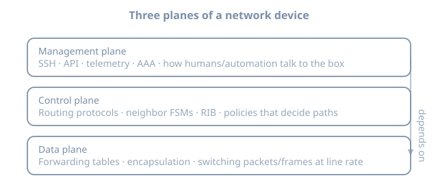

# Control, Data, and Management Planes

Separate **how the network decides**, **how it forwards**, and **how you operate it**. This split keeps troubleshooting honest from first lab to fabric design.

## Learning goals

- Define data, control, and management planes with examples  
- Classify failures into the right plane  
- Pick evidence (tables vs protocols vs access path) per plane  
- Connect planes to tools used in this book  

## Data plane

**Forwards** user and transit packets using programmed tables.

| Examples | Evidence |
|----------|----------|
| Ethernet FDB / MAC table | `bridge fdb`, switch MAC table |
| IP FIB / routes used for forward | `ip route get`, CEF/FIB show |
| ACL counters / nft hits | Counters increment on matches |
| Queues / drops | Interface drop stats |

**Failures:** blackhole route, wrong next hop, MTU drop, ACL drop, congestion.

## Control plane

**Builds and maintains** the information data plane uses.

| Examples | Evidence |
|----------|----------|
| ARP/ND | `ip neigh` |
| OSPF/BGP adjacencies | protocol show commands |
| MAC learning | dynamic FDB entries |
| Route computation | RIB entries, SPF/BGP path choice |

**Failures:** adjacency down, authentication mismatch, policy filter, CPU overload, CoPP drops.

## Management plane

**How humans and automation** configure and observe devices.

| Examples | Evidence |
|----------|----------|
| SSH, HTTPS API, NETCONF | Reachability to mgmt VRF/IP |
| Telemetry, syslog, SNMP | Streams arrive at collectors |
| Console / OOB | Still works when in-band dies |

**Failures:** ACL on vty, expired credentials, mgmt routing broken, “network down” that is only mgmt path down.

{fig-alt="Management, control, and data planes"}

## Interaction

```
Management  →  configures  →  Control
Control     →  programs    →  Data
Data        →  forwards       user packets
```

A BGP session (control) programs the FIB (data). You establish BGP over TCP (data plane for the control session—meta but real).

## Troubleshooting order (habit)

1. **Management:** Can I access the device?  
2. **Data:** Does `ping`/`curl` of interest work? What does `ip route get` say?  
3. **Control:** Are neighbors up? Are routes present in the RIB?  
4. Reconcile: RIB has route but FIB/policy drops?  

## Lab habit

When something fails, write one sentence: *“I think this is a **data / control / management** plane fault because …; I will prove it with ….”*

## Trace one change across the planes

Imagine an operator removes an OSPF adjacency. The configuration operation arrives through a management interface; OSPF's neighbor and route calculations are control-plane behavior; traffic uses the installed forwarding entries in the data plane. These are conceptual roles, not necessarily separate processors or physical networks. An implementation may use a shared CPU, and operational traffic may share links with production traffic.

The state does not necessarily change everywhere at the same instant. A route may remain installed briefly while a protocol detects failure and recalculates; a device may retain a usable forwarding entry even when its management interface is unreachable. Conversely a healthy management session and an established routing neighbor do not prove that a particular data flow passes an ACL or that an egress link works. For a failure drill, record the time of the event, neighbor change, route change, and loss/recovery of probe traffic. That sequence explains convergence more reliably than a single final screenshot.


## Checkpoint

SSH to a router fails, but the router still forwards traffic between two lab hosts. Which plane is most likely broken for you, and which is still working?

## Next

Depth continues in [Ethernet & MAC Learning](../03-layer-2/01-ethernet-mac.qmd). Host and Containerlab skills remain in [Lab platform](../01-lab-platform/01-lab-host-macos.qmd).  
