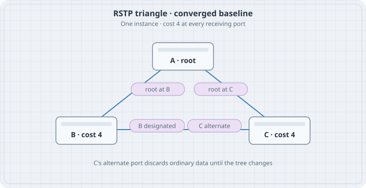

# Spanning Tree: Elections, Roles and Failure Analysis

Spanning tree does not simply disable the slowest link. For each tree or instance, bridges exchange information, select a root and calculate a loop-free set of forwarding ports. The result depends on bridge IDs, path costs, port IDs and the protocol instance. Work through the election before changing a production priority or cost.

## Compare information in order

A bridge ID combines priority-related bits with a MAC address; the exact priority field and any system-ID extension depend on the spanning-tree variant and instance. The lowest complete bridge ID wins the root election. Explicitly configure primary and secondary root intent rather than leaving root placement to MAC addresses. Confirm the actual root ID on every switch and instance; a configured priority is not evidence of the resulting election.

Each non-root bridge chooses its root port using the best received path to the root. Compare the root ID first, then the total root path cost including the receiving port's cost. If those tie, compare the advertising bridge ID and advertising port ID; local port identification resolves a remaining tie where applicable. A segment's designated port advertises the best information to that segment: root ID, root path cost, bridge ID, then port ID break ties. Read the actual implementation's output and cost method, especially with per-VLAN trees, link aggregation, or MST regions.

A port **role** describes its place in the tree; a port **state** says how it handles ordinary data. In RSTP, root and designated ports normally forward after convergence, while an alternate port normally discards and provides an alternate route toward the root. A backup port represents a redundant connection to a segment for which the same bridge is designated; it is not simply another name for alternate. RSTP uses discarding, learning and forwarding states. Classic STP also names listening and blocking states. Control BPDUs can be processed while ordinary data is discarded.

{fig-alt="Root A connects to B and C; the B-C link is designated at B and alternate at C."}

## Worked triangle

Use the [three-switch workbook topology](../09-lab-workbook/05-spanning-tree.qmd) as a physical pattern. For the calculation below assume one common RSTP instance, three point-to-point links, equal port costs of **4** on both ends of every link, and the following bridge IDs ordered A < B < C. These values are chosen for arithmetic; real defaults can use a different cost scale.

| Bridge | Priority | MAC used in bridge ID | Ports |
|---|---:|---|---|
| A | 4096 | `02:00:00:00:00:01` | `a-b`, `a-c` |
| B | 8192 | `02:00:00:00:00:02` | `b-a`, `b-c` |
| C | 12288 | `02:00:00:00:00:03` | `c-a`, `c-b` |

1. **Root:** A has the lowest bridge ID, so A is root and has root cost 0. Its ports toward B and C are designated for those segments.
2. **Root ports:** B's direct path through `b-a` costs 4; through C it costs 8. C's direct path through `c-a` costs 4; through B it costs 8. Their direct ports are root ports.
3. **B–C segment:** both bridges advertise root cost 4. B has the lower bridge ID, so `b-c` is designated. C's `c-b` is alternate and discarding. The root and designated ports forward in the converged tree.

| Link | End 1 | End 2 |
|---|---|---|
| A–B | A designated / forwarding | B root / forwarding |
| A–C | A designated / forwarding | C root / forwarding |
| B–C | B designated / forwarding | C alternate / discarding |

If A–C fails, C's path through B costs 8. `c-b` becomes C's root port and forwards after reconvergence; `b-c` remains designated. When A–C returns, the original calculation applies again. Actual interruption depends on link detection, BPDU exchange, transition behavior and endpoint traffic; it is not guaranteed to be zero.

Now restore all links and change only C's receiving cost on `c-a` from 4 to 12. The path through B costs 8, so `c-b` becomes C's root port; `c-a` is no longer its root port. A's `a-c` remains designated, while C's `c-a` is alternate/discarding in the stable tree. The values are directional: changing C's local receiving cost does not change B's port cost.

## Rapid transitions and topology changes

On suitable point-to-point links, RSTP uses proposal/agreement and synchronization to move toward forwarding without waiting for the full classic timer sequence. Edge ports are intended for end stations and can transition rapidly; connecting a bridge to an edge port changes the assumptions. Legacy peers, shared links, lost BPDUs and platform compatibility behavior can change convergence. Measure rather than promising a fixed failover time.

When the active topology changes, bridges need to update learned forwarding locations. Topology-change signaling accelerates handling of stale MAC information; the exact flushing or aging behavior depends on the protocol and implementation. Expect transient unknown-unicast flooding and inspect MAC movement as well as port state. A new tree can be correct while a VLAN mismatch, stale neighbor entry, or blocked upstream route still prevents the application from working.

## Protection controls and boundaries

- **BPDU guard** on an intended host-facing edge port reacts to unexpected BPDUs, commonly by disabling the port. It protects root placement but can interrupt a legitimate downstream switch; recovery behavior varies.
- **Root guard** prevents a downstream port from becoming a path to a superior root. It is useful at a defined boundary where a downstream device must not influence root placement.
- **Loop guard** addresses certain cases where expected BPDUs stop arriving on a non-designated port, reducing the risk of it transitioning to forwarding incorrectly. It does not repair every physical fault or replace unidirectional-link detection.
- **BPDU filtering** and disabling STP are not interchangeable with guard. Suppressing control traffic on a redundant bridge link can create a loop. Test features on the actual platform and understand which ports and instances they affect.

MST maps VLANs into spanning-tree instances. Region name, revision and VLAN-to-instance mapping must agree to form the intended region; inspect boundary behavior rather than assuming identical VLAN names imply matching configuration. Different per-VLAN or per-instance trees can have different root and blocked ports. Never infer the active path for VLAN 20 from the output for VLAN 10 without checking the relevant instance.

## Practice and verify

Using the workbook's three-switch lab, record device software versions and configure the IDs and costs above using your platform's syntax. The workbook may use a different STP mode and interface names, so align the instance, trunk VLANs and path-cost scale first. Predict each port's role before reading output; then record root ID, root cost, port role/state and BPDU counters on all switches. Repeat the A–C failure and the C-side cost change, allowing convergence between steps. Send a modest continuous test stream between hosts, timestamp loss and recovery, and verify MAC learning and both traffic directions. Restore the baseline after each test.

For a guarded edge-port drill, use an isolated spare port and test switch. Record the expected guard action and recovery procedure first; introduce a BPDU, verify the event and affected port, then restore the original state. Do not connect the spare switch in a way that creates an uncontrolled loop. The exercise is a platform-neutral procedure and has not been validated on a particular switch implementation.

**Questions:** Why does B win designation on B–C even though its bridge priority is worse than A's? How does an altered C-side cost affect C's root port? Why can a port show physical link up while user traffic is blocked? What evidence distinguishes an STP issue from a trunk VLAN mismatch?

Further reading: [IEEE 802.1w project](https://www.ieee802.org/1/pages/802.1w.html), [IEEE MST project](https://www.ieee802.org/1/pages/802.1s.html), and [Linux bridge documentation](https://docs.kernel.org/networking/bridge.html).
