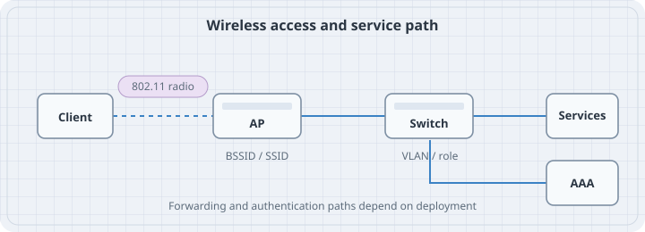

# Wireless LANs: Radio, Access, and Troubleshooting

A wireless client shares radio airtime with other stations; an access point (AP) connects the wireless medium to the distribution network. An Ethernet link can be healthy while clients suffer retries, contention, roaming interruptions, or authentication failures over the air. Diagnose association, authorization, addressing and application reachability as separate stages.

{fig-alt="A client connects by radio to an access point, which connects through a switch to services and an authentication server."}

## From radio to network

A service set identifier (SSID) is the network name presented to a user. A basic service set (BSS) is a radio cell; its BSSID identifies that BSS, normally with a MAC address. Multiple APs can advertise the same SSID as an extended service set, but matching names alone do not guarantee compatible security, mobility, VLANs, or seamless roaming. An AP can expose multiple BSSs per radio, with airtime overhead for each beacon. A controller-managed design may centralize policy and tunnel client traffic, or bridge it locally; determine the actual forwarding path before tracing a VLAN.

A client discovers BSSs through beacons and, when scanning actively, probe exchanges. It chooses a BSS based on its own policy and signal observations. It authenticates and associates at the 802.11 layer, negotiates security, and receives network authorization before ordinary traffic flows. The network then supplies addressing, a gateway and DNS. Association does not prove successful 802.1X authentication, DHCP or Internet access.

## Channels, airtime and capacity

Radios operate in bands and channels subject to local regulatory rules, device capabilities and configured channel width. Wider channels can increase peak physical rate but consume more spectrum and may reduce the number of independent channels available for neighboring cells. Channel plans must account for overlap, neighboring APs, non-Wi-Fi interference, and the client's supported bands. Regulatory constraints, especially in 5 and 6 GHz, vary by jurisdiction and equipment; verify local requirements and device documentation before choosing channels or transmit power.

Wi-Fi is a shared medium. Stations generally use carrier sensing and contention before transmitting, and acknowledge unicast frames; collisions, interference and weak reception can trigger retries. A client that cannot hear another client can still collide at the AP: this is the hidden-node problem. RTS/CTS can help some hidden-node situations but adds overhead. High received signal alone does not guarantee good performance: noise, interference, channel utilization, retries and client rate selection matter. Signal-to-noise ratio compares received signal with the noise floor, both in dBm: `-60 dBm - (-90 dBm) = 30 dB`. Larger positive SNR is generally better, but thresholds depend on client, modulation and application.

A PHY rate is not application throughput. Airtime is spent on contention, interframe gaps, acknowledgments, management frames, retransmissions and protocol overhead. A slow or distant client can consume substantial airtime for a small amount of data. Measure both directions: an AP hearing a client poorly is different from a client hearing the AP poorly. A transmit-power increase at the AP cannot increase the client's transmit power and can create an asymmetric cell.

## Security and access policy

Personal networks typically authenticate with a shared secret; enterprise access commonly uses 802.1X and EAP, with the client as supplicant, the AP or controller as authenticator, and a backend authentication server commonly reached over RADIUS. EAP is a framework for methods, not a single credential exchange. With EAP-TLS, validate the server certificate and expected identity on the client, and provision and revoke client credentials as required by policy. A client that accepts any server certificate can disclose credentials to an impostor when using susceptible methods. Protected management frames reduce certain management-frame attacks; support and enforcement depend on the configured security mode and clients.

Map authorization to the actual data path: an accepted identity may receive a VLAN, role, ACL or tunnel assignment. An authentication success with a wrong VLAN is an authorization or forwarding problem, not proof that DNS is broken. Do not assume every SSID maps to a separate VLAN or that isolation is automatic. Guest isolation, management access, certificate lifecycle and logging require explicit design.

## Roaming and design

The client makes the roaming decision. Neighbor information, transition suggestions and fast-transition mechanisms can assist compatible clients, but do not force every client to roam at the same signal threshold. Moving between APs while retaining the same subnet generally preserves IP addressing; crossing a Layer 3 boundary may change the address or require mobility mechanisms. Voice and real-time traffic expose brief interruptions that a web download may hide. Measure roaming time, packet loss and application impact rather than inferring success from a signal map.

A site survey starts with the floor plan, materials, user density and application requirements. Collect measurements at client height with representative clients, then validate coverage and capacity under expected load. Check AP uplink VLANs, PoE budget, switch capacity and controller reachability alongside radio performance. Coverage maps alone do not prove capacity, and maximum transmit power on every AP can increase contention.

## Troubleshooting exercise

Use an authorized test WLAN with two APs, a client, and an authentication server or personal-security profile. Record time, BSSID, channel, band, client signal and, where exposed, retries and channel utilization. Use the client and AP's normal diagnostic tools; do not capture other users' content. Walk through these tests, restoring the baseline after each intentional fault:

1. **Discovery:** confirm the intended SSID and BSSID are visible. Compare client-supported band and security capabilities with the AP configuration. If the SSID is absent, inspect radio state, channel and regulatory settings before DHCP.
2. **Authentication:** introduce an invalid test credential. Expect association or authentication progress to stop at the relevant stage; compare client and server logs. Restore the credential and verify authorization. For EAP-TLS, inspect time, certificate chain, identity and expiry without disabling validation.
3. **Forwarding:** on a disposable test SSID, change the assigned VLAN to one without the intended DHCP service. Authentication may succeed while addressing fails. Inspect assigned role, AP forwarding mode, trunk membership and DHCP exchange; restore the assignment and renew the lease.
4. **Capacity:** under controlled load compare idle and busy throughput, latency, retries, channel utilization and PHY rates at the same location. High utilization with low retries suggests contention; high retries with poor SNR suggests a radio-quality problem. These are hypotheses, not unique diagnoses.
5. **Roaming:** send a timestamped continuous probe to a local endpoint while moving between cells. Record old and new BSSIDs, loss interval and IP address; compare with AP and authentication logs. A stable BSSID suggests the client did not roam, whereas a BSSID change with a long outage requires investigation of security, VLAN and application behavior.

For each test record a baseline, observation at two points, hypothesis, repair and verification. Never generalize one client's behavior to all clients.

Further reading: [EAP architecture, RFC 3748](https://www.rfc-editor.org/rfc/rfc3748.html), [802.1X RADIUS usage, RFC 3580](https://www.rfc-editor.org/rfc/rfc3580.html), and [EAP-TLS 1.3, RFC 9190](https://www.rfc-editor.org/rfc/rfc9190.html).
