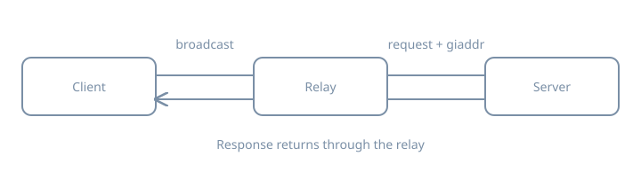

# DHCPv4 Lease and Relay Troubleshooting

A working DHCP server process is not the same as a working client lease. Diagnose the client VLAN, relay, server pool and return path in order. This chapter focuses on DHCPv4; DHCPv6 has different messages and relay formats, and IPv6 default-router discovery is normally provided by Router Advertisements rather than DHCPv6.

{fig-alt="The client broadcasts to a relay, which forwards the request with giaddr to a server; the response returns through the relay."}

## Follow a new lease

A client without a usable lease commonly broadcasts DHCPDISCOVER; one or more servers may send DHCPOFFER; the client selects an offer with DHCPREQUEST; the selected server replies with DHCPACK. This is a common initial exchange, not a sequence every capture must show. A client with remembered state can request or renew a previous address; a DHCPNAK indicates that the client's notion of a binding is invalid. A client detecting a conflict may send DHCPDECLINE. DHCPINFORM asks for configuration when the client already has an address.

Track the transaction ID (`xid`), client identifier or hardware address, message type, selected server identifier, offered address (`yiaddr`), subnet mask, router, DNS and lease time. The transaction ID correlates messages in an exchange; it is not an authentication token. DHCP uses UDP ports 67 and 68 in the usual client/server exchange, but a relay and modern extensions can add details; inspect the actual implementation and packet path.

## Relay and scope selection

A router does not normally forward a local client broadcast as an ordinary IP broadcast. A configured relay receives the request on the client-facing network and forwards it to a server. The `giaddr` field identifies a relay-side address used by a conventional server to select the client subnet and return the response to the relay. It is not the leased client address. Relay Agent Information (Option 82), when present, can supply additional circuit or remote identification for policy; its trust and processing are deployment-specific. See [DHCP Option 82](02c-dhcp-option-82-relay-agent-information.qmd).

A correct outbound relay request is only half the path. Verify the server can select a scope for the relayed request, that the pool has available addresses, and that the server's response reaches the relay and then the client. ACLs, DHCP-snooping trust, VLAN membership, malformed relay information, server policy and return routing can each interfere. Multiple offers are normal when more than one eligible server answers; the question is whether each server and its scope are authorized and coordinated.

## Renewal and expiry

After a lease is bound, the client normally attempts renewal with its original server at T1. If it cannot renew, it enters rebinding at T2 and broadcasts a request to any available server. In RFC 2131 the default T1 is half the lease and T2 is 87.5% of the lease, unless configured otherwise; implementations add jitter and policies differ. At expiry the client must stop using the address if it has not obtained a valid renewal. A server outage can therefore be invisible to existing clients initially while new clients fail, then affect existing clients later. Lease, renewal and failover design must be tested together.

## Evidence-driven exercise

Use the [inter-VLAN and DHCP workbook lab](../09-lab-workbook/07-inter-vlan-and-dhcp.qmd) as a starting point. For a relay test, add a separate server subnet and a relay on the client VLAN using the chosen platform's documented configuration. This is a test plan; no relay/server implementation was available on the writing host. Use an isolated topology and test pool so offers cannot reach a shared network. Record link/VLAN membership, relay-facing address, server address, pool range, router and DNS options, lease time and return routes.

| Fault | Evidence to collect | A plausible conclusion to test |
|---|---|---|
| Client port in wrong VLAN | Client-facing capture, VLAN table, relay interface counters | DISCOVER reaches the wrong broadcast domain or no relay |
| Relay disabled on client interface | DISCOVER on client segment, no corresponding relayed request at server | Relay configuration or forwarding path missing |
| Server unreachable or response blocked | Relayed request at relay and server-side capture, route and filter counters | Request or reply fails between relay and server |
| Pool exhausted or relay scope unmatched | Server logs and request `giaddr`, pool utilization, no valid offer | Server has no eligible address or matching policy |
| Wrong DHCP option | ACK and client route/resolver state | Lease can succeed while gateway or DNS points to the wrong service |
| Server unavailable after binding | Client state and timestamped renewal/rebinding messages | Existing lease may work until expiry; a new client may fail immediately |

For each case capture on both sides of the relay, compare `xid` and client identity, record server decisions and client state, then restore the fault and verify a new lease and data path. Do not confuse a single missing packet in a capture with proof of absence on an offloaded switch; choose an appropriate capture or mirror point. A DHCPACK is evidence of configuration delivery, not proof of DNS, routing, filtering or application success. Test a numeric destination, gateway and resolver separately.

For a shortened-lease exercise, choose a test lease and record actual T1, T2 and expiry rather than assuming a client's timer precision. Disconnect the server after binding, observe renewal and rebinding attempts, then restore the service and verify the resulting lease. Some clients retain or reacquire state differently, and HA servers require correctly coordinated leases; record the actual implementation.

## Review

Why can new clients fail while existing clients still communicate? How do `giaddr` and `yiaddr` differ? Why can an ACK coexist with a broken application? What evidence distinguishes a relay that did not forward from a server that received a request but had no eligible scope?

**References:** [DHCPv4, RFC 2131](https://www.rfc-editor.org/rfc/rfc2131.html), [DHCP options, RFC 2132](https://www.rfc-editor.org/rfc/rfc2132.html), and [relay agent information, RFC 3046](https://www.rfc-editor.org/rfc/rfc3046.html). For DHCPv6, use the current [RFC 9915](https://www.rfc-editor.org/rfc/rfc9915.html).
