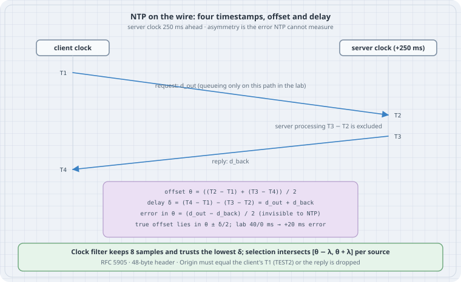

# NTP on the Wire: Timestamps, Offset and Delay, Clock Filter and Selection

Clock drift is silent until it breaks something you care about. TLS certificates fail validation when a host is hours behind, distributed databases reject writes or corrupt leader leases when nodes disagree by hundreds of milliseconds, and post-incident log correlation turns into guesswork when timestamps across routers and servers do not share a common timeline. In most environments, the Network Time Protocol (NTP) is the mechanism keeping those clocks aligned, yet operators routinely treat it as a black box that either "syncs" or "doesn't sync."

Understanding what happens on UDP port 123 turns NTP failures from mysterious daemon states into concrete network and clock-discipline problems. When a client reports a sudden offset jump, the cause might be asymmetric routing on an MPLS path, bufferbloat on an uplink, a server returning a Kiss-o'-Death rate-limit packet, or a pair of upstream clocks that cannot form a majority clique. None of those look like packet loss, and none of them are visible from a simple ping test.

This chapter dissects the unauthenticated NTPv4 core protocol as defined in RFC 5905. We walk through the 48-byte wire header, 64-bit timestamp eras and the 2036 rollover, the four-timestamp offset and delay calculation, the 8-stage clock filter, the intersection algorithm that separates truechimers from falsetickers, and Kiss-o'-Death signaling. (Precision Time Protocol, covered in the preceding chapter, applies the same four-timestamp idea using hardware timestamps in NICs and switches; NTS, covered earlier, wraps these packets in authentication without changing the core math.)

## Learning goals

After reading this chapter and running the accompanying lab, you will be able to:

- Decode every field of the 48-byte NTPv4 header, including Leap Indicator, Version, Mode, Stratum, signed log2 Poll and Precision, 16.16 Root Delay and Root Dispersion, and Reference ID.
- Convert between Unix epoch timestamps and NTP 32.32 fixed-point timestamps, and explain how pivot-based era disambiguation handles the February 2036 rollover.
- Compute clock offset and round-trip delay from the four-timestamp exchange ($T_1$ through $T_4$), and explain why one-way path asymmetry introduces an undetectable offset error of $(d_{\text{out}} - d_{\text{back}}) / 2$.
- Explain why NTP's 8-stage clock filter selects the minimum-delay sample rather than the mean offset, and how the Origin timestamp check (`TEST2`) blocks off-path spoofing.
- Trace the Marzullo-derived intersection algorithm over correctness intervals $[\theta - \lambda, \theta + \lambda]$ to identify truechimers, falsetickers, and why at least four sources are needed to tolerate one bad clock.
- Interpret Kiss-o'-Death (`RATE`, `DENY`, `RSTR`) responses and apply basic control-plane hardening to Mode 6 and Mode 7 queries.

## Version note

NTPv4 is specified in RFC 5905 (June 2010), which obsoletes both RFC 1305 (NTPv3) and RFC 4330 (SNTPv4). Simple Network Time Protocol (SNTP) is no longer a separate protocol specification; it is defined inside RFC 5905 as a subset for clients that use the same wire format and four-timestamp exchange without maintaining the full multi-peer clock filter, selection, and discipline state machine. Extension fields for NTPv4 are specified in RFC 7822, Network Time Security (NTS) is defined in RFC 8915, operational best practices are collected in RFC 8633 (BCP 223), and client source-port randomization is required by RFC 9109 (2021).

The lab in this chapter was executed on Linux 6.12 with Python 3.13.5 using pure Python sockets on the loopback interface. No external NTP daemon or root privileges are required for the lab. Production commands and configuration snippets in the later section target `chrony` (`chronyc`) and the reference `ntpd` (`ntpq`) implementation and are marked as not run in this environment.

## The 48-byte NTPv4 packet

Without extension fields, every NTPv4 packet is 48 octets long and travels over UDP port 123. Despite decades of protocol evolution, the fixed header fits cleanly into twelve 32-bit words, as specified in RFC 5905 section 7.3:

```text
 0                   1                   2                   3
 0 1 2 3 4 5 6 7 8 9 0 1 2 3 4 5 6 7 8 9 0 1 2 3 4 5 6 7 8 9 0 1
+-+-+-+-+-+-+-+-+-+-+-+-+-+-+-+-+-+-+-+-+-+-+-+-+-+-+-+-+-+-+-+-+
|LI | VN  |Mode |    Stratum    |     Poll      |   Precision   |
+-+-+-+-+-+-+-+-+-+-+-+-+-+-+-+-+-+-+-+-+-+-+-+-+-+-+-+-+-+-+-+-+
|                         Root Delay                            |
+-+-+-+-+-+-+-+-+-+-+-+-+-+-+-+-+-+-+-+-+-+-+-+-+-+-+-+-+-+-+-+-+
|                       Root Dispersion                         |
+-+-+-+-+-+-+-+-+-+-+-+-+-+-+-+-+-+-+-+-+-+-+-+-+-+-+-+-+-+-+-+-+
|                         Reference ID                          |
+-+-+-+-+-+-+-+-+-+-+-+-+-+-+-+-+-+-+-+-+-+-+-+-+-+-+-+-+-+-+-+-+
|                                                               |
+                     Reference Timestamp (64)                  +
|                                                               |
+-+-+-+-+-+-+-+-+-+-+-+-+-+-+-+-+-+-+-+-+-+-+-+-+-+-+-+-+-+-+-+-+
|                                                               |
+                      Origin Timestamp (64)                    +
|                                                               |
+-+-+-+-+-+-+-+-+-+-+-+-+-+-+-+-+-+-+-+-+-+-+-+-+-+-+-+-+-+-+-+-+
|                                                               |
+                      Receive Timestamp (64)                   +
|                                                               |
+-+-+-+-+-+-+-+-+-+-+-+-+-+-+-+-+-+-+-+-+-+-+-+-+-+-+-+-+-+-+-+-+
|                                                               |
+                     Transmit Timestamp (64)                   +
|                                                               |
+-+-+-+-+-+-+-+-+-+-+-+-+-+-+-+-+-+-+-+-+-+-+-+-+-+-+-+-+-+-+-+-+
```

The first octet packs three bitfields: Leap Indicator (`LI`, 2 bits), Version Number (`VN`, 3 bits), and `Mode` (3 bits). A standard NTPv4 client request with no leap-second warning has `LI = 0`, `VN = 4`, and `Mode = 3`, which encodes as `(0 << 6) | (4 << 3) | 3 = 0x23`. A server replying to that client sets `Mode = 4`.

| Field | Bits | Values and meaning |
| --- | --- | --- |
| LI (Leap Indicator) | 2 | `0` no warning; `1` last minute of the day has 61 s; `2` last minute has 59 s; `3` unknown (clock unsynchronized) |
| VN (Version Number) | 3 | `4` for NTPv4 |
| Mode | 3 | `1` symmetric active; `2` symmetric passive; `3` client; `4` server; `5` broadcast; `6` NTP control message; `7` reserved for private use |
| Stratum | 8 | `0` unspecified or invalid (used for Kiss-o'-Death); `1` primary server; `2`–`15` secondary server; `16` unsynchronized |

The `Poll` and `Precision` fields are signed 8-bit integers representing powers of two in seconds. A `Poll` value of `6` means $2^6 = 64$ seconds between messages. RFC 5905 bounds the poll exponent between `MINPOLL = 4` (16 seconds) and `MAXPOLL = 17` (131,072 seconds, or about 36.4 hours). `Precision` is negative on modern hardware because a system clock ticks faster than once per second: a value of `-20` means $2^{-20} \approx 0.954\ \mu\text{s}$ per tick.

`Root Delay` and `Root Dispersion` use the 32-bit NTP short format: an unsigned 16-bit integer seconds part followed by a 16-bit fractional seconds part (16.16 fixed point, so each unit of the raw 32-bit integer equals $1/65536 \approx 15.26\ \mu\text{s}$). `Root Delay` measures the total round-trip delay from the server back to the primary (stratum 1) reference clock. `Root Dispersion` accumulates the maximum error budget along that path due to clock frequency drift and measurement uncertainty. Both numbers are cumulative: a stratum 2 server adds its own delay and dispersion to the values it received from its stratum 1 upstream.

The 32-bit `Reference ID` (`refid`) identifies the server's synchronization source, and its interpretation depends on `Stratum`:

- At **stratum 1**, `refid` is a four-character ASCII code naming the reference clock driver, such as `GPS` or `PPS` (padded with NUL bytes if shorter than four characters).
- At **stratum 2 through 15 over IPv4**, `refid` is the 32-bit IPv4 address of the upstream server to which this server is currently synchronized.
- At **stratum 2 through 15 over IPv6**, where a 128-bit address cannot fit in 32 bits, `refid` holds the first four octets of the MD5 hash of the upstream server's IPv6 address.
- At **stratum 0**, `refid` carries a four-character ASCII Kiss-o'-Death code.

For operators, `refid` has two immediate consequences. First, it enables simple loop detection: if Server A sees its own IPv4 address (or its IPv6 MD5 prefix) in Server B's `refid`, Server B is downstream of Server A and must not be used as an upstream source. Second, `refid` leaks topology: any client querying a stratum 2 server can read the IPv4 address (or hashed IPv6 fingerprint) of that server's upstream source, which is useful when debugging unexpected stratum changes but worth noting in privacy-sensitive deployments.

Finally, the header carries four 64-bit timestamps:
- **Reference Timestamp**: the time the server's clock was last set or corrected.
- **Origin Timestamp**: the Transmit Timestamp copied from the client request that triggered this reply.
- **Receive Timestamp**: the server's local time when the request arrived.
- **Transmit Timestamp**: the server's local time when the reply departed.

## Timestamps and the 2036 era wrap

NTP timestamps are 64-bit unsigned fixed-point numbers in 32.32 format: 32 bits for whole seconds and 32 bits for fractional seconds. A single unit in the least-significant bit of the fraction equals $2^{-32}\ \text{s} \approx 232\ \text{ps}$, which is finer than typical kernel timestamping resolution and leaves room for hardware-assisted measurements.

The NTP epoch begins at `1900-01-01 00:00:00 UTC`, whereas the Unix epoch begins 70 years later at `1970-01-01 00:00:00 UTC`. Converting between them requires adding or subtracting the constant delta of `2,208,988,800` seconds (which includes 17 leap years between 1900 and 1970).

Because the seconds field is 32 bits wide, it wraps every $2^{32} = 4,294,967,296$ seconds, or roughly 136.1 years. RFC 5905 section 6 formalizes each 136-year cycle as an **era**. Era 0 began on `1900-01-01 00:00:00 UTC` and ends at NTP second `2^32 - 1`, wrapping to `0` at Unix time `2,085,978,496`, which is `2036-02-07 06:28:16 UTC`. At that instant, Era 1 begins on the wire, even though the 32-bit seconds field itself resets to `0`.

The era number is not transmitted in the 48-byte NTP header. Instead, implementations disambiguate a 32.32 timestamp using a **pivot**—typically the receiver's current notion of time, or a compile-time/build-time floor if the local clock has no battery-backed RTC. Given a raw unwrapped timestamp $t_{\text{raw}}$ (in Era 0) and a pivot $t_{\text{pivot}}$, the receiver picks the integer multiple of $2^{32}$ seconds that places the decoded timestamp closest to the pivot:

```text
t_fixed = t_raw + round((t_pivot - t_raw) / 2^32) * 2^32
```

This rule works cleanly as long as the true time and the receiver's pivot are within half an era of each other—that is, within **68 years** ($2^{31}$ seconds). Once a host's clock is within 68 years of reality, a timestamp from `2036-02-07 06:28:17 UTC` (seconds field `1`) is unambiguously placed in Era 1 rather than `1900-01-01 00:00:01 UTC`. Conversely, a naive decoder that always assumes Era 0 will jump backward 136 years to 1900 the moment `2036-02-07 06:28:16 UTC` arrives.

## The four-timestamp exchange and path asymmetry

{fig-alt="Client and server timelines with the server clock 250 ms ahead. T1 client send, T2 server receive, T3 server send, T4 client receive. Offset is ((T2-T1)+(T3-T4))/2, delay is (T4-T1)-(T3-T2) which equals d_out plus d_back, and the offset error is (d_out-d_back)/2. The clock filter keeps eight samples and uses the lowest delay; selection intersects each source's interval."}

A single client-server exchange captures four timestamps across two timelines: $T_1$ and $T_4$ on the client's clock, and $T_2$ and $T_3$ on the server's clock.

```text
Client clock                                      Server clock
     |                                                 |
    T1  --- request (xmt = T1) --->                    |
     |            d_out                                |
     |                              --->  T2 (rec)     |
     |                                     |           |
     |                                     |  server   |
     |                                     |  work     |
     |                                     |  (T3-T2)  |
     |                              <---  T3 (xmt)     |
     |            d_back                               |
    T4  <-- reply (org=T1, rec=T2, xmt=T3) ---         |
```

Let $\theta$ be the client's estimate of how far ahead the server's clock is relative to the client's clock (so positive $\theta$ means the server is ahead and the client needs to step or slew forward). Let $d_{\text{out}}$ be the one-way network propagation delay from client to server, and $d_{\text{back}}$ be the one-way propagation delay from server to client.

The elapsed time measured on the outbound leg is $T_2 - T_1 = d_{\text{out}} + \theta$. The elapsed time measured on the return leg is $T_4 - T_3 = d_{\text{back}} - \theta$, or equivalently $T_3 - T_4 = \theta - d_{\text{back}}$. Adding those two differences and dividing by two yields the NTP offset equation, while subtracting the server's internal residence time $(T_3 - T_2)$ from the client's total wait $(T_4 - T_1)$ yields the round-trip delay $\delta$:

$$\theta = \frac{(T_2 - T_1) + (T_3 - T_4)}{2}$$

$$\delta = (T_4 - T_1) - (T_3 - T_2)$$

Notice what happens to the server's internal processing delay $T_3 - T_2$. Whether the server takes 10 microseconds or 50 milliseconds between receiving the request and sending the reply, $T_3 - T_2$ is subtracted out of $\delta$ and cancels out of $\theta$.

What does *not* cancel out is path asymmetry. Substituting $T_2 - T_1 = d_{\text{out}} + \theta_{\text{true}}$ and $T_3 - T_4 = \theta_{\text{true}} - d_{\text{back}}$ into the offset formula gives:

$$\theta = \theta_{\text{true}} + \frac{d_{\text{out}} - d_{\text{back}}}{2}$$

If the outbound and return paths have identical delay ($d_{\text{out}} = d_{\text{back}}$), the asymmetry term vanishes and $\theta = \theta_{\text{true}}$. If the outbound path is 40 ms slower than the return path ($d_{\text{out}} = 40\ \text{ms}$, $d_{\text{back}} = 0\ \text{ms}$), the client measures $\delta = 40\ \text{ms}$ and an offset error of $+20\ \text{ms}$. Because NTP only observes the sum $d_{\text{out}} + d_{\text{back}} = \delta$, the asymmetry $(d_{\text{out}} - d_{\text{back}}) / 2$ is fundamentally invisible to the protocol. All the client can prove from a single exchange is that, assuming non-negative one-way delays, the true offset lies somewhere inside the interval $\theta \pm \delta/2$.

### Origin check (`TEST2`) and spoofing defense

Before a client trusts $T_2$ and $T_3$ from a reply, it must verify that the reply corresponds to the request it actually sent. RFC 5905 defines `TEST2` (the origin timestamp check): the client saves the 64-bit `Transmit Timestamp` ($T_1$) it placed in its outgoing request and accepts a reply only if the reply's `Origin Timestamp` field matches $T_1$ bit-for-bit.

Combined with client source-port randomization (required by RFC 9109), `TEST2` prevents an off-path attacker from injecting forged offsets or replaying stale replies. If the `Origin` field does not match the outstanding `Transmit` timestamp, the client drops the packet immediately. Critically, `TEST2` must apply to Kiss-o'-Death packets as well: in CVE-2015-7704 (discovered by Malhotra, Cohen, and Goldberg at Boston University and fixed in `ntpd` 4.2.8p4 in October 2015), `ntpd` accepted KoD `DENY`/`RATE` packets without enforcing the origin check, allowing an off-path attacker to send a single spoofed KoD packet and force a client to stop syncing with its server.

## Filtering, synchronization distance, and clock selection

Even on a symmetric physical link, queueing in switches, routers, and host NICs adds sporadic, one-sided delay spikes. If a packet hits a congested queue on the way to the server, $d_{\text{out}}$ jumps while $d_{\text{back}}$ stays near baseline, pulling the measured offset off by half the queue delay. Averaging those samples does not remove the bias; it bakes the queueing delay into the clock estimate.

### The 8-stage clock filter

RFC 5905 section 10 addresses queueing noise with an 8-stage shift register per peer, holding the last eight `(offset, delay, dispersion)` samples. Whenever a new valid reply arrives, it shifts into the register, and the filter selects the sample with the **lowest round-trip delay** $\delta$—not the mean or median offset.

The reasoning follows directly from the asymmetry bound: queueing can only add positive delay, never negative delay. A sample with $\delta = 4.9\ \text{ms}$ has at most $\pm 2.45\ \text{ms}$ of possible asymmetry error, whereas a sample with $\delta = 50.3\ \text{ms}$ can hide $\pm 25.15\ \text{ms}$ of queueing asymmetry. By trusting the lowest-delay sample in the 8-sample window, the client discards queued outliers and keeps the measurement closest to the true propagation floor.

### Root synchronization distance

To compare multiple upstream servers fairly, the client converts each candidate's delay and dispersion into a single error bound called **root synchronization distance** ($\lambda$). In RFC 5905, $\lambda$ is defined as:

$$\lambda = \frac{\text{root delay} + \delta}{2} + \text{root dispersion} + \text{peer dispersion} + \text{jitter}$$

This bound represents the worst-case total error from the primary reference clock all the way to the local client: half the total round-trip path delay (the maximum possible asymmetry across the entire chain) plus all accumulated clock-drift dispersions and measurement jitter. (In the lab script later in this chapter, we print a simplified bound `rootdelay/2 + rootdisp + delay/2`, omitting peer dispersion and jitter for clarity.)

### Selection via the intersection algorithm

Once each surviving source $i$ has a filtered offset $\theta_i$ and a root synchronization distance $\lambda_i$, it defines a **correctness interval** $[\theta_i - \lambda_i, \theta_i + \lambda_i]$. If source $i$ is honest and its error bounds are accurate, the true time lies inside its interval.

RFC 5905 section 11.2.1 uses a Marzullo-derived **intersection algorithm** to find the tightest interval supported by a majority of sources:

1. Start by assuming $f = 0$ falsetickers among the $m$ candidate sources.
2. Collect all interval endpoints: $(\theta_i - \lambda_i)$ as lower bounds, $\theta_i$ as midpoints, and $(\theta_i + \lambda_i)$ as upper bounds, sorted in ascending order.
3. Scan upward from the lowest endpoint, tracking how many intervals are currently active (`chime`). The first point where `chime >= m - f` becomes the candidate lower bound $l$.
4. Scan downward from the highest endpoint until `chime >= m - f` to find the candidate upper bound $u$.
5. Count how many source midpoints $\theta_i$ fall strictly outside $[l, u]$. Following the RFC 5905 appendix acceptance test, accept $[l, u]$ if $l < u$ and the number of midpoints outside $[l, u]$ is at most $f$.
6. If the test fails, increment $f$ and repeat while $f < m / 2$. If the loop exhausts $f < m / 2$ without finding a valid interval, there is no majority clique and selection fails.

Sources whose midpoint $\theta_i$ falls inside the winning $[l, u]$ are classified as **truechimers**; those outside are **falsetickers** and are discarded. (In a full NTP daemon, the surviving truechimers then pass through a **clustering** stage that trims statistical outliers and a **combining** stage that computes a weighted average offset; those two stages are not implemented in the lab.)

The arithmetic of $f < m / 2$ drives one of the most important operational rules in NTP:
- With $m = 1$ or $m = 2$ sources, $f$ can only be `0`. Two servers that disagree cannot outvote each other, because neither can form a strict majority ($m - f = 2$, so both intervals must overlap and contain both midpoints).
- With $m = 3$ sources, $f = 1$ is allowed, so one falseticker can be outvoted—but if any single server goes offline or becomes unreachable, you drop back to two sources and lose fault tolerance.
- For this reason, **RFC 8633 recommends a minimum of four** configured sources: if one source fails or is unreachable, three remain to outvote a single falseticker.

## Kiss-o'-Death and control-plane hygiene

NTP servers use **Kiss-o'-Death (KoD)** packets (RFC 5905 section 7.4) to tell misbehaving or unauthorized clients to back off. A KoD packet is a normal Mode 4 server reply with `Stratum = 0` and a four-character ASCII kiss code in the `Reference ID` field. Common codes include:

- `RATE`: The client is polling too aggressively. It must immediately reduce its polling rate (increase its `Poll` exponent).
- `DENY` and `RSTR`: Access is denied by policy or administratively restricted. The client must stop sending packets to that server.

Two rules govern KoD handling. First, a client **must never** use the timestamps in a KoD packet to adjust its clock—in fact, servers often zero out `Reference`, `Receive`, and `Transmit` timestamps in KoD replies, setting `LI = 3` (unsynchronized). Second, as noted under CVE-2015-7704, the client must still enforce the `TEST2` Origin timestamp check on any KoD packet before honoring it.

Finally, while client-server time synchronization uses Modes 3 and 4, NTP also defines **Mode 6** (NTP control messages, used by `ntpq`) and **Mode 7** (private/implementation-specific requests, used by legacy `ntpdc`). Historically, Mode 7 `monlist` queries returned a list of up to 600 recent client IP addresses in response to a tiny request, enabling massive UDP reflection amplification attacks (CVE-2013-5211). Public-facing NTP servers should disable Mode 6 and Mode 7 queries from untrusted networks (`restrict ... noquery` in `ntpd`, or `chrony`'s default of binding command sockets to localhost only) and serve only Modes 3 and 4 on public interfaces.

## The lab

The lab script (`ntplab.py`) implements the core NTPv4 wire mechanics in pure Python over loopback UDP sockets—no root privileges or external daemons are required. It exercises six parts in sequence: packing and inspecting the 48-byte header, demonstrating the 2036 Era 0 rollover with and without a pivot, measuring offset and delay across symmetric and asymmetric paths through an in-process delay relay, running the 8-stage clock filter under outbound queueing, running the intersection algorithm across five synthetic sources, and receiving a `RATE` Kiss-o'-Death packet.

### Lab files

The Python script implements the NTPv4 packet codec, loopback server, asymmetric delay relay, clock filter, intersection solver, and KoD test.
```{.python filename="ntplab.py"}
"""NTP on the wire: packet format, eras, offset/delay, clock filter,
intersection and Kiss-o'-Death. Pure Python, loopback only, no root."""
import socket, struct, threading, time, random, datetime

NTP_UNIX_DELTA = 2208988800          # seconds from 1900-01-01 to 1970-01-01
FMT = "!BBbbII4sQQQQ"                # 48-byte NTPv4 header (RFC 5905 fig. 8)

def to_ntp64(t):                     # unix float -> 32.32 fixed point, era 0 wrap
    s = t + NTP_UNIX_DELTA
    return (int(s) % 2**32) << 32 | int((s % 1) * 2**32)

def from_ntp64(v, pivot=None):       # 32.32 -> unix float, era chosen near pivot
    s = (v >> 32) + (v & 0xffffffff) / 2**32
    t = s - NTP_UNIX_DELTA
    if pivot is not None:            # pick the era that lands closest to pivot
        t += round((pivot - t) / 2**32) * 2**32
    return t

def pack(li, vn, mode, stratum, poll, prec, rootdelay, rootdisp, refid, ref, org, rec, xmt):
    return struct.pack(FMT, li << 6 | vn << 3 | mode, stratum, poll, prec,
                       rootdelay, rootdisp, refid, ref, org, rec, xmt)

def unpack(b):
    f = struct.unpack(FMT, b[:48])
    return dict(li=f[0] >> 6, vn=f[0] >> 3 & 7, mode=f[0] & 7, stratum=f[1], poll=f[2],
                prec=f[3], rootdelay=f[4] / 65536, rootdisp=f[5] / 65536, refid=f[6],
                ref=f[7], org=f[8], rec=f[9], xmt=f[10])

print("== 1. The 48-byte header ==")
p = pack(0, 4, 3, 0, 6, -20, 0, 0, b"\0\0\0\0", 0, 0, 0, to_ntp64(1_763_000_000.25))
print("client request bytes:", len(p), "first octet 0x%02x" % p[0], "(LI=0 VN=4 Mode=3)")
print("xmt as 32.32 hex   :", p[40:48].hex(), "-> seconds field", struct.unpack('!I', p[40:44])[0])
print("fraction 0x%08x / 2^32 = %.6f s" % (struct.unpack('!I', p[44:48])[0], struct.unpack('!I', p[44:48])[0] / 2**32))
print("precision -20 = 2^-20 s = %.3f us" % (2**-20 * 1e6))
print("root delay 16.16 encoding of 0.0123 s ->", hex(int(0.0123 * 65536)))

print("\n== 2. Eras: the 2036 wrap ==")
wrap = 2**32 - NTP_UNIX_DELTA
print("era 0 ends at unix", wrap, "=", datetime.datetime.fromtimestamp(wrap, datetime.UTC).isoformat())
for t in (wrap - 1, wrap, wrap + 1):
    v = to_ntp64(t)
    naive = from_ntp64(v)
    fixed = from_ntp64(v, pivot=wrap)
    print(f"unix {t}: seconds field {v >> 32:>10}  naive -> {datetime.datetime.fromtimestamp(naive, datetime.UTC):%Y-%m-%d %H:%M:%S}  pivot -> {datetime.datetime.fromtimestamp(fixed, datetime.UTC):%Y-%m-%d %H:%M:%S}")

# ---------- live exchange over loopback with a path-delay relay ----------
SERVER_OFFSET = 0.250                # server clock is 250 ms ahead of ours

def server(sock, kod=None):
    while True:
        data, addr = sock.recvfrom(512)
        t2 = time.time() + SERVER_OFFSET
        q = unpack(data)
        time.sleep(0.003)                         # 3 ms "processing": excluded by T3-T2
        t3 = time.time() + SERVER_OFFSET
        if kod:
            r = pack(3, 4, 4, 0, q['poll'], -20, 0, 0, kod, 0, q['xmt'], 0, 0)
        else:
            r = pack(0, 4, 4, 2, q['poll'], -20, int(0.010 * 65536), int(0.005 * 65536),
                     socket.inet_aton("192.0.2.1"), to_ntp64(t2 - 16), q['xmt'], to_ntp64(t2), to_ntp64(t3))
        sock.sendto(r, addr)

class Relay:                          # adds one-way delays: d_out (client->server), d_back
    def __init__(self, srv):
        self.s = socket.socket(socket.AF_INET, socket.SOCK_DGRAM); self.s.bind(("127.0.0.1", 0))
        self.u = socket.socket(socket.AF_INET, socket.SOCK_DGRAM); self.u.bind(("127.0.0.1", 0))
        self.srv, self.d_out, self.d_back, self.client = srv, 0.0, 0.0, None
        threading.Thread(target=self.fwd, daemon=True).start()
        threading.Thread(target=self.back, daemon=True).start()
    def fwd(self):
        while True:
            d, self.client = self.s.recvfrom(512)
            threading.Timer(self.d_out, self.u.sendto, (d, self.srv)).start()
    def back(self):
        while True:
            d, _ = self.u.recvfrom(512)
            threading.Timer(self.d_back, self.s.sendto, (d, self.client)).start()

def query(addr):
    c = socket.socket(socket.AF_INET, socket.SOCK_DGRAM); c.settimeout(2)
    t1 = time.time()
    c.sendto(pack(0, 4, 3, 0, 6, -20, 0, 0, b"\0" * 4, 0, 0, 0, to_ntp64(t1)), addr)
    data, _ = c.recvfrom(512); t4 = time.time()
    r = unpack(data)
    if r['org'] != to_ntp64(t1):
        raise RuntimeError("origin mismatch: bogus or replayed reply")
    T1, T2, T3, T4 = t1, from_ntp64(r['rec'], t1), from_ntp64(r['xmt'], t1), t4
    return r, ((T2 - T1) + (T3 - T4)) / 2, (T4 - T1) - (T3 - T2)

srv = socket.socket(socket.AF_INET, socket.SOCK_DGRAM); srv.bind(("127.0.0.1", 0))
threading.Thread(target=server, args=(srv,), daemon=True).start()
relay = Relay(srv.getsockname())

print("\n== 3. Offset and delay from four timestamps (server is +250 ms) ==")
print(f"{'out ms':>6} {'back ms':>7} {'offset ms':>9} {'delay ms':>8} {'error ms':>8} {'(out-back)/2':>12}")
for d_out, d_back in ((0, 0), (20, 20), (40, 0), (0, 40), (60, 10)):
    relay.d_out, relay.d_back = d_out / 1000, d_back / 1000
    r, off, dly = query(relay.s.getsockname())
    print(f"{d_out:>6} {d_back:>7} {off*1000:>9.1f} {dly*1000:>8.1f} {(off-SERVER_OFFSET)*1000:>8.1f} {(d_out-d_back)/2:>12.1f}")
print("reply header: stratum", r['stratum'], "refid", socket.inet_ntoa(r['refid']),
      "root delay %.4f s root disp %.4f s" % (r['rootdelay'], r['rootdisp']))
print("root distance bound = rootdelay/2 + rootdisp + delay/2 = %.1f ms" % ((r['rootdelay'] / 2 + r['rootdisp'] + dly / 2) * 1000))

print("\n== 4. Clock filter: keep 8 samples, trust the lowest delay ==")
random.seed(7)
samples = []
for i in range(8):
    q = random.choice((0, 0, 5, 30, 45))           # queueing on the outbound path only
    relay.d_out, relay.d_back = (2 + q) / 1000, 2 / 1000
    _, off, dly = query(relay.s.getsockname())
    samples.append((dly, off))
    print(f"sample {i}: queue {q:>2} ms  delay {dly*1000:6.1f}  offset {off*1000:6.1f}")
best = min(samples)
mean = sum(o for _, o in samples) / len(samples)
print(f"mean offset {mean*1000:.1f} ms ; min-delay sample offset {best[1]*1000:.1f} ms (delay {best[0]*1000:.1f})")

print("\n== 5. Intersection: finding the truechimers ==")
# (name, offset ms, root distance ms) -> correctness interval [off-rd, off+rd]
srcs = [("A", 3.0, 6.0), ("B", 4.0, 5.0), ("C", 2.5, 7.0), ("D", 3.5, 2.0), ("E", 48.0, 4.0)]
def intersect(srcs):
    edges = []
    for _, o, rd in srcs:
        edges += [(o - rd, -1), (o, 0), (o + rd, +1)]
    edges.sort()
    n = len(srcs)
    for allow in range(0, (n - 1) // 2 + 1):     # allow = falsetickers tolerated
        found, chime, low = 0, 0, None
        for v, t in edges:                         # scan up for the low endpoint
            chime -= t
            if chime >= n - allow: low = v; break
            if t == 0: found += 1
        chime, high = 0, None
        for v, t in reversed(edges):               # scan down for the high endpoint
            chime += t
            if chime >= n - allow: high = v; break
            if t == 0: found += 1
        if low is not None and high is not None and low < high and found <= allow:
            return allow, low, high
    return None
for n, o, rd in srcs:
    print(f"{n}: offset {o:5.1f} ms  interval [{o-rd:5.1f}, {o+rd:5.1f}]")
allow, lo, hi = intersect(srcs)
print(f"falsetickers allowed {allow}; intersection [{lo:.1f}, {hi:.1f}] ms")
print("truechimers (midpoint inside):", [n for n, o, rd in srcs if lo <= o <= hi])
print("wide but correct C at -1.0:", intersect([s if s[0] != "C" else ("C", -1.0, 7.0) for s in srcs]))
print("with only A,B,E:", intersect([s for s in srcs if s[0] in 'ABE']))
print("with only A,E   :", intersect([s for s in srcs if s[0] in 'AE']))

print("\n== 6. Kiss-o'-Death ==")
kod = socket.socket(socket.AF_INET, socket.SOCK_DGRAM); kod.bind(("127.0.0.1", 0))
threading.Thread(target=server, args=(kod, b"RATE"), daemon=True).start()
r, off, dly = query(kod.getsockname())
print("reply: LI", r['li'], "stratum", r['stratum'], "refid", r['refid'], "xmt", r['xmt'])
print("stratum 0 + ASCII refid = kiss code; client must not use the timestamps;",
      "RATE -> increase poll, DENY/RSTR -> stop using this server")
```
The shell wrapper invokes the Python lab script with no special privileges.
```{.bash filename="run.sh"}
#!/bin/sh
# no root needed; loopback only
python3 ntplab.py
```
Run the lab from the lab directory with `sh run.sh`. It only uses loopback UDP sockets, so it needs no root and no network namespace.

### Execution output

```text
== 1. The 48-byte header ==
client request bytes: 48 first octet 0x23 (LI=0 VN=4 Mode=3)
xmt as 32.32 hex   : ecbfbd4040000000 -> seconds field 3971988800
fraction 0x40000000 / 2^32 = 0.250000 s
precision -20 = 2^-20 s = 0.954 us
root delay 16.16 encoding of 0.0123 s -> 0x326

== 2. Eras: the 2036 wrap ==
era 0 ends at unix 2085978496 = 2036-02-07T06:28:16+00:00
unix 2085978495: seconds field 4294967295  naive -> 2036-02-07 06:28:15  pivot -> 2036-02-07 06:28:15
unix 2085978496: seconds field          0  naive -> 1900-01-01 00:00:00  pivot -> 2036-02-07 06:28:16
unix 2085978497: seconds field          1  naive -> 1900-01-01 00:00:01  pivot -> 2036-02-07 06:28:17

== 3. Offset and delay from four timestamps (server is +250 ms) ==
out ms back ms offset ms delay ms error ms (out-back)/2
     0       0     250.1      0.9      0.1          0.0
    20      20     249.9     40.8     -0.1          0.0
    40       0     270.2     41.2     20.2         20.0
     0      40     230.0     41.0    -20.0        -20.0
    60      10     275.1     71.5     25.1         25.0
reply header: stratum 2 refid 192.0.2.1 root delay 0.0100 s root disp 0.0050 s
root distance bound = rootdelay/2 + rootdisp + delay/2 = 45.7 ms

== 4. Clock filter: keep 8 samples, trust the lowest delay ==
sample 0: queue  5 ms  delay   10.0  offset  252.4
sample 1: queue  0 ms  delay    5.2  offset  250.1
sample 2: queue 30 ms  delay   35.3  offset  265.0
sample 3: queue  0 ms  delay    5.5  offset  249.9
sample 4: queue  0 ms  delay    5.2  offset  250.0
sample 5: queue 45 ms  delay   50.3  offset  272.3
sample 6: queue  0 ms  delay    4.9  offset  250.0
sample 7: queue  5 ms  delay   10.7  offset  252.6
mean offset 255.3 ms ; min-delay sample offset 250.0 ms (delay 4.9)

== 5. Intersection: finding the truechimers ==
A: offset   3.0 ms  interval [ -3.0,   9.0]
B: offset   4.0 ms  interval [ -1.0,   9.0]
C: offset   2.5 ms  interval [ -4.5,   9.5]
D: offset   3.5 ms  interval [  1.5,   5.5]
E: offset  48.0 ms  interval [ 44.0,  52.0]
falsetickers allowed 1; intersection [1.5, 5.5] ms
truechimers (midpoint inside): ['A', 'B', 'C', 'D']
wide but correct C at -1.0: (2, -1.0, 6.0)
with only A,B,E: (1, -1.0, 9.0)
with only A,E   : None

== 6. Kiss-o'-Death ==
reply: LI 3 stratum 0 refid b'RATE' xmt 0
stratum 0 + ASCII refid = kiss code; client must not use the timestamps; RATE -> increase poll, DENY/RSTR -> stop using this server
```
## Reading the output

### 1. The 48-byte header

The first line confirms that an unextended NTPv4 client packet is `48` bytes long and begins with `0x23`. In binary, `0x23` is `0010 0011`: bits `00` give `LI = 0` (no leap warning), bits `100` give `VN = 4`, and bits `011` give `Mode = 3` (client).

The client transmit timestamp was built from Unix time `1,763,000,000.25`. Adding the 1900-to-1970 epoch delta (`2,208,988,800`) produces `3,971,988,800` whole seconds, which packs into the upper 32 bits as `0xecbfbd40`. The fractional `0.25` seconds packs into the lower 32 bits as `0x40000000`, because `0x40000000 / 2^32 = 1073741824 / 4294967296 = 0.250000 s`.

The signed `Precision` byte `-20` represents $2^{-20}\ \text{s} \approx 0.954\ \mu\text{s}$ per tick. The `Root Delay` example encodes `0.0123` seconds in 16.16 short format: `int(0.0123 * 65536) = 806`, which is `0x326` in hexadecimal.

### 2. Eras: the 2036 wrap

Era 0 ends at Unix time `2085978496` (`2036-02-07T06:28:16+00:00`), when the 32-bit NTP seconds counter rolls over from `4294967295` (`0xffffffff`) back to `0`.

- At `2085978495` (one second before rollover), the seconds field is `4294967295`, so both the naive Era 0 decoder and the pivot-aware decoder yield `2036-02-07 06:28:15`.
- At `2085978496`, the seconds field wraps to `0`. The naive decoder places it at the start of Era 0 (`1900-01-01 00:00:00`), jumping 136 years into the past. The pivot-aware decoder, using a pivot near 2036, adds one $2^{32}$-second era and recovers `2036-02-07 06:28:16`.
- At `2085978497`, the seconds field is `1`; the naive decoder reads `1900-01-01 00:00:01` while the pivot-aware decoder reads `2036-02-07 06:28:17`.

### 3. Offset and delay from four timestamps

The loopback server is configured with `SERVER_OFFSET = +250 ms` ahead of the client and sleeps `3 ms` between receiving a request ($T_2$) and sending the reply ($T_3$). The five rows sweep different one-way delays through the relay:

- **`out 0 ms, back 0 ms`**: Measured offset is `250.1 ms` (error `0.1 ms` from Python timer jitter) and round-trip delay is `0.9 ms`. Even though the server slept `3 ms`, `T3 - T2` was subtracted out of `delay`, leaving only the local loopback/scheduling overhead.
- **`out 20 ms, back 20 ms`**: The path is symmetric. Measured delay rises to `40.8 ms` (`20 + 20` plus overhead), while measured offset stays at `249.9 ms` (`-0.1 ms` error). Symmetric delay does not corrupt offset.
- **`out 40 ms, back 0 ms`**: Total delay is `41.2 ms`, virtually identical to the `20/20` case, but the measured offset jumps to `270.2 ms`—an error of `+20.2 ms`, matching `(40 - 0) / 2 = +20.0 ms`.
- **`out 0 ms, back 40 ms`**: Total delay is `41.0 ms`, and the measured offset drops to `230.0 ms`—an error of `-20.0 ms`, matching `(0 - 40) / 2 = -20.0 ms`.
- **`out 60 ms, back 10 ms`**: Total delay is `71.5 ms`, and the offset reads `275.1 ms`, an error of `+25.1 ms` matching `(60 - 10) / 2 = +25.0 ms`.

The final two lines inspect the reply header from that last exchange: `stratum 2`, `refid 192.0.2.1`, `root delay 0.0100 s` (`10.0 ms`), and `root disp 0.0050 s` (`5.0 ms`). Plugging those into the lab's simplified root distance bound gives `10.0 / 2 + 5.0 + 71.5 / 2 = 45.75 ms` (printed as `45.7 ms`). Note that the full RFC 5905 root synchronization distance $\lambda$ also adds peer dispersion and jitter, which are omitted in this simplified calculation.

### 4. Clock filter: keep 8 samples, trust the lowest delay

This section sends eight queries with a `2 ms` baseline delay in each direction (`4 ms` round-trip) plus random outbound queueing of `0`, `5`, `30`, or `45 ms`. Every queued sample pulls the measured offset upward by roughly half the queue delay:
- Sample 2 hits a `30 ms` outbound queue (`delay 35.3 ms`) and reports `offset 265.0 ms` (`+15 ms` error).
- Sample 5 hits a `45 ms` outbound queue (`delay 50.3 ms`) and reports `offset 272.3 ms` (`+22.3 ms` error).

Averaging all eight offsets gives `mean offset 255.3 ms`, a `+5.3 ms` bias caused solely by one-way queueing. Selecting the sample with the lowest delay—sample 6, with `delay 4.9 ms`—yields `250.0 ms`, recovering the exact simulated server offset.

### 5. Intersection: finding the truechimers

Five synthetic sources `A` through `E` are evaluated with offsets and root distances defining their correctness intervals:
- `A`: offset `3.0 ms`, interval `[-3.0, 9.0]`
- `B`: offset `4.0 ms`, interval `[-1.0, 9.0]`
- `C`: offset `2.5 ms`, interval `[-4.5, 9.5]`
- `D`: offset `3.5 ms`, interval `[1.5, 5.5]`
- `E`: offset `48.0 ms`, interval `[44.0, 52.0]`

With `f = 0` falsetickers allowed, no interval is contained in all 5 sources because `E` (`[44.0, 52.0]`) is disjoint from `A`–`D`. Incrementing to `f = 1` (`m - f = 4`) succeeds: the intersection of `A`, `B`, `C`, and `D` is `[1.5, 5.5] ms`, and all four midpoints (`3.0`, `4.0`, `2.5`, `3.5`) lie inside `[1.5, 5.5]`. Only `E` (`48.0`) lies outside, so `A`, `B`, `C`, and `D` are truechimers and `E` is rejected as a falseticker.

Three edge cases follow:
- **Wide but correct `C` at `-1.0`**: Moving `C`'s midpoint to `-1.0` (interval `[-8.0, 6.0]`) leaves `C`'s interval overlapping `D`, but `C`'s midpoint `-1.0` now falls outside `[1.5, 5.5]`. At `f = 1`, two midpoints (`C` and `E`) lie outside `[1.5, 5.5]`, failing the `outside <= f` check. The algorithm must step up to `f = 2` (`m - f = 3`), returning `(2, -1.0, 6.0)`.
- **With only `A, B, E`** ($m = 3$): `f = 1` (`m - f = 2`) succeeds, returning `(1, -1.0, 9.0)` and outvoting `E`.
- **With only `A, E`** ($m = 2$): `f` is bounded by `f < m / 2`, so only `f = 0` is permitted. Since `A` and `E` do not overlap, `intersect` returns `None`: two sources cannot form a majority clique.

### 6. Kiss-o'-Death

The KoD server responds with `LI 3` (clock unsynchronized), `stratum 0`, `refid b'RATE'`, and `xmt 0`. Notice that the lab's KoD server still copies the client's transmit timestamp into the reply's `Origin` field, which is why `query()` passes the `TEST2` check and returns the packet rather than raising `origin mismatch`. A spoofed off-path KoD packet without the matching `Origin` timestamp would be rejected. When a real client receives a valid `RATE` KoD, it must discard the timestamps and increase its poll interval; for `DENY` or `RSTR`, it must stop querying that server.

## In production

On Linux hosts running `chrony`, `chronyc` exposes the same wire fields and selection state examined in the lab. Use `chronyc sources -v` to inspect each peer's mode, stratum, poll interval, reachability register, and last offset/error bound, and `chronyc sourcestats` to view sample counts and estimated frequency/offset standard deviations (not run here):

```bash
# (not run here)
chronyc sources -v
chronyc sourcestats
chronyc tracking
```

To inspect the raw NTPv4 header metrics for each source—including `Reference ID`, `Precision`, `Root delay`, `Root dispersion`, `Offset`, and `Peer delay`—use `chronyc ntpdata` (not run here):

```bash
# (not run here)
chronyc ntpdata
```

On hosts running the reference `ntpd` daemon, `ntpq -p` prints the peer billboard showing `refid`, `st` (stratum), `t` (type), `when`, `poll`, `reach`, `delay`, `offset`, and `jitter` (not run here):

```bash
# (not run here)
ntpq -p
```

In `/etc/chrony/chrony.conf`, configure a pool directive with `iburst` (which sends an initial burst of packets to populate the clock filter quickly) and require at least two agreeing sources via `minsources 2` before disciplining the local clock (not run here):

```text
# (not run here)
pool 2.pool.ntp.org iburst
minsources 2
```

If you operate a public-facing `ntpd` server, restrict Mode 6 and Mode 7 queries to localhost so external hosts cannot abuse control or monitoring commands for reflection amplification (not run here):

```text
# (not run here)
restrict default kod nomodify notrap nopeer noquery
restrict -6 default kod nomodify notrap nopeer noquery
restrict 127.0.0.1
restrict ::1
```

## Gotchas

- **Two NTP servers are worse than three or four.** With two configured servers that disagree, neither can form a strict majority (`f < m / 2`), leaving the client unable to pick a winner. Configure at least four sources (per RFC 8633) so that even if one goes offline, three remain to outvote a falseticker.
- **Asymmetric routing produces silent clock error.** A path with `60 ms` outbound delay and `10 ms` return delay looks identical on the wire to a symmetric `35 ms / 35 ms` path, but biases the client's clock by `+25 ms`. Check traceroutes in both directions when an offset refuses to match another nearby reference.
- **Averaging NTP samples degrades accuracy.** Because queueing only adds positive delay, averaging the last eight offsets pulls the estimate toward whichever direction has worse bufferbloat. Always verify that your client's clock filter selects the minimum-delay sample.
- **Naive 32-bit decoders break in February 2036.** Any embedded device or custom monitoring script that decodes NTP 32.32 timestamps without a pivot will jump to `1900-01-01` at `2036-02-07 06:28:16 UTC`. Devices booting without an RTC must seed a compile-time or filesystem-derived pivot within 68 years of current time.
- **KoD packets must still pass `TEST2`.** Accepting `RATE`, `DENY`, or `RSTR` packets without verifying that the `Origin` timestamp matches your outstanding `Transmit` timestamp allows off-path attackers to silence your upstream servers (CVE-2015-7704).
- **Mode 6 and Mode 7 queries must not be exposed publicly.** Unauthenticated control/monitoring ports on UDP 123 have been abused for massive DDoS amplification (CVE-2013-5211). Serve only client/server Modes 3 and 4 on public interfaces.
- **Stratum 2 `refid` exposes upstream topology.** Because an IPv4 stratum 2 server places its upstream server's IPv4 address directly in `Reference ID` (and an IPv6 server places the first 32 bits of the upstream IPv6 MD5 hash), clients can infer your upstream peering unless you account for it.

## Exercises

1. Modify `ntplab.py` so the relay adds `25 ms` outbound delay and `5 ms` return delay, run `sh run.sh`, and verify that the measured offset error equals `+10.0 ms` while `delay` reads roughly `30 ms`.
2. In `ntplab.py`, change the clock filter loop to inject queueing on the *return* path (`d_back`) instead of the outbound path (`d_out`). Observe the sign of the offset error on queued samples and verify that the minimum-delay sample still recovers `+250.0 ms`.
3. Add a sixth source `F` to section 5 with offset `3.2 ms` and root distance `3.0 ms`, and predict the intersection interval and `allow` value before running the script.
4. Change `ntplab.py`'s KoD server in section 6 so it sends `0` in the `Origin` field instead of `q['xmt']`, and confirm that `query()` rejects the packet with `origin mismatch`.
5. Compute by hand the 16.16 NTP short-format hex encoding for a `Root Dispersion` of `0.0250` seconds and verify your result against `hex(int(0.0250 * 65536))` in Python.
6. On a test Linux VM running `chrony`, run `chronyc ntpdata` (not run here in this chapter) and map each reported field (`Refid`, `Stratum`, `Precision`, `Root delay`, `Root dispersion`, `Offset`, `Peer delay`) back to the 48-byte header diagram in this chapter.

## Verification

- **Executed in this chapter:** `sh run.sh` running `ntplab.py` on Linux 6.12 with Python 3.13.5 over the loopback interface (`127.0.0.1`), without root privileges or external NTP daemons. All six sections (header packing, 2036 era pivot, four-timestamp offset/delay table, 8-sample clock filter, intersection algorithm, and `RATE` KoD handling) were verified against the genuine output shown in the lab.
- **Not executed in this chapter:** Production commands (`chronyc sources -v`, `chronyc sourcestats`, `chronyc tracking`, `chronyc ntpdata`, `ntpq -p`) and configuration snippets (`chrony.conf`, `ntpd` `restrict` rules) are marked `(not run here)`.

## Sources

- RFC 5905: Network Time Protocol Version 4: Protocol and Algorithms Specification (June 2010) — <https://www.rfc-editor.org/rfc/rfc5905>
- RFC 7822: Network Time Protocol Version 4 (NTPv4) Extension Fields — <https://www.rfc-editor.org/rfc/rfc7822>
- RFC 8633 (BCP 223): Network Time Protocol Best Current Practices — <https://www.rfc-editor.org/rfc/rfc8633>
- RFC 8915: Network Time Security for the Network Time Protocol — <https://www.rfc-editor.org/rfc/rfc8915>
- RFC 9109: Network Time Protocol Version 4: Port Randomization (2021) — <https://www.rfc-editor.org/rfc/rfc9109>
- Aanchal Malhotra, Isaac E. Cohen, Erik Brakke, and Sharon Goldberg, "Attacking the Network Time Protocol," NDSS 2016 (CVE-2015-7704) — <https://eprint.iacr.org/2015/1020>
- `chronyc(1)` manual page — <https://chrony-project.org/doc/4.5/chronyc.html>
- `chrony.conf(5)` manual page — <https://chrony-project.org/doc/4.5/chrony.conf.html>
- `ntpq(1)` manual page — <https://www.eecis.udel.edu/~mills/ntp/html/ntpq.html>
