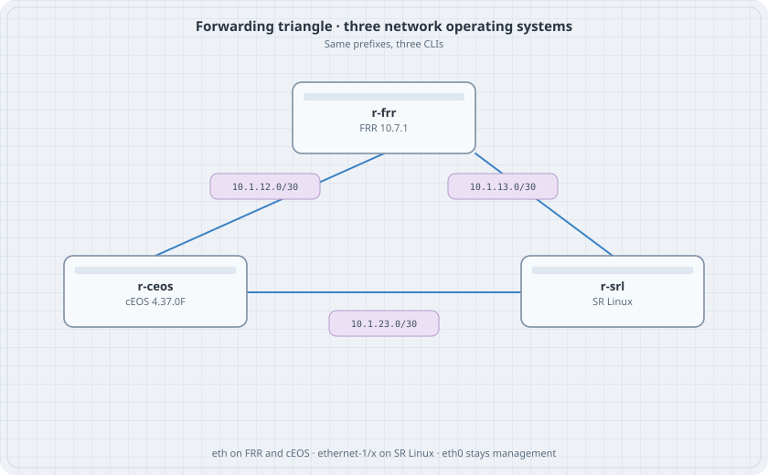

# OSPF Adjacencies and Database Troubleshooting

An OSPF neighbor table is a sequence of clues, not a connectivity test. Diagnose the relationship in stages: can the routers exchange valid Hellos, should they form an adjacency, can they synchronize databases, and does the resulting route reach the forwarding table? This chapter uses OSPFv2 for concrete packet fields. OSPFv3 has different addressing and LSA details; verify its instance and interface configuration independently.

{fig-alt="Three routers connected in a triangle for the OSPF lab."}

## Packet and state vocabulary

OSPF runs directly over IP protocol 89, not TCP or UDP port 89. The five main OSPF packet types are Hello, Database Description (DD), Link State Request (LSR), Link State Update (LSU) and Link State Acknowledgment (LSAck). DD packets summarize database entries; requests ask for missing or newer LSAs; updates carry LSAs; acknowledgments confirm flooding. An **LSA** describes routing information inside an LSU, whereas an LSU is the packet carrying one or more LSAs.

| State | What it tells you | What to investigate if unexpected |
|---|---|---|
| Down | No currently valid Hello from that neighbor | Link, addressing, OSPF enabled on interface, filtering, area and authentication |
| Attempt | On configured non-broadcast networks, attempting contact | Neighbor configuration and unicast reachability |
| Init | A valid Hello arrived, but the local router ID is absent from the neighbor's Hello list | One-way delivery, filtering, multicast or peer processing |
| 2-Way | Each router has seen itself in the other's Hello | On broadcast networks, check DR/BDR roles before declaring a fault |
| ExStart | Neighbors negotiate DD exchange roles and sequence | MTU, duplicate router IDs, DD delivery or implementation logs |
| Exchange | DD summaries are being exchanged | DD retransmissions, MTU, sequence errors and packet loss |
| Loading | Requested LSAs are being obtained | LSR/LSU/LSAck loss, retransmission and database errors |
| Full | The adjacency's initial database synchronization is complete | Still verify the specific LSA, route, forwarding entry and reverse path |

The states may be too brief to observe on a healthy link; transitions can also move backward after an event. `Full` does not mean all traffic can pass, and it does not mean databases across different areas are identical. A router synchronizes the appropriate scoped database with its adjacent neighbor.

## Point-to-point and broadcast behavior

On a point-to-point link, the two routers normally form a full adjacency. On a broadcast LAN, the designated router (DR) and backup designated router (BDR) reduce the number of full adjacencies. Two ordinary routers that are neither DR nor BDR normally stay at 2-Way with one another while each forms Full with the DR and BDR. Check the interface's actual network type and roles before resetting a healthy 2-Way neighbor.

For DR/BDR election, a router with interface priority zero is ineligible; otherwise priority and then router ID influence selection. Election is not ordinarily preemptive: a newly arrived router with a higher priority does not automatically replace the current DR. A mismatch in intended network types can produce unexpected election, neighbor and flooding behavior; inspect both ends rather than assuming every Ethernet interface must be broadcast.

## Evidence before changes

Collect the following from **both** sides with timestamps:

1. Interface state, IP address and prefix, VLAN or link membership, physical MTU, OSPF network type, area, timers, authentication and router ID.
2. Neighbor state, dead timer, DR/BDR role where applicable, transition counts, retransmissions and relevant logs. Look for duplicate router IDs within the OSPF routing domain.
3. Packet captures or counters in both directions. Verify Hello arrival and contents before assuming the configuration is active. A capture on one interface proves observation at that point, not acceptance by the protocol process.
4. For an established adjacency, inspect the LSA by type, link-state ID and advertising router; compare age and sequence where useful. Then inspect OSPF's calculated route, the device's selected RIB route and the actual FIB entry.

Area ID, Hello/dead intervals, authentication and relevant area options must be compatible for OSPFv2 Hellos to be accepted. Other checks depend on network type and implementation. If the neighbor does not appear, a mismatch can cause the receiver to discard a Hello before a neighbor entry is created. A passive interface may advertise its connected network while intentionally suppressing neighbor formation; confirm intent before changing it.

OSPFv2 DD packets advertise interface MTU. A receiver rejects a DD packet that advertises a datagram size larger than it can accept without fragmentation. This can leave an adjacency repeatedly negotiating or exchanging. Compare the actual link and tunnel MTUs, not just an OSPF display; repairing inconsistent MTUs is preferable to hiding the check because a synchronized control plane does not guarantee large data packets will work. MTU is one hypothesis, not the only explanation for ExStart or Exchange.

## A route can fail after Full

If an expected prefix is missing, identify its origin and area, then follow evidence:

- **No originating LSA:** check the source interface, OSPF enablement, passive setting, redistribution policy and originator's database. Passive suppresses Hellos; it does not inherently suppress advertisement of that connected network.
- **LSA present, no OSPF route:** check LSA scope, area connectivity, reachability of the advertising router or forwarding address, route type and the calculation's eligibility rules.
- **OSPF route exists but not selected:** compare competing routes to the same prefix, protocol preferences and policy. Next-hop resolution matters.
- **Selected RIB route but forwarding fails:** inspect FIB programming, outgoing link, neighbor resolution, ACLs, MTU and return path. A ping to a loopback and an application flow may take different policy or ECMP paths.

In OSPFv2, router and network LSAs describe topology within an area; ABRs advertise inter-area reachability; external LSAs describe imported routes subject to area type and flooding scope. Distinguish an LSA's existence from its eligibility to produce a route. For external route metrics, forwarding addresses and redistribution feedback, use [Redistribution Design](03b-redistribution-design.qmd).

## Failure drills

Start from [OSPF in One Area](../09-lab-workbook/10-ospf-one-area.qmd). Record neighbor states and loopback routes on each router. Perform one fault at a time in the isolated lab; platform syntax and exact logs vary. These exercises are test procedures, not a claim that every platform displays the same state.

1. **Hello acceptance:** change the OSPF area on one end of one link. Observe the affected neighbor and Hellos on both sides. Restore the area and verify the adjacency and routes return; other triangle paths may keep the destination reachable throughout.
2. **One-way observation:** selectively filter OSPF packets in one direction on one transit link. Compare both captures and neighbor timers. Depending on timing and implementation, one side can briefly show Init or other transitions before a timeout. Remove the filter and verify recovery. Do not filter unrelated production control traffic.
3. **DD MTU:** use a dedicated point-to-point link and create a documented MTU mismatch between its ends. Compare the DD MTU fields and logs; the smaller side can reject a DD advertising an excessive MTU. Confirm whether a session reset is needed on your platform, restore matching MTUs and verify both adjacency and a suitably sized data packet.
4. **Healthy 2-Way:** connect at least three routers to one broadcast segment, ensure distinct IDs and eligible DR/BDR priorities, and identify the DR/BDR. To observe two ordinary routers in 2-Way with each other and still have both a DR and a BDR, use at least **four** routers with eligible priorities. Verify Full toward the DR and BDR, then restore the topology.
5. **Full but missing route:** keep the transit adjacency intact and remove OSPF advertisement of a test loopback. Verify the adjacency stays Full while the originating LSA and route change. Restore the advertisement and validate the route and forwarding path.

For every drill document the hypothesis, expected state, observations on both ends, the repair and the restored baseline. Do not use neighbor state alone to claim forwarding success.

**References:** [OSPFv2, RFC 2328](https://www.rfc-editor.org/rfc/rfc2328.html), [OSPF terminology update, RFC 9454](https://www.rfc-editor.org/rfc/rfc9454.html), and [OSPFv3, RFC 5340](https://www.rfc-editor.org/rfc/rfc5340.html).
