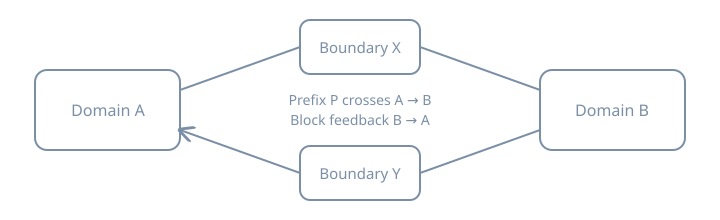

# Redistribution Design and Route Provenance

Redistribution creates a new routing advertisement from a route learned through another source. It is useful during migrations and at boundaries between routing domains, but a second boundary can feed the advertisement back into the domain where it began. The result may be a misleading path, persistent black hole, or forwarding loop even while all routing adjacencies are healthy.

Start with the [redistribution and route-tag workbook lab](../09-lab-workbook/28-redistribute-and-tag.qmd), which shows a single OSPF–BGP boundary. This chapter examines what changes when boundaries are redundant. Commands, redistribution eligibility and default administrative distances differ across implementations; inspect the actual platform rather than assuming a universal behavior.

{fig-alt="Prefix P travels from domain A through boundary X to domain B; a returning path through boundary Y must be filtered."}

## Follow a route across boundaries

Imagine domain A and domain B connected by two boundary routers, X and Y. A originates prefix P. X imports P from A into B. Y learns that B advertisement and could import it back into A. A path can return with a new protocol identity and attributes even though its destination prefix is unchanged. Protocol-local loop prevention, such as BGP AS-path checks, cannot by itself prevent every loop involving a different routing protocol. Multiple redistribution points also create transient risks while a failure is converging.

Before configuring anything, draw each permitted crossing and write its direction, eligible sources, exact prefixes, metric, provenance marker and return filter. Prefer one-way exchange or a controlled default route where the requirements permit. If both directions are required, use explicit prefix allowlists and provenance controls at **every** boundary. Define what happens if the preferred boundary fails; do not assume that changing a route preference fixes route feedback.

## Route selection has separate stages

1. A routing protocol computes or selects its own candidate. OSPF, for example, compares OSPF path types and costs; BGP selects among its eligible paths using its own decision process.
2. The device's route manager chooses among candidates for the **same prefix and prefix length**, commonly using a local protocol preference or administrative distance. Defaults and tie-breaking are implementation-specific.
3. The forwarding table performs longest-prefix matching on the packet destination. A `/25` wins over a `/24` for addresses it covers, even when the `/24` has a more preferred protocol source.
4. Redistribution exports only routes eligible under the implementation's rules and policy. A route in a protocol database is not necessarily selected in the main RIB, installed in the forwarding table, or eligible for export. Verify all three and the advertisement at the next router.

For example, A has native `198.51.100.0/24` and also receives a copy from B. If a boundary chooses the B-derived candidate and forwards back toward a neighbor whose next hop points to that boundary, traffic can loop. The exact outcome depends on the topology, next-hop resolution and platform selection rules; redistribution does not inevitably cause a loop.

## Metrics and OSPF external routes

Metrics from different protocols do not have a universal exchange rate. A hop count of 3, an OSPF cost of 3 and a BGP MED of 3 are not equivalent measurements. Set an intentional seed metric and route type at the target boundary; test the result from multiple locations. Changing the metric can influence which exit a domain uses but does not prove a route is safe to re-export.

For OSPFv2 external routes to the same destination, intra-area and inter-area paths are preferred over external paths; type 1 external paths are preferred over type 2. Within type 1, compare the sum of internal cost to the ASBR or forwarding address and external cost. For type 2, the external metric is the primary cost; internal cost is considered when the relevant higher-priority criteria tie. Other selection details, including ASBR path preference and compatibility settings, can matter. These comparisons are **within OSPF**, before a platform compares a selected OSPF route with candidates from other protocols.

Consider two otherwise comparable external advertisements for the same prefix:

| Exit | Internal cost X | External metric Y | E1 total X+Y | E2 primary Y |
|---|---:|---:|---:|---:|
| X | 10 | 20 | 30 | 20 |
| Y | 30 | 10 | 40 | 10 |

If both are E1, X wins on total cost. If both are E2, Y wins on the lower external metric. If X advertises E1 and Y E2, X wins by path type despite Y's lower displayed number. This example assumes all other applicable selection conditions are equal and the forwarding addresses are reachable.

An OSPF external LSA may specify a forwarding address. When it is nonzero, the router resolves that address through an eligible intra-area or inter-area path; it does not simply forward toward the advertising ASBR. An unreachable forwarding address can leave an LSA visible in the database without an installed usable external route. A zero forwarding address instead directs traffic toward the ASBR. Inspect the LSA, reachability, selected route and forwarding entry separately.

## Mark provenance and deny the return trip

A route tag can record where an external route came from. It is policy metadata, not an automatic loop-prevention mechanism: every relevant boundary must match it and deny the inappropriate return crossing. OSPF external tags are carried in external LSAs, but a tag is not automatically an equivalent BGP community or a universally preserved end-to-end label. Check whether each platform can match, set, copy or translate the metadata at each protocol boundary. A device may discard it on export or summarization; a native route may not have the same tag field as an external route.

Example policy contract, expressed as intent rather than vendor syntax:

| Crossing | Permit | Mark in destination | Deny before permit |
|---|---|---|---|
| A → B | Approved A-origin prefixes | provenance A, if B supports it | anything marked B |
| B → A | Approved B-origin prefixes | provenance B, if A supports it | anything marked A |

Apply the contract at X **and** Y, in both directions. Match exact prefix and length ranges, and include explicit default-deny behavior according to the platform's policy semantics. Test a permitted prefix, a more-specific not intended for export, a route with a return marker, an unmarked route, and the default route. If markers cannot survive a boundary, use other enforceable controls such as disjoint prefix ownership and explicit filtering; do not claim tagging alone protects the design. Allocate tags centrally and document reserved values.

Summarization complicates provenance: an aggregate may cover prefixes from different origins or remain advertised when a component disappears. Test partial and total component failure, discard routes, and whether the aggregate accurately reflects reachability. Never assume a summary's tag represents all of its components without checking the platform's behavior.

## Failure exercises

Use the workbook topology as a baseline, then add a second independently configured boundary with separate transit links and equivalent policy. Keep both source domains isolated from production. Use your lab platform's route database, RIB, FIB, policy counters and packet capture tools to gather evidence:

1. Originate an approved test prefix in A and confirm that both boundaries may advertise it into B with the intended metric and provenance. Verify the selected and alternate paths in B; multiple LSAs do not necessarily imply multiple installed next hops.
2. Verify that both B → A policies reject the returning A-origin route. Inspect the actual tag or translated attribute and the matching policy counter at each boundary; an absent returning route alone does not prove which control stopped it.
3. Withdraw A's original prefix. Observe withdrawals in each protocol and verify that no stale or unmarked return copy sustains reachability. Record convergence times and loss, and restore the prefix.
4. Fail X's transit link. Verify that traffic reaches the destination through Y and that the reverse path works. Restore X, observe reconvergence, and compare forwarding with the pre-failure baseline.
5. In the isolated lab only, remove Y's return filter. Introduce a controlled route that would be eligible for return, inspect the resulting advertisements and next hops, then restore the filter. Whether a loop actually forms depends on route preference and platform export behavior; do not infer a loop solely from duplicate advertisements.
6. Test an unapproved more-specific and a default route. Neither should cross unless the written policy permits it. Check policy counters and advertisements on the receiving side, then remove the test routes.

For each test capture the prefix, source protocol, best path, next hop, route type, metric, tag, export decision, forwarding entry and return path. State the observed outcome rather than assuming a feature is working because the configuration is present.

## Review and references

Why can a route exist in an OSPF database but not in the RIB? Why does a route tag need a corresponding deny rule? What changes if an aggregate remains present after the last reachable component fails? Explain why E1 versus E2 cannot be compared by looking only at their external metric numbers.

References: [OSPFv2, RFC 2328](https://www.rfc-editor.org/rfc/rfc2328.html), particularly external route calculation and external LSAs; [FRR OSPF redistribution](https://docs.frrouting.org/en/stable-8.0/ospfd.html); and [FRR BGP redistribution](https://docs.frrouting.org/en/latest/bgp.html). Consult the exact version and platform used in your lab for commands and defaults.
