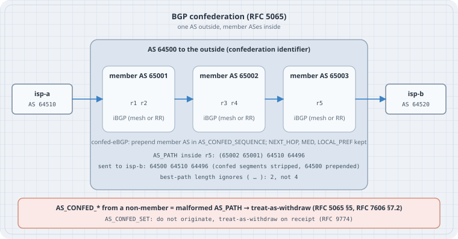

# BGP Confederations: Member ASes, AS_CONFED Segments and How They Differ from Route Reflection

An Internal BGP (iBGP) speaker will not re-advertise a route learned from one iBGP peer to another iBGP peer. That rule prevents routing loops inside an autonomous system (AS) without requiring an `AS_PATH` check, and it forces every iBGP speaker in a flat topology to maintain a session with every other iBGP speaker. For $n$ routers, a full mesh requires $n(n - 1) / 2$ iBGP sessions: 30 routers need 435 sessions, and 100 routers need 4,950. Adding one router requires reconfiguring every existing router in the AS.

Route Reflection, covered in the previous chapter, keeps a single AS and relaxes the iBGP split-horizon rule on designated Route Reflectors (RRs), using `ORIGINATOR_ID` and `CLUSTER_LIST` to prevent loops. BGP Confederations, specified in RFC 5065 (which obsoletes RFC 3065), take the opposite structural approach. Instead of changing how iBGP propagates routes inside one flat AS, a confederation divides the AS internally into multiple smaller Member-ASes. Each Member-AS runs standard iBGP (or its own route reflectors) internally, while the boundaries between Member-ASes run confederation-external BGP (`confed-eBGP`) sessions that use eBGP-style `AS_PATH` loop detection while preserving internal attributes such as `LOCAL_PREF`, `MED`, and `NEXT_HOP`.

To the outside world, the entire confederation still appears as a single autonomous system identified by its Confederation Identifier. External eBGP peers never see the internal Member-AS numbers; the boundary routers strip internal confederation segments and prepend the Confederation Identifier before sending updates outside. For an operator, this matters in two distinct ways. First, confederations provide explicit IGP and policy boundaries inside a single external AS—useful when merging two acquired networks that already have separate IGPs and AS numbers, or when isolating regional backbones. Second, because every router inside a confederation must understand `AS_CONFED_SEQUENCE` and carries its Member-AS number directly in its BGP configuration, migrating into or out of a confederation is far more disruptive than deploying or removing a route reflector.

## Learning goals

- Explain how a BGP confederation reduces iBGP session counts by partitioning one external AS into multiple Member-ASes.
- Decode the wire format of `AS_PATH` segments, distinguishing `AS_SET` (type 1), `AS_SEQUENCE` (type 2), `AS_CONFED_SEQUENCE` (type 3), and `AS_CONFED_SET` (type 4) with 4-octet ASNs.
- Trace how `AS_PATH`, `LOCAL_PREF`, `MED`, and `NEXT_HOP` change—or remain unchanged—across `eBGP-in`, `iBGP`, `confed-eBGP`, and `eBGP-out` boundaries.
- Apply RFC 5065 path-selection rules, including why confederation segments are excluded from `AS_PATH` length calculations and how confederation routes compare against external routes.
- Identify confederation loop-detection conditions, malformed `AS_PATH` errors handled via RFC 7606 treat-as-withdraw, and the RFC 9774 prohibition on `AS_CONFED_SET`.
- Compare BGP confederations against route reflection across operational complexity, migration cost, IGP isolation, and path-hiding behavior.

## Version note

The lab in this chapter was executed on Linux 6.12 with Python 3.13.5 as an unprivileged user (no root access required). The Python model implements the wire encoding, propagation, path-length, loop-detection, and error-handling rules of RFC 5065 (August 2007, obsoleting RFC 3065), RFC 4271 (BGP-4), RFC 6793 (4-octet AS number encoding), RFC 7606 (treat-as-withdraw error handling), and RFC 9774 (May 2025, deprecating `AS_SET` and `AS_CONFED_SET`). Production configuration examples for FRRouting (FRR) and Junos OS in the "In production" section were not executed in this environment; verify exact CLI syntax and defaults against your deployed software version's documentation.

## Splitting an AS: Confederation Identifier and Member ASes

A BGP confederation presents one public identity to external networks while operating as a collection of smaller autonomous systems internally. RFC 5065 defines two distinct identifiers:

- **Confederation Identifier**: The AS number by which the entire confederation is known to the outside world. External peers configure this ASN as their `remote-as`. In our lab, the Confederation Identifier is `64500`.
- **Member-AS Number**: The AS number assigned to an individual sub-AS inside the confederation. Each router belongs to one Member-AS and uses that ASN when establishing sessions with peers inside the same Member-AS and with peers in neighboring Member-ASes. Operators commonly draw Member-AS numbers from the private-use ranges (`64512`–`65534` for 2-octet ASNs, or `4200000000`–`4294967294` for 4-octet ASNs) because they are never exposed to the public Internet. In our lab, the Member-ASes are `65001`, `65002`, and `65003`.

### Topology and session types

Because a confederation sits between external peers and internal routers, a border or backbone router can participate in up to four distinct BGP session types:

1. **`eBGP-in` / `eBGP-out` (External BGP)**: Sessions between a router inside the confederation and a peer in a different external AS (such as `isp-a` in AS `64510` or `isp-b` in AS `64520`). To the external peer, the local router's AS is the Confederation Identifier (`64500`), not its Member-AS.
2. **`iBGP` (Intra-Member iBGP)**: Sessions between two routers in the same Member-AS (for example, `r1` and `r2` in Member-AS `65001`). These behave as standard RFC 4271 iBGP sessions: routes learned via `iBGP` are not re-advertised to other `iBGP` peers in the same Member-AS unless route reflection is also configured inside that Member-AS.
3. **`confed-eBGP` (Confederation-External BGP)**: Sessions between two routers in different Member-ASes of the same confederation (for example, `r2` in `65001` peering with `r3` in `65002`). Although the two routers use different ASNs (`remote-as 65002` from `r2`'s perspective) and prepend to the `AS_PATH`, they are part of the same administrative domain and exchange internal attributes as if they were iBGP peers.

```text
External AS 64510                                        External AS 64520
    +-------+                                                +-------+
    | isp-a |                                                | isp-b |
    +---+---+                                                +---+---+
        | eBGP-in                                                | eBGP-out
        v                                                        ^
+-------|--------------------------------------------------------|-------+
|  Confederation 64500                                           |       |
|                                                                |       |
|  +-----------------+     +-----------------+     +-------------+----+  |
|  | Member-AS 65001 |     | Member-AS 65002 |     | Member-AS 65003  |  |
|  |                 |     |                 |     |                  |  |
|  |  (r1)---->(r2)--------->(r3)---->(r4)--------->(r5)              |  |
|  |       iBGP      |     |       iBGP      |     |                  |  |
|  +-----------------+     +-----------------+     +------------------+  |
|                     ^                       ^                          |
|                confed-eBGP             confed-eBGP                     |
+------------------------------------------------------------------------+
```

Notice how each Member-AS boundary acts like a clean administrative seam. Inside Member-AS `65001`, `r1` and `r2` need a full mesh (here, just one session) or a local route reflector. Between `65001` and `65002`, `r2` and `r3` only need the `confed-eBGP` sessions defined by the physical or logical inter-member topology. `r1` does not need an iBGP session with `r3`, `r4`, or `r5`.

### Session count arithmetic

Partitioning $n$ routers into $k$ equal Member-ASes of $n/k$ routers reduces the intra-member iBGP session count from:

$$\frac{n(n - 1)}{2}$$

to:

$$k \cdot \frac{(n/k)(n/k - 1)}{2} = \frac{n(n/k - 1)}{2}$$

plus whatever `confed-eBGP` sessions connect the Member-ASes. For 30 routers:

- A flat iBGP full mesh requires $30 \times 29 / 2 = 435$ sessions.
- Splitting into 3 Member-ASes of 10 routers drops intra-member iBGP sessions to $3 \times (10 \times 9 / 2) = 135$, plus a handful of inter-member `confed-eBGP` links (2 in a simple chain, or 3 in a triangle).
- Splitting into 5 Member-ASes of 6 routers drops intra-member iBGP sessions to $5 \times (6 \times 5 / 2) = 75$, plus inter-member links (4 in a chain).
- By comparison, 2 route reflectors serving 28 clients require $2 \times 28 + 1 = 57$ sessions (each client peers with both RRs, plus one session between the RRs).

Confederations reduce session counts substantially compared to a full mesh, though usually not as aggressively as a two-tier route reflector hierarchy unless Member-ASes are made very small (which increases `confed-eBGP` configuration overhead).

## AS_CONFED segments and wire encoding

To track which Member-ASes a route has traversed inside a confederation without leaking those private ASNs to external peers, RFC 5065 defines two `AS_PATH` segment types alongside the two standard RFC 4271 types.

### The four AS_PATH segment types

Every `AS_PATH` attribute is a sequence of path segments. Each segment has a type code, a length (number of ASNs in that segment), and a list of ASNs:

| Type Code | Segment Name | Display Notation | Meaning | RFC 9774 Status |
| :--- | :--- | :--- | :--- | :--- |
| `1` | `AS_SET` | `{64510 64520}` | Unordered set of external ASes traversed (used in route aggregation) | Deprecated; MUST NOT advertise |
| `2` | `AS_SEQUENCE` | `64510 64496` | Ordered sequence of external ASes traversed | Active |
| `3` | `AS_CONFED_SEQUENCE` | `(65002 65001)` | Ordered sequence of Member-ASes traversed inside the local confederation | Active |
| `4` | `AS_CONFED_SET` | `[65001 65002]` | Unordered set of Member-ASes traversed (used in aggregation inside confed) | Deprecated; MUST NOT advertise |

In CLI output across common router operating systems (and in the lab's `show()` helper), `AS_CONFED_SEQUENCE` is enclosed in parentheses `( ... )` and `AS_CONFED_SET` is enclosed in square brackets `[ ... ]`, distinguishing them visually from regular `AS_SEQUENCE` (bare numbers) and `AS_SET` (curly braces `{ ... }`).

### Wire format with 4-octet ASNs

On the wire, BGP encodes each `AS_PATH` segment as a 1-octet Segment Type, a 1-octet Segment Length (counting ASNs, not bytes), and the list of ASNs. Under RFC 4271 alone, each ASN occupied 2 octets. Since RFC 6793 (4-octet AS number support), BGP speakers that negotiate the 4-octet AS capability encode every ASN in `AS_PATH`—including Member-ASNs in `AS_CONFED_SEQUENCE`—as a 4-octet big-endian unsigned integer:

```text
 0                   1                   2                   3
 0 1 2 3 4 5 6 7 8 9 0 1 2 3 4 5 6 7 8 9 0 1 2 3 4 5 6 7 8 9 0 1
+-+-+-+-+-+-+-+-+-+-+-+-+-+-+-+-+-+-+-+-+-+-+-+-+-+-+-+-+-+-+-+-+
| Segment Type  | Segment Count |         ASN 1 (high)          |
+-+-+-+-+-+-+-+-+-+-+-+-+-+-+-+-+-+-+-+-+-+-+-+-+-+-+-+-+-+-+-+-+
|         ASN 1 (low)           |         ASN 2 (high)          |
+-+-+-+-+-+-+-+-+-+-+-+-+-+-+-+-+-+-+-+-+-+-+-+-+-+-+-+-+-+-+-+-+
|         ASN 2 (low)           |  ...                          |
+-+-+-+-+-+-+-+-+-+-+-+-+-+-+-+-+-+-+-+-+-+-+-+-+-+-+-+-+-+-+-+-+
```

Because Segment Count is a 1-octet field, a single segment can hold at most 255 ASNs. If prepending an ASN would push an existing leading segment past 255 entries, the speaker must start a new segment of the same type in front of it. With 4-octet ASNs, a segment of type `3` and count `2` occupies $2 + 2 \times 4 = 10$ octets on the wire.

### RFC 9774 and the deprecation of AS_CONFED_SET

RFC 5065 originally defined `AS_CONFED_SET` (type 4) for the same reason RFC 4271 defined `AS_SET` (type 1): when a router aggregates multiple more-specific routes that traversed different Member-ASes into a single summary prefix, an unordered set preserves loop-detection information for all contributing Member-ASes without implying a false linear path.

In practice, `AS_SET` and `AS_CONFED_SET` created persistent operational and security problems—most notably incompatibility with Resource Public Key Infrastructure (RPKI) origin validation, because an unordered set obscures which AS actually originated the prefix, and inconsistent path-length or loop-handling behavior across implementations. RFC 6472 (BCP 172) previously recommended against generating `AS_SET` and `AS_CONFED_SET`. In May 2025, **RFC 9774** obsoleted RFC 6472 and formally updated both RFC 4271 and RFC 5065:

- BGP speakers **MUST NOT** advertise `UPDATE` messages containing `AS_SET` or `AS_CONFED_SET` segments.
- Upon receiving an `UPDATE` containing `AS_SET` or `AS_CONFED_SET`, a BGP speaker **MUST** apply **treat-as-withdraw** (RFC 7606), unless explicitly configured otherwise for a transition period.

Operators summarizing prefixes inside a confederation today should use `summary-only` aggregation without `AS_SET` / `AS_CONFED_SET` (relying on the aggregating Member-AS as the origin) rather than generating type 1 or type 4 segments.

## Propagation, attributes, and path selection

{fig-alt="Confederation 64500 with member ASes 65001 (r1, r2), 65002 (r3, r4) and 65003 (r5), isp-a in AS 64510 and isp-b in AS 64520. Inside r5 the AS_PATH is (65002 65001) 64510 64496; isp-b receives 64500 64510 64496. Path length ignores the confederation segments. AS_CONFED segments from a non-member are treat-as-withdraw; AS_CONFED_SET must not be originated (RFC 9774)."}

The defining behavior of a confederation is how a router treats `AS_PATH` and path attributes differently depending on whether a peer is in the same Member-AS, a different Member-AS, or outside the confederation altogether.

### AS_PATH rewriting rules

RFC 5065 section 4.1 specifies three rules for modifying `AS_PATH` when sending an `UPDATE`:

1. **Sending to a peer in the same Member-AS (`iBGP`)**: Do not modify `AS_PATH`. Any existing `AS_CONFED_SEQUENCE` and `AS_SEQUENCE` segments pass through unchanged.
2. **Sending to a peer in a different Member-AS of the same confederation (`confed-eBGP`)**: Prepend the local Member-AS number to the `AS_PATH` as an `AS_CONFED_SEQUENCE`.
   - If the first segment in `AS_PATH` is already an `AS_CONFED_SEQUENCE` (with fewer than 255 ASNs), prepend the local Member-AS number to the front of that segment.
   - If `AS_PATH` is empty or its first segment is not `AS_CONFED_SEQUENCE` (for instance, it starts with `AS_SEQUENCE` from an external peer), create a new `AS_CONFED_SEQUENCE` segment containing the local Member-AS number and place it at the front.
3. **Sending to a peer outside the confederation (`eBGP-out`)**:
   - Remove all `AS_CONFED_SEQUENCE` and `AS_CONFED_SET` segments from `AS_PATH`.
   - Prepend the **Confederation Identifier** (not the Member-AS number) as an `AS_SEQUENCE` (merging into an existing leading `AS_SEQUENCE` if present and below 255 ASNs, or creating a new `AS_SEQUENCE`).

When a route enters from an external peer (`eBGP-in`), the external peer has already prepended its own external AS as an `AS_SEQUENCE`. Inside the confederation, the `AS_CONFED_SEQUENCE` grows at the front as the route crosses Member-AS boundaries, then vanishes completely when the route exits the confederation, replaced by the single Confederation Identifier.

### NEXT_HOP, LOCAL_PREF, and MED across member boundaries

Although `confed-eBGP` sessions use different AS numbers on each side and prepend Member-ASNs, RFC 5065 sections 5.1 and 5.2 allow iBGP-like attribute handling across Member-AS boundaries:

- **`NEXT_HOP`**: By default, `NEXT_HOP` is **not** rewritten when advertising a route over a `confed-eBGP` session. If `r1` learns a route from `isp-a` with `NEXT_HOP = isp-a`, `r2` advertises it to `r3`, and `r4` advertises it to `r5` with `NEXT_HOP` still pointing to `isp-a`. This assumes either a shared IGP across the confederation (so `r5` can reach `isp-a` or `r1`'s `next-hop-self` address) or explicit policy on the `confed-eBGP` border routers to set `next-hop-self` when each Member-AS runs its own isolated IGP. When advertising to an external peer (`eBGP-out`), standard eBGP rules apply and `r5` sets `NEXT_HOP` to itself.
- **`LOCAL_PREF`**: A speaker **MAY** send `LOCAL_PREF` across `confed-eBGP` sessions, and common implementations preserve it. If `r1` sets `LOCAL_PREF = 200` on ingress from `isp-a`, `r3` and `r5` in other Member-ASes see `LOCAL_PREF = 200` and make consistent exit decisions. On `eBGP-out`, `LOCAL_PREF` is stripped, just as on any external eBGP session.
- **`MED` (Multi-Exit Discriminator)**: A speaker **MAY** pass an unchanged `MED` to a neighboring Member-AS. Under RFC 5065 section 5.2, `MED` values **SHOULD** only be compared between routes whose first AS in the `AS_SEQUENCE` (after skipping `AS_CONFED_*` segments) is the same external AS—matching standard BGP-4 behavior—though an operator **MAY** configure the router to compare `MED` across different Member-ASes (for example, `bgp bestpath med confed` in FRRouting).

### Path selection and AS_PATH length

RFC 5065 section 5.3 adjusts three steps of the BGP-4 best-path decision process (RFC 4271 section 9.1.2.2) so that internal Member-AS hops do not distort routing against external paths:

1. **eBGP-over-iBGP tie-breaker**: Routes learned over `confed-eBGP` sessions are treated as **internal** (equivalent to `iBGP`), not external. A router in Member-AS `65003` with a direct `eBGP-in` path to an external peer will prefer that `eBGP-in` path over a `confed-eBGP` path of equal `LOCAL_PREF` and `AS_PATH` length, enabling hot-potato routing out of the nearest border router.
2. **AS_PATH length**: `AS_CONFED_SEQUENCE` and `AS_CONFED_SET` segments **SHOULD NOT** be counted when computing `AS_PATH` length. A route that crossed two Member-ASes `(65003 65002)` after entering from `64510 64496` has an `AS_PATH` length of **2**, not 4. Without this rule, routers deep inside a confederation would systematically prefer longer external paths just to avoid internal Member-AS hops.
3. **Neighbor AS for MED comparison**: If `AS_PATH` contains only `AS_CONFED_*` segments (a locally originated route inside the confederation), the neighbor AS is the local AS; otherwise, the neighbor AS is the leftmost AS in the first `AS_SEQUENCE` following the `AS_CONFED_*` segments.

## Loop detection and error handling

Splitting an AS into Member-ASes introduces two distinct loop-prevention scopes: one for Member-ASes inside the confederation, and one for the Confederation Identifier outside it.

### Confederation loop rules

When a BGP speaker inside a confederation receives an `UPDATE`, it checks both scopes:

- **Member-AS loop**: If any `AS_CONFED_SEQUENCE` or `AS_CONFED_SET` segment in `AS_PATH` contains the receiver's own Member-AS number, the route has looped across Member-AS boundaries and must be rejected (ignored or withdrawn). Note that a Member-AS number appearing inside an `AS_CONFED_*` segment only triggers loop detection on a router belonging to *that* Member-AS.
- **Confederation Identifier loop**: If any `AS_SEQUENCE` or `AS_SET` segment contains the Confederation Identifier (`64500`), the route has exited the confederation and re-entered from outside, so every speaker inside the confederation rejects it.

External peers perform normal RFC 4271 loop detection: they check whether their own ASN appears in `AS_PATH`. Because `eBGP-out` strips all `AS_CONFED_*` segments, external peers never see Member-ASNs.

### Malformed AS_PATH and RFC 7606 treat-as-withdraw

RFC 5065 section 5 defines two strict boundary invariants:

1. **No `AS_CONFED_*` on external sessions**: A speaker **MUST NOT** send `AS_CONFED_SEQUENCE` or `AS_CONFED_SET` to a non-member peer. Conversely, receiving an `UPDATE` containing `AS_CONFED_*` from a peer outside the confederation is a malformed `AS_PATH` error.
2. **Mandatory leading `AS_CONFED_SEQUENCE` on `confed-eBGP`**: When receiving an `UPDATE` from a peer in a different Member-AS of the same confederation, the first segment in `AS_PATH` **MUST** be `AS_CONFED_SEQUENCE` (containing at least the sending peer's Member-AS). If a buggy speaker forgets to prepend its Member-AS and sends an `AS_SEQUENCE` first, the receiver must treat the `AS_PATH` as malformed.

Under RFC 4271 alone, a malformed `AS_PATH` triggered a `NOTIFICATION` message (Error Code 3, Subcode 11: Malformed `AS_PATH`) and tore down the entire BGP session. **RFC 7606** section 7.2 revised this behavior: a malformed `AS_PATH` (including `AS_CONFED_*` received from a non-member peer) is handled with **treat-as-withdraw**, meaning the receiver withdraws any previously learned route for the NLRI in that `UPDATE` and keeps the BGP session up rather than resetting all prefixes over a single bad update.

## Confederations versus Route Reflection

Both mechanisms solve the $n(n-1)/2$ iBGP full-mesh problem, and neither changes the fundamental BGP-4 rule that iBGP speakers do not re-advertise iBGP-learned routes to arbitrary iBGP peers. Their operational trade-offs, however, are nearly orthogonal:

| Dimension | BGP Confederations (RFC 5065) | Route Reflection (RFC 4456) |
| :--- | :--- | :--- |
| **External appearance** | Single AS (Confederation Identifier) | Single AS |
| **Internal AS numbering** | Multiple Member-ASes configured on every router | Single AS across all routers |
| **Speaker support required** | Every router in the confederation must support RFC 5065 | Only Route Reflectors need RR support; clients run plain iBGP |
| **Loop prevention attributes** | `AS_CONFED_SEQUENCE` (and legacy `AS_CONFED_SET`) in `AS_PATH` | `ORIGINATOR_ID` and `CLUSTER_LIST` |
| **IGP & policy boundaries** | Natural boundary per Member-AS (can run separate IGPs with `next-hop-self`) | Typically assumes one shared IGP across the AS |
| **Path hiding** | Each Member-AS border can advertise its own best path; inter-member links still follow single best-path advertisement | RRs advertise only their single best path per NLRI (unless ADD-PATH is deployed) |
| **Migration / renumbering** | Disruptive: changing Member-AS requires reconfiguring `router bgp <asn>` and neighbor `remote-as` | Non-disruptive: per-router role change (`route-reflector-client`) with no AS renumbering |
| **Classic use case** | M&A network integration, multi-IGP backbones, regional policy isolation | Standard SP and large enterprise iBGP scaling |

Operators frequently combine both mechanisms: a large network is split into a small number of regional Member-ASes (for example, by continent or acquired subsidiary) to preserve IGP and policy boundaries, and each Member-AS uses Route Reflectors internally so routers within a region do not need a full mesh.

## The lab

The lab uses a self-contained Python model (`confed.py`) rather than a live routing daemon so we can inspect raw wire bytes, exact segment transitions, and malformed-packet edge cases in one run. It is a teaching model, not a full BGP implementation: it models `AS_PATH` encoding, `LOCAL_PREF`, `MED`, `NEXT_HOP`, loop detection, and RFC 7606 / RFC 9774 validation, while omitting the rest of the BGP finite state machine and tie-breaking steps beyond `AS_PATH` length.

### Lab files

The Python script implementing the RFC 5065 confederation model and six verification scenarios.

```{.python filename="confed.py"}
"""BGP confederations (RFC 5065) as a model: AS_PATH segment encoding,
propagation across member-AS boundaries, path-length rules, loop detection
and RFC 7606 handling. Pure Python, no routing daemon."""
import struct
AS_SET, AS_SEQUENCE, AS_CONFED_SEQUENCE, AS_CONFED_SET = 1, 2, 3, 4
NAME = {1: "AS_SET", 2: "AS_SEQUENCE", 3: "AS_CONFED_SEQUENCE", 4: "AS_CONFED_SET"}

def encode(path):                       # path: list of (type, [asn...]); 4-octet ASNs
    out = b""
    for t, asns in path:
        out += bytes([t, len(asns)]) + b"".join(struct.pack("!I", a) for a in asns)
    return out

def decode(b):
    path, i = [], 0
    while i < len(b):
        t, n = b[i], b[i + 1]
        path.append((t, list(struct.unpack("!%dI" % n, b[i + 2:i + 2 + 4 * n])))); i += 2 + 4 * n
    return path

def show(path):
    parts = []
    for t, a in path:
        s = " ".join(map(str, a))
        parts.append({AS_SEQUENCE: s, AS_SET: "{" + s + "}", AS_CONFED_SEQUENCE: "(" + s + ")",
                      AS_CONFED_SET: "[" + s + "]"}[t])
    return " ".join(parts) or "(empty)"

def prepend(path, t, asn):
    if path and path[0][0] == t and len(path[0][1]) < 255:
        return [(t, [asn] + path[0][1])] + path[1:]
    return [(t, [asn])] + path

def strip_confed(path):                 # RFC 5065 sec. 4.1 (3): leaving the confederation
    return [(t, a) for t, a in path if t not in (AS_CONFED_SEQUENCE, AS_CONFED_SET)]

def path_length(path, count_confed=False):   # RFC 4271 9.1.2.2 a) + RFC 5065 5.3
    n = 0
    for t, a in path:
        if t == AS_SEQUENCE: n += len(a)
        elif t == AS_SET: n += 1
        elif count_confed: n += len(a) if t == AS_CONFED_SEQUENCE else 1
    return n

CONFED_ID = 64500
MEMBERS = {"r1": 65001, "r2": 65001, "r3": 65002, "r4": 65002, "r5": 65003}
EXTERNAL = {"isp-a": 64510, "isp-b": 64520}

def send(route, frm, to):
    """Return the route as `to` receives it, or None if `to` rejects it."""
    r = dict(route); path = r["as_path"]
    fa = MEMBERS.get(frm) or EXTERNAL[frm]
    ta = MEMBERS.get(to) or EXTERNAL[to]
    if frm in MEMBERS and to in MEMBERS and fa == ta:          # plain iBGP inside a member AS
        kind = "iBGP"
    elif frm in MEMBERS and to in MEMBERS:                      # confederation-external BGP
        kind = "confed-eBGP"
        if not route.get("_skip_prepend"):
            path = prepend(path, AS_CONFED_SEQUENCE, fa)       # LOCAL_PREF, MED, NEXT_HOP kept
        if not path or path[0][0] != AS_CONFED_SEQUENCE:
            return None, kind, "malformed AS_PATH: confed peer in another member AS, first segment not AS_CONFED_SEQUENCE (RFC 5065 sec. 5)"
    elif frm in MEMBERS:                                        # leaving the confederation
        kind = "eBGP-out"
        path = prepend(strip_confed(path), AS_SEQUENCE, CONFED_ID)
        r.pop("local_pref", None); r.pop("med", None); r["next_hop"] = f"{frm}-self"   # RFC 4271 5.1.4: MED not passed on
    else:                                                       # entering from outside
        kind = "eBGP-in"
        if any(t in (AS_CONFED_SEQUENCE, AS_CONFED_SET) for t, _ in path):
            return None, kind, "malformed AS_PATH: confed segment from a non-member peer (RFC 5065 sec. 5) -> treat-as-withdraw (RFC 7606 sec. 7.2)"
        path = prepend(path, AS_SEQUENCE, fa) if path[:1] and path[0][1][:1] != [fa] else path
        r["local_pref"] = 100
    # loop detection on receipt
    if to in MEMBERS:
        if any(t in (AS_CONFED_SEQUENCE, AS_CONFED_SET) and ta in a for t, a in path):
            return None, kind, f"loop: own member AS {ta} in confed segment"
        if any(t in (AS_SEQUENCE, AS_SET) and CONFED_ID in a for t, a in path):
            return None, kind, f"loop: confederation id {CONFED_ID} in AS_PATH"
    elif any(ta in a for t, a in path):
        return None, kind, f"loop: own AS {ta}"
    r["as_path"] = path
    return r, kind, None

print("== 1. Wire encoding of AS_PATH segments ==")
p = [(AS_CONFED_SEQUENCE, [65002, 65001]), (AS_SEQUENCE, [64510, 64496])]
b = encode(p)
print("  path   :", show(p))
print("  bytes  :", b.hex(" ", 2))
print("  decoded:", [(NAME[t], a) for t, a in decode(b)])

print("\n== 2. A route from isp-a crosses the confederation and leaves via isp-b ==")
route = {"prefix": "203.0.113.0/24", "as_path": [(AS_SEQUENCE, [64510, 64496])], "med": 50, "next_hop": "isp-a"}
hops = [("isp-a", "r1"), ("r1", "r2"), ("r2", "r3"), ("r3", "r4"), ("r4", "r5"), ("r5", "isp-b")]
cur = route
for frm, to in hops:
    cur, kind, why = send(cur, frm, to)
    lp = cur.get("local_pref", "-") if cur else "-"
    print(f"  {frm:>5} -> {to:<5} {kind:<12} as_path={show(cur['as_path']):<32} lp={lp:<4} med={cur.get('med', '-')} nh={cur['next_hop']}")
    if lp != "-" and kind == "eBGP-in": cur["local_pref"] = 200        # local policy at r1

print("\n== 3. Path length: confed segments do not count ==")
a = {"as_path": [(AS_CONFED_SEQUENCE, [65003, 65002]), (AS_SEQUENCE, [64510, 64496])]}
b2 = {"as_path": [(AS_SEQUENCE, [64520, 64499, 64496])]}
for n, r in (("via two member ASes", a), ("direct from isp-b", b2)):
    print(f"  {n:<20} {show(r['as_path']):<34} RFC length {path_length(r['as_path'])}  naive length {path_length(r['as_path'], True)}")

print("\n== 4. Loop detection ==")
looped = {"prefix": "203.0.113.0/24", "as_path": [(AS_CONFED_SEQUENCE, [65003, 65002, 65001]), (AS_SEQUENCE, [64510])], "med": 0, "next_hop": "x"}
for frm, to in (("r5", "r1"), ("r5", "r3")):
    r, kind, why = send(looped, frm, to)
    print(f"  {frm} -> {to}: {kind}: {why}")
back_in = {"prefix": "198.51.100.0/24", "as_path": [(AS_SEQUENCE, [64520, 64500, 64510])], "med": 0, "next_hop": "x"}
r, kind, why = send(back_in, "isp-a", "r1"); print(f"  isp-a -> r1: {kind}: {why}")

print("\n== 5. Malformed and deprecated confederation paths ==")
bogus = {"prefix": "192.0.2.0/24", "as_path": [(AS_CONFED_SEQUENCE, [65099]), (AS_SEQUENCE, [64510])], "med": 0, "next_hop": "x"}
r, kind, why = send(bogus, "isp-a", "r1"); print(f"  isp-a -> r1: {why}")
buggy = {"prefix": "192.0.2.0/24", "as_path": [(AS_SEQUENCE, [64510])], "med": 0, "next_hop": "x", "_skip_prepend": True}
r, kind, why = send(buggy, "r2", "r3"); print(f"  r2 -> r3 (sender forgot its member AS): {why}")
aset = {"prefix": "192.0.2.0/23", "as_path": [(AS_CONFED_SET, [65001, 65002]), (AS_SEQUENCE, [64510])], "med": 0, "next_hop": "x"}
print(f"  aggregate with AS_CONFED_SET {show(aset['as_path'])}: RFC 9774 -> do not originate; treat-as-withdraw on receipt")

print("\n== 6. iBGP session counts for 30 routers ==")
n = 30
print(f"  full mesh: {n*(n-1)//2}")
for k in (3, 5):
    per = n // k
    inside = k * per * (per - 1) // 2
    print(f"  {k} member ASes of {per}: {inside} intra-member iBGP + inter-member eBGP links (topology-dependent, e.g. {k-1} for a chain)")
print(f"  2 route reflectors, 28 clients: {2*28 + 1} sessions (each client to both RRs + RR-RR)")
```
The shell wrapper that executes the Python model.

```{.bash filename="run.sh"}
#!/bin/sh
python3 confed.py
```
Run the lab with `sh run.sh`. It is plain Python with no sockets, so it needs no root.

### Execution output

```text
== 1. Wire encoding of AS_PATH segments ==
  path   : (65002 65001) 64510 64496
  bytes  : 0302 0000 fdea 0000 fde9 0202 0000 fbfe 0000 fbf0
  decoded: [('AS_CONFED_SEQUENCE', [65002, 65001]), ('AS_SEQUENCE', [64510, 64496])]

== 2. A route from isp-a crosses the confederation and leaves via isp-b ==
  isp-a -> r1    eBGP-in      as_path=64510 64496                      lp=100  med=50 nh=isp-a
     r1 -> r2    iBGP         as_path=64510 64496                      lp=200  med=50 nh=isp-a
     r2 -> r3    confed-eBGP  as_path=(65001) 64510 64496              lp=200  med=50 nh=isp-a
     r3 -> r4    iBGP         as_path=(65001) 64510 64496              lp=200  med=50 nh=isp-a
     r4 -> r5    confed-eBGP  as_path=(65002 65001) 64510 64496        lp=200  med=50 nh=isp-a
     r5 -> isp-b eBGP-out     as_path=64500 64510 64496                lp=-    med=- nh=r5-self

== 3. Path length: confed segments do not count ==
  via two member ASes  (65003 65002) 64510 64496          RFC length 2  naive length 4
  direct from isp-b    64520 64499 64496                  RFC length 3  naive length 3

== 4. Loop detection ==
  r5 -> r1: confed-eBGP: loop: own member AS 65001 in confed segment
  r5 -> r3: confed-eBGP: loop: own member AS 65002 in confed segment
  isp-a -> r1: eBGP-in: loop: confederation id 64500 in AS_PATH

== 5. Malformed and deprecated confederation paths ==
  isp-a -> r1: malformed AS_PATH: confed segment from a non-member peer (RFC 5065 sec. 5) -> treat-as-withdraw (RFC 7606 sec. 7.2)
  r2 -> r3 (sender forgot its member AS): malformed AS_PATH: confed peer in another member AS, first segment not AS_CONFED_SEQUENCE (RFC 5065 sec. 5)
  aggregate with AS_CONFED_SET [65001 65002] 64510: RFC 9774 -> do not originate; treat-as-withdraw on receipt

== 6. iBGP session counts for 30 routers ==
  full mesh: 435
  3 member ASes of 10: 135 intra-member iBGP + inter-member eBGP links (topology-dependent, e.g. 2 for a chain)
  5 member ASes of 6: 75 intra-member iBGP + inter-member eBGP links (topology-dependent, e.g. 4 for a chain)
  2 route reflectors, 28 clients: 57 sessions (each client to both RRs + RR-RR)
```
## Reading the output

Each numbered section in the output corresponds to one mechanism from RFC 5065, RFC 7606, or RFC 9774.

### 1. Wire encoding of AS_PATH segments

The first section encodes the path `(65002 65001) 64510 64496` into 4-octet wire format and decodes it back. The 20-byte hex string `0302 0000 fdea 0000 fde9 0202 0000 fbfe 0000 fbf0` breaks down field by field:

- `03` (`AS_CONFED_SEQUENCE`), `02` (2 ASNs in this segment):
  - `0000 fdea`: $65002$ in 4-octet big-endian hex ($15 \times 4096 + 13 \times 256 + 14 \times 16 + 10 = 65002$).
  - `0000 fde9`: $65001$.
- `02` (`AS_SEQUENCE`), `02` (2 ASNs in this segment):
  - `0000 fbfe`: $64510$.
  - `0000 fbf0`: $64496$.

Every ASN uses 4 octets per RFC 6793, so each 2-ASN segment takes $2 + 2 \times 4 = 10$ octets, totaling 20 octets.

### 2. Route propagation across the confederation

The second section traces `203.0.113.0/24` originating behind `isp-a` (`64510 64496`, `med=50`, `nh=isp-a`) as it crosses three Member-ASes (`65001` -> `65002` -> `65003`) and exits to `isp-b`:

- `isp-a -> r1` (`eBGP-in`): `r1` receives `64510 64496`, assigns the default `lp=100`, keeps `med=50`, and keeps `nh=isp-a`. Immediately after ingress, `r1`'s local import policy raises `LOCAL_PREF` to `200`.
- `r1 -> r2` (`iBGP`): Both routers are in Member-AS `65001`. `AS_PATH` stays `64510 64496`, and `lp=200`, `med=50`, `nh=isp-a` are unchanged.
- `r2 -> r3` (`confed-eBGP`): Crossing from Member-AS `65001` to `65002`, `r2` creates an `AS_CONFED_SEQUENCE` at the front, producing `(65001) 64510 64496`. Crucially, `lp=200`, `med=50`, and `nh=isp-a` all survive the `confed-eBGP` boundary.
- `r3 -> r4` (`iBGP`): Inside Member-AS `65002`, nothing changes.
- `r4 -> r5` (`confed-eBGP`): Crossing from `65002` to `65003`, `r4` prepends `65002` to the existing leading `AS_CONFED_SEQUENCE`, yielding `(65002 65001) 64510 64496`. `lp=200`, `med=50`, and `nh=isp-a` remain intact.
- `r5 -> isp-b` (`eBGP-out`): Leaving the confederation, `r5` strips `(65002 65001)` completely, prepends the Confederation Identifier `64500` as an `AS_SEQUENCE` (`64500 64510 64496`), removes `LOCAL_PREF` (`lp=-`), drops `MED` (`med=-`; RFC 4271 section 5.1.4: a MED received from a neighboring AS MUST NOT be propagated to other neighboring ASes) and sets `nh=r5-self`.

### 3. Path length calculation

The third section compares a route learned across two internal Member-ASes, `(65003 65002) 64510 64496`, against a direct external route `64520 64499 64496`:

- Under RFC 5065 section 5.3, `AS_CONFED_SEQUENCE` is excluded from the length count, so the internal confederation path has `RFC length 2` (`64510` and `64496`), beating the direct path's `RFC length 3`.
- A naive implementation that counted confederation segments would compute `naive length 4`, causing the router to wrongly prefer the 3-hop external path.

### 4. Loop detection

The fourth section tests three loop conditions:

- `r5 -> r1` (`confed-eBGP`): `r1` (Member-AS `65001`) rejects `(65003 65002 65001) 64510` because its own Member-AS `65001` appears in the `AS_CONFED_SEQUENCE`.
- `r5 -> r3` (`confed-eBGP`): `r3` (Member-AS `65002`) rejects the same path because `65002` is present in the `AS_CONFED_SEQUENCE`.
- `isp-a -> r1` (`eBGP-in`): `r1` rejects `64520 64500 64510` because the Confederation Identifier `64500` appears in the `AS_SEQUENCE`, indicating the route already transited this confederation and looped back externally.

### 5. Malformed and deprecated confederation paths

The fifth section exercises three protocol violations:

- `isp-a -> r1` with `(65099) 64510`: `r1` receives an `AS_CONFED_SEQUENCE` from a non-member external peer (`isp-a`). Per RFC 5065 section 5 and RFC 7606 section 7.2, `r1` treats the update as malformed and applies `treat-as-withdraw`.
- `r2 -> r3` where `r2` failed to prepend its Member-AS (`_skip_prepend`): `r3` receives an `UPDATE` over `confed-eBGP` whose first segment is `AS_SEQUENCE` (`64510`) instead of `AS_CONFED_SEQUENCE`, violating RFC 5065 section 5.
- An aggregate with `AS_CONFED_SET` (`[65001 65002] 64510`): under RFC 9774, speakers must not originate `AS_CONFED_SET` and must apply `treat-as-withdraw` on receipt.

### 6. iBGP session counts for 30 routers

The final section quantifies the scaling trade-off for $n = 30$ routers:

- `full mesh: 435` sessions ($30 \times 29 / 2$).
- `3 member ASes of 10`: `135` intra-member iBGP sessions ($3 \times 45$) plus inter-member `confed-eBGP` links (e.g., `2` for a chain).
- `5 member ASes of 6`: `75` intra-member iBGP sessions ($5 \times 15$) plus inter-member links (e.g., `4` for a chain).
- `2 route reflectors, 28 clients`: `57` sessions ($2 \times 28 + 1$).

## In production

In production, every router inside a confederation is configured with its Member-AS as its local `router bgp` ASN, plus the shared Confederation Identifier and the list of peer Member-ASNs.

In FRRouting (FRR) (`bgpd`), a router in Member-AS `65001` inside Confederation `64500` is configured as follows (not run here):

```text
! FRRouting (not run here) - check your FRR version's docs
router bgp 65001
 bgp router-id 192.0.2.1
 bgp confederation identifier 64500
 bgp confederation peers 65002 65003
 neighbor 192.0.2.2 remote-as 65001
 neighbor 198.51.100.2 remote-as 65002
 ! If Member-ASes run separate IGPs, rewrite next-hop at the boundary:
 ! neighbor 198.51.100.2 next-hop-self
 ! Optional: compare MED across different Member-ASes (RFC 5065 5.2 MAY):
 ! bgp bestpath med confed
```

In Junos OS, the confederation identifier and member list live under `routing-options`, while `protocols bgp` defines internal and external groups using the Member-ASNs (not run here):

```text
/* Junos OS (not run here) - check your Junos version's docs */
routing-options {
    autonomous-system 65001;
    confederation 64500 members [ 65001 65002 65003 ];
}
```

When verifying a live confederation router in FRR or Junos (not run here), inspect the BGP table (`show bgp ipv4 unicast` or `show route protocol bgp`) and verify two things: first, that paths learned from other Member-ASes display parenthesized `AS_CONFED_SEQUENCE` entries such as `(65002 65001)`; second, that `show bgp ipv4 unicast <prefix>` on an external border router's outbound advertisement shows those parentheses stripped and replaced by the Confederation Identifier `64500`.

## Gotchas

- **Every router in the confederation must support RFC 5065**: Unlike Route Reflection—where RR clients are just ordinary iBGP speakers—every router inside a confederation must understand `AS_CONFED_SEQUENCE` and list its Confederation Identifier and peer Member-ASNs. A legacy speaker that does not recognize type 3 segments will treat the `AS_PATH` as malformed.
- **Unreachable `NEXT_HOP` across Member-AS boundaries**: Because `confed-eBGP` leaves `NEXT_HOP` unchanged by default, if each Member-AS runs its own separate IGP without redistributing external next-hop subnets, routers in Member-AS `65002` will receive routes with `NEXT_HOP` pointing to `isp-a` and mark them invalid/unreachable. Configure `next-hop-self` on `confed-eBGP` peering sessions whenever Member-ASes do not share a common IGP.
- **Forgetting `bgp confederation peers` breaks attribute preservation**: If `r2` (`65001`) peers with `r3` (`65002`) without `65002` listed in `bgp confederation peers`, `r2` treats `r3` as a regular external eBGP peer—stripping `AS_CONFED_*`, prepending `64500` (if configured) or `65001`, stripping `LOCAL_PREF`, and causing `r3` to either misroute or reject the update as a loop.
- **Renumbering Member-ASes is a hard cutover**: Changing a router's Member-AS requires changing its `router bgp <asn>` stanza and updating `remote-as` and `confederation peers` on every neighboring router. Plan Member-AS boundaries around long-lived regional or administrative divisions rather than temporary racks.
- **MED comparison surprises across Member-ASes**: By default (RFC 5065 `SHOULD`), routers only compare `MED` when the first AS in `AS_SEQUENCE` matches. If you want `MED` to break ties between paths entering via different Member-ASes from different upstream ASes (or if you use `MED` as an internal IGP metric proxy), you must explicitly enable `bgp bestpath med confed` (or your NOS's equivalent).
- **Do not originate `AS_CONFED_SET` when aggregating**: Legacy `aggregate-address ... as-set` configurations inside a confederation can generate `AS_CONFED_SET` (type 4) segments. Under RFC 9774, modern BGP speakers treat updates containing `AS_CONFED_SET` with `treat-as-withdraw`, silently dropping your aggregated prefix.
- **Mixing private ASNs externally**: If your Confederation Identifier is a public ASN and your Member-ASes are private ASNs (`64512`–`65534`), ensure no external eBGP session is accidentally configured without the confederation identifier, or private ASNs will leak into the global table.

## Exercises

1. **Extend the chain to a triangle**: In `confed.py`, add a `confed-eBGP` link directly between `r1` (`65001`) and `r5` (`65003`), then trace a route from `isp-a` to `isp-b` via `r1 -> r5 -> isp-b`. Verify that `AS_PATH` at `r5` is `(65001) 64510 64496` and at `isp-b` is `64500 64510 64496`, and compare its RFC path length against the longer `r1 -> r2 -> r3 -> r4 -> r5` path.
2. **Test `next-hop-self` policy**: Modify `send()` in `confed.py` so that `confed-eBGP` sessions rewrite `next_hop` to `f"{frm}-self"` when an IGP-isolation flag is set, mimicking multi-IGP confederation deployments.
3. **Verify the 255-ASN segment split**: Write a short test calling `prepend()` 260 times with `AS_CONFED_SEQUENCE` and confirm that `encode()` produces two `AS_CONFED_SEQUENCE` segments (of counts `5` and `255`) rather than overflowing the 1-octet segment count field.
4. **Add RFC 9774 enforcement to `send()`**: Update `send()` so that receiving an `AS_SET` or `AS_CONFED_SET` on any session returns `treat-as-withdraw` with an explicit RFC 9774 reason string, and verify that section 5's `aset` example is rejected on receipt.
5. **Compute hybrid RR + confederation session counts**: Extend section 6 to calculate the total BGP sessions for 60 routers split into 3 Member-ASes of 20 routers, where each Member-AS uses 2 internal Route Reflectors and 18 clients instead of an intra-member full mesh.
6. **Inspect a real daemon in a network namespace**: Using two Linux network namespaces (`unshare -rn`) connected by a `veth` pair, configure two FRR `bgpd` instances in Member-ASes `65001` and `65002` under Confederation `64500`, and verify `(65001)` in `show bgp ipv4 unicast` on `65002`.

## Verification

- **Executed in this environment**: `confed.py` via `sh run.sh` on Linux 6.12 with Python 3.13.5 (unprivileged user, no root). All six output sections—wire encoding/decoding, multi-hop propagation, RFC vs. naive path length, loop detection, RFC 7606 / RFC 9774 error cases, and 30-router session counts—ran and produced the output shown above.
- **Not executed in this environment**: The FRRouting and Junos OS configuration blocks and verification commands in "In production" were not run against live daemons here; they are provided as reference syntax only.

## Sources

- **RFC 5065** — *Autonomous System Confederations for BGP* (August 2007, obsoletes RFC 3065): https://www.rfc-editor.org/rfc/rfc5065
- **RFC 4271** — *A Border Gateway Protocol 4 (BGP-4)* (January 2006): https://www.rfc-editor.org/rfc/rfc4271
- **RFC 6793** — *BGP Support for Four-Octet Autonomous System (AS) Number Space* (December 2012): https://www.rfc-editor.org/rfc/rfc6793
- **RFC 7606** — *Revised Error Handling for BGP UPDATE Messages* (August 2015): https://www.rfc-editor.org/rfc/rfc7606
- **RFC 9774** — *Deprecation of AS_SET and AS_CONFED_SET in BGP* (May 2025, obsoletes RFC 6472): https://www.rfc-editor.org/rfc/rfc9774
- **RFC 4456** — *BGP Route Reflection: An Alternative to Full Mesh Internal BGP (IBGP)* (April 2006): https://www.rfc-editor.org/rfc/rfc4456
- **FRRouting BGP Documentation** — *Confederation configuration (`bgp confederation identifier`, `bgp confederation peers`, `bgp bestpath med confed`)*: https://docs.frrouting.org/en/latest/bgp.html
- **Juniper Networks Junos OS Documentation** — *`confederation` statement (`routing-options`)*: https://www.juniper.net/documentation/us/en/software/junos/cli-reference/topics/ref/statement/confederation-edit-routing-options.html
