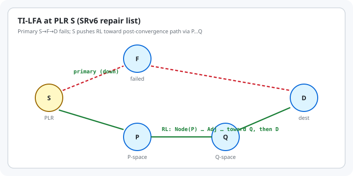

# Segment Routing, SRv6, and TI-LFA

IGP shortest paths are easy to explain and slow to heal. Classic Loop-Free Alternates (LFA) and Remote LFA cover many failures but not all topologies. **Segment Routing (SR)** (RFC 8402) lets the ingress (or a repair point) encode an explicit path as a list of **segments**. On IPv6, that list lives in the **SR Header** and is programmed with **SRv6 network programming** (RFC 8986). **TI-LFA** (RFC 9855) uses those segments so a **Point of Local Repair (PLR)** can pre-install a loop-free backup that follows the **expected post-convergence** path — topology-independent coverage in two-connected IGP areas, without Targeted LDP tunnels. This chapter stays vendor-neutral and RFC-first.

## Learning goals

By the end of this chapter you can:

- State the SR architecture: Prefix-SID / Adjacency-SID, SR-MPLS vs SRv6
- Explain SRv6 SID lists, active segment, and head-end behaviors at a PLR
- Define TI-LFA, P-space / Q-space, and Repair List (RL)
- Predict what the PLR pushes when the active segment is a node SID vs an adjacency SID
- Relate TI-LFA to BFD-scale detection: FRR is local and precomputed; IGP still converges

## Thesis

TI-LFA is not a new IGP. It is a **local repair algorithm** that *expresses* post-failure shortest paths as SR segment lists the PLR can push the moment a link (or protected node/SRLG) dies — then withdraws that repair when the IGP SPF at the PLR catches up.

## Mental model

```text
Before failure (IGP SPF):     S ──→ F ──→ … ──→ D
                                \                 ↑
After local repair (TI-LFA):    └─ RL → P ⋯ Q ────┘
```

{fig-alt="Primary path S-F-D fails; PLR S steers via green repair list through P-space and Q-space nodes to destination D"}

| Term (RFC 9855 / 8402) | Meaning |
|------------------------|---------|
| **PLR** | Router that detects local failure and activates a precomputed backup |
| **RL (Repair List)** | Segment list encoding a loop-free path avoiding the protected resource |
| **P-space** | Nodes reachable from the PLR *without* traversing the failed resource |
| **Q-space** | Nodes that can reach the destination *without* traversing the failed resource |
| **Post-convergence path** | SPF path the PLR would use after the IGP absorbs the failure |

### SR data planes

| Plane | How a segment is carried | Primary RFCs |
|-------|--------------------------|--------------|
| **SR-MPLS** | MPLS label stack | RFC 8402, RFC 8660 |
| **SRv6** | IPv6 destination + optional SRH (RFC 8754); behaviors in RFC 8986 | RFC 8402, 8754, 8986 |

SRv6 **Adjacency SIDs** are often globally routed, so RLs can be shorter than SR-MPLS (less need to precede an Adj-SID with a Prefix-SID) — RFC 9855 §7.2.

## Worked examples

### Case 1: Architecture in one page (RFC 8402)

A **segment** is an instruction. Common kinds:

- **Prefix-SID (node segment)** — "go to this node via the IGP algorithm (usually SPF)"
- **Adjacency-SID** — "take this specific link / adjacency"

An **SR Policy** is an ordered list of segments. On SRv6, the **active** segment is the IPv6 Destination Address; `Segments Left` in the SRH walks the list (RFC 8402 §3.1.3 summary).

Operators instantiate SRv6 SIDs explicitly — ordinary interface addresses are **not** SIDs by default.

### Case 2: TI-LFA repair flavours (RFC 9855 §5)

| Situation along post-convergence path | RL shape |
|---------------------------------------|----------|
| Direct neighbor in P ∩ Q | Empty RL; just change next hop (post-convergence LFA) |
| Remote PQ node | Single node segment to that PQ |
| Adjacent P then Q | Node-SID(P) then Adj-SID(P→Q) |
| Distant P and Q | Node-SID(P) + explicit path EP(P,Q) (Adj-SID list or optimized mix) |

Protection modes: **link**, **node**, or **SRLG** failure assumptions when computing the backup.

### Case 3: What the PLR does to the packet (RFC 9855 §6–7)

**Active segment is a node SID.** Keep it; **add** the RL so the node SID becomes the first segment *after* the repair list.

**Active segment is an adjacency SID S–F (protected).** Apply NEXT on that Adj-SID, then PUSH an RL that restores traffic toward F (or toward a Q whose path to the following node SID avoids the failure) — details in §6.2.1–6.2.2.

**SRv6 transit PLR.** Add the SID list using RFC 8986 **head-end** behaviors (e.g. `H.Encaps` / SRH push as implemented). **Endpoint PLR:** run endpoint processing first, then protect as transit.

**USD flavor** (RFC 8986) is often cited so the last repair endpoint can **decapsulate** the outer header the PLR added and forward the inner packet — useful for TI-LFA encapsulation on P routers.

### Case 4: Numbers from RFC 9855 Appendix B (SR-MPLS measurements)

On real SP/enterprise topologies measured in the RFC:

- Link / local SRLG protection: **≤1 SID** repair path covers **>99%** of prefixes in the data set
- Node protection: **≤2 SIDs** yields about **99%** coverage

Exact hardware MSD limits still matter; implementations may optimize RL length.

## The trap

- Expecting TI-LFA to protect **inter-domain** exits or non-IGP destinations — RFC 9855 limits scope to link-state IGP areas.
- Forgetting **micro-loops** during distributed convergence: TI-LFA is complementary to loop-free convergence methods (RFC 5715, RFC 8333, etc.), not a full substitute.
- Building RLs from **protected** Adj-SIDs and then suffering **double FRR** if a repair hop fails (RFC 9855 §9); some implementations prefer unprotected Adj-SIDs in RLs.
- Assuming SR Policies with custom constraints stay on-policy during local repair — TI-LFA does not know head-end TE constraints; use policy-level protection or Flexible Algorithm-aware TI-LFA (RFC 9855 §8) when constraints matter.
- Confusing **detection** (BFD, carrier) with **repair encoding** (TI-LFA): you need both for fast restoration.

## The boring rule

Run a link-state IGP with SR enabled; precompute TI-LFA RLs toward post-convergence paths; detect failures quickly; keep RL depth inside MSD; let SPF release the repair after convergence.

## Try this

1. Read RFC 8402 §§1–3 (architecture) and RFC 8986 §5 (head-end behaviors) skim.
2. Walk RFC 9855 §5 and Figure 1: compute P-space / Q-space intersection with the post-convergence path on paper.
3. On a lab with FRR or another open IGP+SR stack (when you already have it), enable SR and TI-LFA and compare `show` repair SIDs before/after shutting a link — no new packages required for reading RFCs alone.
4. Related in this book: BFD for *detection* timers; this chapter for *where packets go* during the repair window.

## Sources

- RFC 8402 — Segment Routing Architecture. <https://www.rfc-editor.org/rfc/rfc8402>
- RFC 8986 — SRv6 Network Programming. <https://www.rfc-editor.org/rfc/rfc8986>
- RFC 8754 — IPv6 Segment Routing Header (SRH). <https://www.rfc-editor.org/rfc/rfc8754>
- RFC 9855 — Topology Independent Fast Reroute Using Segment Routing (TI-LFA). <https://www.rfc-editor.org/rfc/rfc9855>
- RFC 8660 — SR-MPLS (for the MPLS twin of the same RL algorithms)
