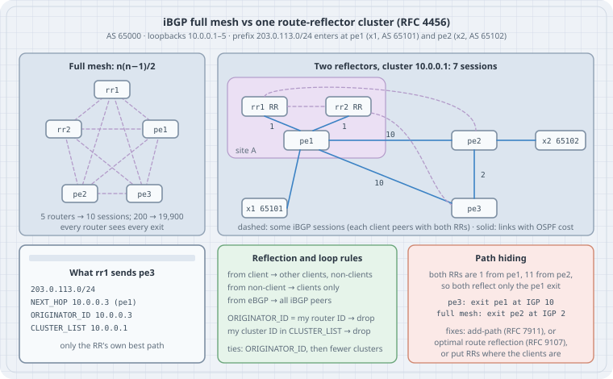

# BGP Route Reflectors: Escaping the iBGP Full Mesh

iBGP has one rule that shapes every large network: a router does **not** pass a route learned from one iBGP neighbour on to another iBGP neighbour (RFC 4271 §9.2). That rule stops loops inside an AS, where AS_PATH can't, because AS_PATH doesn't change inside the AS. The price is a **full mesh**: every BGP router in the AS needs a session with every other, n(n−1)/2 sessions in all. Route reflection (RFC 4456) relaxes the rule on chosen routers, the **route reflectors**, and adds two attributes, ORIGINATOR_ID and CLUSTER_LIST, so the relaxed rule can't loop. It also changes what the clients can see: a reflector passes on only **its own best path**, picked from **its own** place in the IGP. This chapter counts the sessions, runs the reflection rules in a small model where every path is visible, and then builds the same network as a netlab lab on FRR.

## Learning goals

- Explain why iBGP needs a full mesh, and count the sessions it costs
- State the RFC 4456 reflection rules: client, non-client and eBGP routes
- Read ORIGINATOR_ID and CLUSTER_LIST on a reflected route, and say which loop each one stops
- Place ORIGINATOR_ID and CLUSTER_LIST length in the BGP decision process
- Predict **path hiding**: when a client's exit choice differs from a full mesh, and fix it with add-path (RFC 7911) or optimal route reflection (RFC 9107)
- Choose between one shared cluster ID and one per reflector, knowing what each costs
- Build a two-reflector lab with netlab, and verify it with `netlab validate`

Lab platform: Python 3.13.5 for the session count and the reflection model, run unprivileged on this box. netlab **26.10** in a Python venv for `netlab create`, which compiles the topology and renders the FRR configuration without starting anything. Starting the lab (`netlab up`, containerlab, FRR **10.7.1** containers) needs root and a container runtime, so that part was **not run here**: it is written from the netlab and FRR documentation and marked where it applies.

## Thesis

A route reflector is a router that is allowed to break the iBGP split-horizon rule for its **clients**. That turns n(n−1)/2 sessions into about two per client. What you give up is visibility: a full mesh shows every router every exit; a reflector shows each client one exit, the one that is best from the reflector's seat in the IGP. When reflectors sit where their clients are (RFC 4456 §11), nothing changes. When they sit somewhere else, typically a pair of control-plane-only reflectors in one data centre, distant clients start using the reflector's nearest exit instead of their own. That is how a network gets "hot-potato routing that isn't". Know where your reflectors sit, and send more than one path when they can't sit everywhere.

## Mental model

{fig-alt="Left: five routers in AS 65000 in a full mesh, ten sessions. Right: the same five routers with two route reflectors rr1 and rr2 in cluster 10.0.0.1, both next to pe1 in site A at OSPF cost 1; pe1 to pe2 cost 10, pe1 to pe3 cost 10, pe2 to pe3 cost 2; clients pe1, pe2, pe3 each peer with both reflectors, seven sessions. pe1 learns 203.0.113.0/24 from x1 in AS 65101, pe2 from x2 in AS 65102. Card: what rr1 sends pe3, the prefix with NEXT_HOP 10.0.0.3, ORIGINATOR_ID 10.0.0.3, CLUSTER_LIST 10.0.0.1, only the reflector's own best path. Rules card: a route from a client goes to other clients and non-clients, from a non-client to clients only, from eBGP to all iBGP peers; drop a route whose ORIGINATOR_ID is your router ID, and a reflector drops a route whose CLUSTER_LIST holds its cluster ID; in ties, ORIGINATOR_ID replaces the router ID, then fewer clusters wins. Path hiding card: both reflectors are cost 1 from pe1 and 11 from pe2, so both reflect only pe1; pe3 exits via pe1 at IGP 10, while a full mesh would exit via pe2 at IGP 2; fixes: add-path RFC 7911, optimal route reflection RFC 9107, or reflectors where the clients are."}

```text
           full mesh                               route reflection (one cluster)
  every router ── every router            client ── RR (both RRs)      RR ── RR (non-clients)
  n(n-1)/2 sessions                        ≈ k sessions per client, k = number of RRs

  a reflected route carries:
     ORIGINATOR_ID  router ID of the client that injected it into the AS   (set once, never changed)
     CLUSTER_LIST   cluster IDs of every reflector it passed, newest first (prepended per reflection)
```

| Term | RFC 4456 | Meaning |
|---|---|---|
| Route reflector (RR) | §5 | iBGP speaker allowed to re-advertise iBGP-learned routes to its clients |
| Client | §5 | iBGP peer the RR is configured to reflect to (`route-reflector-client` in FRR). The client itself needs no special config |
| Non-client | §5 | Any other iBGP peer of the RR, typically the other RRs. Non-clients must still be fully meshed with each other |
| Cluster | §5, §7 | An RR and its clients. Several RRs can share one **CLUSTER_ID**; by default an RR uses its router ID |
| ORIGINATOR_ID | §8, type code 9 | Optional non-transitive, 4 bytes: the router ID of the route's originator in this AS. Created by the first RR, never overwritten |
| CLUSTER_LIST | §8, type code 10 | Optional non-transitive list of CLUSTER_IDs. Every RR prepends its own when it reflects |

## Concepts

### The reflection rules (RFC 4456 §6)

After an RR selects its best path, it sends it on according to where it came from:

| Best path learned from | Sent to |
|---|---|
| A **non-client** iBGP peer | All clients |
| A **client** | All non-clients and all clients ("Hence the Client peers are not required to be fully meshed"). In practice not back to the client it came from |
| An **eBGP** peer | All iBGP peers, as ordinary BGP (RFC 4271) |

Nothing else about the route changes: §10 says an RR **SHOULD NOT** modify NEXT_HOP, AS_PATH, LOCAL_PREF or MED when it reflects. In particular the NEXT_HOP stays the exit router's address, so every client must be able to reach every exit through the IGP. FRR follows this: `next-hop-self` on an RR's client sessions doesn't touch reflected routes unless you add `force`.

### Two loop checks

- **ORIGINATOR_ID:** "A router that recognizes the ORIGINATOR_ID attribute SHOULD ignore a route received with its BGP Identifier as the ORIGINATOR_ID." This catches a route coming back to the router that injected it.
- **CLUSTER_LIST:** "If the local CLUSTER_ID is found in the CLUSTER_LIST, the advertisement received SHOULD be ignored." This catches a route coming back to a cluster it has already passed through, including a route from the other RR of the **same** cluster.

### Route selection (RFC 4456 §9)

Two changes to the RFC 4271 §9.1.2.2 tie-breaks: in step f), the lowest BGP Identifier, a reflected route is compared by its **ORIGINATOR_ID** instead of the router ID of the peer that sent it; and a new step between f) and g) prefers the **shorter CLUSTER_LIST**. Both come late. Everything before them, including step e), the lowest IGP cost to the NEXT_HOP, is computed by each router from **its own** position. On a reflector, that position is the reflector's, and that's where path hiding comes from.

### One cluster ID or two?

| | Both RRs share one CLUSTER_ID (netlab's default) | Each RR its own CLUSTER_ID |
|---|---|---|
| What an RR does with the other RR's reflection of a client route | Drops it (its own ID is in CLUSTER_LIST) | Keeps it as an extra path |
| RR memory | One copy per client path | About two copies per client path |
| If a client loses its session to one RR | That RR no longer has the client's routes. Other clients still get them from the second RR | Each RR still learns the client's routes via the other RR |
| Typical use | Clients always peer with both RRs | Clients that may peer with only one RR, or RRs in different places |

Both are correct. Pick one on purpose; Lab 2 shows the difference in Adj-RIB-In.

## Lab 1: what the full mesh costs

```python
# sessions.py — iBGP sessions: full mesh vs one cluster with k route reflectors
for n in (5, 10, 50, 200, 1000):
    mesh = n * (n - 1) // 2
    row = [f"{n:5} routers  full mesh {mesh:7}"]
    for k in (2, 4):
        rr = k * (n - k) + k * (k - 1) // 2         # every client to every RR, plus an RR mesh
        row.append(f"{k} RRs {rr:5} (busiest client {k}, each RR {n - 1})")
    print("  ".join(row))
```

```bash
python3 sessions.py
```

```text
    5 routers  full mesh      10  2 RRs     7 (busiest client 2, each RR 4)  4 RRs    10 (busiest client 4, each RR 4)
   10 routers  full mesh      45  2 RRs    17 (busiest client 2, each RR 9)  4 RRs    30 (busiest client 4, each RR 9)
   50 routers  full mesh    1225  2 RRs    97 (busiest client 2, each RR 49)  4 RRs   190 (busiest client 4, each RR 49)
  200 routers  full mesh   19900  2 RRs   397 (busiest client 2, each RR 199)  4 RRs   790 (busiest client 4, each RR 199)
 1000 routers  full mesh  499500  2 RRs  1997 (busiest client 2, each RR 999)  4 RRs  3990 (busiest client 4, each RR 999)
```

The full mesh grows with the square of the number of routers; with two RRs it grows linearly. The busiest **client** keeps one session per RR however large the AS gets. The **RRs** carry the load: each has a session with every other BGP router, so the RRs, not the PEs, are where you size CPU, memory and update-processing capacity. The full mesh hurts operationally before it hurts in numbers: adding one router means touching the config of every other one.

## Lab 2: reflection rules in a model you can see all of

The network from the diagram, in plain Python: five routers in AS 65000, OSPF costs on five links, and one prefix, `203.0.113.0/24`, learned over eBGP at `pe1` and at `pe2`. The model computes IGP distances with Dijkstra, applies the RFC 4271 decision steps from "prefer eBGP" on (LOCAL_PREF, AS_PATH, ORIGIN and MED are equal here) with the RFC 4456 §9 changes, and re-advertises until nothing changes. It runs four designs: a full mesh, two RRs sharing a cluster ID, two RRs with their own cluster IDs, and RRs that choose per client (RFC 9107).

```python
# rr_model.py — iBGP full mesh vs route reflection (RFC 4456) for one prefix, by brute force
# usage: python3 rr_model.py [mesh] [rr] [rr-two-clusters] [rr-orr]
import heapq, itertools, sys

# IGP (OSPF costs): both RRs sit next to pe1 in site A; pe3 is in site B, next to pe2
LINKS = {("rr1", "pe1"): 1, ("rr2", "pe1"): 1, ("pe1", "pe2"): 10, ("pe1", "pe3"): 10, ("pe2", "pe3"): 2}
RID = {"rr1": "10.0.0.1", "rr2": "10.0.0.2", "pe1": "10.0.0.3", "pe2": "10.0.0.4", "pe3": "10.0.0.5"}
EXITS = {"pe1": "x1", "pe2": "x2"}         # both learn 203.0.113.0/24 over eBGP (AS65101, AS65102)
ROUTERS = list(RID)

def spf(src):                               # Dijkstra: IGP distance from src to every router
    adj = {r: [] for r in ROUTERS}
    for (a, b), c in LINKS.items():
        adj[a].append((b, c)); adj[b].append((a, c))
    dist, todo = {src: 0}, [(0, src)]
    while todo:
        d, n = heapq.heappop(todo)
        for m, c in adj[n]:
            if d + c < dist.get(m, 1e9):
                dist[m] = d + c; heapq.heappush(todo, (d + c, m))
    return dist
IGP = {r: spf(r) for r in ROUTERS}

def best(router, paths, position=None):
    """RFC 4271 9.1.2.2 from step d) on (LOCAL_PREF, AS_PATH, ORIGIN and MED are equal here):
    d) eBGP over iBGP, e) lowest IGP cost to NEXT_HOP, f) lowest BGP Identifier, where RFC 4456
    section 9 uses ORIGINATOR_ID if present, then the RFC 4456 step: shorter CLUSTER_LIST.
    position != router models RFC 9107 optimal route reflection (IGP cost from the client)."""
    pos = position or router
    def rank(p):
        ident = p["originator"] or RID[p["sender"]]
        return (p["ebgp"] is False, IGP[pos][p["nh"]], tuple(map(int, ident.split("."))),
                len(p["cluster_list"]))
    return min(paths, key=rank) if paths else None

def run(mode):
    reflectors = set() if mode == "mesh" else {"rr1", "rr2"}
    cluster_id = {"rr1": "10.0.0.1", "rr2": "10.0.0.2" if mode == "rr-two-clusters" else "10.0.0.1"}
    if reflectors:   # clients peer with every RR; the RRs peer with each other (non-clients)
        sessions = {(rr, c) for rr in sorted(reflectors) for c in ROUTERS if c not in reflectors}
        sessions |= set(itertools.combinations(sorted(reflectors), 2))
    else:
        sessions = set(itertools.combinations(ROUTERS, 2))
    peers = {r: sorted({b for a, b in sessions if a == r} | {a for a, b in sessions if b == r})
             for r in ROUTERS}
    rib_in = {r: {} for r in ROUTERS}        # rib_in[router][neighbour] = path learned from it
    for pe, x in EXITS.items():               # next-hop-self on the PEs: NH = exit PE loopback
        rib_in[pe][x] = {"nh": pe, "ebgp": True, "originator": None, "cluster_list": [], "sender": pe}
    loop_drops = set()                        # (receiver, sender) pairs rejected by a loop check
    for _ in range(20):                       # re-advertise until nothing changes
        changed = False
        for r, peer in itertools.product(ROUTERS, ROUTERS):
            if peer not in peers[r]:
                continue
            pos = r if (mode == "rr-orr" and peer in reflectors) else None
            b = best(peer, list(rib_in[peer].values()), pos)
            learned_from = [n for n, p in rib_in[peer].items() if p is b][0] if b else None
            send = b is not None and learned_from != r
            if send and not b["ebgp"]:                     # an iBGP-learned best path
                if peer not in reflectors:
                    send = False                           # RFC 4271: no iBGP -> iBGP re-advertising
                else:                                      # RFC 4456 section 6
                    send = learned_from not in reflectors or r not in reflectors
            new = None
            if send:
                new = dict(b, ebgp=False, sender=peer)
                if peer in reflectors and not b["ebgp"]:   # reflected: set/keep ORIGINATOR_ID,
                    new["originator"] = b["originator"] or RID[learned_from]   # prepend cluster
                    new["cluster_list"] = [cluster_id[peer]] + b["cluster_list"]
                if new["originator"] == RID[r] or (r in reflectors and cluster_id[r] in new["cluster_list"]):
                    loop_drops.add((r, peer)); new = None  # RFC 4456 section 8 loop checks
            if rib_in[r].get(peer) != new:
                if new is None: rib_in[r].pop(peer, None)
                else: rib_in[r][peer] = new
                changed = True
        if not changed:
            break
    print(f"== {mode}: {len(sessions)} iBGP sessions, rejected by loop checks: {sorted(loop_drops) or 0}")
    for r in ROUTERS:
        b = best(r, list(rib_in[r].values()))
        via = [n for n, p in rib_in[r].items() if p is b][0]
        seen = ", ".join(f"{n}:{p['nh']}" + (f"[{' '.join(p['cluster_list'])}]" if p["cluster_list"] else "")
                         for n, p in sorted(rib_in[r].items()))
        print(f"  {r}  exit {b['nh']}  IGP {IGP[r][b['nh']]:2}  via {via:3}  | Adj-RIB-In {seen}")

for m in sys.argv[1:] or ["mesh", "rr", "rr-two-clusters", "rr-orr"]:
    run(m)
```

```bash
python3 rr_model.py
```

```text
== mesh: 10 iBGP sessions, rejected by loop checks: 0
  rr1  exit pe1  IGP  1  via pe1  | Adj-RIB-In pe1:pe1, pe2:pe2
  rr2  exit pe1  IGP  1  via pe1  | Adj-RIB-In pe1:pe1, pe2:pe2
  pe1  exit pe1  IGP  0  via x1   | Adj-RIB-In pe2:pe2, x1:pe1
  pe2  exit pe2  IGP  0  via x2   | Adj-RIB-In pe1:pe1, x2:pe2
  pe3  exit pe2  IGP  2  via pe2  | Adj-RIB-In pe1:pe1, pe2:pe2
== rr: 7 iBGP sessions, rejected by loop checks: [('rr1', 'rr2'), ('rr2', 'rr1')]
  rr1  exit pe1  IGP  1  via pe1  | Adj-RIB-In pe1:pe1, pe2:pe2
  rr2  exit pe1  IGP  1  via pe1  | Adj-RIB-In pe1:pe1, pe2:pe2
  pe1  exit pe1  IGP  0  via x1   | Adj-RIB-In x1:pe1
  pe2  exit pe2  IGP  0  via x2   | Adj-RIB-In rr1:pe1[10.0.0.1], rr2:pe1[10.0.0.1], x2:pe2
  pe3  exit pe1  IGP 10  via rr1  | Adj-RIB-In rr1:pe1[10.0.0.1], rr2:pe1[10.0.0.1]
== rr-two-clusters: 7 iBGP sessions, rejected by loop checks: 0
  rr1  exit pe1  IGP  1  via pe1  | Adj-RIB-In pe1:pe1, pe2:pe2, rr2:pe1[10.0.0.2]
  rr2  exit pe1  IGP  1  via pe1  | Adj-RIB-In pe1:pe1, pe2:pe2, rr1:pe1[10.0.0.1]
  pe1  exit pe1  IGP  0  via x1   | Adj-RIB-In x1:pe1
  pe2  exit pe2  IGP  0  via x2   | Adj-RIB-In rr1:pe1[10.0.0.1], rr2:pe1[10.0.0.2], x2:pe2
  pe3  exit pe1  IGP 10  via rr1  | Adj-RIB-In rr1:pe1[10.0.0.1], rr2:pe1[10.0.0.2]
== rr-orr: 7 iBGP sessions, rejected by loop checks: [('rr1', 'rr2'), ('rr2', 'rr1')]
  rr1  exit pe1  IGP  1  via pe1  | Adj-RIB-In pe1:pe1, pe2:pe2
  rr2  exit pe1  IGP  1  via pe1  | Adj-RIB-In pe1:pe1, pe2:pe2
  pe1  exit pe1  IGP  0  via x1   | Adj-RIB-In x1:pe1
  pe2  exit pe2  IGP  0  via x2   | Adj-RIB-In x2:pe2
  pe3  exit pe2  IGP  2  via rr1  | Adj-RIB-In rr1:pe2[10.0.0.1], rr2:pe2[10.0.0.1]
```

Read it design by design:

- **mesh:** 10 sessions. `pe3` has both exits in its Adj-RIB-In and picks `pe2` at IGP cost 2. This is the reference answer.
- **rr:** 7 sessions, and `pe3` now exits via **`pe1` at IGP cost 10**. Both reflectors are 1 away from `pe1` and 11 away from `pe2`, so both pick `pe1` and reflect only that path. `pe3` never learns the `pe2` exit: that is **path hiding**. Traffic from site B to `203.0.113.0/24` now crosses the core to site A and back. Every reflected copy carries `CLUSTER_LIST 10.0.0.1`, and the RRs reject each other's reflections, `('rr1', 'rr2'), ('rr2', 'rr1')`, because their own cluster ID is already in the list.
- **rr-two-clusters:** same session count, no loop rejections, and each RR now holds a third path, the other RR's reflection (`rr2:pe1[10.0.0.2]` in `rr1`'s Adj-RIB-In). Path hiding is unchanged: more copies of the same best path don't add a different exit.
- **rr-orr:** the reflectors compute the best path from each **client's** IGP position, which is what RFC 9107 optimal route reflection does. `pe3` gets the `pe2` exit and is back to IGP cost 2 with 7 sessions. Note what `pe2` lost: the best path for `pe2` is its own, which isn't sent back to it, so `pe2` now has no backup path through `pe1`. Add-path (RFC 7911) is the other fix: the RR advertises more than one path, so the client gets both exits and decides itself.

The model makes two simplifications, both noted in its code: it doesn't send a route back to the neighbour it was learned from (as real implementations don't), and it doesn't model the final tie-break on peer address, which is why `via rr1` wins over an identical path from `rr2`.

## Lab 3: the same network in netlab (FRR)

netlab compiles a high-level topology into containerlab files and per-device configuration. The BGP module builds the iBGP design for you: nodes listed under `rr` become reflectors, every other member of the AS becomes a client of all of them, and the reflectors are meshed with each other (`bgp.rr_mesh`, default true). All reflectors in an AS get the **same** cluster ID by default, the lowest router ID among them (`bgp.rr_cluster_id` overrides it).

```yaml
# topology.yml — two route reflectors next to pe1, a distant pe3, two exits (netlab 26.10, FRR)
---
provider: clab
defaults.device: frr
module: [ ospf, bgp ]

bgp.as_list:
  65000:
    members: [ rr1, rr2, pe1, pe2, pe3 ]
    rr: [ rr1, rr2 ]              # same cluster ID by default: the lowest RR router ID
  65101:
    members: [ x1 ]
  65102:
    members: [ x2 ]

nodes:                            # order sets the loopbacks: rr1 10.0.0.1 … x2 10.0.0.7
  rr1:
  rr2:
  pe1:
  pe2:
  pe3:
  x1:
    module: [ bgp ]             # external routers run BGP only
    bgp.originate: [ 203.0.113.0/24 ]
  x2:
    module: [ bgp ]
    bgp.originate: [ 203.0.113.0/24 ]

links:
- rr1:
  pe1:
  ospf.cost: 1
- rr2:
  pe1:
  ospf.cost: 1
- pe1:
  pe2:
  ospf.cost: 10
- pe1:
  pe3:
  ospf.cost: 10
- pe2:
  pe3:
  ospf.cost: 2
- pe1-x1
- pe2-x2

validate:
  rr_sessions:
    description: pe3 has Established IPv4 sessions with both route reflectors
    wait: 60
    nodes: [ pe3 ]
    devices: [ frr ]
    show: bgp summary json
    valid: >-
      
      ipv4Unicast.peers["{{ n.ipv4 }}"].state == "Established" and
       True
  reflected:
    description: pe3 has 203.0.113.0/24 only as reflected copies of pe1's path
    wait: 30
    nodes: [ pe3 ]
    devices: [ frr ]
    show: bgp ipv4 unicast 203.0.113.0/24 json
    valid: >-
      len(paths) == 2 and
      all(p.originatorId == "{{ nodes.pe1.loopback.ipv4.split('/')[0] }}" for p in paths)
```

A custom configuration template for the add-path fix, deployed later with `netlab config`. netlab picks `frr.j2` from the `addpath/` directory for FRR nodes:

```jinja
{# addpath/frr.j2 — on a route reflector: send every path to iBGP neighbours (RFC 7911) #}
router bgp {{ bgp.as }}
 address-family ipv4 unicast

  neighbor {{ n.ipv4 }} addpath-tx-all-paths

 exit-address-family
```

### Compile it (run here)

`netlab create` checks the topology, plans addresses, and renders every device's configuration. It needs no root and starts nothing:

```bash
python3 -m venv netlab-venv && netlab-venv/bin/pip install networklab==26.10
mkdir lab && cp -r topology.yml addpath lab/ && cd lab
../netlab-venv/bin/netlab create
```

```text
[CONFIG]  rr1: initial,ospf,bgp,daemons,hosts
[CONFIG]  rr2: initial,ospf,bgp,daemons,hosts (shared)
[CONFIG]  pe1: initial,ospf,bgp,daemons,hosts (shared)
[CONFIG]  pe2: initial,ospf,bgp,daemons,hosts (shared)
[CONFIG]  pe3: initial,ospf,bgp,daemons,hosts (shared)
[CONFIG]  x1: initial,routing,bgp,daemons,hosts (shared)
[CONFIG]  x2: initial,routing,bgp,daemons,hosts (shared)
Created provider configuration file: clab.yml
Created pickled transformed topology data into netlab.snapshot.pickle
Created group_vars for all
Created group_vars for modules
Created group_vars for frr
Created host_vars for rr1, rr2, pe1, pe2, pe3, x1, x2
Created minimized Ansible inventory hosts.yml
Created Ansible configuration file: ansible.cfg
```

The rendered FRR configuration for `rr1`, filtered to the lines that make it a reflector:

```bash
grep -E 'router bgp|router-id|cluster-id|neighbor 10\.0\.0\.[0-9]+ (remote-as|route-reflector-client)' node_files/rr1/bgp
```

```text
router bgp 65000
  bgp router-id 10.0.0.1
  bgp cluster-id 10.0.0.1
  neighbor 10.0.0.2 remote-as 65000
  neighbor 10.0.0.3 remote-as 65000
  neighbor 10.0.0.4 remote-as 65000
  neighbor 10.0.0.5 remote-as 65000
  neighbor 10.0.0.3 route-reflector-client
  neighbor 10.0.0.4 route-reflector-client
  neighbor 10.0.0.5 route-reflector-client
```

`rr2`'s file has `bgp router-id 10.0.0.2` but the same `bgp cluster-id 10.0.0.1`. `pe3`'s has only two neighbours, `10.0.0.1` and `10.0.0.2`, and no reflector lines at all: being a client needs no client configuration. The generated `clab.yml` uses the `quay.io/frrouting/frr:10.7.1` image. A first draft of this topology failed `netlab create` with "Validation test rr_sessions does not include any valid device": tests whose `show`/`valid` are plain strings need `devices: [ frr ]`.

### Start it and verify (not run here)

The next steps need root (containerlab creates network namespaces and veth pairs) and a container runtime, so they were not run on this box. They are written from the netlab and FRR documentation; the expected results come from the model in Lab 2 and the rendered configuration above.

```bash
netlab up                  # containerlab deploy + push the rendered configs (needs root)
netlab validate            # runs the two tests in topology.yml
netlab connect pe3 vtysh -c "show bgp ipv4 unicast 203.0.113.0/24"
```

What to look for:

1. `netlab validate` should pass both tests: `pe3` has two Established sessions, and two paths for `203.0.113.0/24`, both with `originatorId` `10.0.0.3` (`pe1`).
2. In the `show bgp` output on `pe3`, each path should show `Originator: 10.0.0.3, Cluster list: 10.0.0.1` (FRR prints this line for reflected routes), and the next hop should be `10.0.0.3`, not the reflector's address.
3. `show bgp ipv4 unicast 203.0.113.0/24` on `rr1` should list both the `pe1` and the `pe2` paths, with `pe1` best.
4. Apply the fix and check again:

```bash
netlab config addpath -l rr1,rr2    # renders addpath/frr.j2 per node and pushes it
netlab connect pe3 vtysh -c "show bgp ipv4 unicast 203.0.113.0/24"
netlab validate                     # 'reflected' should now FAIL: pe3 sees pe2's path too
```

With `addpath-tx-all-paths` on the reflectors, `pe3` should receive both exits from each RR and pick the `pe2` path (originator `10.0.0.4`) on IGP cost, as the full mesh did. Failing the `reflected` test is the expected result: it was written to prove path hiding. `netlab down --cleanup` removes the lab.

## Case: placing reflectors

| Situation | Design |
|---|---|
| Small AS (a handful of routers), stable | Full mesh is fine. Each new router is one more session on every other router |
| PoPs with a core, RRs in the forwarding path at the PoP/core boundary | One cluster per PoP, the PoP's routers as clients. RFC 4456 §11's conditions keep results equal to a full mesh |
| Control-plane-only RRs in one or two locations (common for Internet and VPN routes) | Expect path hiding for distant clients. Turn on add-path towards clients, or optimal route reflection (RFC 9107) where your implementations support it, and check memory on the RRs |
| Clients that may lose one RR session (single-homed sites) | Separate cluster IDs per RR, so each RR still learns those clients' routes via the other |
| EVPN / VPN overlays with RRs | Same rules, per address family. Next hops stay the PE loopbacks, so loopback reachability is the first thing to check |

## The trap

**Trap: "the RR is just a hub, it doesn't change routing."** It changes which exits the clients can see. In Lab 2 the only difference between `mesh` and `rr` is the session design, and `pe3`'s exit cost went from 2 to 10. Nothing is broken, no alarm fires, and traceroutes from site B quietly cross the core.

**Trap: "add more RRs for more paths."** Two reflectors at the same place pick the same best path. Lab 2's `rr-two-clusters` adds copies of the same path, not a different exit.

**Trap: "set next-hop-self on the RR."** RFC 4456 §10 says a reflector should not change NEXT_HOP. With `next-hop-self force` on an out-of-path reflector, every client sends the traffic **to the reflector**, which then needs a forwarding path and capacity it was never sized for.

**Trap: "clients don't need to be configured, so they can't be misconfigured."** Clients still need IGP reachability to every exit's loopback (the NEXT_HOP), and sessions to every RR. A client that peers with only one RR, in a cluster where both RRs share an ID, has a single point of failure that the "two RRs" diagram hides.

**Trap: "ORIGINATOR_ID and CLUSTER_LIST are just diagnostics."** They are in the decision process (§9). Filtering them, or a box that strips them, removes loop protection and changes tie-breaks.

## The boring rule

Use a full mesh while it is small enough to configure without thinking; after that, use two route reflectors per cluster, with every client peered to both. Leave NEXT_HOP alone on reflected routes. Decide whether the RRs share a cluster ID and write the reason down. If the reflectors don't sit where the clients' exits are, assume path hiding until `show bgp` on a distant client proves otherwise, and fix it with add-path or optimal route reflection, not with more reflectors in the same place.

## Try this

1. In `rr_model.py`, move `rr2` next to `pe3` (replace `("rr2", "pe1"): 1` with `("rr2", "pe3"): 1`). Does `rr` mode still hide the `pe2` exit from `pe3`? Which of RFC 4456 §11's conditions did you just satisfy?
2. Add a sixth router `pe4` far from both exits. How many sessions do `mesh` and `rr` use now, and which exit does `pe4` pick in each?
3. In `sessions.py`, add a column for a two-level hierarchy: 4 top-level RRs, 20 second-level RRs as their clients, and 50 PEs per second-level RR pair. Count the sessions.
4. In the netlab topology, set `bgp.rr_cluster_id` on `rr2` to `10.0.0.2`, run `netlab create`, and confirm the rendered `cluster-id` changes. If you can run the lab, compare `show bgp ipv4 unicast 203.0.113.0/24` on `rr1` before and after.
5. Replace `addpath-tx-all-paths` with `addpath-tx-bestpath-per-AS` in `addpath/frr.j2`. Why does it give `pe3` the same two exits in this topology, and with fewer paths in general?

## Next

- [Policy and Filters](03-policy-and-filters.qmd)
- [BFD: Fast Failure Detection](04-bfd-fast-failure-detection.qmd)

## Verification

- **Run here:** `sessions.py` and `rr_model.py` with Python **3.13.5** on Debian 13 (Linux 6.12.94+), unprivileged. Output blocks are pasted from those runs; the model is deterministic.
- **Run here:** `netlab create` with netlab **26.10** (`networklab` from PyPI, installed in a Python venv under the working directory; no system packages). It compiled the topology, rendered the FRR configuration shown above, and wrote `clab.yml` with `quay.io/frrouting/frr:10.7.1`. The `addpath/frr.j2` template was also rendered by `netlab create` with `config: [ addpath ]` on both RRs; it produced `neighbor 10.0.0.2 … 10.0.0.5 addpath-tx-all-paths` under `address-family ipv4 unicast` for `rr1`.
- **Not run:** `netlab up`, `netlab validate`, `netlab connect`, `netlab config` and `netlab down`. They need root and a container runtime (containerlab), which this run does not use. The expected results are stated as expectations, not as output. The FRR JSON keys used in the validation test (`paths`, `originatorId`) and the `Originator: …, Cluster list: …` text line were checked in FRR's `bgpd/bgp_route.c`.
- Current versions on 2026-10-19: netlab 26.10, FRR 10.7.1 (latest release), containerlab 0.81.1.
- No `sudo`, no system packages, no containers started.

## Sources

- RFC 4456 — [BGP Route Reflection: An Alternative to Full Mesh Internal BGP (IBGP)](https://www.rfc-editor.org/rfc/rfc4456): §5 terminology and concepts, §6 operation, §7 redundant RRs, §8 ORIGINATOR_ID and CLUSTER_LIST, §9 route selection, §10 attributes not to modify, §11 deployment
- RFC 4271 — [A Border Gateway Protocol 4 (BGP-4)](https://www.rfc-editor.org/rfc/rfc4271): §9.1.2.2 breaking ties, §9.2 update-send process (iBGP split horizon)
- RFC 7911 — [Advertisement of Multiple Paths in BGP](https://www.rfc-editor.org/rfc/rfc7911)
- RFC 9107 — [BGP Optimal Route Reflection (BGP ORR)](https://www.rfc-editor.org/rfc/rfc9107)
- netlab — [BGP configuration module](https://netlab.tools/module/bgp/) (`bgp.as_list`, `rr`, `bgp.rr_cluster_id`, `bgp.rr_mesh`, `bgp.originate`), [OSPF module](https://netlab.tools/module/ospf/) (`ospf.cost`), [Lab validation tests](https://netlab.tools/topology/validate/), [`netlab config`](https://netlab.tools/netlab/config/)
- containerlab — [documentation](https://containerlab.dev/) (the provider netlab drives with `provider: clab`)
- FRR — [BGP user guide](https://docs.frrouting.org/en/latest/bgp.html) (route reflection, `next-hop-self force`, `addpath-tx-all-paths`, `addpath-tx-bestpath-per-AS`); `bgpd/bgp_route.c` for the JSON and text output of reflected paths: <https://github.com/FRRouting/frr/blob/master/bgpd/bgp_route.c>
