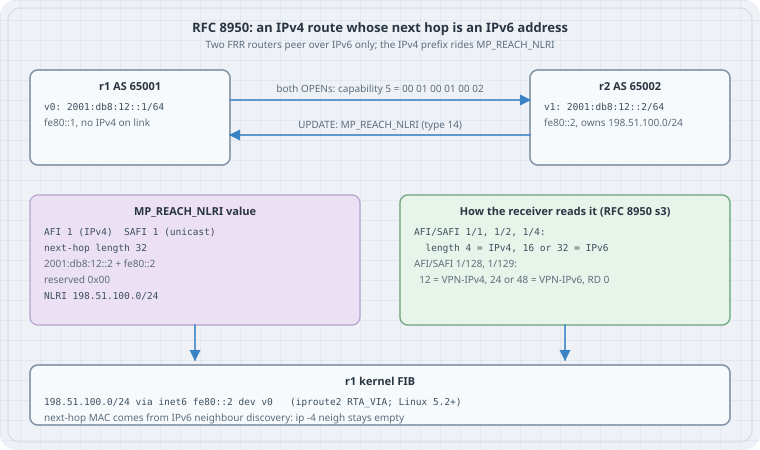

# IPv4 Routes over IPv6 Next Hops: BGP Extended Next Hop (RFC 8950)

A BGP route says two things: *where* (the prefix) and *through whom* (the next hop). For years the address family of the prefix fixed the family of the next hop: IPv4 prefixes got IPv4 next hops. RFC 8950 (which replaced RFC 5549 in 2020) breaks that link. An IPv4 prefix can carry an **IPv6 next hop**, so a link, or a whole core, can run with IPv6 addresses only and still forward IPv4. This is what makes "BGP unnumbered" fabrics work. Two routers peer over IPv6 link-local addresses and swap IPv4 routes, and nobody hands out a /31 per link. This chapter encodes the two wire pieces by hand: the **Extended Next Hop Encoding capability** and an **MP_REACH_NLRI** with a 32-octet next hop. It then builds the forwarding result in a Linux network namespace, an IPv4 route `via inet6`, and shows that the kernel finds the next hop's MAC address with IPv6 neighbour discovery, not ARP. Last comes the FRR configuration for a two-router containerlab lab.

## Learning goals

- Say why a next hop's address family doesn't have to match the prefix's
- Encode and decode capability code 5 and its `<NLRI AFI, NLRI SAFI, Nexthop AFI>` triples
- Read an MP_REACH_NLRI and use the **next-hop length** to decide whether the next hop is IPv4, IPv6 or VPN-IPv6
- Know what changed from RFC 5549: VPN next hops are 24 or 48 octets with a zero RD, and IPv4 multicast VPN (1/129) is allowed
- Install and inspect an IPv4 route with an IPv6 gateway on Linux, and see neighbour discovery resolve it
- Configure FRR for extended next hop, on both interface (link-local) peers and global-address peers

## Thesis

A next hop is not a destination. It is a **neighbour to hand the frame to**. A router forwarding an IPv4 packet needs only a layer-2 address for that neighbour, and IPv6 neighbour discovery gives one as well as ARP does. RFC 8950 is the BGP half of that idea: a way to *say* "IPv6 next hop" for IPv4 routes, and a capability that makes sure the peer understands it before you say it.

## Mental model

{fig-alt="Routers r1 in AS 65001 and r2 in AS 65002 share a link with IPv6 addresses 2001:db8:12::1 and ::2 and link-local fe80::1 and fe80::2, with no IPv4 on the link. Both OPENs carry capability 5 with bytes 00 01 00 01 00 02. r2 sends an UPDATE with MP_REACH_NLRI, type 14: AFI 1, SAFI 1, next-hop length 32, next hops 2001:db8:12::2 plus fe80::2, a reserved zero octet, NLRI 198.51.100.0/24. The receiver rule: for AFI/SAFI 1/1, 1/2 and 1/4 a length of 4 means IPv4, 16 or 32 means IPv6; for 1/128 and 1/129, 12 means VPN-IPv4, 24 or 48 means VPN-IPv6 with RD 0. r1's kernel installs 198.51.100.0/24 via inet6 fe80::2 dev v0, and finds the MAC with IPv6 neighbour discovery while the IPv4 neighbour table stays empty."}

Keep three layers apart:

1. **Negotiation.** In OPEN, each speaker lists the NLRI families for which it accepts an IPv6 next hop. No capability, no IPv6 next hop: RFC 8950 §4 says a speaker MUST NOT send one until the peer has advertised support for that AFI/SAFI.
2. **Encoding.** The IPv4 route moves out of the classic IPv4-only UPDATE fields into the multiprotocol attribute MP_REACH_NLRI (RFC 4760). That attribute has its own next-hop field with an explicit length.
3. **Forwarding.** The RIB entry `198.51.100.0/24 via fe80::2` needs a data plane that can resolve an IPv6 gateway for an IPv4 route. On Linux, that is the `RTA_VIA` route attribute.

## Concepts

### Why the classic NEXT_HOP can't do it

The original BGP-4 UPDATE (RFC 4271) carries IPv4 prefixes in its NLRI field and the next hop in the NEXT_HOP path attribute, type 3. That attribute is exactly four octets: an IPv4 address. There is no room for 16 octets. Multiprotocol BGP (RFC 4760) added MP_REACH_NLRI, type 14. It carries `AFI, SAFI, length of next hop, next hop, reserved octet, NLRI`, so any family can say any next hop as long as the receiver knows how to read the length. RFC 8950 uses MP_REACH_NLRI with AFI 1 (IPv4) and says which lengths are legal.

### The length rule (RFC 8950 §3)

The receiver decides the next hop's family from the **Length of Next Hop Address** field:

| NLRI AFI/SAFI | Length | Next hop is |
|---|---|---|
| 1/1 unicast, 1/2 multicast, 1/4 labeled | 4 | IPv4 (the old case) |
| 1/1, 1/2, 1/4 | 16 | IPv6 global |
| 1/1, 1/2, 1/4 | 32 | IPv6 global, then IPv6 link-local |
| 1/128 VPN, 1/129 VPN multicast | 12 | VPN-IPv4 (8-octet RD + IPv4) |
| 1/128, 1/129 | 24 | VPN-IPv6, RD set to zero |
| 1/128, 1/129 | 48 | VPN-IPv6 global + VPN-IPv6 link-local, RDs zero |

The 32-octet form follows RFC 2545 §3, the same rule IPv6 BGP uses: global address first, link-local second. A router that shares the link uses the link-local address to forward.

### What changed from RFC 5549

RFC 8950 §2 lists two changes. First, for VPN-IPv4 (1/128), RFC 5549 had said the next hop was a plain 16- or 32-octet IPv6 address. Deployed code actually sent a **VPN-IPv6** address, 24 or 48 octets with a zero route distinguisher, matching how VPNv4 over IPv4 and VPNv6 over IPv6 already worked (erratum 5253). RFC 8950 writes down what the implementations did. Second, IPv4 multicast VPN (1/129) gets the same treatment. Plain IPv4 unicast didn't change, so a 5549-era unicast speaker and an 8950 speaker interoperate.

### The capability (RFC 8950 §4)

Capability code **5**, *Extended Next Hop Encoding*, rides in the OPEN message's Capabilities optional parameter (RFC 5492). Its value is a list of 6-octet triples:

```text
+--------------------+---------------------+-----------------------+
| NLRI AFI (2 octets)| NLRI SAFI (2 octets)| Nexthop AFI (2 octets)|  ...repeated
+--------------------+---------------------+-----------------------+
```

RFC 8950 allows only NLRI AFI 1, NLRI SAFI 1, 2, 4, 128 or 129, and Nexthop AFI 2. The capability doesn't *enable* an address family. That is still the job of the Multiprotocol Extensions capability (code 1). It only says how a family that is already enabled may encode its next hop. It isn't meant for families that already allow both next-hop types. IPv6 prefixes with IPv4 next hops, for instance, have their own older mechanism (RFC 4798, RFC 4659).

### Route reflectors and mixed peers (RFC 8950 §5)

A route reflector passes the next hop on unchanged, and RFC 8950 says its encoding MUST NOT change. If one client can't take IPv6 next hops (it didn't send capability 5 for that family), the reflector **can't send it that route at all**. It doesn't translate. In practice, every client of a reflector that carries RFC 8950 routes needs the capability.

## Lab 1: the bytes, by hand (run here)

`enh.py` builds the capability and an MP_REACH_NLRI for two IPv4 prefixes with a global + link-local IPv6 next hop. It then decodes them the way a receiver would, using only the length to pick the next-hop family. It is plain Python 3, standard library only.

```python
"""Encode and decode the RFC 8950 pieces of a BGP session by hand."""
import ipaddress, struct

AFI = {1: "IPv4", 2: "IPv6"}
SAFI = {1: "unicast", 2: "multicast", 4: "labeled", 128: "VPN", 129: "VPN multicast"}

def ext_nh_capability(triples):
    """Capability code 5: a list of <NLRI AFI, NLRI SAFI, Nexthop AFI>, 2 octets each."""
    value = b"".join(struct.pack("!HHH", a, s, n) for a, s, n in triples)
    return struct.pack("!BB", 5, len(value)) + value

def decode_capability(blob):
    code, length = blob[0], blob[1]
    assert code == 5, code
    out = []
    for i in range(2, 2 + length, 6):
        a, s, n = struct.unpack("!HHH", blob[i:i + 6])
        out.append(f"NLRI {AFI[a]}/{SAFI[s]} may use an {AFI[n]} next hop")
    return out

def mp_reach_ipv4_unicast(next_hops, prefixes):
    """MP_REACH_NLRI (type 14) for AFI 1 / SAFI 1 with one or two IPv6 next hops."""
    nh = b"".join(ipaddress.IPv6Address(h).packed for h in next_hops)
    nlri = b""
    for p in prefixes:
        net = ipaddress.IPv4Network(p)
        nbytes = (net.prefixlen + 7) // 8
        nlri += bytes([net.prefixlen]) + net.network_address.packed[:nbytes]
    value = struct.pack("!HBB", 1, 1, len(nh)) + nh + b"\x00" + nlri
    # flags 0x80 = optional, non-transitive; type code 14
    return struct.pack("!BBB", 0x80, 14, len(value)) + value

def decode_mp_reach(attr):
    flags, typ, length = attr[0], attr[1], attr[2]
    v = attr[3:3 + length]
    afi, safi, nhlen = struct.unpack("!HBB", v[:4])
    nh = v[4:4 + nhlen]
    pos = 4 + nhlen + 1          # skip the reserved octet
    prefixes = []
    while pos < len(v):
        plen = v[pos]; nbytes = (plen + 7) // 8
        raw = v[pos + 1:pos + 1 + nbytes] + b"\x00" * (4 - nbytes)
        prefixes.append(f"{ipaddress.IPv4Address(raw)}/{plen}")
        pos += 1 + nbytes
    # RFC 8950 section 3: the length alone says which protocol the next hop is
    kinds = {4: "IPv4", 16: "IPv6 global", 32: "IPv6 global + link-local",
             12: "VPN-IPv4", 24: "VPN-IPv6 (RD 0)", 48: "VPN-IPv6 global + link-local"}
    hops = []
    if nhlen in (16, 32):
        hops = [str(ipaddress.IPv6Address(nh[i:i + 16])) for i in range(0, nhlen, 16)]
    return {"afi/safi": f"{afi}/{safi}", "nh length": nhlen,
            "nh kind": kinds.get(nhlen, "invalid for this AFI/SAFI"),
            "next hops": hops, "nlri": prefixes}

if __name__ == "__main__":
    cap = ext_nh_capability([(1, 1, 2), (1, 128, 2)])
    print("capability bytes:", cap.hex(" "))
    for line in decode_capability(cap):
        print("  ", line)

    attr = mp_reach_ipv4_unicast(["2001:db8:12::2", "fe80::2"],
                                 ["198.51.100.0/24", "203.0.113.128/25"])
    print("MP_REACH_NLRI bytes:", attr.hex(" "))
    for k, val in decode_mp_reach(attr).items():
        print(f"   {k:10} {val}")

    single = mp_reach_ipv4_unicast(["2001:db8:12::2"], ["10.0.0.0/8"])
    d = decode_mp_reach(single)
    print("global-only next hop:", d["nh length"], "octets ->", d["nh kind"], d["next hops"])
```

```console
$ python3 enh.py
capability bytes: 05 0c 00 01 00 01 00 02 00 01 00 80 00 02
   NLRI IPv4/unicast may use an IPv6 next hop
   NLRI IPv4/VPN may use an IPv6 next hop
MP_REACH_NLRI bytes: 80 0e 2e 00 01 01 20 20 01 0d b8 00 12 00 00 00 00 00 00 00 00 00 02 fe 80 00 00 00 00 00 00 00 00 00 00 00 00 00 02 00 18 c6 33 64 19 cb 00 71 80
   afi/safi   1/1
   nh length  32
   nh kind    IPv6 global + link-local
   next hops  ['2001:db8:12::2', 'fe80::2']
   nlri       ['198.51.100.0/24', '203.0.113.128/25']
global-only next hop: 16 octets -> IPv6 global ['2001:db8:12::2']
```

Read the capability bytes left to right: `05` is the code, `0c` the length (12 octets, two triples), then `00 01 00 01 00 02` (IPv4 unicast may use an IPv6 next hop) and `00 01 00 80 00 02` (VPN-IPv4, SAFI 128 = `0x80`). In the attribute, `80 0e 2e` is flags (optional, non-transitive), type 14, and a value length of 46. Then come AFI `00 01` and SAFI `01`, and **`20`, the next-hop length: 32**. After it sit the two 16-octet addresses, the reserved `00`, and the NLRI: `18 c6 33 64` is /24 198.51.100 and `19 cb 00 71 80` is /25 203.0.113.128. Nothing in the attribute says "IPv6" outright. The length of 32 is the whole signal.

## Lab 2: an IPv4 route with an IPv6 gateway (run here, no sudo)

This is what bgpd hands the kernel once it accepts such a route. `unshare -rn` gives an unprivileged user a private network namespace in which they're root, so the lab touches nothing on the host. A veth pair stands in for the link, and **v0 gets no IPv4 address at all**. (A `dummy` interface would be simpler, but loading its kernel module needs real root, so a veth pair it is.) `nh.py` sends one UDP datagram to 198.51.100.7 and listens on the far end, v1, for whatever v0 sends to find the next hop.

```sh
#!/bin/sh
# Run as: unshare -rn sh lab.sh   (a private network namespace, no sudo)
ip link add v0 type veth peer name v1
ip link set lo up; ip link set v0 up; ip link set v1 up
ip addr add 192.0.2.1/32 dev lo            # a source address for our own packets
ip -6 addr add 2001:db8:12::1/64 dev v0 nodad
ip route add 198.51.100.0/24 via inet6 2001:db8:12::2 dev v0
echo "--- ipv4 routes";  ip -4 route show
echo "--- route lookup"; ip -4 route get 198.51.100.7
echo "--- ipv4 addresses on v0"; ip -4 addr show dev v0
sleep 1
python3 nh.py                              # send one UDP datagram, watch v1
echo "--- ipv6 neighbours on v0"; ip -6 neigh show dev v0
echo "--- ipv4 neighbours on v0"; ip -4 neigh show dev v0
```

```python
"""Send one IPv4 datagram to 198.51.100.7 and report how v0 resolves the next hop."""
import socket, struct

cap = socket.socket(socket.AF_PACKET, socket.SOCK_RAW, socket.htons(0x0003))  # all frames
cap.bind(("v1", 0))          # the far end of the veth pair sees what v0 transmits
cap.settimeout(3)

socket.socket(socket.AF_INET, socket.SOCK_DGRAM).sendto(b"hello", ("198.51.100.7", 9))

while True:
    try:
        f = cap.recv(2048)
    except socket.timeout:
        print("nothing seen"); break
    src, ethertype = f[6:12], struct.unpack("!H", f[12:14])[0]
    if ethertype == 0x0806:
        print(f"{src.hex(':')} sent an ARP request"); break
    # IPv6 (0x86dd), next header 58 = ICMPv6, ICMPv6 type 135 = neighbour solicitation
    if ethertype == 0x86dd and len(f) >= 78 and f[20] == 58 and f[54] == 135:
        target = socket.inet_ntop(socket.AF_INET6, f[62:78])
        if not target.startswith("fe80"):          # skip the link-local DAD noise
            print(f"{src.hex(':')} -> {f[:6].hex(':')} ICMPv6 neighbour solicitation"
                  f" for {target}")
            break
```

```console
$ unshare -rn sh lab.sh
--- ipv4 routes
198.51.100.0/24 via inet6 2001:db8:12::2 dev v0 
--- route lookup
198.51.100.7 via inet6 2001:db8:12::2 dev v0 src 192.0.2.1 uid 0 
    cache 
--- ipv4 addresses on v0
ce:c8:07:ce:15:7e -> 33:33:ff:00:00:02 ICMPv6 neighbour solicitation for 2001:db8:12::2
--- ipv6 neighbours on v0
2001:db8:12::2 INCOMPLETE 
--- ipv4 neighbours on v0
```

Three things to notice:

- `ip route` takes `via inet6 <addr>` on an IPv4 route. iproute2 sends this as the `RTA_VIA` attribute, and Linux has accepted IPv6 gateways for IPv4 routes since kernel 5.2. This run used kernel 6.12 with iproute2 6.15.
- v0 has **no IPv4 address**, and the lookup still works. The source address, 192.0.2.1, comes from the loopback, the way a router uses its loopback /32 in an unnumbered fabric.
- To send the IPv4 datagram, the kernel sent an **ICMPv6 neighbour solicitation** to the solicited-node multicast group of 2001:db8:12::2 (`33:33:ff:00:00:02`). The IPv4 neighbour table stays empty, because no ARP is involved. (`INCOMPLETE` is expected: nobody owns ::2 on this veth.)

In a real fabric, bgpd installs the link-local form, `via inet6 fe80::2 dev eth1`. A link-local gateway is only meaningful together with the interface, which is why the route always names the device.

## Lab 3: two FRR routers in containerlab (from the docs, not run here)

Running containers needs a container runtime and root, which this book's build box doesn't have. The topology below follows the containerlab topology-file format, and the FRR commands come from the FRR BGP documentation. Run it yourself and compare against the checks below.

`rfc8950.clab.yml`:

```yaml
name: rfc8950
topology:
  nodes:
    r1:
      kind: linux
      image: quay.io/frrouting/frr:10.2.1
      binds:
        - r1/daemons:/etc/frr/daemons
        - r1/frr.conf:/etc/frr/frr.conf
    r2:
      kind: linux
      image: quay.io/frrouting/frr:10.2.1
      binds:
        - r2/daemons:/etc/frr/daemons
        - r2/frr.conf:/etc/frr/frr.conf
  links:
    - endpoints: ["r1:eth1", "r2:eth1"]
```

`r1/daemons` sets `bgpd=yes` (zebra always runs). `r1/frr.conf`, an **interface peer** with no addresses on eth1 at all:

```text
frr defaults datacenter
!
interface lo
 ip address 192.0.2.1/32
!
router bgp 65001
 bgp router-id 192.0.2.1
 no bgp ebgp-requires-policy
 neighbor eth1 interface remote-as external
 !
 address-family ipv4 unicast
  network 192.0.2.1/32
 exit-address-family
!
```

`r2` is the same with AS 65002, router ID and loopback 198.51.100.1, and `network 198.51.100.0/24` backed by a static `ip route 198.51.100.0/24 blackhole`.

What FRR does for you here, per its documentation:

- `neighbor eth1 interface` peers over the IPv6 **link-local** address it learns from the other side's router advertisements. bgpd asks zebra to send RAs on that interface (the `bgp ipv6-auto-ra` behaviour, on by default).
- On a link-local peering, FRR turns **`capability extended-nexthop` on automatically**. For a peer reached by a *global* IPv6 address you set it yourself: `neighbor 2001:db8:12::2 capability extended-nexthop`. That's what lets bgpd install IPv4 routes with IPv6 next hops when the interfaces have no IPv4.

Checks to run after `containerlab deploy -t rfc8950.clab.yml`:

```text
docker exec clab-rfc8950-r1 vtysh -c "show bgp neighbors eth1"   # look for the Extended nexthop line: advertised and received, IPv4 Unicast
docker exec clab-rfc8950-r1 vtysh -c "show ip route bgp"         # 198.51.100.0/24 via fe80::..., eth1
docker exec clab-rfc8950-r1 ip -4 route show proto bgp           # ... via inet6 fe80::... dev eth1
docker exec clab-rfc8950-r1 ip -4 neigh show dev eth1            # empty: no ARP on this link
```

If the neighbour output shows the capability **advertised but not received**, the peer won't accept IPv6 next hops for IPv4, and per RFC 8950 §4 your router must not send them. On a global-address peer, the usual cause is a missing `capability extended-nexthop` on the far side.

## Case: an unnumbered leaf-spine

A leaf-spine fabric with 64 leaves and 4 spines has 256 links. Numbered with IPv4 /31s, that's 256 /31s to allocate, document and keep consistent in two configs per link. With RFC 8950 and interface peering, each switch needs one IPv4 /32 on its loopback (for sourcing and management) and nothing on its links: IPv6 link-local addresses come up on their own. The price is a hard dependency on IPv6 being enabled on every fabric port. You also have to watch three things:

- **Traceroute** replies come from the loopback (or whatever the vendor picks), because the link has no IPv4 address to answer from.
- **Out-of-band tools** that assume an IPv4 next hop in BGP (old collectors, some BMP pipelines) may print the IPv6 next hop oddly, or drop the route.
- **Every reflector client** needs the capability (RFC 8950 §5), so one old box can quietly miss routes.

## The trap

**"The session is up, so the routes will be fine."** Capability 5 is negotiated per family, and only if *both* sides advertise it. A global-address IPv6 session with IPv4 unicast activated, but no `capability extended-nexthop` on one end, comes up fine and exchanges IPv6 routes. The IPv4 routes then fail to install, or are never sent. Check the capability line in the neighbour output, not just `Established`.

**Second trap:** the 32-octet next hop is global *then* link-local. A hand-built decoder, or a filter that reads only the first 16 octets, gets the global address. That's fine for a multihop peer, but on a shared link the router actually forwards to the link-local one.

## The boring rule

Peer over interfaces where you can, so the capability is on automatically. Turn it on explicitly for global-address IPv6 peers that carry IPv4. Then verify three things: capability received, the IPv4 route installed `via inet6`, and the IPv4 neighbour table empty on the link.

## Try this

1. Change `mp_reach_ipv4_unicast` in `enh.py` to send a 24-octet next hop for AFI/SAFI 1/1. What does `decode_mp_reach` call it? What should a real receiver do with it? (RFC 8950 §3 and RFC 7606 on malformed attributes.)
2. Add a third triple, `(2, 1, 1)`: IPv6 unicast with an IPv4 next hop. Why does RFC 8950 §4 rule it out?
3. In Lab 2, add `2001:db8:12::2/64` on v1 and re-run. What changes in `ip -6 neigh`, and why does `nh.py` now see a different frame?
4. Re-run Lab 2 with `fe80::2` as the gateway. Why does `ip route add 198.51.100.0/24 via inet6 fe80::2` fail without `dev v0`?

## Next

Use this with route reflectors (RFC 8950 §5): a reflector won't translate next-hop encodings for a client that lacks the capability.

## Verification

- `enh.py` was run with Python 3 (standard library only). The capability and MP_REACH_NLRI bytes and decodes shown are its real output.
- Lab 2 (`lab.sh` + `nh.py`) was run unprivileged with `unshare -rn` on Linux 6.12 with iproute2 6.15. The routes, the lookup, the neighbour-solicitation capture and the neighbour tables are genuine output. MAC addresses are random per run.
- Lab 3 (containerlab + FRR) was **not run**: it needs a container runtime and root. It is written from the containerlab and FRR documentation, and the expected output is described, not pasted.

## Sources

- RFC 8950, *Advertising IPv4 Network Layer Reachability Information (NLRI) with an IPv6 Next Hop*: <https://www.rfc-editor.org/rfc/rfc8950>. §2 changes from RFC 5549, §3 next-hop lengths, §4 capability, §5 operations.
- RFC 4760, *Multiprotocol Extensions for BGP-4* (MP_REACH_NLRI): <https://www.rfc-editor.org/rfc/rfc4760>
- RFC 5492, *Capabilities Advertisement with BGP-4*: <https://www.rfc-editor.org/rfc/rfc5492>
- RFC 2545, *Use of BGP-4 Multiprotocol Extensions for IPv6 Inter-Domain Routing* (global + link-local next hop): <https://www.rfc-editor.org/rfc/rfc2545>
- RFC 4271, *A Border Gateway Protocol 4* (NEXT_HOP attribute): <https://www.rfc-editor.org/rfc/rfc4271>
- IANA, BGP Capability Codes (code 5): <https://www.iana.org/assignments/capability-codes/>
- FRR documentation, BGP (`capability extended-nexthop`, interface peers, `bgp ipv6-auto-ra`): <https://docs.frrouting.org/en/latest/bgp.html>
- containerlab documentation, topology definition: <https://containerlab.dev/manual/topo-def-file/>
- iproute2 `ip-route(8)` (`via [ FAMILY ] ADDRESS`): <https://man7.org/linux/man-pages/man8/ip-route.8.html>
