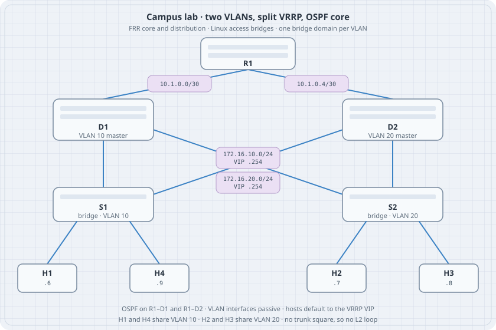

# Campus Lab: VLANs, VRRP, and OSPF

A campus is three jobs at once. Access ports keep user and server broadcast domains apart. Two distribution routers share a virtual gateway so a host still has a first hop when one router stops. A core router learns those prefixes with OSPF so the path beyond the closet is dynamic. This chapter builds that shape as one netlab file on FRR and Linux.

{fig-alt="Core R1 links to distribution routers D1 and D2. S1 bridges VLAN 10 for H1 and H4. S2 bridges VLAN 20 for H2 and H3. Each distribution router attaches to both bridges. D1 is VRRP master for VLAN 10 and D2 is master for VLAN 20."}

## Learning goals

By the end of this chapter you can:

- Read a campus as access bridges, distribution SVIs, and a routed core
- Express VLANs, VRRP, and OSPF in one `topology.yml`
- Predict which router owns each virtual IP
- Check same-VLAN reachability and inter-VLAN reachability separately
- Explain why this lab does not trunk both VLANs around a square

## What the design is doing

```text
        R1          OSPF core
       /  \
     D1    D2        IRB, VRRP, OSPF
     | \  / |
     |  \/  |
    S1      S2       S1 VLAN 10, S2 VLAN 20
   H1 H4   H2 H3
```

| Layer | Nodes | Forwarding |
|-------|--------|------------|
| Core | R1 | OSPF only. Two point-to-point links. |
| Distribution | D1, D2 | One SVI per VLAN, VRRP on each SVI, OSPF toward R1. |
| Access | S1, S2 | Bridge only. S1 is VLAN 10. S2 is VLAN 20. |
| Hosts | H1–H4 | Linux. Default route is the VLAN's VRRP address. |

VRRP is split on purpose. D1 is master for VLAN 10 (priority 110) and backup for VLAN 20 (priority 100). D2 is the opposite. A failure of one distribution router moves only one virtual IP. The other VLAN stays on its master.

Hosts in one VLAN talk at layer 2 through their access bridge. A packet from H1 (VLAN 10) to H2 (VLAN 20) hits the VLAN 10 virtual IP, is routed by whichever router owns it, and leaves on the VLAN 20 SVI. Both distribution routers have both SVIs, so that hop does not need the core. OSPF still matters: R1 must learn `172.16.10.0/24` and `172.16.20.0/24`, and the core links must come up Full.

The VLAN SVIs are OSPF passive. They are advertised, and they do not send hellos onto the access bridges.

## Why this is not a trunk square

A common drawing connects both access switches to both distribution switches with trunks that carry every VLAN. That is a layer-2 loop. Cisco layer-2 images break the loop with spanning tree. FRR's STP does not run on VLAN trunks (BPDUs go out tagged). Linux in netlab has no STP module. This lab keeps each VLAN in its own bridge, so D1 and D2 can both sit on that VLAN for VRRP, and the two VLANs never form a cycle.

On these Linux bridges an access VLAN is untagged. The VLAN id is the bridge (`vlan10`, `vlan20`), not an 802.1Q tag on the wire. Tagged trunks are the subject of the VLANs and trunks chapter. Use them when you want to see tags, on a topology that is still loop-free.

## Topology

Checked with netlab **26.10** (`networklab` on PyPI). `netlab create` plans addresses and writes FRR and Linux config. It does not start containers.

```yaml
# topology.yml
---
name: campus
provider: clab
defaults.device: frr

vlans:
  users:
    id: 10
    mode: irb
    prefix.ipv4: 172.16.10.0/24
    gateway.protocol: vrrp
    gateway.id: 254
    gateway.vrrp.group: 10
    links: [ H1-S1, H4-S1, D1-S1, D2-S1 ]
  servers:
    id: 20
    mode: irb
    prefix.ipv4: 172.16.20.0/24
    gateway.protocol: vrrp
    gateway.id: 254
    gateway.vrrp.group: 20
    links: [ H2-S2, H3-S2, D1-S2, D2-S2 ]

groups:
  dist:
    members: [ D1, D2 ]
    module: [ vlan, ospf, gateway ]
    vlans:
      users:
        ospf.passive: true
      servers:
        ospf.passive: true
  access:
    members: [ S1, S2 ]
    device: linux
    module: [ vlan ]
    vlan.mode: bridge
  hosts:
    members: [ H1, H2, H3, H4 ]
    device: linux
    role: host
    module: [ routing ]
    routing.static:
      - ipv4: 0.0.0.0/0
        nexthop.gateway: true

nodes:
  R1:
    module: [ ospf ]
  D1:
    vlans.users.gateway.vrrp.priority: 110
    vlans.servers.gateway.vrrp.priority: 100
  D2:
    vlans.users.gateway.vrrp.priority: 100
    vlans.servers.gateway.vrrp.priority: 110
  S1:
  S2:
  H1:
  H2:
  H3:
  H4:

links:
  - R1-D1
  - R1-D2

validate:
  r1_sees_d1:
    description: R1 is Full with D1
    nodes: [ R1 ]
    devices: [ frr ]
    plugin: ospf_neighbor('10.0.0.2')
  r1_sees_d2:
    description: R1 is Full with D2
    nodes: [ R1 ]
    devices: [ frr ]
    plugin: ospf_neighbor('10.0.0.3')
  same_vlan:
    description: H1 reaches H4 inside VLAN 10
    nodes: [ H1 ]
    devices: [ linux ]
    plugin: ping('172.16.10.9')
  other_vlan:
    description: H1 reaches H2 across VLANs
    nodes: [ H1 ]
    devices: [ linux ]
    plugin: ping('172.16.20.7')
```

`gateway.id: 254` is the last usable host in the `/24`, so the virtual IPs are `172.16.10.254` and `172.16.20.254`. `nexthop.gateway: true` tells each host to use the gateway on its own VLAN. Node order fixes the other host addresses. Insert a node above `H1` and those addresses move. Read `node_files/` after `netlab create` if you change the file.

## Addresses netlab assigned

`netlab create` with the file above, and with nodes declared in the order R1, D1, D2, S1, S2, H1, H2, H3, H4, produced this plan. The containerlab file uses `quay.io/frrouting/frr:10.7.1` for the routers and `python:3.13-alpine` for Linux nodes.

| Node | Interface | Address | Notes |
|------|-----------|---------|--------|
| R1 | lo | 10.0.0.1/32 | OSPF router-id |
| R1 | eth1 | 10.1.0.2/30 | to D1 |
| R1 | eth2 | 10.1.0.6/30 | to D2 |
| D1 | lo | 10.0.0.2/32 | |
| D1 | eth1 | 10.1.0.1/30 | to R1 |
| D1 | vlan10 | 172.16.10.2/24 | VRRP 10 priority 110 |
| D1 | vlan20 | 172.16.20.2/24 | VRRP 20 priority 100 |
| D2 | lo | 10.0.0.3/32 | |
| D2 | eth1 | 10.1.0.5/30 | to R1 |
| D2 | vlan10 | 172.16.10.3/24 | VRRP 10 priority 100 |
| D2 | vlan20 | 172.16.20.3/24 | VRRP 20 priority 110 |
| H1 | eth1 | 172.16.10.6/24 | default via .254 |
| H4 | eth1 | 172.16.10.9/24 | default via .254 |
| H2 | eth1 | 172.16.20.7/24 | default via .254 |
| H3 | eth1 | 172.16.20.8/24 | default via .254 |

S1 and S2 get no IP. Their startup scripts create a bridge and enslave the access ports. D1's rendered VRRP stanza is the same idea as a hand-written interface block, generated from the YAML priorities:

```text
interface vlan10
 vrrp 10 priority 110
 vrrp 10 preempt
 vrrp 10 ip 172.16.10.254
interface vlan20
 vrrp 20 priority 100
 vrrp 20 preempt
 vrrp 20 ip 172.16.20.254
```

D2 swaps the priorities. Both SVIs on D1 also contain `ip ospf passive`.

## Bring it up

`netlab up` needs root and a container runtime. This chapter's create step was run here. The up, connect, and validate steps were not.

```bash
python3 -m venv netlab-venv
netlab-venv/bin/pip install networklab==26.10
netlab-venv/bin/netlab create
netlab-venv/bin/netlab up
netlab-venv/bin/netlab validate
```

Read state from the devices:

```bash
netlab connect D1 vtysh -c "show vrrp"
netlab connect D2 vtysh -c "show vrrp"
netlab connect R1 vtysh -c "show ip ospf neighbor"
netlab connect R1 vtysh -c "show ip route"
netlab connect H1 ip route
netlab connect H1 ping -c 3 172.16.10.9
netlab connect H1 ping -c 3 172.16.20.7
```

### Predict

- D1 is Master on VRRP group 10 and Backup on group 20. D2 is the reverse.
- R1 has two Full neighbors, `10.0.0.2` and `10.0.0.3`, and both VLAN prefixes in the OSPF table.
- H1 pings H4 without leaving VLAN 10. The path does not use a router.
- H1 pings H2. The first hop is `172.16.10.254` on D1, then D1 routes onto VLAN 20.
- S1 has no route to `172.16.20.0/24`. It is a bridge.

### Drill — move VLAN 10

On D1, shut VRRP group 10 and watch D2 take `172.16.10.254`. H1's default route does not change. `netlab connect H1 ping -c 3 172.16.20.7` should work again once D2 is Master. Bring the group back and D1 should preempt, because preempt is on.

Tear the lab down with `netlab down --cleanup` when you also want the generated files removed. Without `--cleanup`, containers stop and `topology.yml` stays.

## Where this sits

Capstone C1 in the capstone outline is this network. The earlier chapters still own the mechanisms: VLAN access versus trunk, OSPF adjacency, and VRRP on FRR. This page is the place those three show up in one file.

## Sources

- netlab — [VLANs](https://netlab.tools/module/vlan/), [first-hop gateway](https://netlab.tools/module/gateway/) (`gateway.id`, `vrrp.group`, `vrrp.priority`), [OSPF](https://netlab.tools/module/ospf/), [static routes](https://netlab.tools/module/routing/) (`nexthop.gateway`)
- containerlab — [documentation](https://containerlab.dev/)
