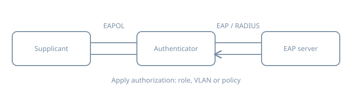

# Network Access Control: 802.1X, EAP and Authorization

A link can be electrically up and still deny ordinary traffic until an endpoint is authenticated and authorized. Network access control connects identity to an access decision, but the access decision must also produce a usable VLAN, role or policy. Diagnose the endpoint, authenticator, authentication service and forwarding path independently.

{fig-alt="The supplicant exchanges EAPOL with the authenticator, which relays EAP through RADIUS to the authentication server."}

## Roles and message path

In a common deployment the endpoint runs a **supplicant**, the switch or access point is the **authenticator**, and an authentication server verifies credentials and returns a decision. The client and authenticator exchange EAP over LAN (EAPOL); the authenticator commonly relays EAP within RADIUS messages to a backend server. An authenticator can implement EAP methods locally, so a separate server is common rather than mandatory. EAP is a framework, not one authentication method or a synonym for RADIUS.

The authenticator controls access at the port or session according to its policy. The controlled port may initially permit only the traffic needed for authentication; the exact treatment of other link-local protocols depends on implementation and configuration. Wired access and wireless association have different link-layer stages. In particular, a wireless client can associate to a BSS without having completed enterprise authentication or obtained IP connectivity.

A simplified successful sequence is: link or association; EAP identity and method exchange; backend decision; authorization applied by the authenticator; address configuration and data forwarding. EAP-TLS typically uses certificates, but a deployment must specify its authentication policy rather than assume every EAP method uses certificates. The unauthenticated outer EAP identity can help route an authentication request; it is not by itself proof of the user's identity.

## Authentication versus authorization

**Authentication** establishes a claimed identity according to the chosen method. **Authorization** decides what access that authenticated identity receives. An Access-Accept may carry policy such as a VLAN, role, access list or session attributes; actual support and precedence are platform-specific. The RADIUS VLAN convention in RFC 3580 uses Tunnel-Type VLAN, Tunnel-Medium-Type 802 and a VLAN identifier encoded in Tunnel-Private-Group-ID. A server sending these attributes does not ensure that the authenticator accepts them, that the VLAN exists, or that its uplinks and DHCP service are correct.

For example, a user may authenticate successfully and be assigned VLAN 20, but receive no address because VLAN 20 is absent from the upstream trunk. Conversely, a client may receive a restricted fallback role after authentication fails: an IP address alone does not prove it passed the intended policy. Check the applied session authorization on the access device and test both permitted and denied destinations.

## EAP-TLS and trust

With certificate-based EAP-TLS, the client must validate the server certificate chain and expected server identity; trusting a broad CA without restricting the server name can accept an unintended server. The server validates the client credential according to deployment policy, including its chain, identity, validity and revocation requirements. RFC 9190 specifies EAP-TLS with TLS 1.3 and updates EAP-TLS guidance; verify the actual client, server and negotiated version. Time synchronization, certificate renewal and revocation availability are operational dependencies. Do not “fix” a certificate error by disabling validation.

Authentication does not automatically encrypt all wired user data. MACsec can provide link-layer protection where the devices and key-management design support it; it is distinct from simply enabling 802.1X. Wireless security has its own key establishment and protection rules. See [MACsec and MKA](09-macsec-and-mka.qmd) and [Wireless LAN Fundamentals](../03-layer-2/06-wireless-lan-fundamentals.qmd).

## Non-supplicant devices and failure modes

Some devices cannot run an 802.1X supplicant. A deployment may classify them using a MAC-address-based fallback, pre-provisioned port or restricted network. A MAC address is observable and spoofable; such a fallback is a weaker identity signal and should be paired with narrowly scoped access, monitoring and an explicit exception lifecycle. Do not mistake it for certificate-based mutual authentication.

Decide in advance how the authenticator behaves when the AAA service is unreachable, rejects a credential, returns an invalid policy, or stops responding during reauthentication. Failure-open, failure-closed and restricted fallback have different availability and security effects; defaults differ. Distinguish a server timeout from an explicit reject. Account for multi-host ports, phones with downstream workstations, virtual machines, session limits, reauthentication and device movement. Test whether a fallback policy can be abused to bypass stronger authentication.

## Validation exercise

Use an isolated access switch or AP that supports 802.1X, a test supplicant, an EAP/RADIUS server and a test CA. A server and authenticator were not available on the writing host, so this is a vendor-neutral test plan, not an executed configuration. Supply platform-specific commands from the actual device documentation and use disposable credentials. Establish a separate recovery path before changing access policy.

| Test | Expected evidence |
|---|---|
| Valid client and trusted server | EAP success in client/server logs; authorized session and expected role/VLAN on access device; intended connectivity |
| Wrong expected server name or untrusted CA | Client rejects server authentication; no ordinary access under the intended fail-closed policy |
| Revoked, expired or unauthorized test client credential | Server's policy and revocation handling produce the documented denial; access device applies intended outcome |
| Valid credentials, deliberately wrong VLAN assignment | Authentication succeeds, but assigned role/VLAN or upstream path explains addressing or reachability failure |
| AAA server unavailable | Timeout and configured fallback behavior are visible; distinguish from an explicit reject |
| Unsupported endpoint using approved fallback | Restricted policy applies; verify both allowed and denied traffic and record the weaker identity basis |
| Reauthentication and port move | Session and authorization follow the documented design without stale access or unexpected outage |

For each case record timestamps, client EAP state, authenticator session/port state, server decision and reason, returned and applied authorization, VLAN/trunk membership, DHCP result, and tests to allowed and denied endpoints. Use test certificates with the correct names and validity, then remove them and restore the access policy. Packet captures and logs can contain identities and security-sensitive metadata; handle them according to the lab's data rules.

## Troubleshooting sequence

1. **No EAP exchange:** verify link, SSID/port, supplicant, 802.1X enablement and EAPOL counters. On wireless, separate association failure from EAP failure.
2. **EAP starts but times out:** trace authenticator-to-server reachability, RADIUS configuration, shared-secret or transport settings, firewall policy and server health. Large certificate exchanges can encounter packet-size or fragmentation issues; inspect actual captures and server logs.
3. **Explicit reject or TLS failure:** compare server reason with client trust, expected server name, certificate chain, expiry, revocation and credential policy. The visible outer identity alone is not proof of authenticated identity.
4. **Accept but no service:** inspect applied authorization and VLAN, port/trunk and DHCP behavior, gateway, DNS and ACL counters. A backend accept is not end-to-end proof.
5. **Intermittent loss after successful access:** correlate reauthentication, session timeout, roaming, address renewal, AAA availability and policy changes with timestamps. Validate recovery, not merely a new initial login.

**References:** [EAP, RFC 3748](https://www.rfc-editor.org/rfc/rfc3748.html), [802.1X RADIUS usage, RFC 3580](https://www.rfc-editor.org/rfc/rfc3580.html), and [EAP-TLS 1.3, RFC 9190](https://www.rfc-editor.org/rfc/rfc9190.html).
