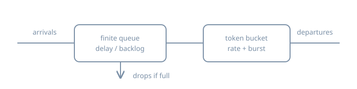

# QoS: Queues, Token Buckets and Congestion Evidence

QoS decides how a finite link and its buffers are shared during contention. A DSCP label alone does not reserve bandwidth or guarantee latency: each hop must classify and apply an appropriate policy, and the path must have enough capacity. Start with [QoS Vocabulary](03-qos-vocabulary.qmd), then quantify the behavior here.

{fig-alt="Packets enter a finite queue; a token bucket controls departures and packets can be dropped if the queue fills."}

## The bottleneck and the queue

For a constant-rate link, a rough serialization time is `packet bits / link bits per second`. A 1,500-byte packet at 10 Mbit/s takes about 1.2 ms to serialize, before link-layer overhead. A queue of 100,000 bytes drained at 10 Mbit/s adds approximately `100,000 × 8 / 10,000,000 = 0.08 s`, or 80 ms, to a packet at the tail. Actual delay varies with packet sizes, scheduling, competing queues and hardware. Increasing a queue can absorb bursts but can also increase latency; a full queue must drop or mark traffic according to its policy.

Traffic need not average above the link rate to create a queue: short bursts can exceed service rate. Measure utilization at a sufficiently fine interval and inspect queue occupancy, drops and delay under the workload. A one-minute average can hide a millisecond burst. Input drops, output queue drops, policer drops, interface errors and remote congestion are different counters with different remedies.

## Token-bucket reasoning

A token bucket is a useful model for a meter or shaper. Tokens accumulate at a configured rate up to a burst capacity; transmitting or admitting a packet consumes tokens. An initially full bucket permits a burst above the sustained rate. With a single ideal bucket of 100,000 bytes and a refill rate of 1,000,000 bytes/s, the bucket represents 100 ms of tokens. This does **not** mean all traffic experiences 100 ms of delay: packet timing, queue size and implementation matter. When accounting includes different headers at different devices, a nominally matching rate may still exceed a provider's measured rate.

A **policer** evaluates traffic against a profile and typically drops or remarks nonconforming packets; it does not normally smooth excess by holding a large queue. A **shaper** queues traffic until its transmission conforms, subject to finite buffer capacity; excess can still be dropped. Either can allow bursts, and neither automatically guarantees application performance. Bucket size and rate use explicit units: 1 Mbit/s is 125,000 bytes/s before accounting differences; a 16,000-byte bucket is not 16,000 bits.

## Class, mark, queue and schedule

Classify traffic using available fields and policy, apply a trust boundary, and map accepted markings to local queues. DSCP is the upper six bits of the IP DS field; the lower two bits carry ECN. For example, EF is DSCP 46 (`101110`); with ECN bits `00`, the full field is binary `10111000`, or hex `0xb8`. If ECN changes to `11`, the DSCP remains 46 while the full byte becomes `0xbb`. Do not compare an entire byte to a DSCP value without masking or accounting for ECN.

A scheduler chooses which eligible queue to serve. Strict priority can reduce delay for a bounded critical class, but an unbounded priority stream can starve other queues. Weighted schedulers distribute service among eligible queues; the exact weights, minimums, maximums and borrowing rules are platform-specific and depend on offered load. A configured minimum is not necessarily unused capacity permanently reserved from others. An active queue management algorithm may drop or ECN-mark before a queue is full to signal congestion; ECN needs compatible endpoints and a suitable path, and is not a substitute for capacity.

## Lab: observe a shaper under burst load

The following Linux example needs `unshare`, `nsenter`, `ip`, `tc`, Python 3, permission for user/network namespaces, and kernel support for veth and TBF. It sends traffic only between disposable namespaces. Run it as shown; do not add a qdisc to a host or production interface. The peer need not run a UDP server: the experiment observes the sender's egress queue, not application delivery. The namespace holders last at most 60 seconds and the trap cleans them up on normal exit.

Save as `shape-lab.sh`, then run `unshare -rn bash shape-lab.sh`:

```bash
set -eu
unshare -n sleep 60 & peer=$!
trap 'kill "$peer" 2>/dev/null || true; wait "$peer" 2>/dev/null || true' EXIT
sleep 0.2
ip link add tx0 type veth peer name rx0
ip link set rx0 netns "$peer"
ip addr add 10.77.0.1/24 dev tx0
ip link set tx0 up
nsenter -t "$peer" -n ip link set lo up
nsenter -t "$peer" -n ip addr add 10.77.0.2/24 dev rx0
nsenter -t "$peer" -n ip link set rx0 up

tc qdisc add dev tx0 root tbf rate 1mbit burst 16kb latency 100ms
python3 - <<'PY'
import socket
s = socket.socket(socket.AF_INET, socket.SOCK_DGRAM)
for _ in range(2000):
    s.sendto(b'x' * 1000, ('10.77.0.2', 9999))
s.close()
PY
sleep 1
tc -s qdisc show dev tx0
tc qdisc del dev tx0 root
```

On the test host, the displayed TBF reported 47 packets sent and 1,957 dropped, with 2,039 overlimits; extra control packets can also pass through the qdisc, so these are not a packet-conservation equation for the 2,000 UDP sends. Values vary with scheduling, kernel, ARP, queueing and machine speed. `overlimits` is a qdisc-specific indication of rate enforcement, not a synonym for loss. A nonzero drop count shows the queue discarded packets; it does not show which application packets arrived at the peer. A local UDP `sendto` success only indicates local acceptance, not delivery.

Repeat with a slower sender or a lower packet count and predict how drops change. Record elapsed time, rate, burst, qdisc statistics and peer observations. To measure end-to-end delivery, run an application receiver with sequence numbers and compare sent and received packets. For latency under load use a separate probe and compare idle and loaded distributions; a single ping is not a latency percentile. For bidirectional service, test both directions because qdiscs here operate on egress only.

## Design checks

1. At 20 Mbit/s, approximately how long does a 50,000-byte FIFO backlog take to drain, ignoring overhead and new arrivals? **20 ms.**
2. If only a few packets are dropped but latency is high, inspect queue depth and the bottleneck rather than assuming a policer.
3. If a marked voice stream enters the best-effort queue, inspect classification, trust and mapping at each hop; packet marking alone is not a queue counter.
4. If a priority queue consumes a whole congested link, verify its admission or rate controls and measure the impact on other classes.
5. Record platform, link speed, traffic direction, offered load, frame sizes, rate accounting, queue configuration and counter deltas when reporting a QoS result.

**References:** [Differentiated Services field, RFC 2474](https://www.rfc-editor.org/rfc/rfc2474.html), [single-rate three-color marker, RFC 2697](https://www.rfc-editor.org/rfc/rfc2697.html), and [Linux TBF manual](https://man7.org/linux/man-pages/man8/tc-tbf.8.html).
