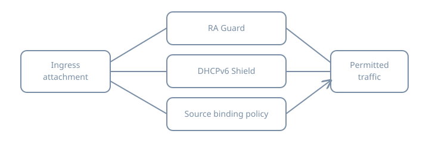

# IPv6 First-Hop Security and Binding Validation

On a shared access link, an unauthorized device can send messages that influence other hosts' IPv6 configuration or claim an address belonging to another device. Access-layer controls can narrow that exposure, but no single feature authenticates every IPv6 message or replaces segmentation, host security and routing policy. The design starts with a precise trust boundary: which attachment points are permitted to provide router advertisements, DHCPv6 service or specific source addresses?

{fig-alt="An ingress attachment is subject to separate router advertisement, DHCPv6 server message and source binding checks."}

## Configuration and threat paths

A host can learn a default router and prefix information through ICMPv6 Router Advertisements (RAs). It may use SLAAC for addresses and DHCPv6 for addresses or other configuration, depending on advertisements and local policy. DHCPv6 does not itself replace the normal RA-based default-router discovery process. A forged RA can advertise an unwanted default router or configuration; a rogue DHCPv6 server can provide unwanted DHCPv6 configuration. These are distinct control paths and require distinct protections.

| Control | Primary question | Important limit |
|---|---|---|
| RA Guard | May an RA enter on this port? | Does not authenticate every packet from a trusted port or protect DHCPv6 |
| DHCPv6 Shield / server-message guard | May DHCPv6 server or relay messages enter here? | Does not block rogue RAs or protect the DHCPv6 server from every attack |
| ND inspection and source validation | Is this address claim or packet consistent with an authorized binding? | Depends on how bindings are learned, aged, moved and enforced |
| Port isolation / segmentation | Which peers can communicate at Layer 2? | Does not automatically validate a permitted router or source address |

Names and capabilities differ by switch. Some products combine these functions; others implement only a subset. Inspect the actual enforcement direction, VLAN, attachment point and hardware support. An uplink can carry both legitimate control traffic and untrusted user traffic from a downstream switch: marking it trusted without understanding the downstream enforcement extends trust to that traffic.

## RA Guard and DHCPv6 protection

Allow RAs only on ports where authorized routers are expected; apply host-facing policy to ports that must not originate them. Validate normal router failover, link aggregation and all legitimate router-facing paths. Guard decisions can include additional policy fields on some platforms, but port trust is not cryptographic authentication and a compromised trusted port remains a risk.

A DHCPv6 server-message guard permits server or relay responses only from approved attachment points. A DHCPv6 relay may be the legitimate upstream source on the access segment; map the real path before applying policy. RA Guard does not protect against a rogue DHCPv6 server, and DHCPv6 Shield does not protect against a rogue RA. Monitoring and logging should identify the port, VLAN and counter that triggered a drop.

IPv6 extension headers and fragmentation make superficial packet inspection unreliable. Earlier RA Guard implementations could miss an RA when they did not traverse the header chain; [RFC 7113](https://www.rfc-editor.org/rfc/rfc7113.html) gives implementation advice, while [RFC 6980](https://www.rfc-editor.org/rfc/rfc6980.html) restricts fragmentation of Neighbor Discovery messages. DHCPv6 Shield has its own parsing and fragmentation considerations. Check the device's handling of header chains, unparseable packets and hardware limits; do not assume a feature name proves resistance to every evasion. Test only with controlled, authorized traffic.

## Bindings and source validation

A binding associates an address with an attachment point, and often additional context such as VLAN, MAC or lease lifetime. Sources include DHCPv6 exchanges, observed SLAAC/DAD events, administrative entries or other platform mechanisms. A DHCPv6-only binding table may not account for SLAAC, temporary privacy addresses, link-local addresses, statically configured infrastructure, or delegated prefixes behind a router. Decide how each legitimate class is learned or authorized before enforcing source validation.

Binding enforcement checks packet source or ND claims against policy. It may mitigate spoofing at the enforced attachment point, but it cannot prove a device's identity and can fail if the initial claim is fraudulent, the enforcement point misses traffic, or an attacker controls a trusted port. A downstream unmanaged switch can place multiple devices behind one port; a port binding is not necessarily a one-device identity. Capacity limits, lease renewal, address churn, mobility, switch reboot and stale bindings all affect availability.

In IPv6 a host can legitimately use several addresses on one interface. A restrictive one-address-per-port assumption can break privacy addresses and normal address rotation. Record the allowed address classes, per-port limits, fail-open or fail-closed behavior, and recovery process. Test legitimate renumbering and device movement as carefully as spoofing attempts.

## Validation lab

Use an isolated managed switch or simulator that explicitly supports the selected features, two hosts, an authorized router or RA generator, and, for DHCPv6 tests, an authorized server or relay. A second disposable host can generate test control messages. Use the [IPv6 Neighbor Discovery lab](../09-lab-workbook/43-ipv6-neighbor-discovery-filter.qmd) for an independently runnable demonstration of how a control-plane filter affects reachability; it does **not** emulate switch RA Guard or DHCPv6 Shield.

Prepare a port table: router-facing, server/relay-facing, client-facing and test port; list VLANs, approved control sources, expected client address methods and a rollback command for your platform. Capture baseline RA receipt, default-router list, host addresses, DHCPv6 lease/configuration if used, switch bindings and relevant per-port counters. A host can retain an earlier RA or lease after a new message is blocked, so use an isolated test client with controlled lifetimes and compare fresh packet observations as well as cached state.

1. **RA boundary:** verify an authorized RA is received on a router-facing path and leads to the expected host state. Send a test RA from the client-facing test port. Confirm the guard drop counter or log on that port and absence of that RA at the client. Restore normal state. A counter increment alone does not prove the legitimate router path still works.
2. **DHCPv6 boundary:** with RA Guard unchanged, send a test DHCPv6 server response from the untrusted test port. Confirm the DHCPv6 guard drops it while an authorized server or relay response reaches the client. Do not infer this result from RA Guard's counter.
3. **Binding enforcement:** establish legitimate DHCPv6 and, if supported, SLAAC bindings. Send traffic using a source address legitimately bound to a different test port; check the enforcement counter and receiving-side capture. Verify that approved addresses, including link-local and any intended temporary addresses, still work. Respect the platform's binding-learning prerequisites.
4. **Lifecycle:** renew or replace a test address, move the client to another test port and inspect the old and new bindings. Test switch restart or binding-table loss only in a disposable lab. Record whether legitimate traffic is blocked, permitted, or relearned and how long recovery takes.
5. **Failover:** switch from the primary authorized router to its backup and verify the backup's RA is accepted through the actual new path. Restore the baseline and remove all test rules and addresses.

For each step record the ingress port and VLAN, sent message, switch counter/log, receiving-side capture and host state. Device support and commands differ; this procedure has not been executed on a particular managed switch. Do not generate unauthorized advertisements on shared or production networks.

## Troubleshooting

A client with an IPv6 address but no default route may have missed or rejected an RA; inspect router lifetime, guard counters and captures. If it has a default router but fails on-link resolution, inspect Neighbor Solicitation/Advertisement traffic and the neighbor table, not just DHCPv6. If DHCPv6 succeeds but a SLAAC privacy address is dropped, investigate binding source, per-port address limit and source enforcement. If failures occur only after a move or reboot, inspect stale or missing bindings and trusted-port placement. Always check both forwarding directions and preserve ICMPv6 messages required by the network's operation.

**References:** [RA Guard, RFC 6105](https://www.rfc-editor.org/rfc/rfc6105.html), [RA Guard implementation advice, RFC 7113](https://www.rfc-editor.org/rfc/rfc7113.html), [DHCPv6 Shield, RFC 7610](https://www.rfc-editor.org/rfc/rfc7610.html), [SAVI framework, RFC 7039](https://www.rfc-editor.org/rfc/rfc7039.html), and [IPv6 operational security, RFC 9099](https://www.rfc-editor.org/rfc/rfc9099.html).
