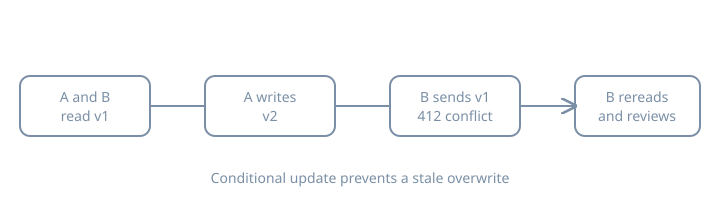

# API Automation: Conditional Updates and Concurrent Changes

A network automation job can read an interface configuration, calculate a change, and overwrite a colleague's intervening change. This **lost update** can happen even if both requests succeed and the JSON is valid. Conditional writes and read-back verification make the conflict visible, but do not eliminate the need to review the intended change.

{fig-alt="Two clients read version one; A writes version two; B receives a stale update rejection and re-reads."}

## HTTP, resource state and safety

An HTTP API exposes resources addressed by URLs. `GET` reads a representation; `PUT` commonly replaces a resource; `PATCH` applies a partial change according to that API's patch format; and `POST` semantics are resource-specific. Check the actual API's contract: methods, required fields, status codes, authentication and transaction scope vary. A response code is evidence of the request outcome, not proof that the physical device forwarded traffic as intended.

An entity tag (**ETag**) identifies a representation version. A client can include `If-Match` in a write to make the change conditional on the resource still matching the tag it read. If the condition fails, a server commonly returns `412 Precondition Failed` without applying the stale change. HTTP also permits a successful response in a narrowly defined already-applied case; follow the actual server's semantics. ETags are opaque: clients must not assume they are sequential numbers or parse a vendor's tag.

`PUT` is defined as idempotent in its intended effect: repeating the same request has the same intended resource effect as applying it once. That does not mean every response is identical, other logging side effects cannot happen, a conditional retry must succeed, or a multi-step workflow is atomic. A timeout after a write can mean the server applied it but the response was lost. Read current state and reconcile before retrying; do not blindly replay a non-idempotent operation.

## Local mock lab

This Python 3 standard-library example starts a **single-threaded, loopback-only mock** on a random available port. It models an interface object, an ETag and conditional `PUT`; it is not a real network device, RESTCONF server, production service or complete HTTP implementation. Its simplified validation and policy intentionally require `If-Match`. It uses no credentials, encryption, external network or persistent state. Run `python3 api-lab.py` after saving the following code. Python 3 and loopback socket access are required.

```python
import json
import threading
from http.server import BaseHTTPRequestHandler, HTTPServer
from urllib.error import HTTPError
from urllib.request import Request, urlopen

class DeviceAPI(BaseHTTPRequestHandler):
    config = {'enabled': True, 'description': 'initial'}
    revision = 1

    def log_message(self, *args):
        pass

    def etag(self):
        return f'"{self.revision}"'

    def respond(self, status, body=b'', etag=None):
        self.send_response(status)
        if etag is not None:
            self.send_header('ETag', etag)
        self.send_header('Content-Type', 'application/json')
        self.send_header('Content-Length', str(len(body)))
        self.end_headers()
        if body:
            self.wfile.write(body)

    def do_GET(self):
        if self.path != '/interface':
            return self.respond(404)
        body = json.dumps(self.config, sort_keys=True).encode()
        self.respond(200, body, self.etag())

    def do_PUT(self):
        if self.path != '/interface':
            return self.respond(404)
        if self.headers.get('If-Match') is None:
            return self.respond(428)
        if self.headers['If-Match'] != self.etag():
            return self.respond(412)
        try:
            length = int(self.headers['Content-Length'])
            new = json.loads(self.rfile.read(length))
            if (not isinstance(new, dict) or set(new) != {'enabled', 'description'}
                    or type(new['enabled']) is not bool
                    or not isinstance(new['description'], str)):
                raise ValueError('invalid resource')
        except (ValueError, TypeError, KeyError):
            return self.respond(400)
        if new != self.config:
            type(self).config = new
            type(self).revision += 1
        self.respond(204, etag=self.etag())

server = HTTPServer(('127.0.0.1', 0), DeviceAPI)
thread = threading.Thread(target=server.serve_forever, daemon=True)
thread.start()
url = f'http://127.0.0.1:{server.server_port}/interface'

def request(method, payload=None, etag=None):
    body = None if payload is None else json.dumps(payload).encode()
    headers = {'Content-Type': 'application/json'}
    if etag is not None:
        headers['If-Match'] = etag
    req = Request(url, data=body, headers=headers, method=method)
    try:
        with urlopen(req, timeout=3) as res:
            data = res.read()
            return res.status, res.headers.get('ETag'), json.loads(data) if data else None
    except HTTPError as err:
        return err.code, err.headers.get('ETag'), None

try:
    _, tag_a, original_a = request('GET')
    _, tag_b, original_b = request('GET')
    assert tag_a == tag_b and original_a == original_b
    print('Both clients read', original_a, 'ETag', tag_a)

    edit_a = {**original_a, 'description': 'uplink to core'}
    status, tag_after_a, _ = request('PUT', edit_a, tag_a)
    assert status == 204
    print('A update:', status, 'new ETag', tag_after_a)

    edit_b = {**original_b, 'enabled': False}
    status, _, _ = request('PUT', edit_b, tag_b)
    assert status == 412
    print('B stale update:', status)
    _, fresh_tag, current = request('GET')
    assert current == edit_a
    print('Read after rejection:', current, 'ETag', fresh_tag)

    merged = {**current, 'enabled': False}
    status, new_tag, _ = request('PUT', merged, fresh_tag)
    assert status == 204
    _, observed_tag, observed = request('GET')
    assert observed == merged and observed_tag == new_tag
    print('B reconciles and verifies:', observed, 'ETag', observed_tag)
finally:
    server.shutdown()
    thread.join()
    server.server_close()
```

On the test host, both clients read ETag `"1"`. A changes the description and receives `204`; B's stale update receives `412`. The next GET confirms A's description survived. B then re-reads, deliberately merges its desired `enabled` value with the current description, writes with the new tag and verifies the resulting state. The numerical tags are a feature of this mock only. The script's assertions check each stage and shut the server down even on failure.

## Practice and operational reasoning

1. Remove B's `If-Match` argument. This mock returns `428` and leaves the resource unchanged. A real API may have different precondition requirements and response behavior; inspect its contract.
2. Before B re-reads, change A's description again. B must retrieve the latest representation and decide whether its intended change still makes sense; automatically merging arbitrary configuration can violate policy.
3. Repeat a `PUT` with the same body and **current** ETag, then read back the object. In this mock the content and tag stay unchanged. A real server can have different revision or logging behavior; a retry with the old ETag can instead be rejected.
4. Change the body to an invalid type such as `"enabled": "false"`. The mock returns `400` rather than silently accepting a string as a boolean. Validate types against the actual device's schema and YANG model where applicable.
5. Plan rollback before editing a real device. A saved pre-change configuration is not always safe to restore blindly: another operator may have made a legitimate later change. Use the system's candidate/confirmed-commit or version checks where available, preserve an independent management path, verify forwarding and application behavior, and document ownership of the change.

For real automation use authenticated encrypted transport, verify server identity, protect credentials, set timeouts, handle rate limits and errors, minimize permissions, and avoid logging secrets. Limit request scope and compare intended and observed state. RESTCONF can expose YANG-modeled resources and conditional editing, but support, datastore behavior, model revisions and transactional features must be discovered on the actual server. See [YANG, NETCONF and gNMI](06-yang-netconf-gnmi.qmd) for the wider model-driven context.

**References:** [HTTP Semantics, RFC 9110](https://www.rfc-editor.org/rfc/rfc9110.html) and [RESTCONF, RFC 8040](https://www.rfc-editor.org/rfc/rfc8040.html).
