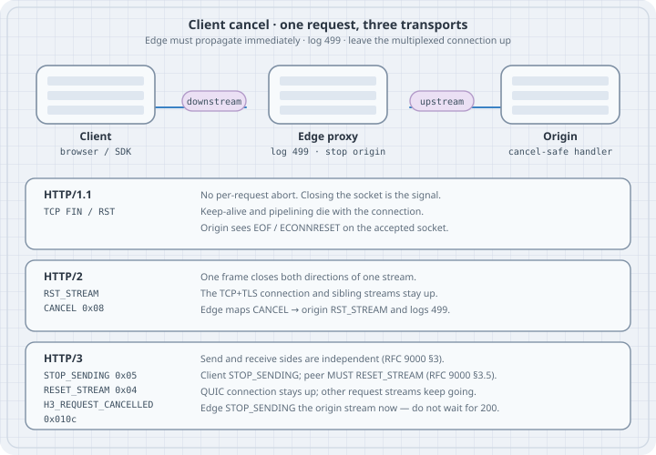

# HTTP/3 Stream Cancellation: STOP_SENDING, RESET_STREAM, and 499

A user closes a tab, a mobile client races a new search, an SDK hits its read timeout. The HTTP request is over for the client. Whether the origin finds out — and how fast — depends on the transport. **HTTP/1.1** has no per-request abort: the only signal is closing the TCP connection, which also kills keep-alive and any pipelined work on that socket. **HTTP/2** can abort one stream with `RST_STREAM` and error code `CANCEL` (0x08) while the TLS connection stays up. **HTTP/3** splits that into two QUIC frames on independent stream halves: `STOP_SENDING` (stop the peer sending) and `RESET_STREAM` (I am done sending), usually carrying `H3_REQUEST_CANCELLED` (0x010c). This chapter is the mapping, the proxy duty (propagate immediately, log 499, do not wait for origin 200), and a localhost HTTP/3 lab that captures the frames.

## Learning goals

- Name the abort signal on HTTP/1.1, HTTP/2, and HTTP/3, and say what happens to sibling requests
- Read a QUIC bidirectional stream as two state machines, and say when `STOP_SENDING` vs `RESET_STREAM` is the right frame (RFC 9000 §3, §19.4, §19.5)
- Pick `H3_REQUEST_CANCELLED` (0x010c) vs `H3_NO_ERROR` (0x0100) vs `H3_REQUEST_REJECTED` (0x010b) from RFC 9114 §4.1.1 and §8.1
- Write the proxy rule: on downstream cancel, stop the origin stream *now* and record a 499-style "client closed request"
- Design an origin so a cancelled GET stops work, and a cancelled POST does not double-apply on retry
- Run a localhost HTTP/3 server and client, cancel mid-response, and point at the qlog frames

Lab platform: Python 3.13.5, aioquic 1.7.0 from PyPI, OpenSSL 3.5.7, Linux 6.12. Bind `127.0.0.1:4433`. No root. Every listing output below is pasted from one run.

This chapter does not reteach QUIC version negotiation or CID-based load balancing.

## Mental model

A cancel is "this request is no longer of interest." The transport has to carry that to the peer without taking down every other request that happens to share a connection.

{fig-alt="Three boxes — client, edge proxy, origin — and three rows: HTTP/1.1 closes the TCP connection; HTTP/2 sends RST_STREAM CANCEL 0x08 on one stream; HTTP/3 sends STOP_SENDING and RESET_STREAM with H3_REQUEST_CANCELLED 0x010c. The edge logs 499 and must stop the origin immediately."}

| | HTTP/1.1 (RFC 9112) | HTTP/2 (RFC 9113) | HTTP/3 (RFC 9114 on RFC 9000) |
|---|---|---|---|
| Abort signal | Close the TCP connection (FIN or RST) | `RST_STREAM` with `CANCEL` (0x08) | `STOP_SENDING` and/or `RESET_STREAM` with `H3_REQUEST_CANCELLED` (0x010c) |
| Scope | The whole connection | One stream; both directions | One stream; send and receive halves independently |
| Sibling requests | Die with the socket | Keep going | Keep going |
| What the origin must notice | `read()` returns 0 / `ECONNRESET` | Stream reset | `StopSendingReceived` / `StreamReset` (library events), then stop the handler |

The edge is not a spectator. RFC 9114 Appendix A.4.1 says an intermediary *may* pass client cancellations indicated by `H3_REQUEST_CANCELLED`. In production that "may" is the difference between origin CPU spent on a tab that already closed and a 499 in the log. nginx invented status **499** ("client closed request") for exactly this: the downstream went away before a response was sent. It is a log code, not an IETF status the client ever sees.

## Concepts — two halves of a QUIC stream

HTTP/3 puts each request/response on one client-initiated **bidirectional** QUIC stream (RFC 9114 §2, §6.1). QUIC treats that stream as two independent parts (RFC 9000 §3): a sending part and a receiving part. Closing one does not close the other.

```text
Client-initiated bidir stream (id 0, 4, 8, …)

  client send  ── STREAM / STREAM+FIN / RESET_STREAM ──►  server recv
  client recv  ◄─ STREAM / STREAM+FIN / RESET_STREAM ──  server send
                 STOP_SENDING travels the opposite way
                 of the data it wants to stop
```

Application operations (RFC 9000 §2.4):

- **Reset sending** → `RESET_STREAM` (type 0x04). "I will not send more on this stream."
- **Abort reading** → `STOP_SENDING` (type 0x05). "Stop sending to me on this stream."

Frame layouts (RFC 9000 §19.4, §19.5):

```text
RESET_STREAM Frame {
  Type (i) = 0x04,
  Stream ID (i),
  Application Protocol Error Code (i),
  Final Size (i),
}

STOP_SENDING Frame {
  Type (i) = 0x05,
  Stream ID (i),
  Application Protocol Error Code (i),
}
```

The coupling that operators forget is RFC 9000 §3.5: an endpoint that receives `STOP_SENDING` **MUST** send `RESET_STREAM` if its sending part is in "Ready" or "Send". It SHOULD copy the error code. STREAM frames that still arrive after `STOP_SENDING` still count toward flow control even if the application discards them.

So a client that has already finished its GET (HEADERS + FIN) and then loses interest in the response does this:

1. `STOP_SENDING` with `H3_REQUEST_CANCELLED` — abort reading.
2. `RESET_STREAM` only if the send side is still open (a POST body still in flight). If the GET is already acknowledged, `RESET_STREAM` is a no-op.
3. The server MUST `RESET_STREAM` the response. The client then sees a stream reset with the same application error code.

That pair is the HTTP/3 equivalent of HTTP/2's single `RST_STREAM`. HTTP/2 streams are one state machine (RFC 9113 §5.1): `RST_STREAM` moves the stream to "closed" in both directions at once.

## Concepts — which HTTP/3 error code

RFC 9114 §4.1.1: implementations SHOULD cancel by resetting any sending parts that are still open and aborting reading on receiving parts. The codes (RFC 9114 §8.1):

| Code | Value | When |
|---|---|---|
| `H3_NO_ERROR` | 0x0100 | Close with no error. A server that has sent a complete response and does not need the rest of the request SHOULD abort reading with this code (RFC 9114 §4.1). Also used for graceful connection close. |
| `H3_REQUEST_REJECTED` | 0x010b | Server refused the request **without** application processing. The client may retry as if the request never happened. Servers MUST NOT use this after passing data to a higher layer. |
| `H3_REQUEST_CANCELLED` | 0x010c | The request or its response is cancelled. Clients SHOULD use this. A server that abandons a *partially processed* response SHOULD use this, not `H3_REQUEST_REJECTED`. |

RFC 9114 Appendix A.4 maps HTTP/2 `CANCEL` (0x08) to `H3_REQUEST_CANCELLED`. Treat them as the same operator event: "this request is no longer needed."

Do not send `H3_NO_ERROR` when the user cancelled. The stream is torn down either way, but `0x0100` tells the peer "nothing went wrong", so metrics and origin cancellation hooks that key off `0x010c` will miss it.

## Case — what a proxy must do

Downstream cancel is not "the origin can finish and we will drop the body." The body is the expensive part.

```text
Client                         Edge                            Origin
  │                              │                                │
  │  GET /report  ─────────────► │  GET /report  ───────────────► │
  │                              │                                │  (query running)
  │  STOP_SENDING 0x010c  ─────► │                                │
  │                              │  log 499                       │
  │                              │  STOP_SENDING 0x010c  ────────►│
  │                              │                                │  abort handler
  │  ◄──── RESET_STREAM 0x010c ─ │  ◄──── RESET_STREAM 0x010c ─── │
```

RFC 9114 Appendix A.4.1: it is beneficial to pass client cancellations indicated by `H3_REQUEST_CANCELLED`. The operational translation:

1. On downstream `STOP_SENDING` / `RESET_STREAM` / HTTP/2 `RST_STREAM CANCEL` / HTTP/1.1 connection close, **stop the origin stream immediately**. Do not wait for origin headers.
2. Log **499** (nginx `NGX_HTTP_CLIENT_CLOSED_REQUEST`; Cloudflare uses the same number in analytics and logs). The client never receives a 499 status line — they already left.
3. Exclude 499 from server-error rates. It is a client abort, not a 5xx. A jump in 499s after you start honouring HTTP/3 cancels is reporting catching up, not a new outage.
4. Leave `proxy_ignore_client_abort` (and equivalents) off for reads. Turn it on only for work that *must* finish without a client, and only with an idempotency story.

Cloudflare's 9 October 2026 changelog records the HTTP/3-shaped version of this bug: the edge did not always stop an HTTP/3 request when the client cancelled the stream, so some requests continued to the origin and were logged with the upstream status instead of 499. The fix stops those requests sooner and records 499. Operators then see more 499s on HTTP/3; the cancellations were already happening.

HTTP/1.1 through the same proxy is the same 499 with a worse blast radius: the only way the client can abort is to close TCP, so the proxy also loses connection reuse.

## Case — cancel-safe origins

The transport can only deliver the signal. The handler has to listen.

- **Context.** In Go, `Request.Context()` is cancelled when the peer goes away. In Python asyncio, cancel the task that is writing the response (the lab below). In any language, the HTTP server must surface stream reset as cancellation, not as "write failed later."
- **Reads (GET, HEAD).** Abort the query, the upstream HTTP call, the file read. Retrying a partial GET is safe (RFC 9110: GET is idempotent).
- **Writes (POST, PUT, PATCH).** A cancel after the origin began processing is *not* "the write never happened." The client may retry. Use an idempotency key (client-supplied or derived) and make the handler safe to run twice. Do not use `H3_REQUEST_REJECTED` after you have touched storage — RFC 9114 §4.1.1 forbids it, because that code tells the client the request is retryable as if it never ran.
- **Do not finish work for a gone client** on the default path. The exception is a small class of must-complete actions (some payments, some audit writes), and those need their own queue, not a streaming HTTP response the client already abandoned.

A 200 that nobody reads still cost the database. A 499 that you treat as 5xx pages people at 3 a.m. for a user tapping Back.

## Lab — cancel mid-response on localhost

Self-signed certificate for `localhost` and `127.0.0.1`, then aioquic 1.7.0 as both HTTP/3 server and client. The server streams 40 × 256-byte chunks with 50 ms between them (~2 s if nobody cancels). The client cancels after 512 bytes, then issues `GET /fast` on a new stream of the **same** connection to prove the abort was per-stream.

```console
$ python3 -m venv /workspace/run-2026-10-17-am/venv-net-http3
$ /workspace/run-2026-10-17-am/venv-net-http3/bin/pip install aioquic
...
Successfully installed aioquic-1.7.0 attrs-26.1.0 certifi-2026.7.22 cffi-2.1.1 cryptography-50.0.2 pycparser-3.11 pylsqpack-1.0.0 pyopenssl-26.4.0 service-identity-26.1.0
$ openssl version
OpenSSL 3.5.7 9 Jun 2026 (Library: OpenSSL 3.5.7 9 Jun 2026)
$ openssl req -x509 -newkey ec -pkeyopt ec_paramgen_curve:prime256v1 -nodes \
    -days 1 -subj /CN=localhost \
    -addext subjectAltName=DNS:localhost,IP:127.0.0.1 \
    -keyout key.pem -out cert.pem
$ ls -l cert.pem key.pem
-rw-r--r-- 1 box box 615 Oct 17 08:47 cert.pem
-rw------- 1 box box 241 Oct 17 08:47 key.pem
```

```python
# cancel_lab.py — HTTP/3 client cancel mid-response (aioquic, localhost)
import asyncio
import json
import ssl
import sys
import time
from typing import Optional

from aioquic.asyncio import connect, serve
from aioquic.asyncio.protocol import QuicConnectionProtocol
from aioquic.h3.connection import H3_ALPN, ErrorCode, H3Connection
from aioquic.h3.events import DataReceived, H3Event, HeadersReceived
from aioquic.quic.configuration import QuicConfiguration
from aioquic.quic.events import ProtocolNegotiated, QuicEvent, StopSendingReceived, StreamReset
from aioquic.quic.logger import QuicLogger

T0 = time.monotonic()
SERVER_CHUNKS_SENT = 0
SERVER_SEND_ABORTED = False
SERVER_SAW_STOP_SENDING: Optional[tuple[int, int]] = None
SERVER_SAW_RESET: Optional[tuple[int, int]] = None
CLIENT_BYTES = 0
CLIENT_SAW_RESET: Optional[tuple[int, int]] = None
CHUNK = b"x" * 256
N_CHUNKS = 40
CHUNK_PAUSE = 0.05


def stamp(role: str, msg: str) -> None:
    print(f"{time.monotonic() - T0:7.3f}s  {role:6}  {msg}", flush=True)


def dump_cancel_frames(label: str, logger: QuicLogger) -> None:
    kinds = {"reset_stream", "stop_sending"}
    print(f"\n# qlog {label}: STOP_SENDING / RESET_STREAM frames")
    n = 0
    for trace in logger.to_dict()["traces"]:
        vp = trace["vantage_point"]["type"]
        for ev in trace["events"]:
            for fr in ev.get("data", {}).get("frames") or []:
                if fr.get("frame_type") in kinds:
                    n += 1
                    extra = (
                        f"  final_size={fr.get('final_size')}"
                        if "final_size" in fr
                        else ""
                    )
                    print(
                        f"  {vp:6}  {ev['name']:28}  {fr['frame_type']}"
                        f"  stream={fr.get('stream_id')}"
                        f"  error_code={fr.get('error_code')}{extra}"
                    )
    if n == 0:
        print("  (none)")


class H3ServerProtocol(QuicConnectionProtocol):
    def __init__(self, *args, **kwargs):
        super().__init__(*args, **kwargs)
        self._http: Optional[H3Connection] = None
        self._tasks: dict[int, asyncio.Task] = {}

    def quic_event_received(self, event: QuicEvent) -> None:
        global SERVER_SAW_STOP_SENDING, SERVER_SAW_RESET
        if isinstance(event, ProtocolNegotiated):
            stamp("server", f"ALPN={event.alpn_protocol}")
            if event.alpn_protocol in H3_ALPN:
                self._http = H3Connection(self._quic)
        if isinstance(event, StopSendingReceived):
            SERVER_SAW_STOP_SENDING = (event.stream_id, event.error_code)
            stamp(
                "server",
                f"StopSendingReceived stream={event.stream_id} "
                f"error_code=0x{event.error_code:x} ({event.error_code})",
            )
            task = self._tasks.pop(event.stream_id, None)
            if task is not None:
                task.cancel()
        if isinstance(event, StreamReset):
            SERVER_SAW_RESET = (event.stream_id, event.error_code)
            stamp(
                "server",
                f"StreamReset stream={event.stream_id} "
                f"error_code=0x{event.error_code:x} ({event.error_code})",
            )
        if self._http is not None:
            for http_event in self._http.handle_event(event):
                self._http_event(http_event)

    def _http_event(self, event: H3Event) -> None:
        if isinstance(event, HeadersReceived):
            headers = {k.decode(): v.decode() for k, v in event.headers}
            path = headers.get(":path", "?")
            stamp(
                "server",
                f"request {headers.get(':method')} {path} stream={event.stream_id}",
            )
            if path == "/fast":
                self._http.send_headers(
                    event.stream_id,
                    [(b":status", b"200"), (b"content-type", b"text/plain")],
                )
                self._http.send_data(event.stream_id, b"ok\n", end_stream=True)
                self.transmit()
                stamp("server", f"/fast complete stream={event.stream_id}")
            elif path == "/slow":
                self._http.send_headers(
                    event.stream_id,
                    [
                        (b":status", b"200"),
                        (b"content-type", b"application/octet-stream"),
                        (b"x-lab", b"slow-body"),
                    ],
                )
                self.transmit()
                self._tasks[event.stream_id] = asyncio.create_task(
                    self._slow_body(event.stream_id)
                )

    async def _slow_body(self, stream_id: int) -> None:
        global SERVER_CHUNKS_SENT, SERVER_SEND_ABORTED
        try:
            for i in range(N_CHUNKS):
                self._http.send_data(
                    stream_id, CHUNK, end_stream=(i == N_CHUNKS - 1)
                )
                self.transmit()
                SERVER_CHUNKS_SENT += 1
                if i == 0:
                    stamp(
                        "server",
                        f"started slow body stream={stream_id} chunk=0/{N_CHUNKS}",
                    )
                await asyncio.sleep(CHUNK_PAUSE)
            stamp(
                "server",
                f"slow body FIN stream={stream_id} chunks={SERVER_CHUNKS_SENT}",
            )
        except asyncio.CancelledError:
            SERVER_SEND_ABORTED = True
            stamp(
                "server",
                f"origin send cancelled stream={stream_id} "
                f"chunks_sent={SERVER_CHUNKS_SENT}/{N_CHUNKS}",
            )
        except RuntimeError as exc:
            SERVER_SEND_ABORTED = True
            stamp(
                "server",
                f"origin send RuntimeError: {exc} chunks_sent={SERVER_CHUNKS_SENT}",
            )


class H3ClientProtocol(QuicConnectionProtocol):
    def __init__(self, *args, **kwargs):
        super().__init__(*args, **kwargs)
        self._http: Optional[H3Connection] = None
        self._slow_id: Optional[int] = None
        self._fast_id: Optional[int] = None
        self._cancelled = False
        self.done = asyncio.get_running_loop().create_future()

    def start_slow(self) -> None:
        self._slow_id = self._quic.get_next_available_stream_id()
        self._http.send_headers(
            self._slow_id,
            [
                (b":method", b"GET"),
                (b":scheme", b"https"),
                (b":authority", b"localhost"),
                (b":path", b"/slow"),
                (b"user-agent", b"cancel-lab/1.0"),
            ],
            end_stream=True,
        )
        self.transmit()
        stamp("client", f"GET /slow stream={self._slow_id}")

    def start_fast(self) -> None:
        self._fast_id = self._quic.get_next_available_stream_id()
        self._http.send_headers(
            self._fast_id,
            [
                (b":method", b"GET"),
                (b":scheme", b"https"),
                (b":authority", b"localhost"),
                (b":path", b"/fast"),
                (b"user-agent", b"cancel-lab/1.0"),
            ],
            end_stream=True,
        )
        self.transmit()
        stamp("client", f"GET /fast stream={self._fast_id}")

    def cancel_slow(self) -> None:
        if self._cancelled or self._slow_id is None:
            return
        self._cancelled = True
        code = ErrorCode.H3_REQUEST_CANCELLED
        self._quic.stop_stream(self._slow_id, code)
        self._quic.reset_stream(self._slow_id, code)
        self.transmit()
        stamp(
            "client",
            f"cancel stream={self._slow_id} "
            f"STOP_SENDING+RESET_STREAM error_code=0x{int(code):x} "
            f"({int(code)} H3_REQUEST_CANCELLED) bytes_so_far={CLIENT_BYTES}",
        )

    def quic_event_received(self, event: QuicEvent) -> None:
        global CLIENT_SAW_RESET
        if isinstance(event, ProtocolNegotiated):
            stamp("client", f"ALPN={event.alpn_protocol}")
            if event.alpn_protocol in H3_ALPN:
                self._http = H3Connection(self._quic)
                self.start_slow()
        if isinstance(event, StreamReset):
            CLIENT_SAW_RESET = (event.stream_id, event.error_code)
            stamp(
                "client",
                f"StreamReset stream={event.stream_id} "
                f"error_code=0x{event.error_code:x} ({event.error_code})",
            )
        if self._http is not None:
            for http_event in self._http.handle_event(event):
                self._http_event(http_event)

    def _http_event(self, event: H3Event) -> None:
        global CLIENT_BYTES
        if isinstance(event, HeadersReceived):
            status = dict(event.headers).get(b":status", b"?").decode()
            stamp(
                "client",
                f"headers :status={status} stream={event.stream_id} "
                f"ended={event.stream_ended}",
            )
        elif isinstance(event, DataReceived):
            CLIENT_BYTES += len(event.data)
            if (
                event.stream_id == self._slow_id
                and not self._cancelled
                and CLIENT_BYTES >= 512
            ):
                stamp("client", f"received {CLIENT_BYTES} bytes of /slow; cancelling")
                self.cancel_slow()
                asyncio.get_running_loop().call_later(0.15, self.start_fast)
            if event.stream_id == self._fast_id:
                stamp(
                    "client",
                    f"/fast data={event.data!r} ended={event.stream_ended}",
                )
                if event.stream_ended and not self.done.done():
                    self.done.set_result(True)


async def main() -> None:
    import aioquic

    print(f"python {sys.version.split()[0]}")
    print(f"aioquic {aioquic.__version__}")
    print(
        f"H3_REQUEST_CANCELLED = {int(ErrorCode.H3_REQUEST_CANCELLED)} "
        f"(0x{int(ErrorCode.H3_REQUEST_CANCELLED):x})"
    )
    print(
        f"H3_NO_ERROR          = {int(ErrorCode.H3_NO_ERROR)} "
        f"(0x{int(ErrorCode.H3_NO_ERROR):x})"
    )
    print()

    server_logger = QuicLogger()
    client_logger = QuicLogger()
    server_conf = QuicConfiguration(
        alpn_protocols=H3_ALPN, is_client=False, quic_logger=server_logger
    )
    server_conf.load_cert_chain("cert.pem", "key.pem")
    server = await serve(
        "127.0.0.1", 4433, configuration=server_conf, create_protocol=H3ServerProtocol
    )
    stamp("lab", "HTTP/3 server listening on 127.0.0.1:4433")

    client_conf = QuicConfiguration(
        alpn_protocols=H3_ALPN,
        is_client=True,
        server_name="localhost",
        quic_logger=client_logger,
    )
    client_conf.verify_mode = ssl.CERT_NONE
    try:
        async with connect(
            "127.0.0.1",
            4433,
            configuration=client_conf,
            create_protocol=H3ClientProtocol,
        ) as client:
            await asyncio.wait_for(client.done, timeout=5)
            await asyncio.sleep(0.2)
            client.close()
            await client.wait_closed()
    finally:
        server.close()

    print("\n# summary")
    print(f"server chunks sent     : {SERVER_CHUNKS_SENT}/{N_CHUNKS}")
    print(f"server send aborted    : {SERVER_SEND_ABORTED}")
    print(f"server StopSending     : {SERVER_SAW_STOP_SENDING}")
    print(f"server StreamReset     : {SERVER_SAW_RESET}")
    print(f"client bytes (end)     : {CLIENT_BYTES}")
    print(f"client StreamReset     : {CLIENT_SAW_RESET}")
    dump_cancel_frames("client", client_logger)
    dump_cancel_frames("server", server_logger)


if __name__ == "__main__":
    asyncio.run(main())
```

The listing above is the lab that ran, with one print-label tweak (`client bytes (end)`) so the summary is not misread as "bytes at cancel." aioquic 1.7.0 reports `H3_REQUEST_CANCELLED = 268`, which is 0x010c.

```console
$ python cancel_lab.py
python 3.13.5
aioquic 1.7.0
H3_REQUEST_CANCELLED = 268 (0x10c)
H3_NO_ERROR          = 256 (0x100)

  0.003s  lab     HTTP/3 server listening on 127.0.0.1:4433
  0.016s  server  ALPN=h3
  0.017s  client  ALPN=h3
  0.018s  client  GET /slow stream=0
  0.019s  server  request GET /slow stream=0
  0.019s  server  started slow body stream=0 chunk=0/40
  0.020s  client  headers :status=200 stream=0 ended=False
  0.071s  client  received 512 bytes of /slow; cancelling
  0.071s  client  cancel stream=0 STOP_SENDING+RESET_STREAM error_code=0x10c (268 H3_REQUEST_CANCELLED) bytes_so_far=512
  0.071s  server  StopSendingReceived stream=0 error_code=0x10c (268)
  0.071s  server  origin send cancelled stream=0 chunks_sent=2/40
  0.071s  client  StreamReset stream=0 error_code=0x10c (268)
  0.222s  client  GET /fast stream=4
  0.222s  server  request GET /fast stream=4
  0.223s  server  /fast complete stream=4
  0.223s  client  headers :status=200 stream=4 ended=False
  0.223s  client  /fast data=b'ok\n' ended=True

# summary
server chunks sent     : 2/40
server send aborted    : True
server StopSending     : (0, 268)
server StreamReset     : None
client bytes (end)     : 515
client StreamReset     : (0, 268)

# qlog client: STOP_SENDING / RESET_STREAM frames
  client  transport:packet_sent         stop_sending  stream=0  error_code=268
  client  transport:packet_received     reset_stream  stream=0  error_code=268  final_size=555

# qlog server: STOP_SENDING / RESET_STREAM frames
  server  transport:packet_received     stop_sending  stream=0  error_code=268
  server  transport:packet_sent         reset_stream  stream=0  error_code=268  final_size=555
```

Read it in order:

1. **ALPN `h3`.** Both sides negotiated HTTP/3. Stream 0 is the first client-initiated bidirectional stream.
2. **Cancel is `STOP_SENDING`, not a connection close.** qlog shows the client *sending* `stop_sending` with `error_code=268` (0x010c) and *not* sending `reset_stream`. The GET already had FIN; aioquic's `reset_stream()` is a no-op once the send side is finished (RFC 9000 §3.1: no `RESET_STREAM` from a terminal send state). RFC 9114 §4.1.1 still says to reset sending parts that are *still open* — here they were not.
3. **The server MUST answer `STOP_SENDING` with `RESET_STREAM`.** aioquic copies the error code (RFC 9000 §3.5). The client event is `StreamReset stream=0 error_code=0x10c`. qlog `final_size=555` is the STREAM offset the server had committed: two 256-byte DATA chunks plus the HEADERS framing (~43 bytes).
4. **The origin stopped.** 2 of 40 chunks. Without the `task.cancel()` on `StopSendingReceived`, the handler would keep calling `send_data` until aioquic raised `RuntimeError: Cannot send data after the stream was reset`. That is the "proxy that does not propagate" failure, on one box.
5. **The connection survived.** `GET /fast` on stream 4 returned `200` and `ok\n` 150 ms later. That is the whole point of multiplexed abort. HTTP/1.1 cannot do this: the cancel would have been a TCP close, and `/fast` would have needed a new connection.
6. **515 vs 512.** The cancel fired at 512 body bytes. The summary's 515 is bytes counted through the end of the run — three extra bytes of STREAM data already in flight. RFC 9000 §3.5: STREAM frames received after `STOP_SENDING` still count toward flow control even when discarded.

nginx was not run here. Its 499 is a log-only code for "downstream closed while we still owed a response," documented by nginx and by Cloudflare's Error 499 page. The lab's `StopSendingReceived` is the HTTP/3 event that a proxy should turn into that log line *and* an upstream cancel.

## The trap

- **Closing the QUIC connection to cancel one request.** That is the HTTP/1.1 move. It dumps every other stream, burns the handshake, and wrecks 0-RTT. Cancel the stream.
- **Waiting for origin 200 after downstream cancel.** The user is gone. Every extra millisecond is origin work you will throw away, then log as 200 and lie to your SLO.
- **Putting 499 in the 5xx burn rate.** 499 means the client left. After you start honouring HTTP/3 `STOP_SENDING`, 499 volume on HTTP/3 will rise. That is the metric becoming honest.
- **Sending `H3_REQUEST_REJECTED` after you processed the request.** RFC 9114 §4.1.1: that code means "safe to retry as if never sent." Use `H3_REQUEST_CANCELLED` once a handler has run.
- **Sending `H3_NO_ERROR` for a user abort.** 0x0100 is "no error" (complete response, leftover request body; graceful GOAWAY). User cancel is 0x010c.
- **Ignoring `STOP_SENDING` in the application.** The transport will `RESET_STREAM` for you. The database query will not, unless you cancel the task.

## The boring rule

Cancel is a stream event, not a connection event. On HTTP/3 the client sends `STOP_SENDING` (and `RESET_STREAM` if it is still sending) with `H3_REQUEST_CANCELLED`. The peer MUST `RESET_STREAM`. The proxy copies that to the origin immediately and logs 499, excluded from server errors. The origin aborts the handler and treats writes as retryable only when they are actually idempotent. Sibling streams keep running.

## Try this

1. Change the client to cancel with `ErrorCode.H3_NO_ERROR` (0x0100). Predict the qlog `error_code` on both `stop_sending` and the server's `reset_stream`, then run it. The origin still stops; your cancel metrics that filter on 0x010c go silent.
2. Comment out `task.cancel()` on the server. How many extra chunks are sent, and do you hit `RuntimeError: Cannot send data after the stream was reset`?
3. Turn `/slow` into a POST whose body is sent in 20 chunks without FIN. Cancel after the first response byte. Confirm a client-originated `reset_stream` now appears in qlog alongside `stop_sending`.
4. Start two `/slow` requests in parallel, cancel only stream 0, and confirm stream 4 still delivers 40 chunks. That is the HTTP/1.1 counterfactual.

## Sources

- RFC 9000 — QUIC: A UDP-Based Multiplexed and Secure Transport (§2.4 operations, §3 stream states, §3.5 solicited state transitions, §19.4 `RESET_STREAM`, §19.5 `STOP_SENDING`): <https://www.rfc-editor.org/rfc/rfc9000.html>
- RFC 9114 — HTTP/3 (§4.1 leftover request body / `H3_NO_ERROR`, §4.1.1 request cancellation and rejection, §8.1 error codes, Appendix A.4 mapping from HTTP/2, Appendix A.4.1 intermediaries): <https://www.rfc-editor.org/rfc/rfc9114.html>
- RFC 9113 — HTTP/2 (§5.1 stream states, §5.4.2 stream errors, §6.4 `RST_STREAM`, §7 `CANCEL` 0x08): <https://www.rfc-editor.org/rfc/rfc9113.html>
- RFC 9112 — HTTP/1.1 (§9 connection management; abort is connection close): <https://www.rfc-editor.org/rfc/rfc9112.html>
- RFC 9110 — HTTP Semantics (idempotent methods; GET/PUT/DELETE retry): <https://www.rfc-editor.org/rfc/rfc9110.html>
- IANA HTTP/3 error codes (`H3_NO_ERROR` 0x0100, `H3_REQUEST_REJECTED` 0x010b, `H3_REQUEST_CANCELLED` 0x010c): <https://www.iana.org/assignments/http3-parameters>
- aioquic 1.7.0 (`H3Connection`, `ErrorCode`, `stop_stream` / `reset_stream`, qlog): <https://aioquic.readthedocs.io/en/latest/> and <https://pypi.org/project/aioquic/1.7.0/>
- aioquic `QuicConnection.stop_stream` / `reset_stream`: <https://aioquic.readthedocs.io/en/latest/quic.html>
- Cloudflare changelog, 9 October 2026 — Improved HTTP/3 client cancellation reporting: <https://developers.cloudflare.com/changelog/post/2026-10-09-http3-499-reporting-improvement/>
- Cloudflare Error 499 (nginx `499 Client Closed Request` in logs and analytics): <https://developers.cloudflare.com/support/troubleshooting/http-status-codes/4xx-client-error/error-499/>
- nginx source — `NGX_HTTP_CLIENT_CLOSED_REQUEST` 499 in `ngx_http_request.h`: <https://hg.nginx.org/nginx/file/tip/src/http/ngx_http_request.h>
