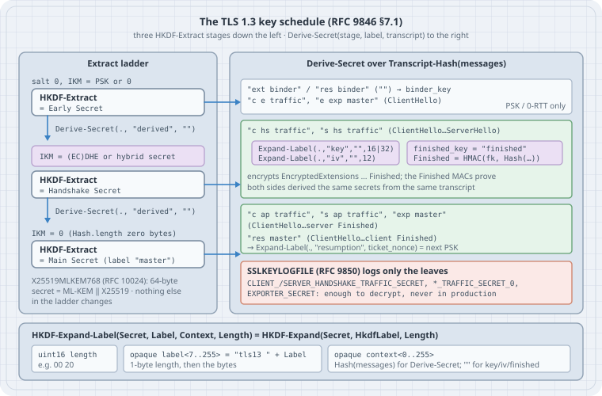

# Inside the TLS 1.3 Key Schedule: HKDF, Three Secrets, and Every Key in a Handshake

Every TLS 1.3 connection turns one shared secret into a dozen keys, IVs and MACs: separate keys for the handshake and for application data, separate keys per direction, a Finished MAC per side, an exporter secret, and a ticket PSK for resumption. All of them come from one small, fully specified computation, the **key schedule**: two HKDF primitives, two wrappers and about thirty lines of Python. This chapter writes it from scratch with the standard library and checks it, value by value, against the RFC 8448 example handshake. Then it uses the same functions to decrypt RFC 8448's records and a live OpenSSL 3.5 connection that negotiated the post-quantum hybrid group. It finishes with the one-line bugs that break it and where each one shows up.

## Learning goals

- Write HKDF-Extract and HKDF-Expand (RFC 5869), HKDF-Expand-Label and Derive-Secret (RFC 9846 §7.1), and say what each input is for
- Draw the three-stage Extract ladder (Early, Handshake, Main) and say which transcript each derived secret covers
- Derive record keys and IVs (§7.3), build a record nonce (§5.3), and compute a Finished MAC (§4.5.3)
- Verify an implementation against RFC 8448's trace, and read a live connection with an RFC 9850 key log
- Recognise the classic mistakes from the first value that goes wrong
- Say what a hybrid X25519MLKEM768 key exchange (RFC 10024) changes in the schedule, and what the proposed XOF schedule draft would change

Lab platform: Python 3.13.5 and its standard library (`hashlib`, `hmac`) on Linux 6.12. Labs 3 and 4 also use **cryptography 50.0.2** from PyPI in a virtual environment (`python3 -m venv venv && venv/bin/pip install cryptography==50.0.2`) for AES-GCM and a throwaway certificate, and the system **OpenSSL 3.5.7** through Python's `ssl` module. No root. Apart from fetching the RFC 8448 text once, nothing touches the network: the live handshake runs in memory. Every output below is pasted from a run.

This chapter doesn't reteach the TLS handshake message flow or certificates. It is about the keys.

## Mental model

{fig-alt="Left: a ladder of three HKDF-Extract steps. Early Secret is Extract of a zero salt and the PSK, or zeros without a PSK. Derive-Secret with the label derived and an empty transcript gives the salt for the next step. Handshake Secret is Extract of that salt and the key exchange shared secret, 64 bytes for X25519MLKEM768. Another derived step and zeros give the Main Secret, still labelled master. Right: what each stage derives over a transcript hash. Early secret: binder key and 0-RTT secrets when a PSK is used. Handshake secret: client and server handshake traffic secrets over ClientHello through ServerHello, each expanding to an AEAD key and IV and to a finished key whose HMAC is the Finished message. Main secret: client and server application traffic secrets and exporter secret over ClientHello through server Finished, and the resumption secret over ClientHello through client Finished, which with the ticket nonce gives the next PSK. SSLKEYLOGFILE logs only the traffic and exporter secrets. Bottom: HkdfLabel is a two-byte length, the label prefixed with tls13 and a space, and the context."}

Think of the schedule as two moves, repeated:

- **Extract** (down the left) mixes a new input secret into the running state: first the PSK (or zeros), then the key-exchange secret, then zeros. Each stage's output is pure entropy with no context.
- **Derive** (to the right) binds that entropy to a *purpose* (the label) and to *what was said so far* (a hash of the handshake messages). A traffic secret is only usable by someone who saw the same transcript.

Between stages, `Derive-Secret(., "derived", "")` turns the old stage into the salt for the next. Nothing is skipped: without a PSK, the Early Secret is still `HKDF-Extract(0, 0)`, and "0" means `Hash.length` zero bytes (RFC 9846 §7.1).

## Concepts

### HKDF in two functions

HKDF (RFC 5869) is HMAC used twice:

- `HKDF-Extract(salt, IKM) = HMAC(salt, IKM)` concentrates possibly non-uniform input keying material into a pseudorandom key (PRK). An absent salt means `HashLen` zero bytes.
- `HKDF-Expand(PRK, info, L)` stretches the PRK to L bytes: `T(1) = HMAC(PRK, info ‖ 0x01)`, `T(i) = HMAC(PRK, T(i-1) ‖ info ‖ i)`, concatenated and truncated.

The hash is the cipher suite's: SHA-256 for `TLS_AES_128_GCM_SHA256` and `TLS_CHACHA20_POLY1305_SHA256`, SHA-384 for `TLS_AES_256_GCM_SHA384`.

### The two TLS wrappers

TLS never calls HKDF-Expand with free-form `info`. It always passes a serialised `HkdfLabel`:

```text
HKDF-Expand-Label(Secret, Label, Context, Length) = HKDF-Expand(Secret, HkdfLabel, Length)

struct {
    uint16 length = Length;
    opaque label<7..255> = "tls13 " + Label;      // 1-byte length prefix, then the bytes
    opaque context<0..255> = Context;             // 1-byte length prefix, then the bytes
} HkdfLabel;

Derive-Secret(Secret, Label, Messages) =
    HKDF-Expand-Label(Secret, Label, Transcript-Hash(Messages), Hash.length)
```

Three properties matter in practice:

- **Each output is bound to its length and its purpose.** "key" with length 16 and "key" with length 32 are different values.
- **The transcript enters as a hash.** `Transcript-Hash(M1, …, Mn) = Hash(M1 ‖ … ‖ Mn)` over the Handshake structures (type, 3-byte length, body), without record headers (§4.1). `Derive-Secret(., "derived", "")` therefore hashes the *empty string*: its context is `e3b0c442…`, SHA-256 of nothing, not zero bytes.
- **Labels are short on purpose.** The "tls13 " prefix replaced "TLS 1.3, " in draft-20 (2017), to "fit within one compression block". RFC 9846 renamed the master secret to "main secret" but kept the wire label `"master"` for compatibility.

### Leaf keys, nonces and Finished

| What | Computation | Section |
|------|-------------|---------|
| Record key, IV | `Expand-Label(traffic_secret, "key", "", key_len)` and `(…, "iv", "", 12)` | RFC 9846 §7.3 |
| Record nonce | the 64-bit record sequence number, left-padded to 12 bytes, XOR the IV. The sequence restarts at 0 for each new key | §5.3 |
| Record AAD | the 5-byte record header (`17 03 03` + length) | §5.2 |
| Inner plaintext | content ‖ real content type (1 byte) ‖ zero padding | §5.2 |
| Finished | `HMAC(Expand-Label(base, "finished", "", Hash.length), Transcript-Hash(…up to the message before Finished))`; `base` is the sender's handshake traffic secret | §4.5.3 |
| Next update | `Expand-Label(application_traffic_secret_N, "traffic upd", "", Hash.length)` | §7.2 |
| Resumption PSK | `Expand-Label(resumption_secret, "resumption", ticket_nonce, Hash.length)` | §4.7.1 |

## Lab 1: HKDF from the standard library

```python
# hkdf.py — HKDF (RFC 5869) and the two TLS 1.3 wrappers (RFC 9846 §7.1), standard library only
import hashlib, hmac

H = hashlib.sha256            # default: TLS_AES_128_GCM_SHA256; pass h=hashlib.sha384 for AES-256
HASH_LEN = H().digest_size

def hkdf_extract(salt: bytes, ikm: bytes, h=H) -> bytes:
    return hmac.new(salt or bytes(h().digest_size), ikm, h).digest()   # no salt = HashLen zeros

def hkdf_expand(prk: bytes, info: bytes, length: int, h=H) -> bytes:
    out, t, i = b"", b"", 1
    while len(out) < length:
        t = hmac.new(prk, t + info + bytes([i]), h).digest()
        out += t; i += 1
    return out[:length]

def hkdf_label(label: str, context: bytes, length: int) -> bytes:
    """struct HkdfLabel { uint16 length; opaque label<7..255>; opaque context<0..255>; }"""
    full = b"tls13 " + label.encode()
    return length.to_bytes(2, "big") + bytes([len(full)]) + full + bytes([len(context)]) + context

def expand_label(secret: bytes, label: str, context: bytes, length: int, h=H) -> bytes:
    return hkdf_expand(secret, hkdf_label(label, context, length), length, h)

def derive_secret(secret: bytes, label: str, messages: bytes, h=H) -> bytes:
    return expand_label(secret, label, h(messages).digest(), h().digest_size, h)

if __name__ == "__main__":          # RFC 5869 Appendix A.1, test case 1
    ikm  = bytes.fromhex("0b" * 22)
    salt = bytes.fromhex("000102030405060708090a0b0c")
    info = bytes.fromhex("f0f1f2f3f4f5f6f7f8f9")
    prk = hkdf_extract(salt, ikm)
    okm = hkdf_expand(prk, info, 42)
    print("PRK", prk.hex())
    print("OKM", okm.hex())
    assert prk.hex() == "077709362c2e32df0ddc3f0dc47bba6390b6c73bb50f9c3122ec844ad7c2b3e5"
    assert okm.hex() == ("3cb25f25faacd57a90434f64d0362f2a2d2d0a90cf1a5a4c5db02d56ecc4c5bf"
                         "34007208d5b887185865")
    print("RFC 5869 A.1: ok")
```

```text
$ python3 hkdf.py
PRK 077709362c2e32df0ddc3f0dc47bba6390b6c73bb50f9c3122ec844ad7c2b3e5
OKM 3cb25f25faacd57a90434f64d0362f2a2d2d0a90cf1a5a4c5db02d56ecc4c5bf34007208d5b887185865
RFC 5869 A.1: ok
```

Nothing TLS-specific is checked yet: these are RFC 5869's own test vectors. The two TLS wrappers are six lines on top.

## Lab 2: the whole schedule against RFC 8448

RFC 8448 §3 is a complete example handshake (X25519, `TLS_AES_128_GCM_SHA256`, server-only authentication), with every private key, message and intermediate value printed in hex. A small parser turns its text into Python bytes:

```python
# rfc8448.py — read the labelled hex values of one RFC 8448 trace into Python
import re, urllib.request, pathlib

def load(section="3.  Simple 1-RTT Handshake", end="4.  Resumed 0-RTT Handshake"):
    path = pathlib.Path("rfc8448.txt")
    if not path.exists():
        urllib.request.urlretrieve("https://www.rfc-editor.org/rfc/rfc8448.txt", path)
    text = path.read_text()
    text = text[text.index("\n" + section) : text.index("\n" + end)]
    lines = [l for l in text.splitlines()          # drop page footers/headers
             if not re.match(r"(Thomson .*\[Page \d+\]|RFC 8448 .*January 2019|\f)", l)]
    steps, step, item = [], None, None
    for l in lines:
        if m := re.match(r"   \{(client|server)\}  (.*)", l):
            step = {"who": m[1], "what": m[2], "values": {}}; steps.append(step); item = None
        elif step and not step["values"] and re.match(r"      \S", l) and "octets" not in l \
                and not l.strip().endswith(":"):
            step["what"] += " " + l.strip()                 # step title wrapped onto 2 lines
        elif m := re.match(r"      (\S.*?) \((\d+) octets\):\s+(.*)", l):
            item = m[1]; step["values"][item] = m[3]
        elif item and re.match(r"         [0-9a-f]{2}( |$)", l):
            step["values"][item] += " " + l.strip()
        elif l.strip():
            item = None                                     # blank lines (page breaks) keep the item
    for s in steps:
        s["values"] = {k: bytes.fromhex(v.replace("(empty)", "")) for k, v in s["values"].items()}
    return steps

def get(steps, who, what, name):
    """The value `name` from the first step by `who` whose title starts with `what`."""
    for s in steps:
        if s["who"] == who and s["what"].startswith(what) and name in s["values"]:
            return s["values"][name]
    raise KeyError((who, what, name))
```

X25519 itself is short enough to write out from RFC 7748 §5. That way even the shared secret is computed here, not copied:

```python
# x25519.py — the X25519 function from RFC 7748 §5 (Montgomery ladder), standard library only
P = 2**255 - 19
A24 = 121665

def _clamp(k: bytes) -> int:
    k = bytearray(k); k[0] &= 248; k[31] &= 127; k[31] |= 64
    return int.from_bytes(k, "little")

def x25519(scalar: bytes, u: bytes) -> bytes:
    k = _clamp(scalar)
    x1 = int.from_bytes(u, "little") & ((1 << 255) - 1)
    x2, z2, x3, z3, swap = 1, 0, x1, 1, 0
    for t in reversed(range(255)):
        bit = (k >> t) & 1
        swap ^= bit
        if swap: x2, x3, z2, z3 = x3, x2, z3, z2
        swap = bit
        a, b = (x2 + z2) % P, (x2 - z2) % P
        aa, bb = a * a % P, b * b % P
        e = (aa - bb) % P
        c, d = (x3 + z3) % P, (x3 - z3) % P
        da, cb = d * a % P, c * b % P
        x3, z3 = (da + cb) ** 2 % P, x1 * (da - cb) ** 2 % P
        x2, z2 = aa * bb % P, e * (aa + A24 * e) % P
    if swap: x2, x3, z2, z3 = x3, x2, z3, z2
    return (x2 * pow(z2, P - 2, P) % P).to_bytes(32, "little")

BASE = (9).to_bytes(32, "little")
```

Now the schedule, top to bottom, each value compared with the RFC's:

```python
# schedule.py — the whole TLS 1.3 key schedule for the RFC 8448 §3 handshake, checked value by value
from hkdf import hkdf_extract, derive_secret, expand_label, H, HASH_LEN
from x25519 import x25519, BASE
import hmac, rfc8448

T = rfc8448.load()
def rfc(who, what, name): return rfc8448.get(T, who, what, name)
checked = 0
def check(name, mine, theirs):
    global checked; checked += 1
    print(f"{name:<26} {mine[:8].hex()}…  {'ok' if mine == theirs else 'MISMATCH'}")
    assert mine == theirs, name

# 1. ECDHE: each side combines its private key with the other's public key
c_priv, c_pub = rfc("client", "create an ephemeral", "private key"), rfc("client", "create an ephemeral", "public key")
s_priv, s_pub = rfc("server", "create an ephemeral", "private key"), rfc("server", "create an ephemeral", "public key")
check("client public = priv·9", x25519(c_priv, BASE), c_pub)
shared_c, shared_s = x25519(c_priv, s_pub), x25519(s_priv, c_pub)
check("ECDHE (client = server)", shared_c, shared_s)
check("ECDHE vs RFC 8448", shared_c, rfc("server", 'extract secret "handshake"', "IKM"))

# 2. the handshake messages, in order (Handshake structs: type, uint24 length, body)
CH  = rfc("client", "construct a ClientHello", "ClientHello")
SH  = rfc("server", "construct a ServerHello", "ServerHello")
EE  = rfc("server", "construct an EncryptedExtensions", "EncryptedExtensions")
CRT = rfc("server", "construct a Certificate", "Certificate")
CV  = rfc("server", "construct a CertificateVerify", "CertificateVerify")
SF  = rfc("server", "construct a Finished", "Finished")
CF  = rfc("client", "construct a Finished", "Finished")

# 3. the schedule (RFC 8446 §7.1)
zeros = bytes(HASH_LEN)
early   = hkdf_extract(b"", zeros)                       # no PSK: IKM = 32 zero bytes
check("early secret", early, rfc("server", 'extract secret "early"', "secret"))
derived = derive_secret(early, "derived", b"")
check('derived (from early)', derived, rfc("server", 'derive secret for handshake "tls13 derived"', "expanded"))
hs      = hkdf_extract(derived, shared_c)
check("handshake secret", hs, rfc("server", 'extract secret "handshake"', "secret"))
c_hs    = derive_secret(hs, "c hs traffic", CH + SH)
s_hs    = derive_secret(hs, "s hs traffic", CH + SH)
check("client hs traffic", c_hs, rfc("server", 'derive secret "tls13 c hs traffic"', "expanded"))
check("server hs traffic", s_hs, rfc("server", 'derive secret "tls13 s hs traffic"', "expanded"))
derived2 = derive_secret(hs, "derived", b"")
master  = hkdf_extract(derived2, zeros)
check("master secret", master, rfc("server", 'extract secret "master"', "secret"))

# 4. traffic keys (§7.3) for the server's handshake flight
key, iv = expand_label(s_hs, "key", b"", 16), expand_label(s_hs, "iv", b"", 12)
check("server hs key", key, rfc("server", "derive write traffic keys for handshake", "key expanded"))
check("server hs iv", iv,  rfc("server", "derive write traffic keys for handshake", "iv expanded"))

# 5. Finished (§4.4.4): HMAC over the transcript so far, keyed from the sender's hs secret
def finished(base, transcript):
    fk = expand_label(base, "finished", b"", HASH_LEN)
    return hmac.new(fk, H(transcript).digest(), H).digest()
check("server Finished", finished(s_hs, CH + SH + EE + CRT + CV), SF[4:])
check("client Finished", finished(c_hs, CH + SH + EE + CRT + CV + SF), CF[4:])

# 6. application secrets cover the transcript up to the *server* Finished
upto_sf = CH + SH + EE + CRT + CV + SF
c_ap = derive_secret(master, "c ap traffic", upto_sf)
s_ap = derive_secret(master, "s ap traffic", upto_sf)
check("client ap traffic", c_ap, rfc("server", 'derive secret "tls13 c ap traffic"', "expanded"))
check("server ap traffic", s_ap, rfc("server", 'derive secret "tls13 s ap traffic"', "expanded"))
check("exporter master", derive_secret(master, "exp master", upto_sf),
      rfc("server", 'derive secret "tls13 exp master"', "expanded"))
res = derive_secret(master, "res master", upto_sf + CF)  # resumption also covers the client Finished
check("resumption master", res, rfc("client", 'derive secret "tls13 res master"', "expanded"))
check("PSK for ticket nonce 0000", expand_label(res, "resumption", b"\x00\x00", HASH_LEN),
      rfc("server", 'generate resumption secret', "expanded"))
print(f"all {checked} values match RFC 8448 §3")
```

```text
$ python3 schedule.py
client public = priv·9     99381de560e4bd43…  ok
ECDHE (client = server)    8bd4054fb55b9d63…  ok
ECDHE vs RFC 8448          8bd4054fb55b9d63…  ok
early secret               33ad0a1c607ec03b…  ok
derived (from early)       6f2615a108c702c5…  ok
handshake secret           1dc826e93606aa6f…  ok
client hs traffic          b3eddb126e067f35…  ok
server hs traffic          b67b7d690cc16c4e…  ok
master secret              18df06843d13a08b…  ok
server hs key              3fce516009c21727…  ok
server hs iv               5d313eb2671276ee…  ok
server Finished            9b9b141d906337fb…  ok
client Finished            a8ec436d677634ae…  ok
client ap traffic          9e40646ce79a7f9d…  ok
server ap traffic          a11af9f05531f856…  ok
exporter master            fe22f881176eda18…  ok
resumption master          7df235f2031d2a05…  ok
PSK for ticket nonce 0000  4ecd0eb6ec3b4d87…  ok
all 18 values match RFC 8448 §3
```

Every intermediate in the trace comes out of about thirty lines of HKDF and the message bytes. Two things to notice:

- **Each Finished covers a different transcript.** The server's covers everything up to its CertificateVerify. The client's also covers the server's Finished.
- **The application secrets stop at the server Finished.** That's why a server may send application data before the client's Finished arrives (the second case in §4.5.3). The resumption secret is the only one that needs the client Finished.

## Lab 3: open RFC 8448's records with those keys

The trace also prints every encrypted record. Deriving the right key and IV is necessary but not sufficient. The nonce and the AAD must be right too, or AES-GCM refuses.

```python
# decrypt.py — open RFC 8448's encrypted records with the keys from schedule.py (needs `cryptography`)
import contextlib, io
with contextlib.redirect_stdout(io.StringIO()):          # reuse schedule.py's secrets, quietly
    from schedule import rfc, expand_label, s_hs, c_hs, s_ap, c_ap
from cryptography.hazmat.primitives.ciphers.aead import AESGCM

def open_record(secret, seq, record):
    key, iv = expand_label(secret, "key", b"", 16), expand_label(secret, "iv", b"", 12)
    nonce = bytes(a ^ b for a, b in zip(iv, seq.to_bytes(12, "big")))   # §5.3: iv XOR seq
    header, body = record[:5], record[5:]                                # §5.2: AAD = header
    inner = AESGCM(key).decrypt(nonce, body, header)
    content = inner.rstrip(b"\x00")                       # strip zero padding, then the type byte
    return header, content[:-1], content[-1]

NAMES = {0x08: "EncryptedExtensions", 0x0b: "Certificate", 0x0f: "CertificateVerify",
         0x14: "Finished", 0x04: "NewSessionTicket"}
def walk(msgs):                       # split a handshake byte stream into its messages
    while msgs:
        n = int.from_bytes(msgs[1:4], "big")
        yield NAMES.get(msgs[0], hex(msgs[0])), n; msgs = msgs[4 + n:]

T = [("server", "send handshake record", 1, s_hs, 0, "server handshake flight"),
     ("client", "send handshake record", 1, c_hs, 0, "client Finished"),
     ("server", "send handshake record", 2, s_ap, 0, "NewSessionTicket"),
     ("client", "send application_data", 0, c_ap, 0, "client app data"),
     ("server", "send application_data", 0, s_ap, 1, "server app data")]
import rfc8448
for who, what, nth, secret, seq, label in T:
    steps = [s for s in rfc8448.load() if s["who"] == who and s["what"].startswith(what)]
    rec, want = steps[nth]["values"]["complete record"], steps[nth]["values"]["payload"]
    header, plain, ctype = open_record(secret, seq, rec)
    kind = {22: "handshake", 23: "application_data", 21: "alert"}[ctype]
    print(f"{label:<24} {header.hex(' ')}  seq={seq}  → inner type {ctype} ({kind}),"
          f" {len(plain)} bytes, {'= RFC payload' if plain == want else 'MISMATCH'}")
    if ctype == 22:
        print("    " + ", ".join(f"{n} ({l})" for n, l in walk(plain)))
    else:
        print("    " + plain.hex(" ", 2)[:59] + " …")
```

```text
$ venv/bin/python decrypt.py
server handshake flight  17 03 03 02 a2  seq=0  → inner type 22 (handshake), 657 bytes, = RFC payload
    EncryptedExtensions (36), Certificate (441), CertificateVerify (132), Finished (32)
client Finished          17 03 03 00 35  seq=0  → inner type 22 (handshake), 36 bytes, = RFC payload
    Finished (32)
NewSessionTicket         17 03 03 00 de  seq=0  → inner type 22 (handshake), 205 bytes, = RFC payload
    NewSessionTicket (201)
client app data          17 03 03 00 43  seq=0  → inner type 23 (application_data), 50 bytes, = RFC payload
    0001 0203 0405 0607 0809 0a0b 0c0d 0e0f 1011 1213 1415 1617 …
server app data          17 03 03 00 43  seq=1  → inner type 23 (application_data), 50 bytes, = RFC payload
    0001 0203 0405 0607 0809 0a0b 0c0d 0e0f 1011 1213 1415 1617 …
```

- The server's whole encrypted flight (EncryptedExtensions, Certificate, CertificateVerify, Finished: 657 bytes) travels in one record at sequence number 0 under the server handshake key.
- The record header says `17` (application_data) even for handshake data. The real type (22) is the last byte of the decrypted plaintext (§5.2). An observer sees only `17 03 03` and a length.
- The server's NewSessionTicket and its first application data share the **server application key**, at sequence numbers 0 and 1. The client's first application record is sequence 0 under a different key: each direction and each key has its own counter.

## Lab 4: a live OpenSSL 3.5 connection, through its key log

RFC 8448 is from 2019. A connection made today by OpenSSL 3.5 differs in three visible ways: it prefers `TLS_AES_256_GCM_SHA384` (so SHA-384 everywhere), it sends a change_cipher_spec record for middlebox compatibility, and its default key exchange is the hybrid **X25519MLKEM768** (group `0x11EC`, RFC 10024).

You can't see a live connection's ECDHE private key, but you can ask the client to write an **SSLKEYLOGFILE** (RFC 9850). Python's `SSLContext.keylog_filename` does exactly that. The lab runs client and server in one process over `ssl.MemoryBIO` pairs, keeps every byte each side sends, then opens the records with `hkdf.py` and the logged secrets:

```python
# live.py — a real OpenSSL TLS 1.3 handshake in memory, opened with hkdf.py and the key log
import ssl, os, tempfile, datetime, hashlib, hmac
from cryptography import x509
from cryptography.x509.oid import NameOID
from cryptography.hazmat.primitives import hashes, serialization
from cryptography.hazmat.primitives.asymmetric import ec
from cryptography.hazmat.primitives.ciphers.aead import AESGCM
from hkdf import expand_label

tmp = tempfile.mkdtemp()
key = ec.generate_private_key(ec.SECP256R1())                     # throwaway self-signed cert
name = x509.Name([x509.NameAttribute(NameOID.COMMON_NAME, "lab.test")])
now = datetime.datetime.now(datetime.timezone.utc)
cert = (x509.CertificateBuilder().subject_name(name).issuer_name(name).public_key(key.public_key())
        .serial_number(1).not_valid_before(now).not_valid_after(now + datetime.timedelta(days=1))
        .add_extension(x509.SubjectAlternativeName([x509.DNSName("lab.test")]), False)
        .sign(key, hashes.SHA256()))
open(f"{tmp}/c.pem", "wb").write(cert.public_bytes(serialization.Encoding.PEM))
open(f"{tmp}/k.pem", "wb").write(key.private_bytes(serialization.Encoding.PEM,
     serialization.PrivateFormat.PKCS8, serialization.NoEncryption()))

sctx = ssl.SSLContext(ssl.PROTOCOL_TLS_SERVER); sctx.load_cert_chain(f"{tmp}/c.pem", f"{tmp}/k.pem")
cctx = ssl.SSLContext(ssl.PROTOCOL_TLS_CLIENT); cctx.load_verify_locations(f"{tmp}/c.pem")
cctx.keylog_filename = f"{tmp}/keys.log"                          # what SSLKEYLOGFILE writes
for c in (sctx, cctx): c.minimum_version = ssl.TLSVersion.TLSv1_3

bios = {s: (ssl.MemoryBIO(), ssl.MemoryBIO()) for s in ("c", "s")}
cli = cctx.wrap_bio(*bios["c"], server_hostname="lab.test")
srv = sctx.wrap_bio(*bios["s"], server_side=True)
wire = {"c": b"", "s": b""}                                         # every byte each side sent
def pump():
    for me, peer in (("c", "s"), ("s", "c")):
        data = bios[me][1].read()
        wire[me] += data; bios[peer][0].write(data)
for _ in range(6):
    for side in (cli, srv):
        try: side.do_handshake()
        except ssl.SSLWantReadError: pass
    pump()
cli.write(b"GET / HTTP/1.1\r\n\r\n"); pump(); srv.read(); srv.write(b"hello from OpenSSL"); pump(); cli.read()
print(cli.version(), cli.cipher()[0], "| OpenSSL", ssl.OPENSSL_VERSION.split()[1])

def records(stream):
    while stream:
        n = int.from_bytes(stream[3:5], "big"); yield stream[:5 + n]; stream = stream[5 + n:]
ch_rec, *c_rest = list(records(wire["c"]))
sh_rec, *s_rest = list(records(wire["s"]))
CH, SH = ch_rec[5:], sh_rec[5:]
def extensions(hello):                                              # ServerHello body → {type: data}
    i = 4 + 2 + 32; i += 1 + hello[i]; i += 2 + 1 + 2                # version, random, session id, suite, comp
    out = {}
    while i < len(hello):
        t, n = int.from_bytes(hello[i:i+2], "big"), int.from_bytes(hello[i+2:i+4], "big")
        out[t] = hello[i+4:i+4+n]; i += 4 + n
    return out
ks = extensions(SH)[0x33]                                           # key_share: group, key_exchange
print(f"ServerHello key_share: group 0x{ks[:2].hex()}, {int.from_bytes(ks[2:4], 'big')} bytes"
      " | server record types:", " ".join(f"{r[0]}" for r in s_rest))

client_random = CH[6:38].hex()
log = {}
for line in open(f"{tmp}/keys.log"):
    if line.startswith("#"): continue
    label, rnd, secret = line.split()
    if rnd == client_random: log[label] = bytes.fromhex(secret)
print("key log labels:", ", ".join(log))

suite = cli.cipher()[0]                                             # TLS_AES_256_GCM_SHA384
h, klen = (hashlib.sha384, 32) if suite.endswith("SHA384") else (hashlib.sha256, 16)
def opener(secret):
    k, iv = expand_label(secret, "key", b"", klen, h), expand_label(secret, "iv", b"", 12, h)
    seq = 0
    def open_(rec):
        nonlocal seq
        nonce = bytes(a ^ b for a, b in zip(iv, seq.to_bytes(12, "big"))); seq += 1
        inner = AESGCM(k).decrypt(nonce, rec[5:], rec[:5]).rstrip(b"\x00")
        return inner[-1], inner[:-1]
    return open_

NAMES = {8: "EncryptedExtensions", 11: "Certificate", 15: "CertificateVerify", 20: "Finished",
         4: "NewSessionTicket"}
def messages(stream):
    while stream:
        n = int.from_bytes(stream[1:4], "big"); yield stream[:4 + n]; stream = stream[4 + n:]

hs_open, ap_open = opener(log["SERVER_HANDSHAKE_TRAFFIC_SECRET"]), opener(log["SERVER_TRAFFIC_SECRET_0"])
flight, after = b"", []
for rec in s_rest:
    if rec[0] != 23: continue                                       # skip change_cipher_spec (compat)
    if not any(m[0] == 20 for m in messages(flight)):                # until the server Finished
        ctype, body = hs_open(rec); flight += body
    else:
        after.append(ap_open(rec))
msgs = list(messages(flight))
print("server handshake flight:", ", ".join(f"{NAMES[m[0]]} ({len(m) - 4})" for m in msgs))

def finished(base, transcript):
    fk = expand_label(base, "finished", b"", h().digest_size, h)
    return hmac.new(fk, h(transcript).digest(), h).digest()
sf = msgs[-1]
mine = finished(log["SERVER_HANDSHAKE_TRAFFIC_SECRET"], CH + SH + b"".join(msgs[:-1]))
print("server Finished recomputed:", "ok" if mine == sf[4:] else "MISMATCH")

c_open = opener(log["CLIENT_HANDSHAKE_TRAFFIC_SECRET"])
c_recs = [r for r in c_rest if r[0] == 23]
_, cf = c_open(c_recs[0])
mine = finished(log["CLIENT_HANDSHAKE_TRAFFIC_SECRET"], CH + SH + flight)
print("client Finished recomputed:", "ok" if mine == cf[4:] else "MISMATCH")

for ctype, body in after:
    if ctype == 22: print("after the handshake, server sent:", NAMES[body[0]], f"({len(body) - 4})")
    else: print("after the handshake, server sent application_data:", body)
_, req = opener(log["CLIENT_TRAFFIC_SECRET_0"])(c_recs[1])
print("client application_data:", req)
```

```text
$ venv/bin/python live.py
TLSv1.3 TLS_AES_256_GCM_SHA384 | OpenSSL 3.5.7
ServerHello key_share: group 0x11ec, 1120 bytes | server record types: 20 23 23 23 23 23 23 23
key log labels: SERVER_HANDSHAKE_TRAFFIC_SECRET, EXPORTER_SECRET, SERVER_TRAFFIC_SECRET_0, CLIENT_HANDSHAKE_TRAFFIC_SECRET, CLIENT_TRAFFIC_SECRET_0
server handshake flight: EncryptedExtensions (2), Certificate (311), CertificateVerify (76), Finished (48)
server Finished recomputed: ok
client Finished recomputed: ok
after the handshake, server sent: NewSessionTicket (229)
after the handshake, server sent: NewSessionTicket (229)
after the handshake, server sent application_data: b'hello from OpenSSL'
client application_data: b'GET / HTTP/1.1\r\n\r\n'
```

The certificate is generated per run, so the Certificate and CertificateVerify sizes change by a byte or two between runs (DER-encoded ECDSA signatures vary in length). Everything else is identical every time.

- **The hybrid key exchange is invisible to the schedule.** The server's key_share is 1120 bytes (a 1088-byte ML-KEM-768 ciphertext plus a 32-byte X25519 share). The shared secret that enters the second Extract is 64 bytes (ML-KEM's 32 ‖ X25519's 32, RFC 10024 §4.3) instead of 32. HKDF-Extract takes any length of IKM, so not one line of `hkdf.py` changed.
- **SHA-384 changes only `h` and the lengths.** Finished is 48 bytes; the AES-256 key is 32.
- **The key log holds only the leaves.** It logs the handshake and application traffic secrets and the exporter secret, never the Early, Handshake or Main secrets. That's enough to decrypt everything and to check both Finished MACs, as above, but not to derive the resumption secret. RFC 9850 §1.1 is blunt: the file "completely undermines the core guarantees that TLS provides", and the mechanism "MUST NOT be used in a production system".
- OpenSSL sends **two** NewSessionTickets by default, and each record (EncryptedExtensions, Certificate, …) separately. RFC 8448's server packed its whole flight into one.

## Lab 5: one-line bugs and where they surface

The schedule is unforgiving and the failure is always the same: the handshake fails, often only as a `bad_record_mac` or `decrypt_error` alert. The useful skill is knowing which value to check first.

```python
# bugs.py — five one-line mistakes and the first RFC 8448 value each one breaks
import contextlib, io, hmac
with contextlib.redirect_stdout(io.StringIO()):
    import schedule as S
from hkdf import hkdf_extract, hkdf_expand, expand_label, derive_secret, H, HASH_LEN

def run(bug=None):
    zeros = bytes(HASH_LEN)
    early = hkdf_extract(b"", zeros)
    if bug == "derived = Expand-Label(…, context \"\")":
        derived = expand_label(early, "derived", b"", HASH_LEN)      # forgot Hash("")
    else:
        derived = derive_secret(early, "derived", b"")
    salt = early if bug == "skip the \"derived\" step" else derived
    hs = hkdf_extract(salt, S.shared_c)
    if bug == "label prefix \"TLS 1.3, \" (draft-19)":
        full = b"TLS 1.3, c hs traffic"
        info = (32).to_bytes(2, "big") + bytes([len(full)]) + full + bytes([32]) + H(S.CH + S.SH).digest()
        c_hs = hkdf_expand(hs, info, 32)
    else:
        c_hs = derive_secret(hs, "c hs traffic", S.CH + S.SH)
    s_hs = derive_secret(hs, "s hs traffic", S.CH + S.SH)
    tr = S.CH + S.SH + S.EE + S.CRT + S.CV
    fk = expand_label(s_hs, "finished", b"", HASH_LEN)
    if bug == "Finished over the raw transcript":
        sf = hmac.new(fk, tr, H).digest()
    else:
        sf = hmac.new(fk, H(tr).digest(), H).digest()
    master = hkdf_extract(derive_secret(hs, "derived", b""), zeros)
    upto = tr + S.SF + (S.CF if bug == "app secrets include the client Finished" else b"")
    c_ap = derive_secret(master, "c ap traffic", upto)
    return [("handshake secret", hs, S.hs), ("client hs traffic", c_hs, S.c_hs),
            ("server Finished", sf, S.SF[4:]), ("client ap traffic", c_ap, S.c_ap)]

for bug in [None, "skip the \"derived\" step", "derived = Expand-Label(…, context \"\")",
            "label prefix \"TLS 1.3, \" (draft-19)", "Finished over the raw transcript",
            "app secrets include the client Finished"]:
    first = next((name for name, mine, want in run(bug) if mine != want), None)
    print(f"{bug or 'no bug':<42} first wrong value: {first or '— (all four match)'}")
```

```text
$ python3 bugs.py
no bug                                     first wrong value: — (all four match)
skip the "derived" step                    first wrong value: handshake secret
derived = Expand-Label(…, context "")      first wrong value: handshake secret
label prefix "TLS 1.3, " (draft-19)        first wrong value: client hs traffic
Finished over the raw transcript           first wrong value: server Finished
app secrets include the client Finished    first wrong value: client ap traffic
```

Read this as a debugging table:

- **Handshake secret wrong:** your Extract ladder or "derived" step is off. Typically the "derived" context is zero bytes instead of `Hash("")`, or the step is skipped.
- **Handshake secret right, traffic secret wrong:** the label encoding (prefix, length bytes) or the transcript is off.
- **Traffic secrets right, Finished wrong:** the MAC input. It must be the transcript *hash*, keyed with `finished_key`, and the transcript must exclude the Finished being computed.
- **Handshake right, application wrong:** the transcript boundary. It ends at the server Finished, not the client's.

## Case: what the proposed XOF key schedule would change

`draft-sullivan-tls-xof-schedule-00` (Nick Sullivan, July 2026) was presented to the TLS working group the same month. It is an individual draft, not adopted, and not part of TLS. It defines an extension that negotiates a different KDF *beside* the cipher suite. With it, the transcript hash, every derivation, and the Finished and binder MACs run on one Keccak-based extendable-output function: TurboSHAKE256 (12 rounds, RFC 9861) or SHAKE256 (FIPS 202). No SHA-2, HMAC or HKDF is left in the schedule.

The motivation is not that SHA-2 is weak. ML-KEM already ships the Keccak permutation, so a pure post-quantum stack could drop SHA-2 entirely. And a keyed sponge needs one permutation call per output, where HMAC runs two nested hashes. Without the extension the connection runs exactly the schedule in this chapter, and the record layer, cipher suites and state machine are untouched. Even if it's adopted, the ladder-and-leaves shape above is what such a schedule would mirror. The draft's own §7.2 maps its derivations to TLS 1.3's "shape by shape".

## The trap

- **Treating the label as a free-form string.** `"key"` is really `00 10 09 "tls13 key" 00`: the length, a length-prefixed label with its prefix, and an empty context. A missing prefix or a two-byte label length produces valid-looking, wrong keys.
- **Zero bytes where the spec says `Hash("")`.** `Derive-Secret(., "derived", "")` hashes the empty transcript. Zeros appear only as Extract inputs ("0" in the diagram).
- **Transcripts with record headers, or with the wrong end.** Hash the Handshake messages (4-byte header + body) only. Stop before the message you are computing.
- **Reusing a nonce.** The sequence number is per key and per direction. If you forget to reset it when the keys change, or share one counter across directions, AES-GCM fails on the first record, if you are lucky.
- **Leaving SSLKEYLOGFILE on.** Any process that inherits the environment variable and uses a library that honours it writes every connection's traffic secrets to disk.

## The boring rule

Don't implement the key schedule in production code; use a maintained TLS library. When you have to (a protocol on top of TLS, an exporter, QUIC, a test harness, a decoder), build it from the two wrappers, test it against RFC 8448 value by value before anything touches the network, and debug it by finding the first value that differs: secret, then traffic secret, then key/IV, then Finished. Use key logs on test systems only.

## Try this

1. Change `schedule.py` to `TLS_AES_256_GCM_SHA384` thinking. Which values in RFC 8448 §3 would you no longer be able to check, and why can't you just "pass `h=sha384`"?
2. QUIC uses the same `HKDF-Expand-Label` with its own labels (RFC 9001 §5.2). With `initial_secret = HKDF-Extract(0x38762cf7f55934b34d179ae6a4c80cadccbb7f0a, 0x8394c8f03e515708)`, check that `Expand-Label(initial_secret, "client in", "", 32)` starts with `c00cf151` and that its `"quic key"` is `1f369613dd76d5467730efcbe3b1a22d` (RFC 9001 Appendix A.1).
3. Implement a key update: derive `application_traffic_secret_1` with the label `"traffic upd"` (§7.2) and say which counter resets.
4. RFC 8448 §4 is a resumed 0-RTT handshake. Using the resumption PSK from Lab 2, derive the binder key (`"res binder"`) and the client early traffic secret, and check them against §4.
5. In `live.py`, add `cctx.set_ecdh_curve("X25519")` after the contexts are made. Confirm that the key_share becomes group `0x001d` with 32 bytes, and that nothing else in the output changes.

## Next

- [QUIC v2 and version negotiation](06-quic-v2-and-version-negotiation.qmd): QUIC's own HKDF labels and salts, built on the same Expand-Label.
- [HTTP/3 stream cancellation](09-http3-stream-cancellation.qmd): what runs over those application keys.

## Verification

- **Run here:**
  - `hkdf.py` with Python 3.13.5's standard library: RFC 5869 A.1 matched.
  - `schedule.py`: all 18 compared values matched RFC 8448 §3, including an X25519 shared secret computed in pure Python.
  - `decrypt.py` and `bugs.py` (cryptography 50.0.2 in a venv for AES-GCM): every RFC 8448 §3 record decrypts to the RFC's payload.
  - `live.py`: OpenSSL 3.5.7 negotiated TLS 1.3 with `TLS_AES_256_GCM_SHA384` and group `0x11ec`; both Finished MACs were recomputed from the logged secrets, and all records decrypted. It was run six times; only the certificate-dependent sizes changed.
  - The QUIC values in Try this 2 were checked with `hkdf.py` against RFC 9001 Appendix A.1.
- **Checked against primary texts:**
  - RFC 9846, which obsoleted RFC 8446 in July 2026: section numbers §4.1, §4.5.3, §4.7.1, §5.2, §5.3, §7.1–§7.3, and the "main"/"master" note.
  - RFC 10024: group value 4588 (0x11EC), share sizes, secret order.
  - RFC 9850: labels and the applicability statement.
  - draft-ietf-tls-tls13-19 and -20: the `"TLS 1.3, "` → `"tls13 "` label change.
  - draft-sullivan-tls-xof-schedule-00: abstract, §1, §1.1.
- No root, no packages outside a user venv, no network beyond downloading the RFC text.

## Sources

- RFC 9846 — [The Transport Layer Security (TLS) Protocol Version 1.3](https://www.rfc-editor.org/rfc/rfc9846) (obsoletes RFC 8446): §4.1 transcript hash, §4.5.3 Finished, §4.7.1 NewSessionTicket and the resumption PSK, §5.2–§5.3 record protection and nonce, §7.1 key schedule, §7.2 key update, §7.3 traffic keys
- RFC 8448 — [Example Handshake Traces for TLS 1.3](https://www.rfc-editor.org/rfc/rfc8448): §3 simple 1-RTT handshake, §4 resumed 0-RTT handshake
- RFC 5869 — [HMAC-based Extract-and-Expand Key Derivation Function (HKDF)](https://www.rfc-editor.org/rfc/rfc5869): §2, Appendix A.1
- RFC 7748 — [Elliptic Curves for Security](https://www.rfc-editor.org/rfc/rfc7748): §5 the X25519 function
- RFC 10024 — [Post-Quantum Traditional (PQ/T) Hybrid Key Agreement Mechanisms for TLS 1.3](https://www.rfc-editor.org/rfc/rfc10024): §4.1–§4.3, §7.1
- RFC 9850 — [The SSLKEYLOGFILE Format for TLS](https://www.rfc-editor.org/rfc/rfc9850): §1.1, §2.1
- RFC 9001 — [Using TLS to Secure QUIC](https://www.rfc-editor.org/rfc/rfc9001): §5.2, Appendix A.1
- draft-ietf-tls-tls13-20 — [change log, "Shorten labels for HKDF-Expand-Label"](https://www.ietf.org/archive/id/draft-ietf-tls-tls13-20.txt)
- draft-sullivan-tls-xof-schedule-00 — [TLS 1.3 key schedule on an extendable-output function](https://www.ietf.org/archive/id/draft-sullivan-tls-xof-schedule-00.html) (individual draft, work in progress)
- Python — [`ssl.SSLContext.keylog_filename`](https://docs.python.org/3/library/ssl.html#ssl.SSLContext.keylog_filename), [`ssl.MemoryBIO`](https://docs.python.org/3/library/ssl.html#memory-bio-support)
- pyca/cryptography — [AEAD: `AESGCM`](https://cryptography.io/en/latest/hazmat/primitives/aead/)
