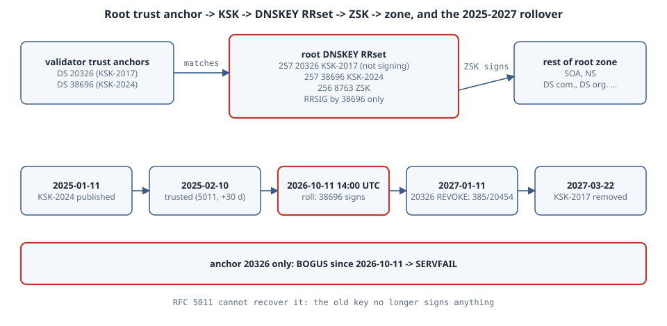

# The 2026 Root KSK Rollover: Trust Anchors, RFC 5011, and What Breaks When Keys Are Hard-Coded

Every DNSSEC validator on the Internet starts from one fact it cannot look up: the public key that signs the root zone's DNSKEY set, the root **Key Signing Key** (KSK). On **11 October 2026 at 14:00 UTC** that key changed for the second time ever. **KSK-2017** (key tag 20326) stopped signing and **KSK-2024** (key tag 38696) took over. A validator that has learned the new key keeps working, unnoticed. One that still trusts only KSK-2017 now marks *every signed answer* as bogus, and depending on its configuration fails every lookup. This chapter shows the chain from trust anchor to root DNSKEY, checks today's root keys live against IANA's published anchors, reproduces the "old anchor only" failure, and explains how RFC 5011 is meant to make this automatic and when it cannot.

## Learning goals

- Explain what a trust anchor is, and why the KSK, not the ZSK, is the one that matters
- Read the root DNSKEY RRset: flags 257 vs 256, key tags, which key signed it
- Check a resolver's anchors against `root-anchors.xml` by computing the DS digest yourself
- Describe RFC 5011's add hold-down and revoke bit, and the dates IANA used for this rollover
- Find hard-coded anchors (old images, appliances, smart contracts, embedded resolvers) before they fail

## Mental model

{fig-alt="Top row: the validator's trust anchor store holds DS or DNSKEY data for key tags 20326 and 38696. An arrow labelled 'matches' goes to the root DNSKEY RRset, which contains two KSKs with flags 257 (tags 20326 and 38696) and one ZSK with flags 256 (tag 8763). Since 11 October 2026 the RRSIG over that RRset is made by tag 38696 only. The ZSK signs the rest of the root zone, including the DS records for com, org and the other TLDs, which continue the chain downwards. Bottom row: a timeline. 11 January 2025, KSK-2024 published. 10 February 2025, trusted by RFC 5011 resolvers after the 30-day add hold-down. 11 October 2026, rollover: KSK-2024 signs and KSK-2017 stops. 11 January 2027, KSK-2017 published with the REVOKE bit (flags 385, which changes its key tag to 20454). 22 March 2027, KSK-2017 removed. A red note says a validator holding only tag 20326 has been failing since 11 October 2026, and RFC 5011 can no longer rescue it because the old key no longer signs anything."}

```text
trust anchor (20326, 38696)            root zone
   │ matches DS digest / key           ┌─────────────────────────────────────────┐
   └────────────────────────────────►  │ DNSKEY 257 20326 (KSK-2017, not signing) │
                                       │ DNSKEY 257 38696 (KSK-2024)  ── RRSIG ──┐│
                                       │ DNSKEY 256  8763 (ZSK)  ◄───────────────┘│
                                       │   └── signs SOA, NS, DS com., DS org. ...│
                                       └─────────────────────────────────────────┘
2025-01-11 publish 38696 ─ 2025-02-10 trusted (5011) ─ 2026-10-11 ROLL ─ 2027-01-11 revoke 20326 ─ 2027-03-22 remove
```

Three rules:

1. **Only the KSK is anchored.** The ZSK changes every quarter without anyone noticing, because the KSK signs the DNSKEY set that contains it.
2. **An anchor is just a key, or the hash of one.** `root-anchors.xml` publishes the SHA-256 DS digest of each KSK. Any validator can recompute it from the DNSKEY it receives and compare.
3. **RFC 5011 only works while an old trusted key still signs.** A new KSK is accepted automatically only if a key you already trust signs the DNSKEY set that introduces it. Since 11 October 2026 KSK-2017 signs nothing, so a validator that missed the 2025–2026 window can no longer catch up on its own.

## Concepts

### Key tags and flags

A DNSKEY's **flags** field is 256 for a zone-signing key and 257 when the Secure Entry Point (SEP) bit is set, which by convention marks a KSK. The **key tag** is a 16-bit checksum over the whole DNSKEY RDATA (RFC 4034 Appendix B), so it is a quick label, not an identity: two keys can collide, and flipping a flag changes the tag. RRSIG records name the signing key by tag.

### Trust anchors in the wild

| Validator | Where the root anchor lives | RFC 5011 |
|---|---|---|
| Unbound | `auto-trust-anchor-file` (for example `/var/lib/unbound/root.key`), bootstrapped by `unbound-anchor` from `root-anchors.xml` | yes, writes state back to that file |
| BIND 9 | built-in `trust-anchors { . initial-key ...; }` / `initial-ds`, state in `managed-keys.bind` | yes for `initial-*`; `static-key` / `static-ds` are never updated |
| Knot Resolver | `trust_anchors` module, keyfile with RFC 5011 state | yes |
| systemd-resolved | anchor compiled into the binary; overrides in `dnssec-trust-anchors.d` `.positive` files | updated by upgrading systemd |
| Public resolvers (1.1.1.1, 8.8.8.8, 9.9.9.9) | operator-managed | operator's job |
| Hand-written validators, appliances, smart contracts | wherever the developer put a constant | no |

The last row is where the 2026 rollover hurt: the inspiration for this chapter is a report that an on-chain DNSSEC oracle anchored only KSK-2017, so DNS-based claims verified against it stopped working after 11 October.

### RFC 5011 in one paragraph

A validator doing RFC 5011 re-fetches the root DNSKEY set periodically. When a new SEP key appears in a set validly signed by a key it already trusts, it starts an **add hold-down** timer (30 days). If the key is still there when the timer expires, it becomes a trust anchor. To remove a key, the zone publishes it with the **REVOKE** bit (0x0080) set, signed by the revoked key itself; the validator then drops it immediately. IANA's dates follow this: KSK-2024 was published on 11 January 2025 and "should begin to be trusted by resolvers that follow RFC 5011" on 10 February 2025, 30 days later.

## Lab 1: the root keys right now, against IANA's anchors

IANA's trust anchor file (abridged to the fields used here; fetched with `curl -sS https://data.iana.org/root-anchors/root-anchors.xml`):

```text
<KeyDigest id="Kjqmt7v" validFrom="2010-07-15T00:00:00+00:00" validUntil="2019-01-11T00:00:00+00:00">
    <KeyTag>19036</KeyTag>
    <Digest>49AAC11D7B6F6446702E54A1607371607A1A41855200FD2CE1CDDE32F24E8FB5</Digest>
<KeyDigest id="Klajeyz" validFrom="2017-02-02T00:00:00+00:00">
    <KeyTag>20326</KeyTag>
    <Digest>E06D44B80B8F1D39A95C0B0D7C65D08458E880409BBC683457104237C7F8EC8D</Digest>
<KeyDigest id="Kmyv6jo" validFrom="2024-07-18T00:00:00+00:00">
    <KeyTag>38696</KeyTag>
    <Digest>683D2D0ACB8C9B712A1948B27F741219298D0A450D612C483AF444A4C0FB2B16</Digest>
```

KSK-2010 (19036) has a `validUntil`; the other two do not. The box this was written on cannot send DNS queries straight to the root servers (port 53 to the Internet is filtered), so `rootkeys.py` asks for the root DNSKEY set over DNS-over-HTTPS (RFC 8484) with dnspython 2.9.1, then recomputes each KSK's DS digest:

```python
import urllib.request
import dns.message, dns.query, dns.rdatatype, dns.dnssec, dns.name, datetime
q = dns.message.make_query('.', 'DNSKEY', want_dnssec=True, payload=4096)
req = urllib.request.Request('https://cloudflare-dns.com/dns-query', data=q.to_wire(),
                             headers={'content-type': 'application/dns-message', 'accept': 'application/dns-message'})
r = dns.message.from_wire(urllib.request.urlopen(req, timeout=10).read())   # RFC 8484 DoH POST
keys = [rr for rr in r.answer if rr.rdtype == dns.rdatatype.DNSKEY][0]
sigs = [rr for rr in r.answer if rr.rdtype == dns.rdatatype.RRSIG][0]
print(f"DNSKEY RRset for '.', TTL {keys.ttl}, via DNS-over-HTTPS (cloudflare-dns.com)")
for k in sorted(keys, key=lambda k: -k.flags):
    role = {257: 'KSK (SEP)', 256: 'ZSK'}.get(k.flags & 0xFFFF & ~0x80, str(k.flags))
    rev = ' REVOKED' if k.flags & 0x80 else ''
    print(f"  flags={k.flags:<3} alg={k.algorithm.value} tag={dns.dnssec.key_id(k):<5} {role}{rev}")
for s in sigs:
    exp = datetime.datetime.fromtimestamp(s.expiration, datetime.UTC)
    print(f"RRSIG over DNSKEY: signed by key tag {s.key_tag}, expires {exp:%Y-%m-%d %H:%M} UTC")
for tag, digest in ((20326, 'E06D44B80B8F1D39A95C0B0D7C65D08458E880409BBC683457104237C7F8EC8D'),
                    (38696, '683D2D0ACB8C9B712A1948B27F741219298D0A450D612C483AF444A4C0FB2B16')):
    for k in keys:
        if dns.dnssec.key_id(k) == tag:
            ds = dns.dnssec.make_ds(dns.name.root, k, 'SHA256')
            print(f"tag {tag}: DS digest matches IANA root-anchors.xml: {ds.digest.hex().upper() == digest}")
```

```text
$ python rootkeys.py
DNSKEY RRset for '.', TTL 2562, via DNS-over-HTTPS (cloudflare-dns.com)
  flags=257 alg=8 tag=20326 KSK (SEP)
  flags=257 alg=8 tag=38696 KSK (SEP)
  flags=256 alg=8 tag=8763  ZSK
RRSIG over DNSKEY: signed by key tag 38696, expires 2026-11-11 00:00 UTC
tag 20326: DS digest matches IANA root-anchors.xml: True
tag 38696: DS digest matches IANA root-anchors.xml: True
```

Both KSKs are still *published*, but the only RRSIG over the DNSKEY set comes from 38696. The TTL is what was left in Cloudflare's cache; the root zone itself publishes DNSKEY with a 172800-second (two-day) TTL. Both digests match IANA's file byte for byte, which is exactly the check `unbound-anchor` does (plus verifying the S/MIME signature in `root-anchors.p7s`).

## Lab 2: what each trust-anchor configuration sees today

`anchors.py` validates the live DNSKEY RRset three times with different anchor stores, then computes what KSK-2017's tag will be once it is revoked:

```python
import urllib.request, datetime
import dns.message, dns.dnssec, dns.name, dns.rdatatype, dns.rrset, dns.rdtypes.ANY.DNSKEY

def doh(qname, qtype):
    q = dns.message.make_query(qname, qtype, want_dnssec=True, payload=4096)
    req = urllib.request.Request('https://cloudflare-dns.com/dns-query', data=q.to_wire(),
                                 headers={'content-type': 'application/dns-message',
                                          'accept': 'application/dns-message'})
    return dns.message.from_wire(urllib.request.urlopen(req, timeout=10).read())

r = doh('.', 'DNSKEY')
keys = next(rr for rr in r.answer if rr.rdtype == dns.rdatatype.DNSKEY)
sig = next(rr for rr in r.answer if rr.rdtype == dns.rdatatype.RRSIG)

# A validator's trust anchor store: the DS digests from IANA's root-anchors.xml
ANCHORS = {20326: 'E06D44B80B8F1D39A95C0B0D7C65D08458E880409BBC683457104237C7F8EC8D',  # KSK-2017
           38696: '683D2D0ACB8C9B712A1948B27F741219298D0A450D612C483AF444A4C0FB2B16'}  # KSK-2024

def validate(anchor_tags):
    trusted = [k for k in keys if dns.dnssec.key_id(k) in anchor_tags and
               dns.dnssec.make_ds(dns.name.root, k, 'SHA256').digest.hex().upper()
               == ANCHORS[dns.dnssec.key_id(k)]]
    anchor = dns.rrset.from_rdata_list(dns.name.root, keys.ttl, trusted)
    try:
        dns.dnssec.validate(keys, sig, {dns.name.root: anchor})
        return 'SECURE (DNSKEY RRset verifies)'
    except dns.dnssec.ValidationFailure as e:
        return f'BOGUS ({e})'

now = datetime.datetime.now(datetime.UTC)
print(f"checked {now:%Y-%m-%d %H:%M} UTC; RRSIG(DNSKEY) key tags: {[s.key_tag for s in sig]}")
print("anchor = KSK-2017 only (hard-coded before 2025):", validate({20326}))
print("anchor = KSK-2024 only:                         ", validate({38696}))
print("anchor = both (RFC 5011 resolver today):        ", validate({20326, 38696}))

# What KSK-2017 will look like once revoked (RFC 5011: REVOKE bit = 0x0080)
old = next(k for k in keys if dns.dnssec.key_id(k) == 20326)
revoked = dns.rdtypes.ANY.DNSKEY.DNSKEY(old.rdclass, old.rdtype, old.flags | 0x0080,
                                         old.protocol, old.algorithm, old.key)
print(f"KSK-2017 flags {old.flags} tag {dns.dnssec.key_id(old)} -> with REVOKE bit: flags {revoked.flags} tag {dns.dnssec.key_id(revoked)}")
```

```text
$ python anchors.py
checked 2026-10-31 03:33 UTC; RRSIG(DNSKEY) key tags: [38696]
anchor = KSK-2017 only (hard-coded before 2025): BOGUS (no RRSIGs validated)
anchor = KSK-2024 only:                          SECURE (DNSKEY RRset verifies)
anchor = both (RFC 5011 resolver today):         SECURE (DNSKEY RRset verifies)
KSK-2017 flags 257 tag 20326 -> with REVOKE bit: flags 385 tag 20454
```

- **KSK-2017 only** is the configuration of any validator that stopped updating anchors before 2025, or that copied a `root.key` into an image years ago. The DNSKEY set has no signature by 20326, so nothing validates: **BOGUS**. Everything below the root inherits that. Even an unsigned zone cannot be proven insecure without a validated root, so a validating resolver in this state answers `SERVFAIL` for essentially every name.
- **Both keys** is what a healthy RFC 5011 resolver holds today, and it validates.
- In January 2027 KSK-2017 will appear with flags 385 and therefore a **different key tag, 20454**, signed by itself. Alerting that greps for "20326" will not see it.

## Lab 3 (operator checklist, from vendor docs; not run here)

No resolver daemons are installed on the box, so these commands come from the vendors' documentation and were not run:

```bash
# Unbound: the anchor file must list 38696 as VALID
grep -E '20326|38696' /var/lib/unbound/root.key
unbound-anchor -v -a /var/lib/unbound/root.key      # re-bootstrap from root-anchors.xml if it does not

# BIND 9: managed (RFC 5011) keys and their state
rndc managed-keys status

# Any validator: a signed name should come back with the AD flag, a deliberately broken one with SERVFAIL
dig +dnssec www.isc.org @127.0.0.1 | grep -E 'flags:|status:'
dig dnssec-failed.org @127.0.0.1 | grep status:
```

## The trap

- **"It worked on 10 October" does not mean the anchor was updated.** Until the roll, a resolver holding only KSK-2017 validated perfectly. The failure arrived all at once on the roll date.
- **Read-only anchor files.** RFC 5011 needs to write state. Containers that mount `root.key` read-only, or rebuild it from the image on every start, never keep what they learn. They are effectively hard-coded.
- **Images built from old packages.** A golden image or a container base layer from 2023 ships an anchor file without 38696. If the resolver starts after 11 October 2026 it cannot learn the new key (rule 3), so it must be re-bootstrapped from `root-anchors.xml` or upgraded.
- **Clocks.** Validation checks RRSIG inception and expiration. A device that boots with a 1970 clock fails DNSSEC whatever its anchors, which is the classic "NTP needs DNS, DNS needs time" loop.
- **Monitoring by key tag.** Tags change on revocation (20326 → 20454). Compare digests or full keys.

## The boring rule

Let the resolver manage the root anchor with RFC 5011 or its package manager, and make sure its anchor file is writable and persistent. Never paste a root key into code or config. If you must pin one (an appliance, a contract, an offline validator), pin every key in `root-anchors.xml` that has no `validUntil`, ship a way to update it, and put the IANA rollover dates in your calendar.

## Try this

1. Run `anchors.py` again after 11 January 2027. How many RRSIGs over the DNSKEY set do you expect, and with which tags?
2. Change `validate()` to also accept the KSK-2010 digest from `root-anchors.xml`. Does anything change, and why not?
3. Modify `rootkeys.py` to fetch `com. DNSKEY` and `com. DS` (the DS from the root zone), and verify that one of com's KSKs hashes to the DS digest. That is the next link of the chain.
4. Look for hard-coded anchors in a codebase you know: search for `20326`, `E06D44B8`, or `AwEAAaz/tAm8`.

## Next

- [DNS authoritative and recursive](05-dns-authoritative-and-recursive.qmd): stub, recursive and authoritative roles, and validating with Unbound in the lab.

## Verification

- **Run here** on 31 October 2026 (03:33 UTC), from a box without direct DNS access, using DNS-over-HTTPS to cloudflare-dns.com:
  - `rootkeys.py` and `anchors.py` were run with dnspython 2.9.1 and Python 3.13.5 in a user venv. Output is genuine and unedited.
  - Both DS digests matched IANA's `root-anchors.xml`, fetched the same morning. Validation succeeded with KSK-2024 and failed with KSK-2017 alone. The revoked-tag value is computed, not observed.
- **Not run:** the Unbound, BIND and `dig` commands in Lab 3 (no resolver or `dig` on the box). They come from the vendor docs listed below.
- Dates come from IANA's *DNSSEC Trust Anchors and Rollovers* page, ICANN's rollover status page ("On 11 October 2026 at 14:00 UTC, KSK-2024 began signing the DNS root zone as scheduled") and IANA's news item of 15 October 2026.

## Sources

- IANA — [DNSSEC Trust Anchors and Rollovers](https://www.iana.org/dnssec/files), and the trust anchor file [root-anchors.xml](https://data.iana.org/root-anchors/root-anchors.xml)
- IANA — [Root Zone KSK Rollover Completed as Planned](https://www.iana.org/news/2026/root-zone-ksk-rollover-completed-as-planned) (2026-10-15)
- ICANN — [Root Zone KSK Rollover](https://www.icann.org/resources/pages/ksk-rollover-en)
- RFC 5011 — [Automated Updates of DNS Security (DNSSEC) Trust Anchors](https://www.rfc-editor.org/rfc/rfc5011): §2.1 revocation, §2.2 and §2.4.1 add hold-down, §3 the REVOKE bit
- RFC 4034 — [Resource Records for the DNS Security Extensions](https://www.rfc-editor.org/rfc/rfc4034): §2.1.1 flags, §5 DS, Appendix B key tag
- RFC 9718 — [DNSSEC Trust Anchor Publication for the Root Zone](https://www.rfc-editor.org/rfc/rfc9718)
- RFC 8484 — [DNS Queries over HTTPS (DoH)](https://www.rfc-editor.org/rfc/rfc8484)
- Unbound — [unbound-anchor(8)](https://unbound.docs.nlnetlabs.nl/en/latest/manpages/unbound-anchor.html); BIND 9 — [trust-anchors](https://bind9.readthedocs.io/en/latest/reference.html#trust-anchors-block); systemd — [dnssec-trust-anchors.d(5)](https://www.freedesktop.org/software/systemd/man/latest/dnssec-trust-anchors.d.html)
- dnspython — [DNSSEC functions](https://dnspython.readthedocs.io/en/stable/dnssec.html)
- Inspiration: [@taylor_ on the ENS DNSSEC oracle and KSK-2017](https://x.com/taylor_/status/2110755370272502122)
