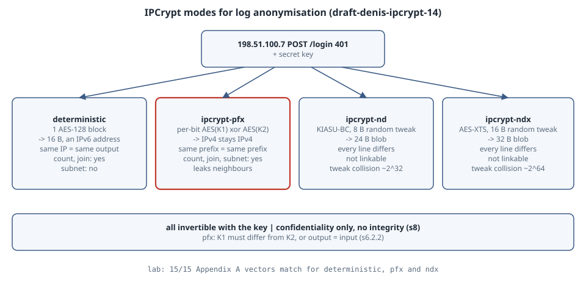

# Encrypting IP Addresses in Logs with IPCrypt

## Learning goals

- Explain why hashing or truncating client IPs is a weak way to share network logs, and what keyed, invertible IP encryption gives you.
- Choose between IPCrypt's three families: **deterministic**, **prefix-preserving** (`ipcrypt-pfx`) and **non-deterministic** (`ipcrypt-nd` / `ipcrypt-ndx`). Each one keeps different analytics possible and leaks different things.
- Implement three of the modes in about 70 lines of Python and check them against the specification's test vectors.
- Spot the operational traps: equal pfx key halves, IPv4 turning into IPv6, and blobs that are no longer IP addresses.

Version note: this follows **draft-denis-ipcrypt-14** (Informational, IETF Internet-Draft, Barber & Denis, expires February 2027). The labs ran on 31 Oct 2026 with Python 3.13 and the `cryptography` 43 package already on the box. No installs were needed. All addresses come from the documentation ranges (RFC 5737, RFC 3849), and the keys are demo values only. The output blocks are pasted from the runs.

{fig-alt="An access-log line with a client address goes into one of four IPCrypt modes under a secret key. Deterministic mode runs one AES-128 block over the 16-byte address and outputs a 16-byte value that is itself an IPv6 address. The same client always maps to the same value, so counting distinct clients and finding the top failed-login source still work. Prefix-preserving ipcrypt-pfx encrypts bit by bit and keeps IPv4 as IPv4. Addresses that share a prefix share an encrypted prefix, so per-subnet counts also work, at the cost of revealing which clients are neighbours. The non-deterministic modes ipcrypt-nd and ipcrypt-ndx add a random 8-byte or 16-byte tweak, giving 24-byte or 32-byte outputs that are no longer addresses. Every line looks different, so even repeat visits cannot be linked without the key. All modes are invertible by the key holder, and none provides integrity."}

## Why not just hash or truncate?

The common shortcuts each fail in a different way:

- **Unkeyed hashes** of IPv4 addresses are not private. There are only 2^32 inputs, so anyone can hash them all and reverse the mapping.
- **Truncation** (zeroing the last octet) destroys the data you need for abuse handling, and still identifies small networks.
- **Ad hoc encryption** with a library's default mode gives outputs that are not addresses, so they break every downstream tool.

The draft's motivation (§1.1) is to provide a common, specified set of constructions with test vectors, so that two implementations of the same mode, with the same key, produce the same output.

## The modes in one table

| Mode | Construction (draft §) | Output | Same IP, same output? | Keeps subnet structure? |
|---|---|---|---|---|
| `ipcrypt-deterministic` | one AES-128 block, 16-byte key (§5.1) | 16 bytes, an IPv6 address | yes | no |
| `ipcrypt-pfx` | per-bit PRF = AES(K1)⊕AES(K2), 32-byte key (§6.2) | native size: IPv4 stays IPv4 | yes | **yes** |
| `ipcrypt-nd` | KIASU-BC, 8-byte random tweak (§7.4.1) | 24 bytes | no | no |
| `ipcrypt-ndx` | single-block AES-XTS, 16-byte random tweak (§7.4.2) | 32 bytes | no | no |

All four modes are invertible with the key. The draft states plainly that they provide **confidentiality, not integrity** (§8): someone who can edit the log can still swap or forge ciphertexts.

Every mode except `pfx` first maps an address to 16 bytes, turning IPv4 into `::ffff:a.b.c.d` (§3.1.2). That is why `192.0.2.1` and `::ffff:192.0.2.1` encrypt identically.

## Lab 1: implement it and check the test vectors

`ipcrypt.py` covers deterministic, pfx and ndx. `ipcrypt-nd` is left out because KIASU-BC (AES with a tweak mixed into every round key) is not in standard crypto libraries. The pfx loop follows the draft's §9.6 pseudocode. The PRF input at each step is `zeros || 1 || prefix-so-far`, where the prefix is always the **plaintext** prefix. That is what makes equal prefixes encrypt to equal prefixes.

```python
"""ipcrypt-deterministic, ipcrypt-pfx and ipcrypt-ndx, following
draft-denis-ipcrypt-14 sections 3, 5.1, 6.2, 7.4.2 and 9.  AES from `cryptography`."""
import ipaddress, os
from cryptography.hazmat.primitives.ciphers import Cipher, algorithms, modes

def aes(key, block, dec=False):
    c = Cipher(algorithms.AES(key), modes.ECB())
    op = c.decryptor() if dec else c.encryptor()
    return op.update(block) + op.finalize()

def to16(ip):                      # section 3.1: IPv4 -> ::ffff:a.b.c.d
    a = ipaddress.ip_address(ip)
    if a.version == 4:
        return bytes(10) + b"\xff\xff" + a.packed
    return a.packed

def from16(b):                     # section 3.2
    if b[:12] == bytes(10) + b"\xff\xff":
        return str(ipaddress.IPv4Address(b[12:]))
    return str(ipaddress.IPv6Address(b))

def xor(a, b): return bytes(x ^ y for x, y in zip(a, b))

# --- 5.1 ipcrypt-deterministic: one AES-128 block --------------------------
def det_encrypt(ip, key): return from16(aes(key, to16(ip)))
def det_decrypt(ip, key): return from16(aes(key, to16(ip), dec=True))

# --- 6.2 / 9.6 ipcrypt-pfx: one PRF bit per address bit ----------------------
def _get(d, pos): return (d[15 - pos // 8] >> (pos % 8)) & 1
def _set(d, pos, v): d[15 - pos // 8] |= (v & 1) << (pos % 8)
def _shl(d):
    r, carry = bytearray(16), 0
    for i in range(15, -1, -1):
        r[i] = ((d[i] << 1) | carry) & 0xFF
        carry = (d[i] >> 7) & 1
    return r

def _pfx(ip, key, decrypt):
    assert len(key) == 32
    k1, k2 = key[:16], key[16:]
    src = to16(ip)
    out = bytearray(16)
    pad = bytearray(16)
    if src[:12] == bytes(10) + b"\xff\xff":
        start = 96; out[10] = out[11] = 0xFF
        pad[3] = 0x01; pad[14] = pad[15] = 0xFF
    else:
        start = 0; pad[15] = 0x01
    for n in range(start, 128):
        e = xor(aes(k1, bytes(pad)), aes(k2, bytes(pad)))
        pos = 127 - n
        bit = _get(src, pos) ^ (e[15] & 1)
        _set(out, pos, bit)
        plain_bit = bit if decrypt else _get(src, pos)
        pad = _shl(pad); _set(pad, 0, plain_bit)   # prefix is always the PLAINTEXT prefix
    return from16(bytes(out))

def pfx_encrypt(ip, key): return _pfx(ip, key, False)
def pfx_decrypt(ip, key): return _pfx(ip, key, True)

# --- 7.4.2 / 9.8 ipcrypt-ndx: single-block AES-XTS (XEX), random 16-byte tweak
def ndx_encrypt(ip, key, tweak=None):
    tweak = tweak or os.urandom(16)
    et = aes(key[16:], tweak)
    return tweak + xor(aes(key[:16], xor(to16(ip), et)), et)

def ndx_decrypt(blob, key):
    tweak, c = blob[:16], blob[16:]
    et = aes(key[16:], tweak)
    return from16(xor(aes(key[:16], xor(c, et), dec=True), et))
```

`vectors.py` checks every encryption against the draft's Appendix A and decrypts it back:

```python
# Check ipcrypt.py against draft-denis-ipcrypt-14 Appendix A (A.1, A.2, A.4).
from ipcrypt import *
H = bytes.fromhex
det = [("0123456789abcdeffedcba9876543210", "0.0.0.0", "bde9:6789:d353:824c:d7c6:f58a:6bd2:26eb"),
       ("1032547698badcfeefcdab8967452301", "255.255.255.255", "aed2:92f6:ea23:58c3:48fd:8b8:74e8:45d8"),
       ("2b7e151628aed2a6abf7158809cf4f3c", "192.0.2.1", "1dbd:c1b9:fff1:7586:7d0b:67b4:e76e:4777")]
K1 = "0123456789abcdeffedcba98765432101032547698badcfeefcdab8967452301"
K2 = "2b7e151628aed2a6abf7158809cf4f3ca9f5ba40db214c3798f2e1c23456789a"
pfx = [(K1, "0.0.0.0", "151.82.155.134"), (K1, "255.255.255.255", "94.185.169.89"),
       (K1, "192.0.2.1", "100.115.72.131"), (K1, "2001:db8::1", "c180:5dd4:2587:3524:30ab:fa65:6ab6:f88"),
       (K2, "10.0.0.47", "19.214.210.244"), (K2, "10.0.0.129", "19.214.210.80"),
       (K2, "172.16.5.193", "210.78.229.136"), (K2, "172.16.97.42", "210.78.179.241"),
       (K2, "2001:db8::a5c9:4e2f:bb91:5a7d", "7cec:702c:1243:f70:1956:125:b9bd:1aba"),
       (K2, "2001:db8:3a5c:0:e7d1:4b9f:2c8a:f673", "7cec:702c:3503:bef:e616:96bd:be33:a9b9")]
ndx = [("0123456789abcdeffedcba98765432101032547698badcfeefcdab8967452301", "0.0.0.0",
        "21bd1834bc088cd2b4ecbe30b70898d7", "21bd1834bc088cd2b4ecbe30b70898d782db0d4125fdace61db35b8339f20ee5"),
       ("2b7e151628aed2a6abf7158809cf4f3c3c4fcf098815f7aba6d2ae2816157e2b", "2001:db8::1",
        "21bd1834bc088cd2b4ecbe30b70898d7", "21bd1834bc088cd2b4ecbe30b70898d76089c7e05ae30c2d10ca149870a263e4")]
ok = 0; total = 0
for k, ip, want in det:
    got = det_encrypt(ip, H(k)); back = det_decrypt(got, H(k)); total += 1
    ok += got == want and back == ip
    print(f"det  {ip:<36} -> {got:<40} {'OK' if got == want and back == ip else 'FAIL'}")
for k, ip, want in pfx:
    got = pfx_encrypt(ip, H(k)); back = pfx_decrypt(got, H(k)); total += 1
    ok += got == want and back == ip
    print(f"pfx  {ip:<36} -> {got:<40} {'OK' if got == want and back == ip else 'FAIL'}")
for k, ip, tw, want in ndx:
    got = ndx_encrypt(ip, H(k), H(tw)).hex(); back = ndx_decrypt(H(got), H(k)); total += 1
    ok += got == want and back == ip
    print(f"ndx  {ip:<36} -> {got[32:]:<40} {'OK' if got == want and back == ip else 'FAIL'}")
print(f"{ok}/{total} Appendix A vectors match (encrypt and decrypt round-trip)")
```

```text
$ python3 vectors.py
det  0.0.0.0                              -> bde9:6789:d353:824c:d7c6:f58a:6bd2:26eb  OK
det  255.255.255.255                      -> aed2:92f6:ea23:58c3:48fd:8b8:74e8:45d8   OK
det  192.0.2.1                            -> 1dbd:c1b9:fff1:7586:7d0b:67b4:e76e:4777  OK
pfx  0.0.0.0                              -> 151.82.155.134                           OK
pfx  255.255.255.255                      -> 94.185.169.89                            OK
pfx  192.0.2.1                            -> 100.115.72.131                           OK
pfx  2001:db8::1                          -> c180:5dd4:2587:3524:30ab:fa65:6ab6:f88   OK
pfx  10.0.0.47                            -> 19.214.210.244                           OK
pfx  10.0.0.129                           -> 19.214.210.80                            OK
pfx  172.16.5.193                         -> 210.78.229.136                           OK
pfx  172.16.97.42                         -> 210.78.179.241                           OK
pfx  2001:db8::a5c9:4e2f:bb91:5a7d        -> 7cec:702c:1243:f70:1956:125:b9bd:1aba    OK
pfx  2001:db8:3a5c:0:e7d1:4b9f:2c8a:f673  -> 7cec:702c:3503:bef:e616:96bd:be33:a9b9   OK
ndx  0.0.0.0                              -> 82db0d4125fdace61db35b8339f20ee5         OK
ndx  2001:db8::1                          -> 6089c7e05ae30c2d10ca149870a263e4         OK
15/15 Appendix A vectors match (encrypt and decrypt round-trip)
```

All 15 published vectors match, including the prefix-preserving ones. For example, `10.0.0.47` and `10.0.0.129` both encrypt into `19.214.210.0/24`.

## Lab 2: anonymise a log, then ask analyst questions

A tiny access log:

```text
198.51.100.7 GET /login 200
198.51.100.7 POST /login 401
198.51.100.7 POST /login 401
198.51.100.42 POST /login 401
203.0.113.9 GET / 200
2001:db8:1::5 GET /api 200
2001:db8:1::5 GET /api 200
2001:db8:2::77 GET /api 503
```

`logs.py` encrypts it in each mode, then asks the questions an analyst would ask: how many distinct clients, who failed login most, and how traffic splits per subnet.

```python
# Anonymise access.log three ways, then ask the questions an analyst asks.
import ipaddress, os, collections
from ipcrypt import *
k16 = bytes.fromhex("000102030405060708090a0b0c0d0e0f")              # demo keys only
k32 = bytes.fromhex("000102030405060708090a0b0c0d0e0f" "f0e1d2c3b4a5968778695a4b3c2d1e0f")
rows = [l.split(" ", 1) for l in open("access.log").read().splitlines()]
modes_ = {"deterministic": lambda ip: det_encrypt(ip, k16),
          "pfx":           lambda ip: pfx_encrypt(ip, k32),
          "ndx":           lambda ip: ndx_encrypt(ip, k32).hex()}
for name, f in modes_.items():
    out = [(f(ip), rest) for ip, rest in rows]
    print(f"== {name}")
    for ip, rest in out: print(f"   {ip:<66} {rest}")
    ips = [ip for ip, _ in out]
    print(f"   distinct clients seen: {len(set(ips))} (true: {len(set(i for i, _ in rows))})")
    fails = collections.Counter(ip for ip, r in out if r.endswith("401"))
    print(f"   top failed-login source: {fails.most_common(1)[0]}")
    if name == "pfx":
        nets = collections.Counter(str(ipaddress.ip_network(ip + ("/24" if "." in ip else "/48"), strict=False))
                                   for ip in ips)
        print(f"   requests per encrypted /24 or /48: {dict(nets)}")
print("== pitfalls")
same = k16 + k16
print(f"   pfx with K1 == K2:            198.51.100.7 -> {pfx_encrypt('198.51.100.7', same)}")
print(f"   deterministic IPv4 output is an IPv6 address: 198.51.100.7 -> {det_encrypt('198.51.100.7', k16)}")
print(f"   ::ffff:198.51.100.7 and 198.51.100.7 encrypt alike: "
      f"{det_encrypt('::ffff:198.51.100.7', k16) == det_encrypt('198.51.100.7', k16)}")
blob = ndx_encrypt("198.51.100.7", k32)
print(f"   ndx decrypts with the key: {ndx_decrypt(blob, k32)}  (32-byte blob, not an IP)")
```

```text
$ python3 logs.py
== deterministic
   6cf6:bc3b:adc5:c807:7270:735:8db6:e26e                             GET /login 200
   6cf6:bc3b:adc5:c807:7270:735:8db6:e26e                             POST /login 401
   6cf6:bc3b:adc5:c807:7270:735:8db6:e26e                             POST /login 401
   bd7:ebb4:ef51:d560:d775:ffc0:9fdc:98a1                             POST /login 401
   9e96:b5fa:cc75:1ff5:b970:3a73:7d65:bdc                             GET / 200
   1eca:41ba:da03:6949:d97:4996:c9b4:2d45                             GET /api 200
   1eca:41ba:da03:6949:d97:4996:c9b4:2d45                             GET /api 200
   2dd7:5e83:56db:9d8c:438:164f:a863:1ba9                             GET /api 503
   distinct clients seen: 5 (true: 5)
   top failed-login source: ('6cf6:bc3b:adc5:c807:7270:735:8db6:e26e', 2)
== pfx
   138.109.141.226                                                    GET /login 200
   138.109.141.226                                                    POST /login 401
   138.109.141.226                                                    POST /login 401
   138.109.141.217                                                    POST /login 401
   130.129.173.184                                                    GET / 200
   58c4:2b5:1d26:30c6:9e1:f8b:da5b:4d8b                               GET /api 200
   58c4:2b5:1d26:30c6:9e1:f8b:da5b:4d8b                               GET /api 200
   58c4:2b5:1d24:2949:9b9c:dcc9:77e0:4639                             GET /api 503
   distinct clients seen: 5 (true: 5)
   top failed-login source: ('138.109.141.226', 2)
   requests per encrypted /24 or /48: {'138.109.141.0/24': 4, '130.129.173.0/24': 1, '58c4:2b5:1d26::/48': 2, '58c4:2b5:1d24::/48': 1}
== ndx
   9aa70866a42bf765f8b3301d0c5560aa5333b450f7dc10f61382a832c6c0451d   GET /login 200
   8f4e760fb216b782a7589e395730dbf098e5e6497705a51a817225643e46b607   POST /login 401
   3128a30be457eee93d19d47b9d8030263a71d85a2607f2951c0b2d16761afc03   POST /login 401
   33c8caec07707f1613ff523449732512bf2bdaa16896728597ca60c0504fb9de   POST /login 401
   79baa7f5b899ad7728bec6c41d220a51aa6bed86b0151eb28bbef603189b645d   GET / 200
   504ffca0be16d2841be91d61ca1483a7962c7ca76c531fc34f02faa689e5bce0   GET /api 200
   e5082e0614cb69f1a481568759435b20345a213d6b16055de98ecaf3f3b80053   GET /api 200
   3e529042bac91aa14af5151e5ac02842c56622440e726931c7b84c7a80da7624   GET /api 503
   distinct clients seen: 8 (true: 5)
   top failed-login source: ('8f4e760fb216b782a7589e395730dbf098e5e6497705a51a817225643e46b607', 1)
== pitfalls
   pfx with K1 == K2:            198.51.100.7 -> 198.51.100.7
   deterministic IPv4 output is an IPv6 address: 198.51.100.7 -> 6cf6:bc3b:adc5:c807:7270:735:8db6:e26e
   ::ffff:198.51.100.7 and 198.51.100.7 encrypt alike: True
   ndx decrypts with the key: 198.51.100.7  (32-byte blob, not an IP)
```

The `ndx` rows will differ on every run, because the tweak comes from `os.urandom`. Everything else is deterministic for these keys.

Reading it:

- **Deterministic:** counting and joins still work: 5 distinct clients, and the brute-force source is visible with 2 failures. But `198.51.100.7` and `198.51.100.42` are now unrelated values, so you cannot tell they sit in the same /24. Every IPv4 client also becomes an IPv6-looking address, which surprises tools that bucket by family.
- **pfx:** everything deterministic gives, plus structure. The two `198.51.100.x` clients share `138.109.141.0/24`. `2001:db8:1::/48` and `2001:db8:2::/48` become `…:1d26::/48` and `…:1d24::/48`, which share 46 bits exactly as the originals do. That is useful for "which subnet is attacking us". It is also a leak: anyone with outside knowledge of one host can learn about its neighbours. §6.2.3 says it outright: prefix-preserving encryption "intentionally reveals network structure", and organisations needing complete obfuscation should use a non-prefix-preserving mode. §7.4.3 lists network analytics, subnet monitoring and DDoS mitigation as its use cases.
- **ndx:** 8 rows give 8 distinct values. Without the key you cannot even tell that one client failed login twice. Use it when the log reader should not be able to link anything. The output is a 32-byte blob, not an IP, so the schema has to change.

## Pitfalls the lab shows

- **pfx with equal key halves is the identity function.** The PRF is AES(K1)⊕AES(K2), so K1 = K2 cancels out. The draft says the halves MUST NOT be identical (§6.2.2), and the lab shows `198.51.100.7 -> 198.51.100.7`. Generate the 32-byte key randomly, and never by repeating a 16-byte key.
- **Format change in deterministic mode.** IPv4 goes in and IPv6 comes out. Size and parse columns accordingly.
- **Keys are the whole security.** Anyone holding the key decrypts everything; that is by design (§8). Store the key like any other secret, and rotate it on a schedule. Rotation also breaks correlation across periods, which may be exactly what a retention policy wants.
- **Tweak collisions in the nd modes** are bounded by about 2^32 encryptions per key for nd and 2^64 for ndx (§7.4.1, §7.4.2). A collision reveals only a repetition, not the address.

## The boring rule

- Logs shared outside the team that only need "same client?" get `ipcrypt-deterministic`.
- Abuse and DDoS work that needs subnets gets `ipcrypt-pfx`, accepting the neighbour leak, with a random 32-byte key.
- Anything that must not be linkable gets `ipcrypt-ndx`, with a schema that stores 32 bytes.
- Keep the key in your secret store, rotate it, and never treat ciphertext as tamper-proof.

## Try this

1. Encrypt every address in `10.0.0.0/24` with `pfx_encrypt` and confirm that all 256 outputs fall into one /24. Then try `10.0.0.0/23`.
2. Change one bit of a `det_encrypt` output and decrypt it. What comes back? (There is no integrity, so you get a different, valid-looking address.)
3. Add `ipcrypt-nd` by implementing KIASU-BC from the draft's §9.9 and check it against Appendix A.3.

## Sources

- F. Denis, draft-denis-ipcrypt-14, *Methods for IP Address Encryption and Obfuscation*: §3 conversion, §5.1 deterministic, §6.2 ipcrypt-pfx, §7.4 nd/ndx, §8 security considerations, §9.6 and §9.8 pseudocode, Appendix A test vectors: <https://datatracker.ietf.org/doc/draft-denis-ipcrypt/>
- IPCrypt project site (implementations and examples): <https://ipcrypt-std.github.io/>
- RFC 4291 §2.5.5.2 (IPv4-mapped IPv6 addresses): <https://www.rfc-editor.org/rfc/rfc4291>
- RFC 5737 and RFC 3849 (documentation address ranges): <https://www.rfc-editor.org/rfc/rfc5737>, <https://www.rfc-editor.org/rfc/rfc3849>
- `cryptography` AES/ECB primitive docs: <https://cryptography.io/en/latest/hazmat/primitives/symmetric-encryption/>
