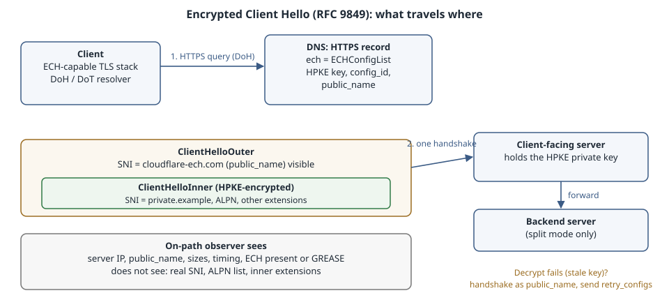

# Encrypted Client Hello: Hiding the Server Name

## Learning goals

- Explain what TLS 1.3 still leaks in the clear (the server name, ALPN and extensions in the ClientHello) and which part Encrypted Client Hello (ECH) hides.
- Walk through the ECH handshake: the HTTPS DNS record that carries the key, the outer and inner ClientHello, accept confirmation, GREASE and the `retry_configs` recovery path.
- Fetch and decode a live `ECHConfigList` with about 60 lines of Python, and read every field.
- Know what ECH does **not** hide, why it depends on encrypted DNS, and what it changes for firewalls, SNI routing and incident response.
- Decide what you need to deploy it: a CDN that does it for you, or your own server plus automated key rotation in DNS.

Version note: ECH is **RFC 9849** (*TLS Encrypted Client Hello*, Standards Track, March 2026). Publishing its keys in DNS is **RFC 9848** (*Bootstrapping TLS Encrypted ClientHello with DNS Service Bindings*). The labs ran on 13 Nov 2026 from an unprivileged Linux host with Python 3.13 and dnspython 2.9.1, curl 8.14.1 and OpenSSL 3.5.7. Neither curl nor OpenSSL 3.5 on that host can *send* ECH, and that limitation is part of the lab. All DNS queries went over DoH (RFC 8484), because the host's plain UDP/53 is intercepted. The output blocks are pasted from the runs. The server configuration near the end is written from the Caddy documentation and was **not run**.

{fig-alt="A client looks up the HTTPS record for private.example over encrypted DNS and receives an ECHConfig containing an HPKE public key and the public name cloudflare-ech.com. It then sends a ClientHelloOuter whose visible SNI is the public name; inside it the ClientHelloInner, carrying the real SNI private.example and ALPN, is HPKE-encrypted. The client-facing server decrypts the inner hello and either serves it itself (shared mode) or forwards it to a backend server (split mode). An on-path observer sees the server IP address, the public name, packet sizes and timing, but not the real server name. If decryption fails because the key rotated, the server completes a handshake as the public name and returns retry_configs, and the client retries with the fresh key."}

## What TLS 1.3 still shows

TLS 1.3 encrypts the certificate and everything after the ServerHello. But the **ClientHello** goes out before any keys exist, so it is plaintext. It carries:

- **server_name (SNI)**: the exact host the client wants, for example `private.example`. The server needs it to choose a certificate, and a reverse proxy or CDN needs it to route.
- **application_layer_protocol_negotiation (ALPN)**: `h2`, `http/1.1` and similar, which hints at the application.
- Every other extension and its order. That is enough to fingerprint the client software (JA3/JA4-style fingerprints).

Encrypted DNS (DoT/DoH) hides the *lookup*, but the next packet then announces the same name in SNI. Any on-path device can log it, block on it or rewrite policy around it. SNI is the main remaining plaintext name in a modern HTTPS connection, which is why so many firewalls and parental-control products filter on it.

An earlier attempt, ESNI, encrypted only the SNI extension. It shipped experimentally around 2018–2020 and was abandoned because encrypting one extension left the rest of the hello, and the fact that ESNI was in use, visible. ECH encrypts the **whole** ClientHello instead.

## How ECH works

### The keys come from DNS

A server operator publishes an **ECHConfigList** in the `ech` parameter (SvcParamKey 5) of the domain's `HTTPS` record (RFC 9460, RFC 9848). Each ECHConfig holds:

| Field | Meaning |
|---|---|
| `version` | `0xfe0d` for the RFC 9849 format. Clients skip configs with versions they do not know. |
| `config_id` | One byte that tells the server which private key to try. |
| `kem_id`, `public_key` | The HPKE (RFC 9180) key-encapsulation algorithm and public key. |
| `cipher_suites` | The HPKE KDF/AEAD pairs the server accepts. |
| `maximum_name_length` | Helps the client pad the inner name so its length does not leak. 0 means "no hint". |
| `public_name` | The name the client puts in the **outer** SNI and the name the server must hold a valid certificate for. |
| `extensions` | Optional ECHConfig extensions (none are in common use). |

### Two ClientHellos in one

The client builds its real hello, the **ClientHelloInner**, with the true SNI, ALPN and extensions. It then builds a **ClientHelloOuter** with the config's `public_name` as SNI and puts the inner hello, HPKE-encrypted to the server's public key, into an `encrypted_client_hello` extension. Only the outer hello crosses the network in the clear. The inner hello is padded so its length says little about the real name.

The server that holds the private key is the **client-facing server**. It tries to decrypt the inner hello:

- **Shared mode**: the client-facing server is also the origin and serves the inner hello itself.
- **Split mode**: the client-facing server only decrypts and forwards the connection to a separate **backend server** that finishes the handshake. This is how a CDN can hide many customer names behind one public name.

If decryption works, the server continues the handshake with the inner hello. It signals acceptance by setting the last 8 bytes of `ServerHello.random` to a value derived from the inner transcript. The client checks those bytes: matching means "ECH accepted, you are talking to the real host"; anything else means the server used the outer hello.

### Rejection and `retry_configs`

Keys rotate. A client may hold a cached or slightly old ECHConfig, and decryption fails. RFC 9849 handles this without a silent downgrade:

1. The server completes the handshake **as the public_name**, presenting a certificate valid for that name, and puts its current configs in `retry_configs` in EncryptedExtensions.
2. The client authenticates that certificate against the `public_name`. Only then does it trust the retry configs.
3. The client aborts that connection with an `ech_required` alert and opens a new one using the fresh config.

A client should not accept a *second* `retry_configs` on the retried connection. If it gets one, the RFC treats that as server misconfiguration: two nodes behind the same name hold different keys, so the client keeps landing on the wrong one.

If the rejecting server sends no `retry_configs`, it is authenticated as `public_name` saying "I no longer do ECH", and the client should reconnect with ECH disabled. Because the certificate must be valid for the public name, an attacker cannot forge this opt-out without that certificate.

### GREASE

A client that has no ECHConfig for a site still sends an `encrypted_client_hello` extension filled with random bytes of a plausible size ("GREASE ECH"). The observer then cannot tell "real ECH to a CDN site" from "a browser that just always sends the extension". It also keeps middleboxes from ossifying around the extension's absence.

## Lab 1: fetch and decode a live ECHConfigList

This script asks for `HTTPS` records over DoH using only the Python standard library's HTTP client plus dnspython for the DNS message format. It then decodes the `ech` parameter byte by byte, following the `ECHConfig` structure in RFC 9849 section 4.

```{.python filename="ech.py"}
# ech.py NAME...: fetch HTTPS RRs over DoH and decode the ECHConfigList (RFC 9849 section 4).
import base64, struct, sys, urllib.request
import dns.message, dns.rcode, dns.rdatatype, dns.rdtypes.svcbbase

def doh(q, url="https://cloudflare-dns.com/dns-query"):
    """RFC 8484 POST with application/dns-message, stdlib HTTP client."""
    req = urllib.request.Request(url, data=q.to_wire(), headers={
        "Content-Type": "application/dns-message", "Accept": "application/dns-message"})
    with urllib.request.urlopen(req, timeout=5) as resp:
        return dns.message.from_wire(resp.read())

KEM = {0x0010: "DHKEM(P-256)", 0x0020: "DHKEM(X25519)", 0x0021: "DHKEM(X448)"}
KDF = {1: "HKDF-SHA256", 2: "HKDF-SHA384", 3: "HKDF-SHA512"}
AEAD = {1: "AES-128-GCM", 2: "AES-256-GCM", 3: "ChaCha20Poly1305"}

def vec(b, off, n):                      # TLS vector with an n-byte length prefix
    ln = int.from_bytes(b[off:off + n], "big")
    return b[off + n:off + n + ln], off + n + ln

def decode_ech_config_list(raw):
    body, _ = vec(raw, 0, 2)
    off = 0
    while off < len(body):
        version, length = struct.unpack("!HH", body[off:off + 4])
        c = body[off + 4:off + 4 + length]; off += 4 + length
        if version != 0xFE0D:
            print(f"    skip ECHConfig version 0x{version:04x}"); continue
        cid = c[0]; kem = struct.unpack("!H", c[1:3])[0]
        pk, p = vec(c, 3, 2)
        suites, p = vec(c, p, 2)
        max_name = c[p]; p += 1
        pub_name, p = vec(c, p, 1)
        ext, p = vec(c, p, 2)
        ss = [f"{KDF.get(k, k)}/{AEAD.get(a, a)}" for k, a in
              (struct.unpack("!HH", suites[i:i + 4]) for i in range(0, len(suites), 4))]
        print(f"    ECHConfig v0x{version:04x} config_id={cid} kem={KEM.get(kem, hex(kem))} "
              f"pk={len(pk)}B\n      suites={ss}\n      public_name={pub_name.decode()} "
              f"maximum_name_length={max_name} extensions={len(ext)}B")

for name in sys.argv[1:]:
    q = dns.message.make_query(name, "HTTPS")
    r = doh(q)
    print(f"{name}: rcode={dns.rcode.to_text(r.rcode())}")
    for rrset in r.answer:
        for rd in rrset:
            if rd.rdtype != dns.rdatatype.HTTPS:
                print(f"  {rrset.name} {dns.rdatatype.to_text(rrset.rdtype)} {rd}"); continue
            keys = [dns.rdtypes.svcbbase.key_to_text(k) for k in rd.params]
            print(f"  HTTPS {rd.priority} {rd.target} keys={keys}")
            if 5 in rd.params:
                raw = rd.params[5].ech
                print(f"    ech= {len(raw)} bytes, base64 {base64.b64encode(raw)[:32].decode()}...")
                decode_ech_config_list(raw)
```

Run against Cloudflare's ECH test host and three comparison names:

```{.bash}
python3 ech.py crypto.cloudflare.com cloudflare.com example.com www.google.com
```

```{.text}
crypto.cloudflare.com: rcode=NOERROR
  HTTPS 1 . keys=['alpn', 'ipv4hint', 'ech', 'ipv6hint']
    ech= 71 bytes, base64 AEX+DQBBqgAgACCVJ6nEVFI2GoHbi5RX...
    ECHConfig v0xfe0d config_id=170 kem=DHKEM(X25519) pk=32B
      suites=['HKDF-SHA256/AES-128-GCM']
      public_name=cloudflare-ech.com maximum_name_length=0 extensions=0B
cloudflare.com: rcode=NOERROR
  HTTPS 1 . keys=['alpn', 'ipv4hint', 'ipv6hint']
example.com: rcode=NOERROR
  HTTPS 1 . keys=['alpn', 'ipv4hint', 'ipv6hint']
www.google.com: rcode=NOERROR
  HTTPS 1 . keys=['alpn']
```

Reading it:

- Only `crypto.cloudflare.com` publishes an `ech` key. `cloudflare.com` itself and `example.com` publish HTTPS records with `alpn` and address hints but no ECH, and `www.google.com` only advertises `alpn`. ECH is per name, and publishing an HTTPS record does not imply ECH.
- The config is version `0xfe0d`, the RFC 9849 format, with one HPKE suite: X25519 for the KEM, HKDF-SHA256 and AES-128-GCM. The public key is 32 bytes, an X25519 point.
- `public_name=cloudflare-ech.com` is what the outer SNI will say for **every** ECH-enabled Cloudflare site. That shared name, plus the shared anycast addresses, is the anonymity set.
- `maximum_name_length=0` means the server gives no name-length hint, so no extra name padding is added. The client still rounds the whole encoded inner hello up to a multiple of 32 bytes (RFC 9849 section 6.1.3), which hides small differences in name length.
- The `config_id` is the key Cloudflare is using right now. A run of the same script about 25 minutes earlier, at 03:25 IST, returned `config_id=112`, and this one returned `170`: the key had rotated in between. Cloudflare rotates often and publishes the new key in DNS with a short TTL. Old clients recover through `retry_configs`.

## Lab 2: what this host's client actually sends

Cloudflare's trace endpoint reports, from the server's side, how the TLS connection arrived. Asked from curl:

```{.bash}
curl -s https://crypto.cloudflare.com/cdn-cgi/trace | grep -E '^(http|tls|sni|kex)='
```

```{.text}
http=http/2
tls=TLSv1.3
sni=plaintext
kex=X25519MLKEM768
```

`sni=plaintext` is the important line: the server received an ordinary ClientHello with the real name in the clear. The key exchange is the X25519 + ML-KEM-768 hybrid, so this connection is post-quantum for confidentiality, yet it still leaks the hostname. Encryption strength and metadata privacy are separate properties.

Why plaintext? The client cannot do ECH:

```{.bash}
curl --version | head -1
curl --ech true https://crypto.cloudflare.com/
openssl version
```

```{.text}
curl 8.14.1 (x86_64-pc-linux-gnu) libcurl/8.14.1 OpenSSL/3.5.7 zlib/1.3.1 brotli/1.1.0 zstd/1.5.7 libidn2/2.3.8 libpsl/0.21.2 libssh2/1.11.1 nghttp2/1.64.0 nghttp3/1.8.0 librtmp/2.3 OpenLDAP/2.6.10
curl: option --ech: the installed libcurl version does not support this
curl: try 'curl --help' or 'curl --manual' for more information
OpenSSL 3.5.7 9 Jun 2026 (Library: OpenSSL 3.5.7 9 Jun 2026)
```

curl has an `--ech` option, but it only works when libcurl is built against a TLS library with an ECH API and with ECH enabled at build time. OpenSSL gained that API in **4.0**. Older releases, such as the 3.5 LTS on this host, have no ECH at all, so `openssl s_client` also has no ECH options here. BoringSSL, wolfSSL and rustls have ECH client support, and Chrome and Firefox ship it on by default. With a browser you can check the same trace URL: it shows `sni=encrypted` when ECH was used.

The lesson for operators: **ECH is a property of the client build.** Server-side support plus a published key changes nothing for a command-line tool, monitoring probe or older library that cannot use it.

## What ECH does not hide

- **The IP address.** If a site has its own address, ECH hides nothing useful. The privacy comes from many names sharing one client-facing server, which in practice means large CDNs or big shared hosting.
- **The public name.** An observer learns "this is a Cloudflare ECH connection" (or whoever's public name it is).
- **Sizes and timing.** Traffic analysis still works, and padding only covers the hello.
- **DNS, unless DNS is private too.** The ECHConfig arrives in a DNS answer. Over plain UDP an on-path attacker can read the query name directly, or just strip the `ech` parameter, and the client then connects without ECH. Real deployments pair ECH with DoH or DoT; Firefox, for example, only uses ECH when its own DoH is enabled.
- **The server's own logs.** The client-facing server decrypts the hello and sees everything.

## Operational consequences

**SNI-based controls go blind.** A firewall, proxy or parental-control product that allows or blocks by SNI now sees only `cloudflare-ech.com`. Its options are coarse: block the public name (and every site behind it), block ECH as a whole, or control the endpoint. In managed fleets the practical levers are browser policy (Chrome's `EncryptedClientHelloEnabled` enterprise policy, Firefox's `network.dns.echconfig.enabled` preference) and a managed resolver. Clients only learn ECH keys from DNS, so a resolver you control decides which configs they see, *as long as* clients cannot bypass it with their own DoH.

**SNI routing still works, but on the outer name.** A TCP-level SNI router in front of an ECH-terminating server must route on the `public_name`. Only the box with the private key (the client-facing server) can see the real name and route on it.

**Keys must stay in sync with DNS.** If the private key rotates but the HTTPS record does not, or the record changes but some servers lack the key, clients take the `retry_configs` path. It costs an extra round trip and a second handshake. That is not an outage, but it is a latency regression you will only see if you measure ECH accept/retry rates.

**The public name needs a real certificate.** Retry and opt-out are authenticated against `public_name`, so every client-facing server needs a valid certificate for it. An expired public-name certificate breaks the recovery path for every hidden site at once.

**Incident response loses a field.** Packet captures and NetFlow-style logs no longer contain the hostname. Plan for logging at the point that decrypts, the CDN or your client-facing server.

## Deploying it

- **Behind a CDN** (Cloudflare and others): ECH is a zone setting. The CDN runs the client-facing servers, rotates keys and publishes the HTTPS records. Lab 1 shows the result.
- **Your own server**: you need a TLS stack with server-side ECH, a public name with a certificate, and automation that publishes each new ECHConfig in DNS before the matching private key goes live, then removes the old one after its TTL has passed. Caddy 2.10 added this as a built-in feature. Its `ech` global option names the public name(s) and its `dns` global option gives it a DNS provider module to publish the HTTPS record. Written from the Caddy documentation, **not run** here (it needs a DNS-provider module, API credentials and a public domain):

```{.text}
{
	dns cloudflare {env.CLOUDFLARE_API_TOKEN}
	ech ech.example.net
}

private.example.net {
	respond "hello from behind ECH"
}
```

  Caddy then generates the ECH keys, gets a certificate for `ech.example.net`, and publishes `ech` in the HTTPS record of `private.example.net`. Check the outcome with the Lab 1 script against your own name.

- **OpenSSL 4.0 based servers**: OpenSSL 4.0 (April 2026) provides the ECH API, so servers built on it can add support. Check your server's own documentation for whether and how it exposes ECH.

## Pitfalls

1. **Testing with a tool that cannot do ECH.** curl or OpenSSL builds without ECH silently send plaintext SNI (or reject `--ech`, as in Lab 2). Check the client build before concluding the server is broken.
2. **Publishing `ech` with no secure DNS on the client side.** Clients that will not trust plaintext DNS for ECH configs simply ignore them. Clients that would trust them are trivially downgraded.
3. **Rotating keys without DNS automation.** A hand-edited HTTPS record falls behind the first key rotation, and every connection then takes the retry path.
4. **A single-tenant "hidden" site.** If only one site sits behind the public name and IP, the observer knows which site it is anyway.
5. **Forgetting the public name's certificate.** It is used only on rejection paths, so it fails silently until keys rotate.
6. **Inconsistent keys across a server pool.** If node A and node B behind one name hold different ECH keys, a client can be told to retry by A and then land on B. RFC 9849 tells clients not to follow a second `retry_configs`, so those connections fail. Roll keys to every node before publishing them.
7. **Assuming ECH defeats SNI-based allowlists in your own network.** It does, if clients use their own DoH. Write the policy for that case before rolling out managed browsers with ECH enabled.

## The boring rule

Let the CDN do ECH if you are behind one. If you run your own, use a server that rotates keys *and* publishes the HTTPS record itself, make sure the public name has a valid certificate everywhere, and measure accepted versus retried ECH handshakes. On managed networks, decide your SNI-filtering policy explicitly: control ECH with browser policy and a managed resolver, not by blocking random TLS extensions.

## Try this

1. Run `ech.py` against `crypto.cloudflare.com` every 15 minutes for two hours and record the `config_id`. How often does it change, and how does that compare with the record's TTL?
2. Extend `ech.py` to print the HTTPS record's TTL and the `ipv4hint` addresses, then explain why the hints point at the same anycast addresses as many other Cloudflare sites.
3. Point `ech.py` at five sites you use. Which publish `ech`? Which share a `public_name`?
4. In a browser with DoH enabled, open `https://crypto.cloudflare.com/cdn-cgi/trace` and compare `sni=` with Lab 2. Then disable the browser's secure DNS and check again.
5. On paper: a client holds an ECHConfig that is one rotation old. Write down every message of the resulting connection attempt, including the alert and the second ClientHello.

## Sources

- RFC 9849, *TLS Encrypted Client Hello*: <https://www.rfc-editor.org/rfc/rfc9849>
- RFC 9848, *Bootstrapping TLS Encrypted ClientHello with DNS Service Bindings*: <https://www.rfc-editor.org/rfc/rfc9848>
- RFC 9460, *Service Binding and Parameter Specification via the DNS (SVCB and HTTPS Resource Records)*: <https://www.rfc-editor.org/rfc/rfc9460>
- RFC 9180, *Hybrid Public Key Encryption*: <https://www.rfc-editor.org/rfc/rfc9180>
- RFC 8484, *DNS Queries over HTTPS (DoH)*: <https://www.rfc-editor.org/rfc/rfc8484>
- Cloudflare, *Encrypted Client Hello* documentation: <https://developers.cloudflare.com/ssl/edge-certificates/ech/>
- Caddy global options (`ech`, `dns`): <https://caddyserver.com/docs/caddyfile/options>
- curl, ECH support notes: <https://github.com/curl/curl/blob/master/docs/ECH.md>
- OpenSSL 4.0 NEWS ("Support for Encrypted Client Hello"): <https://github.com/openssl/openssl/blob/openssl-4.0/NEWS.md>
