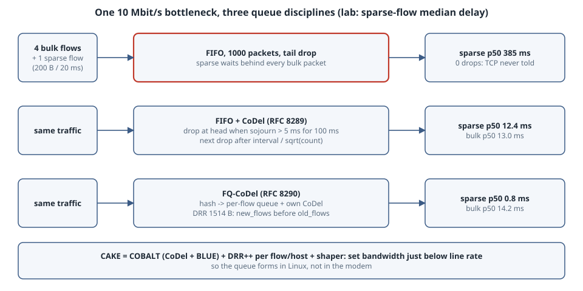

# FQ-CoDel and CAKE: How Linux Fights Bufferbloat, and How to Check It Is Actually On

A link that is full does not have to be slow. When a bulk upload makes a video call stutter, the culprit is almost never bandwidth. It is a **queue** in front of the bottleneck that fills with the upload's packets until each call packet waits hundreds of milliseconds behind them. That is **bufferbloat**. Linux has two well-known answers. **FQ-CoDel** (RFC 8290) gives each flow its own small queue and keeps each queue short with the **CoDel** AQM (RFC 8289). **CAKE** adds a shaper so that *you* own the bottleneck queue rather than the modem. This chapter builds the algorithms from the RFC pseudocode in a small simulator, measures FIFO against CoDel and FQ-CoDel, and ends with the configuration and checks that matter on a real router.

## Learning goals

- Explain why a full FIFO causes delay without causing loss, and why loss-based TCP keeps filling it
- Describe CoDel's control law: sojourn time, `target`, `interval`, and drop spacing `interval/sqrt(count)`
- Describe FQ-CoDel's DRR scheduler with new and old flow lists, and why sparse flows skip the queue
- Know when FQ-CoDel is enough and when you need CAKE's shaper (or HTB + FQ-CoDel)
- Verify which qdisc is really running, and whether the queue you are managing is the one that fills

## Mental model

{fig-alt="Three rows show the same 10 Mbit/s bottleneck. Row one: a single FIFO, where packets from four bulk flows and a sparse voice flow share one long queue; the sparse flow's median delay is 385 ms and nothing is dropped. Row two: a single FIFO managed by CoDel, which measures each packet's sojourn time at dequeue and starts dropping, at a rate that grows with interval over the square root of count, once the delay has stayed above the 5 ms target for a 100 ms interval; the sparse flow's median delay is 12.4 ms. Row three: FQ-CoDel hashes every flow into its own queue, each with its own CoDel, and a deficit round robin scheduler serves the new-flows list before the old-flows list; the sparse flow's median delay is 0.8 ms. A side note says CAKE combines the same ideas, an AQM called COBALT plus per-flow and per-host fairness, with a built-in shaper set slightly below the line rate so that the queue forms in Linux instead of in the modem."}

```text
              one queue                         per-flow queues + DRR
FIFO       [b b b b b b b b b b v b b b] ─►    FQ-CoDel   new: [v] ──┐
           v waits behind everything            old: [b b] [b b] [b b] [b b] ─┴─► link
CoDel      [b b b v b] ─► drop at head when     each queue has its own CoDel,
           sojourn > 5 ms for 100 ms            a sparse flow is served from "new"
```

Three rules:

1. **Delay is queue length divided by link rate.** A thousand 1514-byte packets at 10 Mbit/s is 1.2 seconds. Memory is cheap, so buffers are deep.
2. **Loss-based TCP grows until something drops.** A deep tail-drop buffer gives no signal, so every bulk flow fills it. AQM sends the signal (drop or ECN mark) early, based on *time* spent queued rather than bytes.
3. **You can only manage a queue you own.** The qdisc must sit on the bottleneck. On a home router the bottleneck is usually the modem's buffer, so you shape slightly below line rate (CAKE `bandwidth`, or HTB) to move the queue into Linux.

## Concepts

### CoDel in four lines (RFC 8289)

- Stamp every packet at enqueue. At dequeue compute its **sojourn time**.
- If sojourn has been above **target** (5 ms) continuously for at least **interval** (100 ms), enter the dropping state and drop the head packet.
- While dropping, drop the next packet after `interval / sqrt(count)`, so the drop rate rises until TCP backs off.
- Leave the dropping state as soon as sojourn falls below target. If you re-enter soon, resume near the previous `count` rather than starting over.

Dropping at the **head** matters: the sender learns about congestion one queue-length sooner than it would with tail drop.

### FQ-CoDel (RFC 8290)

- Packets are hashed on the 5-tuple into one of **1024** queues (`flows`). Each queue has its own CoDel state.
- A deficit round robin scheduler with a **1514-byte quantum** serves two lists. A queue that becomes active joins **new_flows** and is served first. When it uses up its quantum, it moves to the tail of **old_flows**.
- A flow that never builds a queue (DNS, game traffic, voice, TCP ACKs) is served from new_flows almost every time it has a packet, which is why its latency collapses.
- The defaults in `tc-fq_codel(8)` are `limit 10240` packets, `memory_limit` 32 MB, `target 5ms`, `interval 100ms`, and `ecn` **on**, which unlike plain `codel` marks ECN-capable packets instead of dropping them.

### CAKE (tc-cake(8))

CAKE is "a shaping-capable queue discipline which uses both AQM and FQ". Its parts:

- **COBALT**, which is CoDel combined with BLUE for unresponsive flows
- a deficit-mode shaper
- DRR++ flow isolation with 8-way set-associative hashing
- diffserv tins (`diffserv3` by default)
- `triple-isolate` per-host fairness by default, with `nat` to see through masquerading
- overhead keywords (`docsis`, `ethernet`, `pppoe-*`, `atm`) that make the shaper count bytes the way the link does

### Who is on by default

- The kernel's built-in `net.core.default_qdisc` is `pfifo_fast`. Virtual devices such as `lo` and `veth` ignore it and default to `noqueue`.
- systemd's `sysctl.d/50-default.conf` sets `net.core.default_qdisc = fq_codel`, so most systemd distributions get FQ-CoDel on new interfaces.
- Multi-queue NICs get `mq` with a per-queue child of that default.
- Interfaces created before the sysctl applied, and kernels without the module, keep whatever they had.

## Lab 1: what this host actually runs

```text
$ cat /proc/sys/net/core/default_qdisc
pfifo_fast
$ ip link show enp0s4 | head -1
2: enp0s4: <BROADCAST,MULTICAST,UP,LOWER_UP> mtu 1500 qdisc pfifo_fast state UP mode DEFAULT group default qlen 1000
```

The box has `pfifo_fast`, not `fq_codel`. `tc` is not installed, so `kernel.py` asks the kernel directly over netlink (pyroute2 0.9.7 in a user venv) inside an unprivileged network namespace (`unshare -rn`). It creates a veth pair and tries to attach each qdisc:

```python
from pyroute2 import IPRoute
ip = IPRoute()
ip.link('add', ifname='a', kind='veth', peer='b')
i = ip.link_lookup(ifname='a')[0]
for kind in ('pfifo', 'fq_codel', 'cake'):
    try:
        ip.tc('add', kind, i, '1:'); print(f"{kind:9} available"); ip.tc('del', kind, i, '1:')
    except Exception as e:
        print(f"{kind:9} {type(e).__name__}: {e}")
```

```text
$ unshare -rn python kernel.py
pfifo     available
fq_codel  NetlinkError: (2, 'No such file or directory')
cake      NetlinkError: (2, 'No such file or directory')
```

`ENOENT` from `RTM_NEWQDISC` means the kernel does not know that qdisc, either because `sch_fq_codel` / `sch_cake` is not built or because the module cannot be loaded. This kernel (6.12) is a minimal build with neither. On a real router the same check is `tc qdisc add dev X root fq_codel` failing with "No such file or directory". **Check this before you tune parameters that are not running.**

## Lab 2: the algorithms, simulated

Because the kernel here has no FQ-CoDel, `aqm.py` implements both from the RFCs. CoDel follows the RFC 8289 §5 pseudocode. FQ-CoDel follows RFC 8290 §4: DRR over new/old lists with a CoDel per queue. The bottleneck is 10 Mbit/s with a 1000-packet buffer. Four Reno-like bulk flows run with a 20 ms base RTT, alongside one sparse flow sending a 200-byte packet every 20 ms. Delay is measured from enqueue to the end of transmission:

```python
"""Bottleneck simulator: FIFO vs CoDel (RFC 8289) vs FQ-CoDel (RFC 8290).
10 Mbit/s link, 1514-byte bulk packets, 4 Reno-like bulk flows (base RTT 20 ms),
plus one sparse flow: a 200-byte packet every 20 ms (a VoIP-ish probe)."""
import heapq, math, statistics, sys
from collections import deque

RATE = 10e6 / 8            # bytes per second
BASE_RTT = 0.020
TARGET, INTERVAL = 0.005, 0.100   # RFC 8289 defaults
LIMIT = 1000               # packets, a "bufferbloated" tail-drop buffer
SIM = float(sys.argv[1]) if len(sys.argv) > 1 else 30.0

class CoDel:                       # RFC 8289 section 5 pseudocode, one instance per queue
    def __init__(s): s.first_above = 0.0; s.drop_next = 0.0; s.count = 0; s.lastcount = 0; s.dropping = False
    def _ok_to_drop(s, sojourn, now, qlen_bytes):
        if sojourn < TARGET or qlen_bytes <= 1514:
            s.first_above = 0.0; return False
        if s.first_above == 0.0:
            s.first_above = now + INTERVAL; return False
        return now >= s.first_above
    def dequeue(s, q, now, drop):
        """q: deque of (enq_time, size, flow, seq); returns a packet or None; drop(p) records a drop."""
        if not q: s.dropping = False; return None
        p = q.popleft(); ok = s._ok_to_drop(now - p[0], now, sum(x[1] for x in q) + p[1])
        if s.dropping:
            if not ok: s.dropping = False
            while s.dropping and now >= s.drop_next:
                drop(p); s.count += 1
                if not q: s.dropping = False; return None
                p = q.popleft()
                if not s._ok_to_drop(now - p[0], now, sum(x[1] for x in q) + p[1]): s.dropping = False
                else: s.drop_next += INTERVAL / math.sqrt(s.count)
        elif ok:
            drop(p)
            if not q: return None
            p = q.popleft(); s.dropping = True
            delta = s.count - s.lastcount
            s.count = delta if (delta > 1 and now - s.drop_next < 16 * INTERVAL) else 1
            s.drop_next = now + INTERVAL / math.sqrt(s.count); s.lastcount = s.count
        return p

class Fifo:
    def __init__(s, aqm): s.q = deque(); s.codel = CoDel() if aqm else None
    def enqueue(s, p, drop):
        if len(s.q) >= LIMIT: drop(p)
        else: s.q.append(p)
    def dequeue(s, now, drop):
        if s.codel: return s.codel.dequeue(s.q, now, drop)
        return s.q.popleft() if s.q else None
    def __len__(s): return len(s.q)

class FqCodel:                     # RFC 8290 section 4: DRR over new/old flow lists, CoDel per queue
    QUANTUM = 1514
    def __init__(s): s.qs = {}; s.new = deque(); s.old = deque(); s.n = 0
    def enqueue(s, p, drop):
        f = p[2]
        if f not in s.qs: s.qs[f] = [deque(), CoDel(), 0, None]   # queue, codel, deficit, list
        st = s.qs[f]; st[0].append(p); s.n += 1
        if st[3] is None: st[2] = s.QUANTUM; st[3] = 'new'; s.new.append(f)
        if s.n > LIMIT * 10:       # drop from the fattest queue (section 4.1)
            fat = max(s.qs, key=lambda k: sum(x[1] for x in s.qs[k][0])); drop(s.qs[fat][0].popleft()); s.n -= 1
    def dequeue(s, now, drop):
        while s.new or s.old:
            lst = s.new if s.new else s.old
            f = lst[0]; st = s.qs[f]
            if st[2] <= 0:
                st[2] += s.QUANTUM; lst.popleft(); s.old.append(f); st[3] = 'old'; continue
            before = len(st[0])
            p = st[1].dequeue(st[0], now, drop); s.n -= before - len(st[0])
            if p is None:
                lst.popleft()
                if lst is s.new: s.old.append(f); st[3] = 'old'
                else: st[3] = None
                continue
            st[2] -= p[1]; return p
        return None
    def __len__(s): return s.n

def run(name, qdisc):
    ev, now, seq = [], 0.0, 0
    cwnd = {f: 2.0 for f in range(4)}; inflight = {f: 0 for f in range(4)}; last_cut = {f: -1.0 for f in range(4)}
    delays = {f: [] for f in range(5)}; delivered = {f: 0 for f in range(5)}; drops = [0]
    busy = [False]
    def push(t, kind, data=None):
        nonlocal seq; seq += 1; heapq.heappush(ev, (t, seq, kind, data))
    def drop(p):
        drops[0] += 1
        if p[2] < 4: push(now + BASE_RTT, 'loss', p)     # sender notices about one RTT later
    def send(f, size):
        qdisc.enqueue((now, size, f, seq), drop)
        if f < 4: inflight[f] += 1
        if not busy[0]: push(now, 'tx')
        busy[0] = True
    def pump(f):
        while inflight[f] < int(cwnd[f]): send(f, 1514)
    for f in range(4): push(0.01 * f, 'start', f)
    push(0.5, 'sparse')
    while ev:
        now, _, kind, d = heapq.heappop(ev)
        if now > SIM: break
        if kind == 'start': pump(d)
        elif kind == 'sparse': send(4, 200); push(now + 0.020, 'sparse')
        elif kind == 'tx':
            p = qdisc.dequeue(now, drop)
            if p is None: busy[0] = False; continue
            done = now + p[1] / RATE
            if now > 5.0: delays[p[2]].append(done - p[0]); delivered[p[2]] += p[1]
            if p[2] < 4: push(done + BASE_RTT, 'ack', p)
            push(done, 'tx')
        elif kind == 'ack':
            f = d[2]; inflight[f] -= 1; cwnd[f] += 1 / cwnd[f]; pump(f)
        elif kind == 'loss':
            f = d[2]; inflight[f] -= 1
            if now - last_cut[f] > BASE_RTT: cwnd[f] = max(2.0, cwnd[f] / 2); last_cut[f] = now
            pump(f)
    ms = lambda xs, q: 1000 * statistics.quantiles(xs, n=100)[q - 1]
    bulk = [x for f in range(4) for x in delays[f]]
    tput = sum(delivered[f] for f in range(4)) * 8 / (SIM - 5.0) / 1e6
    share = [round(delivered[f] / sum(delivered[g] for g in range(4)), 2) for f in range(4)]
    print(f"{name:9} sparse p50 {ms(delays[4],50):6.1f} ms  p99 {ms(delays[4],99):6.1f} ms | "
          f"bulk p50 {ms(bulk,50):6.1f} ms | bulk {tput:4.2f} Mbit/s shares {share} | drops {drops[0]}")

print(f"10 Mbit/s bottleneck, 4 bulk flows + 1 sparse flow, {SIM:.0f} s simulated, stats after 5 s")
run('fifo', Fifo(False)); run('codel', Fifo(True)); run('fq_codel', FqCodel())
```

```text
$ python3 aqm.py
10 Mbit/s bottleneck, 4 bulk flows + 1 sparse flow, 30 s simulated, stats after 5 s
fifo      sparse p50  385.3 ms  p99  511.7 ms | bulk p50  385.3 ms | bulk 9.92 Mbit/s shares [0.25, 0.25, 0.25, 0.25] | drops 0
codel     sparse p50   12.4 ms  p99   21.3 ms | bulk p50   13.0 ms | bulk 9.92 Mbit/s shares [0.25, 0.25, 0.25, 0.25] | drops 850
fq_codel  sparse p50    0.8 ms  p99    1.4 ms | bulk p50   14.2 ms | bulk 9.92 Mbit/s shares [0.25, 0.25, 0.25, 0.25] | drops 740
$ python3 aqm.py 120
10 Mbit/s bottleneck, 4 bulk flows + 1 sparse flow, 120 s simulated, stats after 5 s
fifo      sparse p50  755.6 ms  p99 1048.2 ms | bulk p50  755.2 ms | bulk 9.92 Mbit/s shares [0.25, 0.25, 0.25, 0.25] | drops 0
codel     sparse p50   12.7 ms  p99   21.8 ms | bulk p50   13.0 ms | bulk 9.92 Mbit/s shares [0.25, 0.25, 0.25, 0.25] | drops 3405
fq_codel  sparse p50    0.8 ms  p99    1.4 ms | bulk p50   14.2 ms | bulk 9.92 Mbit/s shares [0.25, 0.25, 0.25, 0.25] | drops 2975
```

What the numbers say:

- **FIFO never drops, and gets worse with time.** With 0 drops TCP gets no signal, so the queue keeps growing. The sparse flow's median delay rises from 385 ms after 30 s to 756 ms after 120 s, for the same 9.92 Mbit/s of throughput.
- **CoDel holds the queue near target.** About 13 ms (5 ms target, plus the time it takes the four flows to react, plus serialisation) at the same throughput, by dropping roughly one bulk packet in 30.
- **FQ-CoDel isolates.** The bulk flows see the same ~14 ms as under CoDel, but the sparse flow sees **0.8 ms**, because it is almost always on the new-flows list. That is the effect you notice on a call.

This is a model, not a kernel. There is no ECN, no pacing, no GSO, no hash collisions, and a simplified Reno. Treat the ratios as the lesson, not the milliseconds.

## Lab 3: configuring it (from the man pages; not run here)

The box has no `tc` and no FQ-CoDel/CAKE in its kernel, so these come from `tc-fq_codel(8)`, `tc-cake(8)` and `systemd.network(5)` and were not run:

```bash
# What is running, with drop/mark/backlog counters
tc -s qdisc show dev eth0

# Hosts and servers where the NIC is the bottleneck: FQ-CoDel at root
tc qdisc replace dev eth0 root fq_codel

# Router WAN on a 100/20 Mbit/s cable line: shape upload just below the line rate
tc qdisc replace dev wan0 root cake bandwidth 19mbit docsis nat
```

```ini
# systemd-networkd equivalent (/etc/systemd/network/10-wan.network)
[Match]
Name=wan0

[CAKE]
Parent=root
Bandwidth=19M
NAT=yes
OverheadBytes=18
MPUBytes=64
```

For download, the queue forms at the ISP side, so shaping ingress requires redirecting it to an `ifb` device and attaching CAKE there with the `ingress` keyword.

## The trap

- **Managing a queue that never fills.** FQ-CoDel on the WAN NIC of a router with a 1 Gbit/s port in front of a 20 Mbit/s modem does nothing: the queue builds in the modem. Shape below line rate, or the AQM has nothing to manage.
- **Shaping exactly at line rate.** Shape slightly below the measured rate, so the queue moves into Linux and not into the modem. The man pages leave the margin to you, and setting CAKE's overhead keyword correctly matters as much as the number.
- **Believing the sysctl.** `default_qdisc` applies only to qdiscs created after it is set, and only where the kernel has the module. Lab 1 shows a 6.12 kernel without it. Always read `tc -s qdisc`.
- **Tuning `target` for a LAN-only path.** `interval` should be on the order of the worst-case RTT through the bottleneck (`tc-fq_codel(8)`). Lowering it for a datacentre path makes Internet flows back off too hard.
- **Benchmarking with one flow.** Fairness and isolation show up only with several bulk flows plus a latency probe, as in Lab 2. A single `iperf3` stream mostly measures the shaper.

## The boring rule

Make sure FQ-CoDel (or `fq` with paced TCP on servers) is actually attached wherever Linux is the bottleneck. On routers in front of slower links, run CAKE (or HTB + FQ-CoDel) with `bandwidth` just under the real rate and the right overhead keyword, in both directions. Then measure latency **under load**, with several flows, before and after.

## Try this

1. In `aqm.py`, raise `LIMIT` to 5000 and run FIFO for 300 s. When do the first drops appear, and what is the sparse delay then?
2. Add an unresponsive bulk flow, a constant 6 Mbit/s that ignores loss. What happens to the Reno flows' shares under CoDel versus FQ-CoDel? This is the case BLUE in CAKE's COBALT is for.
3. Send the sparse flow at 2 Mbit/s instead of 80 kbit/s, so it is no longer sparse. Does it stay on the new-flows list?
4. Change `INTERVAL` to 10 ms with the 20 ms RTT. Watch throughput and drops, and explain them with rule 2.
5. On a Linux machine you control, run `tc -s qdisc` while a large upload is running, and read `dropped`, `ecn_mark` and `new_flows_len`.

## Next

- [QoS vocabulary](03-qos-vocabulary.qmd): classes, shaping vs policing, and where FQ-CoDel sits as a leaf under HTB.
- [SYN floods and listen queues](05-syn-floods-and-listen-queues.qmd): another queue that fills silently.

## Verification

- **Run here** (31 October 2026, Python 3.13.5):
  - `aqm.py` uses only the standard library. Both runs are pasted unedited, and the results are deterministic.
  - `kernel.py` ran under `unshare -rn` with pyroute2 0.9.7 in a user venv, on the box's 6.12 kernel. `default_qdisc` and `ip link` were read live.
- **Not run:** everything in Lab 3. The box has no `tc` binary and its kernel has no `sch_fq_codel`/`sch_cake`. Commands and option names were checked against `tc-fq_codel(8)`, `tc-cake(8)` and `systemd.network(5)`.
- The `fq_codel` defaults (`limit` 10240, `flows` 1024, `quantum` 1514, `target` 5ms, `interval` 100ms, `memory_limit` 32 MB, ECN on) are quoted from `tc-fq_codel(8)`. The systemd default comes from `sysctl.d/50-default.conf` in systemd's repository.

## Sources

- RFC 8289 — [Controlled Delay Active Queue Management](https://www.rfc-editor.org/rfc/rfc8289): §3 building blocks, §4 overview, §5 annotated pseudocode
- RFC 8290 — [The Flow Queue CoDel Packet Scheduler and Active Queue Management Algorithm](https://www.rfc-editor.org/rfc/rfc8290): §4.1 enqueue, §4.2 dequeue, §5 implementation considerations
- RFC 7567 — [IETF Recommendations Regarding Active Queue Management](https://www.rfc-editor.org/rfc/rfc7567)
- [tc-fq_codel(8)](https://man7.org/linux/man-pages/man8/tc-fq_codel.8.html), [tc-cake(8)](https://man7.org/linux/man-pages/man8/tc-cake.8.html)
- [systemd.network(5)](https://www.freedesktop.org/software/systemd/man/latest/systemd.network.html): `[FairQueueingControlledDelay]` and `[CAKE]` sections
- systemd [sysctl.d/50-default.conf](https://github.com/systemd/systemd/blob/main/sysctl.d/50-default.conf)
- Linux kernel documentation — [net.core.default_qdisc](https://docs.kernel.org/admin-guide/sysctl/net.html)
- Inspiration: [@FBorsik on FQ_CoDel / CAKE at Linux Plumbers and WLPC 2026](https://x.com/FBorsik/status/2107230888677318945)
