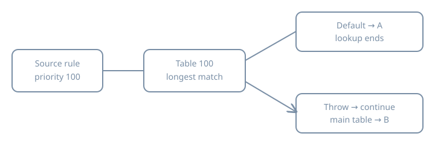

# Policy Routing: Table Order, Throw and Blackhole

A router can have the correct specific route and still choose a different path because a policy rule looks up another table first. This lab separates **rule order** from longest-prefix matching within a table. Linux commands provide a reproducible example; other platforms implement policy differently.

{fig-alt="The matching source rule checks table 100; the default selects A, while a throw for the destination continues to the main table and selects B."}

## Objectives and requirements

Predict a lookup with two tables, make an exception using a `throw` route, compare it with a blackhole, and explain why neither a route lookup nor a dummy interface proves end-to-end delivery. You need Linux, `iproute2`, `unshare`, and permission to create user and network namespaces. No external interfaces or installed routing daemons are used. Systems that disable unprivileged user namespaces or lack the dummy driver cannot run this form. Do not execute the setup in your normal host namespace.

The following commands were checked on Linux with iproute2 7.3.0 inside `unshare -rn`; exact output and UID vary. The addresses are documentation addresses. Dummy interfaces discard transmitted packets: these are **route lookup** tests, not connectivity tests.

## Build an isolated router

Start a shell inside a new user and network namespace; all subsequent commands in this lab run inside that shell. Exit it to remove these temporary interfaces and routes. A new namespace has its own routing tables and loopback; it does not carry your host's interfaces or routes.

```bash
unshare -rn bash
```

```bash
ip link set lo up
ip link add name uplinkA type dummy
ip link add name uplinkB type dummy
ip link set uplinkA up
ip link set uplinkB up
ip addr add 192.0.2.10/32 dev lo

# Main table: a specific destination via B.
ip route add 203.0.113.0/24 dev uplinkB
# Policy table: a default via A for packets with this source.
ip route add default dev uplinkA table 100
ip rule add priority 100 from 192.0.2.10/32 lookup 100

ip rule show
ip route show table 100
ip route show table main
```

The built-in local rule normally has priority 0, the new rule has priority 100, and the main-table rule normally has priority 32766. Lower numbers are evaluated first. Local-address handling can therefore take precedence over the new rule. `192.0.2.10` is assigned to loopback to give the lookup a valid local source; the destination is not local.

## Predict before looking

Will a packet from `192.0.2.10` to `203.0.113.7` select A's default or B's `/24`? Run:

```bash
ip route get 203.0.113.7 from 192.0.2.10
```

On the test host the result contained `dev uplinkA table 100`. The source rule reaches table 100 first; its default is a successful lookup, so the main table's more-specific route is not compared with it. Longest-prefix match applies **inside the table consulted**, not across every table in the system.

## Add a controlled exception

```bash
ip route add throw 203.0.113.0/24 table 100
ip route get 203.0.113.7 from 192.0.2.10
ip route get 198.51.100.7 from 192.0.2.10
```

For `203.0.113.7`, the `/24` throw route beats table 100's default and makes that table's lookup behave as if no route was found. Rule processing continues to the main table, which selects `uplinkB`. The unrelated destination still selects `uplinkA` through table 100's default. A `throw` does not send traffic out an interface, and fallback works only if a later rule finds a usable route.

## Replace throw with a blackhole

```bash
ip route replace blackhole 203.0.113.0/24 table 100
ip route get 203.0.113.7 from 192.0.2.10
```

The test host reported `RTNETLINK answers: Invalid argument`. The selected blackhole is a terminal discard, not a request to continue to the main table. Error text and behavior exposed to local applications depend on route type and tools; do not treat this message as proof of remote packet delivery. A `prohibit` or `unreachable` route is also a terminal decision with different error behavior.

Restore the lookup and remove the policy rule:

```bash
ip route del blackhole 203.0.113.0/24 table 100
ip rule del priority 100
ip route get 203.0.113.7 from 192.0.2.10
exit
```

The final lookup selects `uplinkB` in the main table. Exiting the namespace shell cleans up the lab, provided no other process remains in it.

## Troubleshoot and extend

- A lookup selects A when B has the more-specific route: inspect `ip rule show` and **each** table in priority order, not only `ip route show` without a table argument.
- A throw does not reach B: check for later matching rules, a main-table route and the lookup's actual source. A throw with no later usable route ends in failure.
- `ip route get` reports the selected route for the supplied lookup keys; it does not transmit a test packet, prove neighbor resolution, test filtering, or validate a return path. For forwarded traffic, include the appropriate input interface and other policy selectors when modeling a lookup, and validate with real endpoints and captures.
- Add a more-specific route in table 100 and predict which entry wins there. Remove it before exiting. Repeat with another source address assigned to loopback and explain why the source rule does not match it.

**Sources:** [Linux ip-rule manual](https://man7.org/linux/man-pages/man8/ip-rule.8.html) and [ip-route manual](https://man7.org/linux/man-pages/man8/ip-route.8.html). For the broader model, see [Policy Routing and VRF](../04-ip-routing-services/07-vrf-and-policy-routing.qmd).
