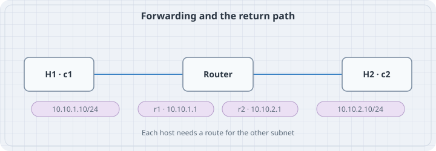

# Build a Router and Break the Return Path

A successful forward lookup does not prove that a reply can return. Build two hosts and a router from isolated Linux network namespaces, then deliberately remove the receiver's route back. This lab uses Linux as an implementation of vendor-neutral forwarding concepts.

{fig-alt="H1 and H2 are on separate subnets connected by a router; each host needs a return route."}

## Prerequisites and topology

You need Linux with user and network namespaces enabled, veth support, Bash, `ip`, `nsenter`, `unshare`, `sysctl`, and `ping`. Some systems disable unprivileged user namespaces. Run the script only through the `unshare -rn` command shown below: it enables forwarding in the **new router network namespace**, not on your host. The script was tested with Linux and iproute2 7.3.0; timings and ping output vary.

| Node | Interface | Address | Gateway |
|---|---|---|---|
| H1 | c1 | `10.10.1.10/24` | `10.10.1.1` |
| Router | r1 | `10.10.1.1/24` | directly connected |
| Router | r2 | `10.10.2.1/24` | directly connected |
| H2 | c2 | `10.10.2.10/24` | `10.10.2.1` |

A veth pair acts like a virtual cable. The shell's isolated network namespace is the router; two background processes hold the host namespaces open. The router's connected routes are created by assigning its interface addresses. The host default routes send remote traffic to the router; they do not describe the return direction on the other host.

## Run the experiment

Save the following as `forwarding-lab.sh` and execute **exactly** `unshare -rn bash forwarding-lab.sh`. The trap terminates the background namespace holders on normal exit or error. This uses disposable namespaces, not persistent named namespaces. Avoid killing the outer process with `SIGKILL`, which cannot run the cleanup trap; if interrupted abnormally, terminate any remaining `sleep 300` children belonging to your lab.

```bash
set -eu
unshare -n sleep 300 & h1=$!
unshare -n sleep 300 & h2=$!
trap 'kill "$h1" "$h2" 2>/dev/null || true; wait "$h1" "$h2" 2>/dev/null || true' EXIT
sleep 0.2

ip link add r1 type veth peer name c1
ip link add r2 type veth peer name c2
ip link set c1 netns "$h1"
ip link set c2 netns "$h2"
ip link set lo up
ip addr add 10.10.1.1/24 dev r1
ip addr add 10.10.2.1/24 dev r2
ip link set r1 up
ip link set r2 up

nsenter -t "$h1" -n ip link set lo up
nsenter -t "$h1" -n ip addr add 10.10.1.10/24 dev c1
nsenter -t "$h1" -n ip link set c1 up
nsenter -t "$h1" -n ip route add default via 10.10.1.1
nsenter -t "$h2" -n ip link set lo up
nsenter -t "$h2" -n ip addr add 10.10.2.10/24 dev c2
nsenter -t "$h2" -n ip link set c2 up
nsenter -t "$h2" -n ip route add default via 10.10.2.1

sysctl -qw net.ipv4.ip_forward=1
printf '\nBaseline routes and ping\n'
nsenter -t "$h1" -n ip route get 10.10.2.10
nsenter -t "$h2" -n ip route get 10.10.1.10
nsenter -t "$h1" -n ping -c 1 -W 1 10.10.2.10

printf '\nRemove H2 return route; ping should fail\n'
nsenter -t "$h2" -n ip route del default
if nsenter -t "$h2" -n ip route get 10.10.1.10; then
  echo 'Unexpected return route' >&2; exit 1
fi
if nsenter -t "$h1" -n ping -c 1 -W 1 10.10.2.10; then
  echo 'Unexpected ping success' >&2; exit 1
fi

printf '\nRestore H2 return route\n'
nsenter -t "$h2" -n ip route add default via 10.10.2.1
nsenter -t "$h1" -n ping -c 1 -W 1 10.10.2.10
printf 'Baseline restored.\n'
```

A normal run shows a successful ping, a missing H2 route and failed ping, then a successful ping after restoration. On the test host the first response had TTL 63: one router decremented the reply's initial TTL of 64. Initial TTL is a host setting, not a universal constant. The fault deliberately removes only H2's default; the router still has both directly connected routes.

## Trace the packet

1. H1 sees `10.10.2.10` is outside `10.10.1.0/24`; it selects the default via `10.10.1.1` and resolves the gateway's Ethernet address with ARP.
2. The router receives the IP packet, decrements TTL and selects the connected `10.10.2.0/24` route. It resolves H2 on r2 and sends a new Ethernet frame. Source and destination IP addresses remain H1 and H2; link-layer addresses change at the router.
3. H2 receives the echo request. With its default removed, it has no route to `10.10.1.10`, so it cannot send the echo reply. The failed ping alone does not prove the exact loss location: the H2 route lookup provides separate evidence of this fault.
4. Restoring the gateway gives H2 a route for the reply. H1 can receive the reply because its address is on its directly connected LAN.

A route lookup alone does not prove that ARP, a firewall or a remote application works. To confirm actual packet arrival at H2 in a larger lab, capture ICMP on its ingress interface or compare interface/ICMP counters, then inspect the return route and egress traffic. Check both directions when diagnosing a real network.

## Further drills

Modify a copy of the script to set `net.ipv4.ip_forward=0` after the successful baseline, verify that forwarding fails while the router's interface addresses remain present, then re-enable it and retest. Changing `ip_forward` resets several IPv4 parameters to host/router defaults, so apply any custom sysctls after the change. As a separate experiment, break H1's default route and distinguish a local route lookup failure from the missing return path. Predict each outcome before running it, and keep the cleanup trap.

**References:** [Linux network namespaces](https://man7.org/linux/man-pages/man7/network_namespaces.7.html), [veth](https://man7.org/linux/man-pages/man4/veth.4.html), and [Linux IPv4 sysctls](https://docs.kernel.org/networking/ip-sysctl.html).
