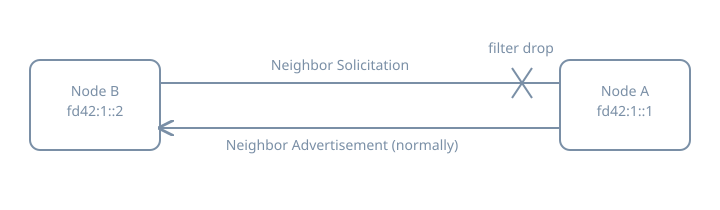

# IPv6 Neighbor Discovery and an ICMPv6 Filter Failure

IPv6 uses Neighbor Discovery (ND) to resolve a next hop's link-layer address and maintain reachability. Blocking Neighbor Solicitations can make a directly connected destination unreachable even when both interfaces have IPv6 addresses and the route is present. This isolated Linux lab demonstrates the failure and the evidence needed to distinguish it from a missing route.

{fig-alt="B sends a Neighbor Solicitation to A; the lab filter drops it, preventing the normal advertisement response."}

## Prerequisites and topology

You need Linux, Bash, `ip`, `nft`, `nsenter`, `unshare`, `ping`, veth support and permission to create user/network namespaces and nftables rules. Some hosts restrict these capabilities. The first shell becomes node A; a child namespace is node B. `a0` and `b0` are opposite ends of a veth cable. A is `fd42:1::1/64`, B is `fd42:1::2/64`. These ULA addresses are for this isolated experiment; generate a suitable unique prefix for a real site.

Run the script through `unshare -rn` as shown. Its firewall rule exists only in A's new network namespace. **Do not run the script directly on the host**, where it would create interfaces and alter host firewall state. The lab was tested on Linux with iproute2 7.3.0; packet counts and neighbor states vary with timing.

## Run the fault and repair

Save the script as `nd-lab.sh`, then run `unshare -rn bash nd-lab.sh`. The trap stops the namespace holder on exit; avoid `SIGKILL`, which cannot execute the trap. The two `nodad` flags keep setup brief and deterministic here; they disable Duplicate Address Detection for these lab addresses and are **not** a general operational recommendation.

```bash
set -eu
unshare -n sleep 60 & h=$!
trap 'kill "$h" 2>/dev/null || true; wait "$h" 2>/dev/null || true' EXIT
sleep 0.2
ip link add name a0 type veth peer name b0
ip link set b0 netns "$h"
ip link set lo up
ip link set a0 up
ip -6 addr add fd42:1::1/64 dev a0 nodad
nsenter -t "$h" -n ip link set lo up
nsenter -t "$h" -n ip link set b0 up
nsenter -t "$h" -n ip -6 addr add fd42:1::2/64 dev b0 nodad

printf '\nBaseline route and ping\n'
nsenter -t "$h" -n ip -6 route get fd42:1::1
nsenter -t "$h" -n ping -6 -c 1 -W 1 fd42:1::1
nsenter -t "$h" -n ip -6 neigh show dev b0

printf '\nDrop solicitations arriving at A and clear B cache\n'
nft add table ip6 ndlab
nft 'add chain ip6 ndlab input { type filter hook input priority 0; policy accept; }'
nft add rule ip6 ndlab input icmpv6 type nd-neighbor-solicit counter drop
nsenter -t "$h" -n ip -6 neigh flush dev b0
if nsenter -t "$h" -n ping -6 -c 1 -W 2 fd42:1::1; then
  echo 'Unexpected ping success' >&2; exit 1
fi
nsenter -t "$h" -n ip -6 route get fd42:1::1
nsenter -t "$h" -n ip -6 neigh show dev b0
nft list chain ip6 ndlab input

printf '\nRemove the fault and retry\n'
nft delete table ip6 ndlab
nsenter -t "$h" -n ip -6 neigh flush dev b0
nsenter -t "$h" -n ping -6 -c 1 -W 2 fd42:1::1
nsenter -t "$h" -n ip -6 neigh show dev b0
printf 'Connectivity restored.\n'
```

Baseline ping succeeds. With the rule in place and B's cached entry cleared, B still has an on-link route, but its Neighbor Solicitations arriving at A are dropped. The test host showed an unsuccessful ping and a positive nftables drop counter; the neighbor entry can show `INCOMPLETE` or `FAILED` depending on observation time. Removing the rule and flushing the failed entry permits a fresh resolution and the ping succeeds. A successful `send` or a route lookup does not prove neighbor resolution or packet delivery.

## Explain what happened

B determines that A is on link, then sends a Neighbor Solicitation to A's solicited-node multicast group to learn its link-layer address. A normally replies with a Neighbor Advertisement. With the fault, A's input chain discards the solicitation before normal ND processing. A cached neighbor entry can temporarily mask the problem, which is why the lab clears B's entry **after** installing the filter. Neighbor entries normally move through states as traffic and reachability confirmation change; `STALE` alone is not evidence of failure.

This rule intentionally blocks only incoming Neighbor Solicitations at A. It does not demonstrate every ICMPv6 failure and should not be copied into a real firewall. ICMPv6 also carries essential errors such as Packet Too Big for path MTU discovery; blanket blocking can cause failures that look like broken applications or large-packet black holes. Filter according to role and scope, preserving necessary control traffic; see the ICMPv6 recommendations below.

## Extend and investigate

1. Repeat without clearing the cache immediately after adding the rule. Does traffic continue temporarily? Compare B's neighbor state and rule counter; cache timers and upper-layer reachability confirmation influence the result.
2. Use an authorized packet capture on `a0` or `b0` to compare the solicitation and advertisement before and during the fault. Record interfaces and direction: an ingress capture can observe a packet that the firewall later drops.
3. Repeat the lab without `nodad`, allow tentative addresses time to complete DAD, and inspect the address state before testing. Compare with the [DAD exercise](../02-networking-foundations/06-ipv6-essentials.qmd).
4. Explain why an installed connected route, an up interface and a successful local address assignment are each insufficient to prove that a remote application is reachable.

**References:** [IPv6 Neighbor Discovery, RFC 4861](https://www.rfc-editor.org/rfc/rfc4861.html), [ICMPv6 filtering recommendations, RFC 4890](https://www.rfc-editor.org/rfc/rfc4890.html), and [IPv6 stateless address autoconfiguration, RFC 4862](https://www.rfc-editor.org/rfc/rfc4862.html).
