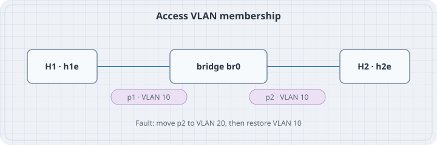

# VLAN Access Membership: Build, Break and Repair

Two hosts can have addresses in the same IPv4 subnet and still be unable to exchange frames if their access ports belong to different VLANs. In this lab a Linux VLAN-aware bridge models an Ethernet switch. You will inspect membership and MAC learning, move a port to another VLAN, and restore it. The concepts apply broadly; configuration and hardware counters vary by switch.

{fig-alt="Two hosts connect to a VLAN-aware bridge; both ports initially use VLAN 10 and p2 is moved to VLAN 20 for the fault."}

## Prerequisites and plan

You need Linux, Bash, `unshare`, `nsenter`, `ip`, `bridge`, `ping`, and permission to create user/network namespaces and veth interfaces. The kernel must support VLAN-filtering bridges. Some hosts disable unprivileged user namespaces. Run only through `unshare -rn`, so the bridge and interfaces are isolated from the host network. The lab was tested with iproute2 7.3.0; MAC addresses, timings and neighbor states vary.

| Endpoint | Address | Bridge port | Baseline access VLAN |
|---|---|---|---|
| H1 | `10.44.10.1/24` | p1 | 10 |
| H2 | `10.44.10.2/24` | p2 | 10 |

Each host connects to a bridge port through a veth pair. The host sends untagged frames. The port VLAN ID (**PVID**) classifies untagged ingress into a VLAN; the **untagged** flag removes the VLAN tag on egress for that membership. The bridge uses VLAN and destination MAC when forwarding. This is an access-port lab, not a tagged trunk; it does not run STP or model a hardware ASIC.

## Run the lab

Save as `vlan-lab.sh` and run `unshare -rn bash vlan-lab.sh`. The shell's network namespace contains the bridge; two short-lived background processes hold the host namespaces. The trap cleans up on normal exit or error. Avoid `SIGKILL`, which cannot run the trap; after an abnormal termination, stop any remaining lab `sleep 60` children.

```bash
set -eu
unshare -n sleep 60 & h1=$!
unshare -n sleep 60 & h2=$!
trap 'kill "$h1" "$h2" 2>/dev/null || true; wait "$h1" "$h2" 2>/dev/null || true' EXIT
sleep 0.2

ip link add name br0 type bridge vlan_filtering 1 vlan_default_pvid 0
ip link add name p1 type veth peer name h1e
ip link add name p2 type veth peer name h2e
ip link set h1e netns "$h1"
ip link set h2e netns "$h2"
ip link set p1 master br0
ip link set p2 master br0
bridge vlan add dev p1 vid 10 pvid untagged
bridge vlan add dev p2 vid 10 pvid untagged
ip link set br0 up
ip link set p1 up
ip link set p2 up

nsenter -t "$h1" -n ip link set lo up
nsenter -t "$h1" -n ip addr add 10.44.10.1/24 dev h1e
nsenter -t "$h1" -n ip link set h1e up
nsenter -t "$h2" -n ip link set lo up
nsenter -t "$h2" -n ip addr add 10.44.10.2/24 dev h2e
nsenter -t "$h2" -n ip link set h2e up

printf '\nBaseline: both access ports in VLAN 10\n'
bridge vlan show
nsenter -t "$h1" -n ping -c 1 -W 1 10.44.10.2
bridge fdb show br br0

printf '\nFault: move p2 to VLAN 20\n'
bridge vlan del dev p2 vid 10
bridge vlan add dev p2 vid 20 pvid untagged
nsenter -t "$h1" -n ip neigh flush dev h1e
nsenter -t "$h2" -n ip neigh flush dev h2e
bridge vlan show
if nsenter -t "$h1" -n ping -c 1 -W 2 10.44.10.2; then
  echo 'Unexpected connectivity across separate VLANs' >&2; exit 1
fi
nsenter -t "$h1" -n ip neigh show dev h1e

printf '\nRepair: restore p2 to VLAN 10\n'
bridge vlan del dev p2 vid 20
bridge vlan add dev p2 vid 10 pvid untagged
nsenter -t "$h1" -n ip neigh flush dev h1e
nsenter -t "$h2" -n ip neigh flush dev h2e
bridge vlan show
nsenter -t "$h1" -n ping -c 1 -W 2 10.44.10.2
printf 'Baseline restored.\n'
```

The baseline and repaired pings succeed on the test host. During the fault, the port listing shows p1 in VLAN 10 and p2 in VLAN 20, and the ping fails. H1 considers H2 on-link and sends ARP requests, but the bridge does not flood VLAN 10 frames out a port that belongs only to VLAN 20. A neighbor can appear `INCOMPLETE` or `FAILED` depending on timing. A failed ping alone cannot prove a VLAN mismatch; the membership listing is separate evidence.

`vlan_default_pvid 0` prevents an implicit default PVID from admitting untagged traffic before the explicit assignments. The FDB includes learned and permanent entries; inspect the device, VLAN and entry type rather than counting every entry as a learned host. The host neighbor cache is deliberately flushed to make the ARP failure visible; in a real network cache state can affect timing and symptoms.

## Extend the experiment

- Remove p2's VLAN membership without assigning a replacement PVID. Predict what happens to its untagged ingress traffic, inspect `bridge vlan show`, then restore VLAN 10.
- Put both ports into VLAN 20 without changing IP addresses. They can again communicate at Layer 2 because they share a VLAN; the IP subnet number does not automatically select a VLAN. Restore the baseline afterward.
- Add a third host in VLAN 20, with an appropriate separate subnet, and prove isolation. Routing between VLANs requires a router or Layer 3 switch and explicit addressing and policy; it is not provided by the bridge here.
- Compare this access-port failure with the [tagged trunk lab](04-vlans-and-trunks.qmd). A mismatched native/PVID configuration across switches can also leak traffic into an unintended VLAN; loss is not the only possible symptom.

Record the topology, expected result, VLAN table, FDB, neighbor state, fault and repair. End-to-end connectivity after repair is necessary evidence; it does not prove every VLAN, trunk or security policy is correct.

**References:** [Linux bridge documentation](https://docs.kernel.org/networking/bridge.html) and [bridge(8) VLAN options](https://man7.org/linux/man-pages/man8/bridge.8.html).
