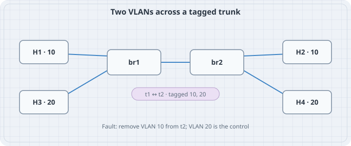

# Tagged Trunk: A Missing VLAN and an Unaffected Control

An inter-switch link can remain physically up and carry one VLAN while silently excluding another. Build two VLAN-aware Linux bridges, put a host in each of VLANs 10 and 20 at each end, then remove VLAN 10 from one trunk endpoint. This extends [VLAN Access Membership](44-vlan-access-membership.qmd) from one bridge to two. The concepts are vendor-neutral; the commands demonstrate one Linux implementation.

{fig-alt="Two bridges connect hosts in VLAN 10 and VLAN 20 through a tagged trunk; the fault removes VLAN 10 on the second bridge."}

## Plan and prerequisites

| Host | Bridge / port | VLAN | Address |
|---|---|---:|---|
| H1 | br1 / p1 | 10 | `10.44.10.1/24` |
| H2 | br2 / p2 | 10 | `10.44.10.2/24` |
| H3 | br1 / p3 | 20 | `10.44.20.1/24` |
| H4 | br2 / p4 | 20 | `10.44.20.2/24` |

`br1:t1` and `br2:t2` are the two ends of one veth cable. Both carry VLANs 10 and 20 as tagged members. Each host-facing bridge port uses its VLAN as PVID and emits untagged frames. The bridges have no default PVID and do not route between VLANs. The topology has a single inter-bridge link; no redundant loop or spanning-tree exercise is implied.

You need Linux, Bash, `unshare`, `nsenter`, `ip`, `bridge`, `ping`, user/network namespace permission, veth support and VLAN-aware Linux bridges. Some hosts restrict these capabilities. Run only in the isolated user and network namespace below; do not create this bridge or modify interfaces on a production host. The script was tested with iproute2 7.3.0; timings and MAC addresses vary.

## Build, break and restore

Save as `trunk-lab.sh` and run `unshare -rn bash trunk-lab.sh`. Four background processes hold host namespaces; the trap stops them on exit. Avoid `SIGKILL`, which cannot run cleanup. If the parent terminates abnormally, stop any remaining lab `sleep 90` children. The experiment does not rely on Docker or hardware switch images.

```bash
set -eu
unshare -n sleep 90 & h1=$!
unshare -n sleep 90 & h2=$!
unshare -n sleep 90 & h3=$!
unshare -n sleep 90 & h4=$!
trap 'kill "$h1" "$h2" "$h3" "$h4" 2>/dev/null || true; wait "$h1" "$h2" "$h3" "$h4" 2>/dev/null || true' EXIT
sleep 0.2
ip link add br1 type bridge vlan_filtering 1 vlan_default_pvid 0
ip link add br2 type bridge vlan_filtering 1 vlan_default_pvid 0
ip link add t1 type veth peer name t2
ip link set t1 master br1
ip link set t2 master br2
bridge vlan add dev t1 vid 10
bridge vlan add dev t1 vid 20
bridge vlan add dev t2 vid 10
bridge vlan add dev t2 vid 20
ip link set br1 up
ip link set br2 up
ip link set t1 up
ip link set t2 up
setup_host() {
  pid=$1; port=$2; hostif=$3; br=$4; vid=$5; addr=$6
  ip link add "$port" type veth peer name "$hostif"
  ip link set "$hostif" netns "$pid"
  ip link set "$port" master "$br"
  bridge vlan add dev "$port" vid "$vid" pvid untagged
  ip link set "$port" up
  nsenter -t "$pid" -n ip link set lo up
  nsenter -t "$pid" -n ip addr add "$addr" dev "$hostif"
  nsenter -t "$pid" -n ip link set "$hostif" up
}
setup_host "$h1" p1 h1e br1 10 10.44.10.1/24
setup_host "$h2" p2 h2e br2 10 10.44.10.2/24
setup_host "$h3" p3 h3e br1 20 10.44.20.1/24
setup_host "$h4" p4 h4e br2 20 10.44.20.2/24
bridge vlan show
nsenter -t "$h1" -n ping -c 1 -W 1 10.44.10.2
nsenter -t "$h3" -n ping -c 1 -W 1 10.44.20.2
bridge vlan del dev t2 vid 10
nsenter -t "$h1" -n ip neigh flush dev h1e
nsenter -t "$h2" -n ip neigh flush dev h2e
bridge vlan show dev t2
if nsenter -t "$h1" -n ping -c 1 -W 2 10.44.10.2; then exit 1; fi
nsenter -t "$h3" -n ping -c 1 -W 1 10.44.20.2
bridge vlan add dev t2 vid 10
nsenter -t "$h1" -n ip neigh flush dev h1e
nsenter -t "$h2" -n ip neigh flush dev h2e
nsenter -t "$h1" -n ping -c 1 -W 2 10.44.10.2
```

The baseline membership listing shows both VLANs on t1 and t2 without the `Egress Untagged` flag, and the access ports with `PVID Egress Untagged`. Both test pings succeed. After VLAN 10 is removed from t2, its listing shows VLAN 20 but no VLAN 10: H1 to H2 fails while H3 to H4 still works. Restoring VLAN 10 restores H1-to-H2 connectivity. Flushes of H1 and H2 neighbor entries make the ARP phase observable rather than depending on cache timing. A ping loss proves a symptom, not its cause; compare membership, counters, FDB and captures at both ends.

## Follow the frame

H1 sends an untagged ARP request. p1 classifies it into VLAN 10; br1 can forward it out t1 with an 802.1Q VLAN 10 tag. br2 accepts it on t2 only while t2 permits VLAN 10, then sends it untagged out p2. H2 replies through the reverse path. When t2 no longer permits VLAN 10, that VLAN cannot traverse this link even though t1, t2 and VLAN 20 remain operational. The test does not simulate a physical cable break.

If supported, capture on t1 and t2 with a VLAN-aware packet analyzer to observe the tag. Interface offload and capture location can alter how tags appear; a capture on a host access interface generally sees untagged traffic. Inspect `bridge fdb show br br1` and `bridge fdb show br br2` after traffic to relate learned source MACs to ports and VLANs. Stale entries can persist after a change; do not infer current reachability from an old FDB entry alone.

## Practice

1. Remove VLAN 20 from t1 instead, leaving VLAN 10 present. Predict and verify which flow fails; restore it.
2. Remove VLAN 10 from **both** trunk ends and compare the listings with the one-sided fault. Do not confuse the absence of a VLAN with a down physical link.
3. Examine the PVID/untagged configuration before designing a native-VLAN test. A mismatch can put untagged traffic into the wrong VLAN and cause leakage as well as loss. Test it only in an isolated topology and document intended versus observed VLAN at each end.
4. Explain why this lab needs a router to exchange IP traffic between the two VLANs. Add that routing in a separate topology and verify policy and the reverse path.

**References:** [Linux bridge documentation](https://docs.kernel.org/networking/bridge.html) and [bridge VLAN options](https://man7.org/linux/man-pages/man8/bridge.8.html).
