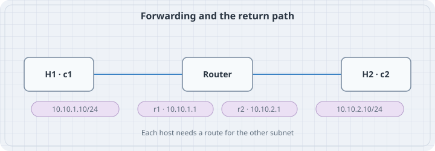

# Stateful Filtering: Direction, Counters and Return Traffic

A firewall rule must identify where packets enter and leave, not merely the service name. In this lab H1 may initiate IPv4 echo requests to H2; H2 may reply but may not initiate a new echo request to H1. Removing the return-state rule demonstrates why permitting only the forward packet is insufficient. Linux nftables implements the exercise; the reasoning applies to stateful firewalls generally.

{fig-alt="H1 and H2 are on separate subnets connected through a router, which enforces the lab forwarding policy."}

## Prerequisites and policy

Complete [Build a Router and Break the Return Path](42-isolated-forwarding-return-path.qmd) first. This self-contained script recreates that topology: H1 `10.10.1.10/24`, router r1 `10.10.1.1/24`, router r2 `10.10.2.1/24`, H2 `10.10.2.10/24`. Both hosts have default routes through the router. The `forward` chain filters packets passing **through** the router; traffic addressed to the router itself traverses a different hook and is not protected by this lab's forward chain.

You need Linux, Bash, `unshare`, `nsenter`, `ip`, `nft`, `sysctl`, `ping`, veth and conntrack/nftables kernel support, and permission to create user/network namespaces. Some environments prohibit these operations. Run the script only using `unshare -rn`: it creates a firewall table and enables forwarding inside a new isolated network namespace. Never run it directly against host interfaces or a production ruleset. The cleanup trap stops the namespace holders; avoid `SIGKILL`, which bypasses the trap. The example was tested with iproute2 7.3.0; counters and timing vary.

The policy is deliberately narrow: permit H1's ICMP echo request to H2, allow established/related traffic, and drop other forwarded IPv4 traffic. This is a demonstration, not a complete firewall policy. In particular, a general established/related rule can allow traffic beyond this one echo reply; a production policy needs an explicit design for its zones, protocols, IPv6, management plane and state handling.

## Run the experiment

Save as `acl-lab.sh` and run `unshare -rn bash acl-lab.sh`:

```bash
set -eu
unshare -n sleep 300 & h1=$!
unshare -n sleep 300 & h2=$!
trap 'kill "$h1" "$h2" 2>/dev/null || true; wait "$h1" "$h2" 2>/dev/null || true' EXIT
sleep 0.2
ip link add r1 type veth peer name c1
ip link add r2 type veth peer name c2
ip link set c1 netns "$h1"
ip link set c2 netns "$h2"
ip link set lo up
ip addr add 10.10.1.1/24 dev r1
ip addr add 10.10.2.1/24 dev r2
ip link set r1 up
ip link set r2 up
nsenter -t "$h1" -n ip link set lo up
nsenter -t "$h1" -n ip addr add 10.10.1.10/24 dev c1
nsenter -t "$h1" -n ip link set c1 up
nsenter -t "$h1" -n ip route add default via 10.10.1.1
nsenter -t "$h2" -n ip link set lo up
nsenter -t "$h2" -n ip addr add 10.10.2.10/24 dev c2
nsenter -t "$h2" -n ip link set c2 up
nsenter -t "$h2" -n ip route add default via 10.10.2.1
sysctl -qw net.ipv4.ip_forward=1
nft add table ip acllab
nft 'add chain ip acllab forward { type filter hook forward priority filter; policy drop; }'
nft add rule ip acllab forward ct state established,related counter accept
nft add rule ip acllab forward iifname r1 oifname r2 ip saddr 10.10.1.10 ip daddr 10.10.2.10 icmp type echo-request counter accept
nft add rule ip acllab forward counter drop
nsenter -t "$h1" -n ping -c 1 -W 1 10.10.2.10
if nsenter -t "$h2" -n ping -c 1 -W 1 10.10.1.10; then echo unexpected; exit 1; fi
nft -a list chain ip acllab forward
nft flush chain ip acllab forward
nft add rule ip acllab forward iifname r1 oifname r2 ip saddr 10.10.1.10 ip daddr 10.10.2.10 icmp type echo-request counter accept
nft add rule ip acllab forward counter drop
if nsenter -t "$h1" -n ping -c 1 -W 1 10.10.2.10; then echo unexpected; exit 1; fi
nft list chain ip acllab forward
nft insert rule ip acllab forward ct state established,related counter accept
nsenter -t "$h1" -n ping -c 1 -W 1 10.10.2.10
nft delete table ip acllab
```

Expected sequence: H1's first ping succeeds; H2's new reverse ping fails. The first counter shows a reply matched established/related, the second shows an H1 request accepted, and the final counter shows a dropped packet. After the chain is replaced with only the request permit and a drop, H1's next ping fails: the request counter rises, but the reply has no matching permit and reaches the drop counter. Inserting the state rule at the beginning restores H1's ping. Exact counts depend on other traffic and timing.

The test removes only its own `ip acllab` table. No NAT is configured. The isolated router still needs working routes and IPv4 forwarding; a stateful firewall cannot repair a missing return route. Conntrack associates the ICMP reply with the request in this experiment. Do not assume that every related flow, fragment or ICMP error is treated identically by all implementations.

## Interpret and extend

1. Trace an H1 request through `iif r1` and `oif r2`, then its reply in the reverse direction. Why would a rule permitting only an echo request not admit the echo reply?
2. Compare the first `nft -a list` counters with the listing after the chain is replaced. Rule handles and counters change when rules are recreated; they are not a permanent audit history.
3. Move a broad drop above the permit in a disposable copy and predict the result. Rules in this chain are evaluated in order; a terminal verdict stops evaluation. Restore the original order and retest.
4. Add an explicit stateless echo-reply permit instead of the state rule in a separate isolated run. Specify source, destination and interface direction carefully. Explain why a broad reverse permit is not equivalent to allowing only replies to legitimate initiated flows.
5. Compare forward traffic with a probe addressed to the router itself. The latter does not traverse this forward chain. Design and test a separate management-plane policy rather than assuming this lab's rules protect it.

A rule counter identifies a matching packet, not a successful end-to-end transaction. Capture at the relevant interfaces, check routing and neighbor resolution, observe both directions, and test representative application traffic. The lab's expected denial of H2 initiation is not proof that all unsolicited protocols are blocked on a real firewall.

**References:** [nftables manual](https://netfilter.org/projects/nftables/manpage.html), [connection tracking sysctls](https://docs.kernel.org/networking/nf_conntrack-sysctl.html), and [ACL Thinking](../06-policy-qos-hardening/01-acl-thinking.qmd).
