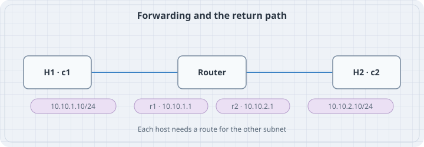

# Source NAT: Observe the Translation and Return Path

Source NAT changes the source address seen by a remote endpoint. Stateful NAT also maps matching reply packets back to the initiating host. Neither translation nor a successful rule counter proves that routing, filtering or the application is correct. This lab measures what the server actually sees, then repeats with a new flow after removing the translation rule.

{fig-alt="H1 and H2 are on separate subnets connected by a router that applies source NAT toward H2."}

## Plan and prerequisites

H1 is `10.10.1.10/24`, the router is `10.10.1.1/24` on r1 and `10.10.2.1/24` on r2, and H2 is `10.10.2.10/24`. Each host uses its local router address as default gateway. H2 runs a UDP echo-like server that replies with the source IP it observed. The “outside” address is private here because both networks are isolated; this is a translation demonstration, not an Internet connection.

You need Linux, Bash, `unshare`, `nsenter`, `ip`, `nft`, `sysctl`, Python 3, veth and nftables NAT/connection-tracking support, plus permission to create user and network namespaces. Some systems restrict these capabilities. Run **only** with `unshare -rn`: the router, interfaces, forwarding setting and NAT rule are created in a disposable network namespace. Never run the script directly on the host. The script was tested on Linux with iproute2 7.3.0; port translation and counters vary.

## Build and test

Save as `nat-lab.sh` and run `unshare -rn bash nat-lab.sh`. The child processes hold the host namespaces; the trap stops them and the temporary server on exit. Avoid `SIGKILL`, which cannot run the trap; after abnormal termination, stop any remaining lab `sleep 300` or server children. The receiver uses a ten-second timeout; if the machine is heavily loaded, extend it and the namespace-holder duration in an isolated copy.

```bash
set -eu
unshare -n sleep 300 & h1=$!
unshare -n sleep 300 & h2=$!
trap 'kill "$h1" "$h2" 2>/dev/null || true; wait "$h1" "$h2" 2>/dev/null || true' EXIT
sleep 0.2
ip link add r1 type veth peer name c1
ip link add r2 type veth peer name c2
ip link set c1 netns "$h1"
ip link set c2 netns "$h2"
ip link set lo up
ip addr add 10.10.1.1/24 dev r1
ip addr add 10.10.2.1/24 dev r2
ip link set r1 up
ip link set r2 up
nsenter -t "$h1" -n ip link set lo up
nsenter -t "$h1" -n ip addr add 10.10.1.10/24 dev c1
nsenter -t "$h1" -n ip link set c1 up
nsenter -t "$h1" -n ip route add default via 10.10.1.1
nsenter -t "$h2" -n ip link set lo up
nsenter -t "$h2" -n ip addr add 10.10.2.10/24 dev c2
nsenter -t "$h2" -n ip link set c2 up
nsenter -t "$h2" -n ip route add default via 10.10.2.1
sysctl -qw net.ipv4.ip_forward=1
nsenter -t "$h2" -n python3 -u - <<'SERVER' &
import socket
s = socket.socket(socket.AF_INET, socket.SOCK_DGRAM)
s.bind(('10.10.2.10', 9999))
s.settimeout(10)
for _ in range(2):
    data, peer = s.recvfrom(1024)
    s.sendto(peer[0].encode(), peer)
s.close()
SERVER
server=$!
trap 'kill "$server" "$h1" "$h2" 2>/dev/null || true; wait "$server" "$h1" "$h2" 2>/dev/null || true' EXIT
sleep 0.2
nft add table ip natlab
nft 'add chain ip natlab post { type nat hook postrouting priority srcnat; policy accept; }'
nft add rule ip natlab post ip saddr 10.10.1.10 oifname r2 counter masquerade
nsenter -t "$h1" -n python3 - <<'CLIENT'
import socket
s = socket.socket(socket.AF_INET, socket.SOCK_DGRAM)
s.bind(('10.10.1.10', 40001))
s.settimeout(3)
s.sendto(b'first', ('10.10.2.10', 9999))
seen = s.recv(1024).decode()
print('Server saw with NAT:', seen)
assert seen == '10.10.2.1'
CLIENT
nft list chain ip natlab post
nft delete table ip natlab
nsenter -t "$h1" -n python3 - <<'CLIENT'
import socket
s = socket.socket(socket.AF_INET, socket.SOCK_DGRAM)
s.bind(('10.10.1.10', 40002))
s.settimeout(3)
s.sendto(b'second', ('10.10.2.10', 9999))
seen = s.recv(1024).decode()
print('Server saw without NAT:', seen)
assert seen == '10.10.1.10'
CLIENT
wait "$server"
```

The first assertion requires H2 to report `10.10.2.1`: the router's r2 address replaced H1's source. H2 replies to that address and the connection-tracking NAT mapping delivers the reply to H1. The nftables rule counter should increment for the new flow; the exact packet count is not an end-to-end delivery counter.

After the NAT table is removed, the second client uses a **different UDP source port** to create a new flow. H2 reports `10.10.1.10` and can still reply because its default route points to the router. Stateful NAT chooses a binding for the first packet of a flow; later packets can continue using that binding even after a rule changes. A new tuple prevents an old mapping from misleading the comparison. Do not assume a rule edit immediately changes every existing session.

## Trace and investigate

1. H1 routes the packet to `10.10.1.1`. The router chooses r2 as the outgoing interface. Its postrouting rule matches H1's source and masquerades it to r2's address.
2. H2 sees the translated source. It replies to that source, and the router uses the connection mapping to reverse the translation before forwarding to H1. Source-port translation can also occur to avoid collisions; this lab asserts only the source address.
3. Without NAT, H2 sees H1's original address. Its default route supplies the return path. If that route is removed, the unmodified reply fails even though the forward packet can arrive.
4. NAT is not a firewall policy. A separate filter can deny a translated or untranslated flow, and an accept rule in one chain does not necessarily override a later drop elsewhere. Inspect the relevant hooks, rules and counters.

Extend the isolated script with a third client flow after removing H2's default route. Predict the difference between translated and untranslated traffic, verify the server's observation and reply outcome, then restore the route. Use packet capture on both router interfaces or a connection-tracking tool if available to correlate original and translated tuples; do not rely on one counter or a single ping. Never flush a production connection table to make a test convenient.

**References:** [Traditional NAT, RFC 3022](https://www.rfc-editor.org/rfc/rfc3022.html), [nftables NAT behavior](https://wiki.nftables.org/wiki-nftables/index.php/Performing_Network_Address_Translation_%28NAT%29), and [nftables manual](https://netfilter.org/projects/nftables/manpage.html).
