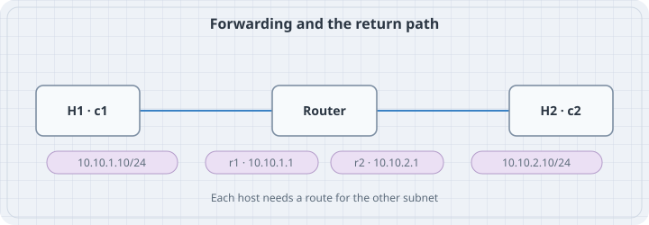

# Destination NAT: Map a Service and Verify the Backend

A destination NAT (DNAT) rule can map a service address and port to a backend. The translated destination still needs a route, the forwarding policy must permit it, and replies must traverse the translation state. This lab compares a mapped UDP request, a new request after removing the mapping, and a direct backend control.

{fig-alt="A client and a backend are on separate subnets with a router between them."}

## Plan and prerequisites

H1 `10.10.1.10/24` is the client, router r1 is `10.10.1.1/24`, router r2 is `10.10.2.1/24`, and H2 `10.10.2.10/24` runs a UDP service on port 9999. Hosts use their local router interface as default gateway. A rule on packets arriving at r1 maps `10.10.1.1:8080/UDP` to `10.10.2.10:9999/UDP`. Both addresses are private and exist only inside the lab; no public service is exposed.

You need Linux, Bash, `unshare`, `nsenter`, `ip`, `nft`, `sysctl`, Python 3, veth and nftables NAT/connection-tracking support, and permission to create user and network namespaces. Run the script only as `unshare -rn bash dnat-lab.sh`, never directly on the host: all interfaces, forwarding settings and firewall rules belong to the disposable namespace. Some environments restrict namespaces or kernel modules. The script was tested on Linux with iproute2 7.3.0; timing and counters vary.

## Build and test

Save as `dnat-lab.sh` and run `unshare -rn bash dnat-lab.sh`. The trap stops the host-namespace holders and backend on normal exit or error. Avoid `SIGKILL`, which bypasses cleanup; after abnormal termination, stop any remaining lab `sleep 300` or server children. The server waits at most ten seconds; on a heavily loaded machine increase the timeout in an isolated copy.

```bash
set -eu
unshare -n sleep 300 & h1=$!
unshare -n sleep 300 & h2=$!
trap 'kill "$h1" "$h2" 2>/dev/null || true; wait "$h1" "$h2" 2>/dev/null || true' EXIT
sleep 0.2
ip link add r1 type veth peer name c1
ip link add r2 type veth peer name c2
ip link set c1 netns "$h1"
ip link set c2 netns "$h2"
ip link set lo up
ip addr add 10.10.1.1/24 dev r1
ip addr add 10.10.2.1/24 dev r2
ip link set r1 up
ip link set r2 up
nsenter -t "$h1" -n ip link set lo up
nsenter -t "$h1" -n ip addr add 10.10.1.10/24 dev c1
nsenter -t "$h1" -n ip link set c1 up
nsenter -t "$h1" -n ip route add default via 10.10.1.1
nsenter -t "$h2" -n ip link set lo up
nsenter -t "$h2" -n ip addr add 10.10.2.10/24 dev c2
nsenter -t "$h2" -n ip link set c2 up
nsenter -t "$h2" -n ip route add default via 10.10.2.1
sysctl -qw net.ipv4.ip_forward=1
nsenter -t "$h2" -n python3 -u - <<'SERVER' &
import socket
s = socket.socket(socket.AF_INET, socket.SOCK_DGRAM)
s.bind(('10.10.2.10', 9999))
s.settimeout(10)
for _ in range(2):
    data, peer = s.recvfrom(1024)
    s.sendto(b'backend-response', peer)
s.close()
SERVER
server=$!
trap 'kill "$server" "$h1" "$h2" 2>/dev/null || true; wait "$server" "$h1" "$h2" 2>/dev/null || true' EXIT
sleep 0.2
nft add table ip dnatlab
nft 'add chain ip dnatlab pre { type nat hook prerouting priority dstnat; policy accept; }'
nft add rule ip dnatlab pre iifname r1 ip daddr 10.10.1.1 udp dport 8080 counter dnat to 10.10.2.10:9999
nsenter -t "$h1" -n python3 - <<'CLIENT'
import socket
s = socket.socket(socket.AF_INET, socket.SOCK_DGRAM)
s.bind(('10.10.1.10', 40001))
s.settimeout(3)
s.sendto(b'hello', ('10.10.1.1', 8080))
data, peer = s.recvfrom(1024)
print('Received:', data.decode(), 'from', peer)
assert data == b'backend-response' and peer == ('10.10.1.1', 8080)
CLIENT
nft list chain ip dnatlab pre
nft delete table ip dnatlab
nsenter -t "$h1" -n python3 - <<'CLIENT'
import socket
s = socket.socket(socket.AF_INET, socket.SOCK_DGRAM)
s.bind(('10.10.1.10', 40002))
s.settimeout(1)
s.sendto(b'no mapping', ('10.10.1.1', 8080))
try:
    data, peer = s.recvfrom(1024)
    raise AssertionError(f'unexpected response: {data!r} from {peer}')
except socket.timeout:
    print('New flow without mapping: timed out as expected')
CLIENT
kill -0 "$server"
nsenter -t "$h1" -n python3 - <<'CLIENT'
import socket
s = socket.socket(socket.AF_INET, socket.SOCK_DGRAM)
s.settimeout(3)
s.sendto(b'direct control', ('10.10.2.10', 9999))
data, peer = s.recvfrom(1024)
print('Direct backend control:', data.decode(), 'from', peer)
assert data == b'backend-response' and peer == ('10.10.2.10', 9999)
CLIENT
wait "$server"
```

First, H1 receives `backend-response` from the apparent service tuple `10.10.1.1:8080`. The DNAT counter shows the initial request matched. After the NAT table is deleted, a **new** client tuple sent to the same address and port times out: the gateway has no listener at that port. The direct control then reaches `10.10.2.10:9999` while the backend is still running, proving basic backend reachability in this topology. The local unconnected UDP client observes a timeout; other clients or platforms may report an ICMP-derived error instead.

## Follow both directions

The client sends toward the router's r1 address. In the router's prerouting NAT hook, the destination becomes `10.10.2.10:9999`; the subsequent route lookup selects r2. The backend receives a packet from H1 and replies through its default gateway. Connection tracking applies the reverse translation so H1 sees the reply as coming from `10.10.1.1:8080`. This result depends on the backend's return route crossing the same translation state; asymmetric forwarding can break it.

Without the mapping, the destination remains the router's local address and is not forwarded to H2. A different client source port makes the second request a new flow: existing state can retain a translation after a rule change. The direct-control request uses the backend address, and is possible here because H1 has a route through the lab router; Internet clients would require appropriate routing and policy to reach such an address.

DNAT does not by itself authorize the forwarded packet. A firewall may need an explicit permit and can evaluate original or translated tuples depending on hook and platform. Conversely, adding the mapping can make a service reachable when forwarding policy allows it. Validate the actual service, source restrictions, both directions and exposure before making any real change.

## Failure drills

1. In an isolated copy, block forwarding to the backend while keeping the DNAT rule. Compare NAT and filter counters and backend capture: a NAT hit alone is not delivery.
2. Remove H2's return route and repeat a fresh mapped flow. Observe the backend receiving the request and the client failing to get a reply; restore the route.
3. Change the mapped backend port to a non-listening port. Distinguish a correct mapping to the wrong service from a missing mapping using captures or counters.
4. Document the original and translated five-tuples, hook, rule counter, selected route, backend listener and return path. Do not flush a production connection table to perform these tests.

**References:** [Traditional NAT, RFC 3022](https://www.rfc-editor.org/rfc/rfc3022.html), [nftables NAT](https://wiki.nftables.org/wiki-nftables/index.php/Performing_Network_Address_Translation_%28NAT%29), and the [source NAT lab](47-source-nat-observe.qmd).
