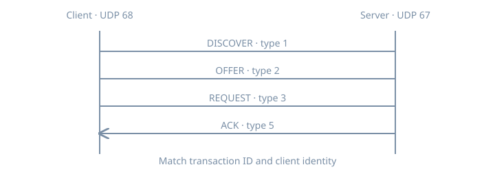

# DHCPv4 on the Wire: A Minimal Isolated Exchange

Observe DHCPDISCOVER, DHCPOFFER, DHCPREQUEST and DHCPACK as actual UDP packets without installing a DHCP server. The deliberately small Python endpoints below demonstrate message layout and correlation on one isolated link. They are **teaching code**, not compliant general-purpose DHCP implementations: they do not configure the client address, maintain a real lease database, retransmit, renew, rebind, implement relay handling, or authenticate peers.

{fig-alt="The client sends Discover, receives Offer, sends Request, and receives Ack from the server."}

## Lab boundary

You need Linux, Bash, Python 3, `ip`, `unshare`, `nsenter`, veth support and permission to create user and network namespaces. Some systems restrict these features or binding UDP ports 67 and 68. The test was run in an unprivileged user/network namespace; run only through `unshare -rn`, never on a shared LAN. Broadcast DHCP replies from a test server can disrupt real clients. A default route is added **inside the isolated client namespace** solely to select the veth interface for broadcasting; it is not a DHCP-installed route.

The server is `10.55.0.1/24` on `s0`, and the client connects through `c0` with no configured IPv4 address. The server offers `10.55.0.100` with a 600-second lease value. The fixed transaction ID and client hardware field are synthetic, so captures are easy to correlate; they are not a unique identity or a security mechanism. Both endpoints use broadcast for this simplified exchange.

## Save the protocol code

Save this file as `dhcp_wire.py` in a new working directory:

```python
import socket, struct, sys
MAGIC = b'\x63\x82\x53\x63'
XID = 0x12345678
MAC = bytes.fromhex('020000000001')
SERVER = '10.55.0.1'
OFFER = '10.55.0.100'

def option(code, value):
    return bytes((code, len(value))) + value

def packet(op, msg_type, extra=b''):
    yiaddr = socket.inet_aton(OFFER if op == 2 else '0.0.0.0')
    hdr = struct.pack('!BBBBIHH4s4s4s4s16s64s128s', op, 1, 6, 0, XID, 0, 0x8000,
                      bytes(4), yiaddr, bytes(4), bytes(4), MAC.ljust(16, b'\0'), bytes(64), bytes(128))
    return hdr + MAGIC + option(53, bytes([msg_type])) + extra + b'\xff'

def parse(data):
    if len(data) < 240 or data[236:240] != MAGIC:
        raise ValueError('bad BOOTP header or cookie')
    xid = struct.unpack_from('!I', data, 4)[0]
    if xid != XID or data[28:34] != MAC:
        raise ValueError('unexpected client transaction')
    opts = {}; i = 240
    while i < len(data):
        code = data[i]; i += 1
        if code == 255: break
        if code == 0: continue
        if i >= len(data): raise ValueError('missing option length')
        n = data[i]; i += 1
        if i+n > len(data): raise ValueError('truncated option')
        opts[code] = data[i:i+n]; i += n
    return data[0], socket.inet_ntoa(data[16:20]), opts

s = socket.socket(socket.AF_INET, socket.SOCK_DGRAM)
s.setsockopt(socket.SOL_SOCKET, socket.SO_REUSEADDR, 1)
s.setsockopt(socket.SOL_SOCKET, socket.SO_BROADCAST, 1)
s.setsockopt(socket.SOL_SOCKET, socket.SO_BINDTODEVICE, (sys.argv[2]+'\0').encode())
s.settimeout(5)
if sys.argv[1] == 'server':
    s.bind(('', 67))
    for expected, reply in ((1, 2), (3, 5)):
        data, peer = s.recvfrom(2048)
        op, yiaddr, opts = parse(data)
        assert op == 1 and opts[53] == bytes([expected])
        if expected == 3:
            assert opts[50] == socket.inet_aton(OFFER) and opts[54] == socket.inet_aton(SERVER)
        extra = option(54, socket.inet_aton(SERVER)) + option(51, struct.pack('!I', 600))
        s.sendto(packet(2, reply, extra), ('255.255.255.255', 68))
        print('server received', expected, 'sent', reply, flush=True)
else:
    s.bind(('', 68))
    for sent, expected in ((1, 2), (3, 5)):
        extra = b'' if sent == 1 else option(50, socket.inet_aton(OFFER)) + option(54, socket.inet_aton(SERVER))
        s.sendto(packet(1, sent, extra), ('255.255.255.255', 67))
        data, peer = s.recvfrom(2048)
        op, yiaddr, opts = parse(data)
        assert op == 2 and opts[53] == bytes([expected]) and yiaddr == OFFER
        assert opts[54] == socket.inet_aton(SERVER)
        print('client sent', sent, 'received', expected, 'yiaddr', yiaddr, flush=True)
s.close()
```

A BOOTP header is 236 bytes; the DHCP magic cookie follows, then length-delimited options. Here option 53 contains message type, option 54 identifies the selected server, option 50 names the requested address and option 51 carries a lease value. The parser validates lengths, transaction ID and the synthetic client field. It does not implement full RFC validation, option overload, relay information, address conflict detection or production security. Code 1/2/3/5 represents Discover/Offer/Request/Ack respectively.

Save the next block as `dhcp-lab.sh` **in the same directory**, then run `unshare -rn bash dhcp-lab.sh`. The background process holds the server namespace and the trap cleans it up on normal exit or error. Avoid `SIGKILL`; if the parent is killed abnormally, stop any remaining lab `sleep 60` or server child. The server times out rather than waiting indefinitely.

```bash
set -eu
unshare -n sleep 60 & serverns=$!
trap 'kill "$serverns" 2>/dev/null || true; wait "$serverns" 2>/dev/null || true' EXIT
sleep 0.2
ip link add c0 type veth peer name s0
ip link set s0 netns "$serverns"
ip link set lo up
ip link set c0 up
ip route add default dev c0
nsenter -t "$serverns" -n ip link set lo up
nsenter -t "$serverns" -n ip addr add 10.55.0.1/24 dev s0
nsenter -t "$serverns" -n ip link set s0 up
nsenter -t "$serverns" -n python3 ./dhcp_wire.py server s0 & srv=$!
trap 'kill "$srv" "$serverns" 2>/dev/null || true; wait "$srv" "$serverns" 2>/dev/null || true' EXIT
sleep 0.2
python3 ./dhcp_wire.py client c0
wait "$srv"
```

A successful run prints that the server received 1 and sent 2, then received 3 and sent 5; the client reports the same message sequence and `yiaddr 10.55.0.100`. Output ordering across processes may vary. No client address is applied and no traffic to that address is tested. A real client must validate the ACK, manage lease state and configure its interface and options according to its implementation and applicable standards.

## Investigate and extend

1. Compare the request's transaction ID and client field with both responses. Why does this client reject a reply for a different transaction?
2. Change the client's requested-address option in a disposable copy. The teaching server's assertion rejects it; real servers have more complex selection, authorization and error behavior.
3. If packet capture is available, observe UDP 67/68 on `c0` and `s0` inside their respective namespaces. Confirm broadcast destinations, DHCP message types and option values. A capture at one point is not evidence of processing by the other endpoint.
4. Explain why the server offers the address but `ip addr show dev c0` would not show it installed. Then use the [DHCP relay diagnostics](../04-network-services/02d-dhcp-lease-relay-diagnostics.qmd) exercise to trace the extra relay and return-path requirements.
5. Restore all modified files and clean up the namespace processes. Do not attach this toy server to a real network.

**References:** [DHCPv4, RFC 2131](https://www.rfc-editor.org/rfc/rfc2131.html), [DHCP options, RFC 2132](https://www.rfc-editor.org/rfc/rfc2132.html), and [BOOTP, RFC 951](https://www.rfc-editor.org/rfc/rfc951.html).
