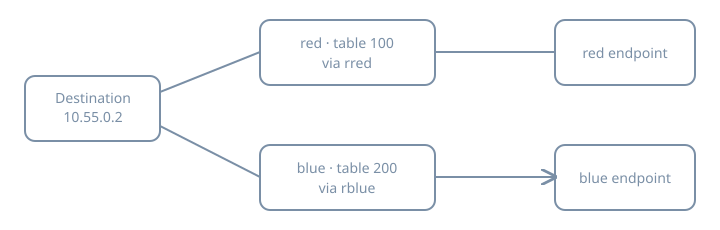

# Linux VRFs: Overlapping Addresses and Lookup Fallback

Two routing domains can use the same addresses but reach different endpoints. A missing VRF route, however, can fall through to a later Linux policy rule and select the main table. This lab demonstrates both facts and a terminal unreachable default. It complements the multi-NOS [VRF-lite lab](26-vrf-lite.qmd) with an executable Linux example.

{fig-alt="The same destination is resolved through red table 100 or blue table 200 to different interfaces and endpoints."}

## Topology and prerequisites

The router namespace contains VRF `red` (table 100) and `blue` (table 200). Interfaces rred and rblue each have `10.55.0.1/24`; each connects to a separate host namespace using `10.55.0.2/24`. Both hosts run a UDP server on port 9999, returning their domain name. The addresses intentionally overlap in isolated domains; they must not be bridged together.

You need Linux with VRF, veth, network/user namespaces, Bash, `ip`, `nsenter`, `unshare`, and Python 3. Run only as `unshare -rn bash vrf-lab.sh`, never on the host network. Some kernels or environments do not support VRF creation or the needed permissions. This exercise uses `SO_BINDTODEVICE` in Python rather than `ip vrf exec`, avoiding that helper's separate cgroup/BPF prerequisites. It was executed with iproute2 7.3.0; output and interface details vary.

## Run the test

Save the following as `vrf-lab.sh` and run `unshare -rn bash vrf-lab.sh`. Background processes keep the two host namespaces and UDP servers alive. The trap stops them on normal exit or error; `SIGKILL` bypasses cleanup, so stop remaining lab children after abnormal termination.

```bash
set -eu
unshare -n sleep 60 & redhost=$!
unshare -n sleep 60 & bluehost=$!
trap 'kill "$redhost" "$bluehost" 2>/dev/null || true; wait "$redhost" "$bluehost" 2>/dev/null || true' EXIT
sleep 0.2
ip link set lo up
ip link add red type vrf table 100
ip link add blue type vrf table 200
ip link set red up
ip link set blue up
ip link add rred type veth peer name hred
ip link add rblue type veth peer name hblue
ip link set hred netns "$redhost"
ip link set hblue netns "$bluehost"
ip link set rred master red
ip link set rblue master blue
ip addr add 10.55.0.1/24 dev rred
ip addr add 10.55.0.1/24 dev rblue
ip link set rred up
ip link set rblue up
nsenter -t "$redhost" -n ip link set lo up
nsenter -t "$redhost" -n ip addr add 10.55.0.2/24 dev hred
nsenter -t "$redhost" -n ip link set hred up
nsenter -t "$bluehost" -n ip link set lo up
nsenter -t "$bluehost" -n ip addr add 10.55.0.2/24 dev hblue
nsenter -t "$bluehost" -n ip link set hblue up
ip route get vrf red 10.55.0.2
ip route get vrf blue 10.55.0.2
nsenter -t "$redhost" -n python3 -u - <<'SERVER' &
import socket
s = socket.socket(socket.AF_INET, socket.SOCK_DGRAM)
s.bind(('10.55.0.2', 9999)); s.settimeout(10)
d, p = s.recvfrom(100); s.sendto(b'red', p)
SERVER
sr=$!
nsenter -t "$bluehost" -n python3 -u - <<'SERVER' &
import socket
s = socket.socket(socket.AF_INET, socket.SOCK_DGRAM)
s.bind(('10.55.0.2', 9999)); s.settimeout(10)
for _ in range(2):
    d, p = s.recvfrom(100); s.sendto(b'blue', p)
SERVER
sb=$!
trap 'kill "$sr" "$sb" "$redhost" "$bluehost" 2>/dev/null || true; wait "$sr" "$sb" "$redhost" "$bluehost" 2>/dev/null || true' EXIT
sleep 0.2
python3 - <<'CLIENT'
import socket
for vrf in ('red', 'blue'):
    s = socket.socket(socket.AF_INET, socket.SOCK_DGRAM)
    s.setsockopt(socket.SOL_SOCKET, socket.SO_BINDTODEVICE, vrf.encode()+b'\0')
    s.settimeout(3)
    s.sendto(b'query', ('10.55.0.2', 9999))
    value = s.recv(100).decode()
    print(vrf, 'received', value)
    assert value == vrf
    s.close()
CLIENT
ip link set rred down
if ip route get vrf red 10.55.0.2; then echo 'Unexpected red route' >&2; exit 1; fi
ip link add name leak0 type dummy
ip link set leak0 up
ip route add default dev leak0
ip route get vrf red 10.55.0.2
ip route add table 100 unreachable default metric 4278198272
if ip route get vrf red 10.55.0.2; then echo 'Unexpected fallback' >&2; exit 1; fi
ip route del default dev leak0
python3 - <<'CLIENT'
import socket
s = socket.socket(socket.AF_INET, socket.SOCK_DGRAM)
s.setsockopt(socket.SOL_SOCKET, socket.SO_BINDTODEVICE, b'blue\0')
s.settimeout(3)
s.sendto(b'query', ('10.55.0.2', 9999))
value = s.recv(100).decode()
print('blue after red link down:', value)
assert value == 'blue'
CLIENT
ip link set rred up
ip route get vrf red 10.55.0.2
wait "$sr" "$sb"
```

The two route lookups select rred/table 100 and rblue/table 200 for the same destination. The UDP client binds its socket to each VRF device; it receives `red` and `blue` respectively. This proves which test server responded, not that all applications or every traffic class are isolated.

After rred is brought down, the first red lookup fails because there is no usable route in this isolated setup. The script then creates a **dummy** default route in `main`: a red lookup falls through the l3mdev rule and selects `leak0`. This is evidence of route selection, not evidence that the dummy device delivered traffic. Adding `unreachable default` to table 100 makes the next red lookup fail instead of continuing to main. The high metric follows the Linux VRF documentation's example and permits more-specific routes and suitable lower-metric defaults to take precedence; dynamic-routing daemons may interpret that metric differently. The blue server continues to answer while the red link is down, then the red connected route returns when rred comes up.

## Understand the boundary

A VRF associates interfaces and a routing table, and the Linux l3mdev policy rule selects the relevant table. Policy rules are evaluated by priority: a higher-priority rule can direct traffic elsewhere, and a table lookup with no route can continue to later rules. A terminal `unreachable` route stops this particular fallback; it is not a substitute for auditing other policy rules, socket bindings, route leaks, firewall policy or management access. Check `ip rule show` and all relevant tables on the target system.

A process must select the intended VRF for its sockets. Here `SO_BINDTODEVICE` does that explicitly. `ip vrf exec` can be useful on supported systems but has cgroup/BPF requirements. Services bound in the default VRF and Linux's `*_l3mdev_accept` settings can change which sockets accept traffic; inspect the configuration instead of assuming a VRF is a complete security boundary. Capture on real ingress/egress interfaces where needed: forwarded packets are not necessarily visible on the VRF device itself.

## Extend

1. Inspect `ip rule show`, `ip route show table 100`, `ip route show table 200` and `ip route show table main` at each stage in a disposable copy. Identify the rule that permits fallback.
2. Remove the unreachable default, repeat the main-table fallback, then restore it. Explain why an installed unreachable default is different from an absent route.
3. Use a longer-running pair of servers to repeat the red traffic test after restoring rred; this script verifies the red **route** after restoration but has already stopped the red server.
4. Design an intentional route leak with a non-overlapping test prefix and both forward and return paths. Define source validation and policy first; the same destination prefix in both VRFs is ambiguous without the lookup context.

**References:** [Linux VRF documentation](https://docs.kernel.org/networking/vrf.html), [ip-vrf(8)](https://man7.org/linux/man-pages/man8/ip-vrf.8.html), and [Policy Routing and VRF](../04-ip-routing-services/07-vrf-and-policy-routing.qmd).
