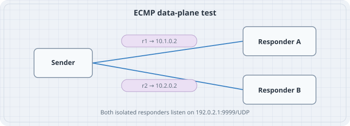

# ECMP: Observe Real Flows and Remove a Path

Equal-cost multipath (ECMP) can distribute different flows across next hops. It does not normally combine two links into twice the bandwidth for a single flow, nor does a route listing prove that data arrived. This lab sends UDP to two isolated responders behind distinct next hops, then explicitly removes one path and tests new flows. It complements the [Linux ECMP lookup and resilient groups chapter](../04-ip-routing-services/08-linux-ecmp-nexthop-groups.qmd).

{fig-alt="A sender has two next hops to separate responders with the same destination address; the responders return distinct labels."}

## Topology and prerequisites

The sending namespace has r1 `10.1.0.1/30` and r2 `10.2.0.1/30`. Each link leads to a separate host namespace: A uses `10.1.0.2/30`, B uses `10.2.0.2/30`. Both hosts deliberately have `192.0.2.1/32` on loopback and listen on UDP 9999, but reply with distinct labels `A` or `B`. This models two equivalent destinations for an experiment; it is not a routing-protocol advertisement or a complete anycast design. Each host has a return route via its own link.

You need Linux with IPv4 multipath routing, Bash, Python 3, `ip`, `sysctl`, `unshare`, `nsenter`, veth support and permission to create user/network namespaces. Run only using `unshare -rn bash ecmp-lab.sh`; the routes, sysctl and interfaces are isolated from the host. Some systems restrict namespace operations or lack multipath support. Tested on Linux with iproute2 7.3.0. The trap stops the host and server processes on normal exit or error; `SIGKILL` bypasses cleanup, so stop remaining lab children after abnormal termination.

## Build and observe

Save as `ecmp-lab.sh` and run `unshare -rn bash ecmp-lab.sh`:

```bash
set -eu
unshare -n sleep 60 & ha=$!
unshare -n sleep 60 & hb=$!
trap 'kill "$ha" "$hb" 2>/dev/null || true; wait "$ha" "$hb" 2>/dev/null || true' EXIT
sleep 0.2
ip link set lo up
ip link add r1 type veth peer name h1
ip link add r2 type veth peer name h2
ip link set h1 netns "$ha"
ip link set h2 netns "$hb"
ip addr add 10.1.0.1/30 dev r1
ip addr add 10.2.0.1/30 dev r2
ip link set r1 up
ip link set r2 up
nsenter -t "$ha" -n ip link set lo up
nsenter -t "$ha" -n ip addr add 192.0.2.1/32 dev lo
nsenter -t "$ha" -n ip addr add 10.1.0.2/30 dev h1
nsenter -t "$ha" -n ip link set h1 up
nsenter -t "$ha" -n ip route add default via 10.1.0.1
nsenter -t "$hb" -n ip link set lo up
nsenter -t "$hb" -n ip addr add 192.0.2.1/32 dev lo
nsenter -t "$hb" -n ip addr add 10.2.0.2/30 dev h2
nsenter -t "$hb" -n ip link set h2 up
nsenter -t "$hb" -n ip route add default via 10.2.0.1
sysctl -qw net.ipv4.fib_multipath_hash_policy=1
ip route add 192.0.2.1/32 nexthop via 10.1.0.2 dev r1 weight 1 nexthop via 10.2.0.2 dev r2 weight 1
nsenter -t "$ha" -n python3 -u -c 'import socket;s=socket.socket(socket.AF_INET,socket.SOCK_DGRAM);s.bind(("192.0.2.1",9999));exec("while True:\n d,p=s.recvfrom(100)\n s.sendto(b\"A\",p)")' & sa=$!
nsenter -t "$hb" -n python3 -u -c 'import socket;s=socket.socket(socket.AF_INET,socket.SOCK_DGRAM);s.bind(("192.0.2.1",9999));exec("while True:\n d,p=s.recvfrom(100)\n s.sendto(b\"B\",p)")' & sb=$!
trap 'kill "$sa" "$sb" "$ha" "$hb" 2>/dev/null || true; wait "$sa" "$sb" "$ha" "$hb" 2>/dev/null || true' EXIT
sleep 0.2
python3 - <<'PY'
import socket,collections
counts=collections.Counter()
for i in range(40):
 s=socket.socket(socket.AF_INET,socket.SOCK_DGRAM);s.settimeout(1);s.sendto(b'q',('192.0.2.1',9999));counts[s.recv(10).decode()]+=1;s.close()
print('ECMP responses:',dict(counts))
assert set(counts)=={'A','B'}
PY
ip route replace 192.0.2.1/32 via 10.2.0.2 dev r2
python3 - <<'PY'
import socket
for i in range(5):
 s=socket.socket(socket.AF_INET,socket.SOCK_DGRAM);s.settimeout(1);s.sendto(b'q',('192.0.2.1',9999));value=s.recv(10).decode();s.close();assert value=='B'
print('After removing path A: all responses B')
PY
```

The script sets the Linux IPv4 multipath hash policy to include transport fields in the isolated sender namespace. Each new UDP socket normally receives a different ephemeral source port, yielding multiple flow keys. On the test host, 40 requests produced 21 A responses and 19 B responses; the exact split is not guaranteed. The assertion checks that this sample reached both paths, not a particular ratio. Hash seeds, kernel versions, socket port selection and sample size can change the distribution; if only one path appears, inspect route and policy state and repeat with more distinct flows before diagnosing an error.

After `ip route replace`, only the B next hop remains and five new requests return B. This is an **explicit routing change**, not automatic link failure detection or dynamic routing convergence. The servers run until the trap stops them. The client creates a new socket per request; it does not measure a long-lived session or packet reordering.

## Analyze the result

For each request, the sender selects a next hop from the ECMP route, sends a frame to that next hop, and receives the selected server's label. The reply follows the server's return route. Different five-tuples can hash differently, but a fixed flow key normally stays on one path while the topology and hash inputs remain unchanged. Implementations may rehash on topology changes or other events; they need not provide the same hash or exact distribution. A sampled route lookup and a successful response are different evidence: here the response confirms the application reached one of the test endpoints.

A physical link can stay up while a downstream service fails. A static ECMP route does not automatically prove a next hop is healthy; detection and route withdrawal depend on the implementation and configured routing or tracking mechanisms. A single successful probe can exercise only one selected path. Test multiple independent flows, both directions, and failure scenarios; account for asymmetric paths and stateful devices.

## Extend

1. Keep a UDP socket open and send several packets with the same tuple. Record the response labels, then change the route and observe whether the flow is remapped. Do not assume an existing stateful session survives a path change.
2. Use `ip route get` with the relevant source, protocol and port fields to compare predicted next hops with actual packets. Confirm tool and kernel support; `route get` is a lookup, not a packet transmission.
3. Test a silent failure by stopping one responder while retaining both next hops. Some flows can time out even though the route still lists both. Restore the server, then remove the route as the script does. The exercise needs a server that remains active for the extra requests; adjust the disposable script and cleanup accordingly.
4. Read the [resilient groups chapter](../04-ip-routing-services/08-linux-ecmp-nexthop-groups.qmd) before comparing flow remapping. Bucket assignment, weights, timers and offload behavior differ from this simple multipath route.

**References:** [Linux IP sysctls](https://docs.kernel.org/networking/ip-sysctl.html), [Linux resilient next-hop groups](https://docs.kernel.org/networking/nexthop-group-resilient.html), and [IPv4 ECMP analysis, RFC 2992](https://www.rfc-editor.org/rfc/rfc2992.html).
