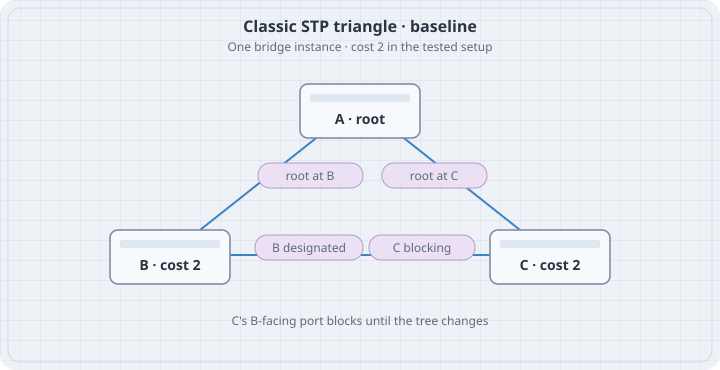

# Classic STP: Observe a Triangle Reconfigure

Three bridges in a triangle have a Layer 2 loop unless a control mechanism prevents it. This isolated lab uses Linux **kernel classic STP**, not RSTP or MSTP, to observe a blocked port, a link failure and recovery. It complements the [spanning-tree election walkthrough](../03-layer-2/03b-spanning-tree-election.qmd), whose RSTP example uses different costs and roles.

{fig-alt="Bridge A is root, and the port on bridge C toward B blocks in the baseline triangle."}

## Topology and prerequisites

Bridges `bra`, `brb` and `brc` form a triangle. Ports `ab`/`ba`, `ac`/`ca` and `bc`/`cb` are veth pairs; the first letter denotes the local bridge. H1 `10.66.0.1/24` attaches to brb through `bp`; H2 `10.66.0.2/24` attaches to brc through `cp`. Bridge priorities 4096, 8192 and 12288 make bra the intended root. Veth port costs on the test host were 2; check actual values rather than assuming the arithmetic in the RSTP chapter applies here.

You need Linux with bridge STP and veth support, Bash, `ip`, `bridge`, `unshare`, `nsenter`, `ping`, and permission to create user and network namespaces. This script requires an iproute2/kernel combination supporting `stp_mode kernel`. Run only with `unshare -rn bash stp-lab.sh`: it creates an intentionally redundant Layer 2 topology inside a disposable namespace. Never attach it to a real network. The test host used iproute2 7.3.0. Timer values in this example use the Linux bridge netlink clock-tick units used by that system (`USER_HZ` 100): 400, 100 and 600 correspond to 4, 1 and 6 seconds. Confirm supported syntax and units for your version; these shortened lab timers are not production recommendations.

## Run and inspect

Save as `stp-lab.sh`, then run `unshare -rn bash stp-lab.sh`. It waits at least 12 seconds at each of three stages and takes over 40 seconds including probes. Two background processes hold the host namespaces; the trap stops them on normal exit or error. `SIGKILL` bypasses cleanup, so stop remaining lab `sleep 90` children after abnormal termination.

```bash
set -eu
unshare -n sleep 90 & h1=$!
unshare -n sleep 90 & h2=$!
trap 'kill "$h1" "$h2" 2>/dev/null || true; wait "$h1" "$h2" 2>/dev/null || true' EXIT
sleep 0.2
for b in a b c; do
  ip link add name "br$b" type bridge stp_mode kernel stp_state 1 forward_delay 400 hello_time 100 max_age 600
  ip link set "br$b" up
done
ip link set bra type bridge priority 4096
ip link set brb type bridge priority 8192
ip link set brc type bridge priority 12288
ip link add ab type veth peer name ba
ip link add ac type veth peer name ca
ip link add bc type veth peer name cb
ip link set ab master bra
ip link set ac master bra
ip link set ba master brb
ip link set bc master brb
ip link set ca master brc
ip link set cb master brc
for p in ab ba ac ca bc cb; do ip link set "$p" up; done
ip link add bp type veth peer name h1e
ip link add cp type veth peer name h2e
ip link set h1e netns "$h1"
ip link set h2e netns "$h2"
ip link set bp master brb
ip link set cp master brc
ip link set bp up
ip link set cp up
nsenter -t "$h1" -n ip link set lo up
nsenter -t "$h1" -n ip addr add 10.66.0.1/24 dev h1e
nsenter -t "$h1" -n ip link set h1e up
nsenter -t "$h2" -n ip link set lo up
nsenter -t "$h2" -n ip addr add 10.66.0.2/24 dev h2e
nsenter -t "$h2" -n ip link set h2e up
sleep 12
printf 'Baseline port states:\n'
bridge link show
nsenter -t "$h1" -n ping -c 1 -W 2 10.66.0.2
ip link set ac down
sleep 12
printf 'After A-C failure:\n'
bridge link show
bridge fdb show br brb
bridge fdb show br brc
nsenter -t "$h1" -n ip neigh flush dev h1e
nsenter -t "$h2" -n ip neigh flush dev h2e
nsenter -t "$h1" -n ping -c 3 -W 2 10.66.0.2
ip link set ac up
sleep 12
printf 'After restoring A-C:\n'
bridge link show
nsenter -t "$h1" -n ip neigh flush dev h1e
nsenter -t "$h2" -n ip neigh flush dev h2e
nsenter -t "$h1" -n ping -c 3 -W 2 10.66.0.2
```

On the test host, before the failure `cb` on brc was **blocking**, while `bc` on brb and the A-facing ports were forwarding; the hosts communicated through brb–bra–brc. After `ac` was disabled, `ca` became disabled and `cb` transitioned to forwarding, providing a brb–brc path. After `ac` returned and the tree settled, `cb` blocked again. The three host probes after each change succeeded in the checked run. MAC addresses, costs, timing and output vary with implementation.

The script shows FDB entries and flushes each host's neighbor cache before post-change probes so ARP is exercised again. A flush changes the experiment: this is a connectivity and state check, not a measurement of uninterrupted production convergence. In a preliminary run, a single ping failed after the port showed forwarding; multiple factors, including cached forwarding and neighbor state, can affect that observation. Record MAC tables and capture packets before attributing a specific cause. The 12-second waits are lab allowances rather than guaranteed convergence limits; on a slow system inspect the states and repeat after the tree stabilizes.

## Practice

1. Before running, calculate the expected root and blocked side from bridge IDs and actual equal port costs. Compare `bridge link show` with `ip -d link show bra`, `brb`, and `brc` while the lab is running. The `root_port` field is a bridge port number, not necessarily the interface's Linux ifindex.
2. Run a timestamped continuous probe during failure and restoration, without manually flushing neighbor state. Record the last successful, failed and recovered probes, FDB changes and port transitions. Probe interval bounds measurement precision.
3. Change the priority of brb in a disposable copy and predict the resulting root before observing it. Different root or port costs can change which side blocks.
4. Compare with [RSTP elections](../03-layer-2/03b-spanning-tree-election.qmd). Classic STP's timer-based transitions do not demonstrate RSTP proposal/agreement, edge behavior, MST instances or vendor guard features.

**References:** [Linux bridge documentation](https://docs.kernel.org/networking/bridge.html) and [ip-link bridge options](https://man7.org/linux/man-pages/man8/ip-link.8.html).
