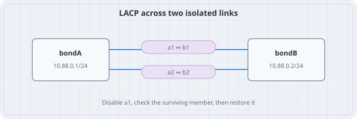

# LACP Bond: Member Failure and Recovery

Link Aggregation Control Protocol (LACP) lets two systems negotiate a group of links as one logical connection. A configured member is not necessarily selected and forwarding: inspect partner and aggregator state as well as traffic. In this isolated Linux exercise, two bonds negotiate across two veth pairs, then one member is taken down and restored.

{fig-alt="bondA and bondB are connected by two links, a1 to b1 and a2 to b2."}

## Topology and prerequisites

The first namespace has `bondA` with members `a1` and `a2`; the second has `bondB` with members `b1` and `b2`. The links are `a1`–`b1` and `a2`–`b2`. The logical interfaces use `10.88.0.1/24` and `10.88.0.2/24`. There is no physical switch, STP domain or multi-chassis system in this test. Veth-reported speed and observed latency are not physical-link performance measurements.

You need Linux with bonding and veth support, Bash, `ip`, `unshare`, `nsenter`, `ping`, access to `/proc/net/bonding` and permission to create user/network namespaces. Some systems prohibit these operations or cannot load the bonding module. Run only as `unshare -rn bash lacp-lab.sh`: never enslave or reconfigure host interfaces for this exercise. Tested on Linux with iproute2 7.3.0; field availability, timing and negotiation behavior vary.

## Build and test

Save as `lacp-lab.sh` and run `unshare -rn bash lacp-lab.sh`. It enables LACP on both ends, waits for negotiation, records state, takes `a1` down, tests the remaining path and brings `a1` back. It takes roughly half a minute. The trap stops the namespace holder on normal exit or error; `SIGKILL` bypasses cleanup, so stop any remaining lab `sleep 90` child after abnormal termination.

```bash
set -eu
unshare -n sleep 90 & peer=$!
trap 'kill "$peer" 2>/dev/null || true; wait "$peer" 2>/dev/null || true' EXIT
sleep 0.2
ip link set lo up
ip link add name bondA type bond mode 802.3ad miimon 100 lacp_rate fast
ip link add name a1 type veth peer name b1
ip link add name a2 type veth peer name b2
ip link set b1 netns "$peer"
ip link set b2 netns "$peer"
nsenter -t "$peer" -n ip link set lo up
nsenter -t "$peer" -n ip link add name bondB type bond mode 802.3ad miimon 100 lacp_rate fast
ip link set a1 master bondA
ip link set a2 master bondA
nsenter -t "$peer" -n ip link set b1 master bondB
nsenter -t "$peer" -n ip link set b2 master bondB
ip link set a1 up
ip link set a2 up
nsenter -t "$peer" -n ip link set b1 up
nsenter -t "$peer" -n ip link set b2 up
ip addr add 10.88.0.1/24 dev bondA
nsenter -t "$peer" -n ip addr add 10.88.0.2/24 dev bondB
ip link set bondA up
nsenter -t "$peer" -n ip link set bondB up
sleep 12
printf '\nBond state (baseline or restored):\n'
ip -d link show bondA
cat /proc/net/bonding/bondA
nsenter -t "$peer" -n cat /proc/net/bonding/bondB
ping -c 2 -W 1 10.88.0.2
ip link set a1 down
sleep 3
printf '\nBond state with a1 down:\n'
ip -d link show bondA
cat /proc/net/bonding/bondA
ping -c 2 -W 1 10.88.0.2
ip link set a1 up
sleep 12
printf '\nBond state (baseline or restored):\n'
ip -d link show bondA
cat /proc/net/bonding/bondA
ping -c 2 -W 1 10.88.0.2
```

On the test host, `ip -d link show bondA` reported `ad_num_ports 2` after baseline negotiation, `1` after a1 was disabled and `2` after restoration. The partner key and MAC were present, both member statuses were initially up, a1 became down during the fault, and pings succeeded at each recorded stage. The exact state fields and convergence time vary; inspect both ends and wait for negotiation rather than relying only on these fixed sleeps. A ping after a wait does not measure packet loss during the transition or prove both links carry data.

The setting `lacp_rate fast` requests a fast LACPDU rate from the partner; it is not an end-to-end failure detector. `miimon 100` polls link carrier approximately every 100 ms. Carrier detection, LACP negotiation, the selected aggregator, neighbor updates and application retries can all influence actual recovery. If a member remains electrically up while a downstream path fails, carrier monitoring alone may not detect the fault.

## Investigate

1. Compare actor and partner information, aggregator ID, member link states, selected port count and logical interface state on **both** ends. An up bond alone does not prove two members are synchronized and usable.
2. Run a timestamped continuous probe while changing a1, and record loss and recovery separately from the fixed-wait test. The probe interval bounds measurement precision; a successful final ping is not proof of zero interruption.
3. Inspect member TX/RX counters before and after traffic. With the default Layer 2 hash, one peer's traffic can remain on one member. Different flows and hash policies may use links differently; two members do not guarantee one flow receives twice the bandwidth or that traffic splits evenly.
4. In an isolated copy change one side's mode or disconnect one link and observe the partner state and data behavior. Some implementations allow a temporary fallback when no partner is established; verify the actual platform's configuration instead of assuming a mismatch must immediately drop everything.
5. Consider a minimum-links policy and the capacity needed after a failure. Test actual platform behavior before using it to trigger routing failover. Restore the baseline and verify the member and application states.

**References:** [Linux bonding driver documentation](https://docs.kernel.org/networking/bonding.html), [IEEE 802.1AX link aggregation](https://1.ieee802.org/tsn/802-1ax-rev/), and [Link Aggregation](../03-layer-2/04-link-aggregation.qmd).
