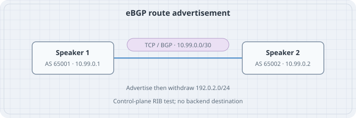

# eBGP Without Containers: Advertise and Withdraw a Route

Two BGP speakers can exchange a prefix while the underlying data plane remains a separate concern. This lab runs the open-source GoBGP daemon in isolated Linux network namespaces, establishes eBGP, advertises a documentation prefix and withdraws it. It needs no container runtime or vendor image. It tests the **BGP control plane** only; a route in GoBGP's RIB is not proof of kernel installation or packet forwarding.

{fig-alt="Two BGP speakers in AS 65001 and AS 65002 exchange a test prefix across an isolated link."}

## Requirements and topology

The first speaker is AS 65001, router ID `10.0.0.1`, interface `10.99.0.1/30`. The second is AS 65002, router ID `10.0.0.2`, interface `10.99.0.2/30`. A veth pair connects the two network namespaces. The advertised prefix is `192.0.2.0/24`, used only as documentation data inside the isolated lab.

You need Linux, Bash, `ip`, `unshare`, `nsenter`, `grep`, `seq`, standard core utilities, namespace permission and the `gobgp` and `gobgpd` executables. The lab was tested with upstream GoBGP **v4.11.0**, Linux and iproute2 7.3.0. Binaries and command behavior can differ by release and architecture. Keep the BGP and gRPC API listeners in the isolated namespaces: the example's API is unauthenticated and is bound to namespace loopback. Do not attach this lab to a shared or production network.

For Linux x86-64, obtain the [v4.11.0 release](https://github.com/osrg/gobgp/releases/tag/v4.11.0) and verify its published checksums before extracting the two executables. The following digest identifies the Linux AMD64 archive observed for this release; verify it against the publisher's release metadata and checksum file as well:

```text
b45eefb6f8cb662740efa99631f14bac23c9ea8cca158843293a3ecb5cbc72b6  gobgp_4.11.0_linux_amd64.tar.gz
```

Set `GOBGP_DIR` to the **absolute path** of the directory containing the verified executables and export it. Check both versions and executable permissions. Other architectures need their own matching upstream asset and checksum. Avoid installing unverified binaries or exposing the API outside the lab.

## Build, advertise, withdraw

Save as `bgp-lab.sh`; with `GOBGP_DIR` exported, run `unshare -rn bash bgp-lab.sh`. The second namespace is held by a background process. The trap stops both daemons and the namespace holder, removes the temporary configuration files and removes their directory on normal exit or error. `SIGKILL` bypasses cleanup; after abnormal termination stop remaining lab children and remove the specific temporary directory. Daemon logs are suppressed to keep the example readable; for diagnosis in a disposable copy, capture each daemon's logs in its own temporary file and protect them as operational data.

```bash
set -eu
: "${GOBGP_DIR:?Set GOBGP_DIR to the directory containing gobgp and gobgpd}"
work=$(mktemp -d)
unshare -n sleep 90 & peer=$!
trap 'kill "$peer" 2>/dev/null || true; wait "$peer" 2>/dev/null || true; unlink "$work/r1.toml" 2>/dev/null || true; unlink "$work/r2.toml" 2>/dev/null || true; rmdir "$work" 2>/dev/null || true' EXIT
sleep 0.2
ip link set lo up
ip link add r1 type veth peer name r2
ip link set r2 netns "$peer"
ip addr add 10.99.0.1/30 dev r1
ip link set r1 up
nsenter -t "$peer" -n ip link set lo up
nsenter -t "$peer" -n ip addr add 10.99.0.2/30 dev r2
nsenter -t "$peer" -n ip link set r2 up
cat > "$work/r1.toml" <<'CONFIG'
[global.config]
  as = 65001
  router-id = "10.0.0.1"
[[neighbors]]
  [neighbors.config]
    neighbor-address = "10.99.0.2"
    peer-as = 65002
CONFIG
cat > "$work/r2.toml" <<'CONFIG'
[global.config]
  as = 65002
  router-id = "10.0.0.2"
[[neighbors]]
  [neighbors.config]
    neighbor-address = "10.99.0.1"
    peer-as = 65001
CONFIG
"$GOBGP_DIR/gobgpd" -f "$work/r1.toml" --api-hosts 127.0.0.1:50051 --pprof-disable > /dev/null 2>&1 & d1=$!
nsenter -t "$peer" -n "$GOBGP_DIR/gobgpd" -f "$work/r2.toml" --api-hosts 127.0.0.1:50051 --pprof-disable > /dev/null 2>&1 & d2=$!
trap 'kill "$d1" "$d2" "$peer" 2>/dev/null || true; wait "$d1" "$d2" "$peer" 2>/dev/null || true; unlink "$work/r1.toml" 2>/dev/null || true; unlink "$work/r2.toml" 2>/dev/null || true; rmdir "$work" 2>/dev/null || true' EXIT
ready=0
for _ in $(seq 1 30); do
  if "$GOBGP_DIR/gobgp" neighbor 2>/dev/null | grep -q Establ; then ready=1; break; fi
  sleep 1
done
[ "$ready" -eq 1 ] || { echo 'BGP session did not establish' >&2; exit 1; }
"$GOBGP_DIR/gobgp" neighbor
nsenter -t "$peer" -n "$GOBGP_DIR/gobgp" neighbor
"$GOBGP_DIR/gobgp" global rib add 192.0.2.0/24 nexthop 10.99.0.1
seen=0
for _ in $(seq 1 20); do
  if nsenter -t "$peer" -n "$GOBGP_DIR/gobgp" global rib 2>/dev/null | grep -q '192.0.2.0/24'; then seen=1; break; fi
  sleep 1
done
[ "$seen" -eq 1 ] || { echo 'Route was not received' >&2; exit 1; }
nsenter -t "$peer" -n "$GOBGP_DIR/gobgp" global rib
"$GOBGP_DIR/gobgp" global rib del 192.0.2.0/24 nexthop 10.99.0.1
gone=0
for _ in $(seq 1 20); do
  view=$(nsenter -t "$peer" -n "$GOBGP_DIR/gobgp" global rib) || { echo 'Cannot query peer RIB' >&2; exit 1; }
  if ! printf '%s\n' "$view" | grep -q '192.0.2.0/24'; then gone=1; break; fi
  sleep 1
done
[ "$gone" -eq 1 ] || { echo 'Route was not withdrawn' >&2; exit 1; }
nsenter -t "$peer" -n "$GOBGP_DIR/gobgp" global rib
```

The script polls for `Establ` rather than assuming a fixed establishment time, then prints each neighbor table. It injects `192.0.2.0/24` with next hop `10.99.0.1`, waits for the second speaker's RIB to show it, and withdraws it. On the test host the remote RIB showed the prefix, next hop and AS path `65001`, then `Network not in table`. The withdrawal check requires the RIB query itself to succeed; a failed API query is not treated as proof of withdrawal. Timings and text formatting can vary across versions.

## Understand what was proved

The two processes exchanged a BGP advertisement and withdrawal over a TCP session. The injected prefix is a control-plane test object; there is no destination host behind it in this topology. GoBGP's displayed best path is not equivalent to an operating-system FIB entry or an end-to-end data-plane test. Next-hop resolution and BGP-to-kernel integration depend on the routing stack and configuration. For a forwarding lab, create an actual destination, explicitly configure the routing installation mechanism and return path, and verify packets at both ends.

AS 65001 appears in the eBGP advertisement's AS path; the prefix and AS numbers are examples, not public announcements. The lab uses a simple permissive policy suitable only for isolated testing. Real external peering requires explicit import/export policy, route-origin and prefix controls, session protection, monitoring and agreement with the peer.

## Failure drills

1. In a disposable copy, configure the wrong peer AS on one side. Record the session state and daemon logs; fix the AS and wait for Established. Do not interpret a TCP connection alone as a working BGP session.
2. Withdraw the prefix while keeping the session up, as the script does. Explain why session state and route presence must be checked separately.
3. Add a second documentation prefix and withdraw only one. Verify the other stays in the remote RIB. Record the exact commands and the selected address family.
4. Continue with [eBGP Import Policy](55-ebgp-import-policy.qmd) to compare incoming paths with the selected RIB and change the permitted prefix length.

**References:** [GoBGP getting started](https://github.com/osrg/gobgp/blob/master/docs/sources/getting-started.md), [GoBGP v4.11.0 release](https://github.com/osrg/gobgp/releases/tag/v4.11.0), and [BGP-4, RFC 4271](https://www.rfc-editor.org/rfc/rfc4271.html).
