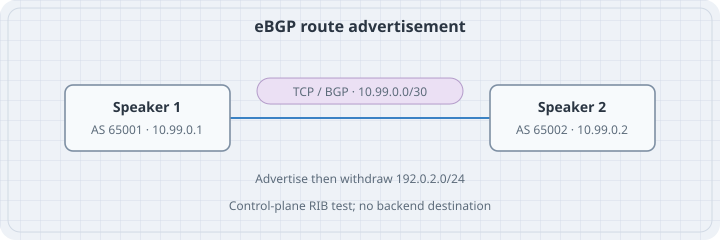

# eBGP Import Policy: Exact Prefixes and More-Specifics

An Established BGP session can carry routes that the receiver deliberately refuses to select. This lab uses two isolated GoBGP speakers to distinguish a neighbor's incoming advertisements from the receiver's selected RIB, then changes an allowlist to admit a more-specific prefix. It builds directly on [eBGP Without Containers](54-ebgp-gobgp-namespaces.qmd).

{fig-alt="Two speakers in AS 65001 and AS 65002 exchange routes across an isolated eBGP session."}

## Prerequisites and policy

Use the verified **GoBGP v4.11.0** executables and Linux namespace prerequisites from the preceding lab. Export `GOBGP_DIR` as their absolute directory. The script creates AS 65001 at `10.99.0.1/30` and AS 65002 at `10.99.0.2/30`; both API listeners are unauthenticated and bound to the loopback interface of their isolated namespaces. Run only as `unshare -rn bash bgp-policy-lab.sh` and do not connect this test to a shared or production network. It was executed with GoBGP v4.11.0 and iproute2 7.3.0; configuration semantics, output and capabilities can differ by version.

The receiver's **global import policy** permits exactly `192.0.2.0/24` and rejects unmatched routes. The sender announces that prefix, its more-specific `192.0.2.128/25`, and unrelated `198.51.100.0/24`. These documentation prefixes are control-plane examples only. Before running, predict which appear in the receiver's Adj-RIB-In and selected RIB. A policy scoped globally can affect more than one peer: this lab has only one, and it is not a production policy template.

## Run the experiment

Save as `bgp-policy-lab.sh` and run `unshare -rn bash bgp-policy-lab.sh`. The script creates temporary configuration files, two daemons and a namespace holder. Its trap terminates the processes and removes those temporary files on normal exit or error; `SIGKILL` bypasses cleanup. Daemon logs are suppressed; in a disposable debugging copy capture and protect separate logs. Polling loops have bounded waits and treat a failed RIB query as an error, not as evidence of absence.

```bash
set -eu
: "${GOBGP_DIR:?Set GOBGP_DIR to the directory containing gobgp and gobgpd}"
work=$(mktemp -d)
unshare -n sleep 90 & peer=$!
trap 'kill "$peer" 2>/dev/null || true; wait "$peer" 2>/dev/null || true; unlink "$work/r1.toml" 2>/dev/null || true; unlink "$work/r2.toml" 2>/dev/null || true; rmdir "$work" 2>/dev/null || true' EXIT
sleep 0.2
ip link set lo up
ip link add r1 type veth peer name r2
ip link set r2 netns "$peer"
ip addr add 10.99.0.1/30 dev r1
ip link set r1 up
nsenter -t "$peer" -n ip link set lo up
nsenter -t "$peer" -n ip addr add 10.99.0.2/30 dev r2
nsenter -t "$peer" -n ip link set r2 up
cat > "$work/r1.toml" <<'CONFIG'
[global.config]
  as = 65001
  router-id = "10.0.0.1"
[[neighbors]]
  [neighbors.config]
    neighbor-address = "10.99.0.2"
    peer-as = 65002
CONFIG
cat > "$work/r2.toml" <<'CONFIG'
[global.config]
  as = 65002
  router-id = "10.0.0.2"
[global.apply-policy.config]
  import-policy-list = ["allow-exact"]
  default-import-policy = "reject-route"
[[defined-sets.prefix-sets]]
  prefix-set-name = "approved"
  [[defined-sets.prefix-sets.prefix-list]]
    ip-prefix = "192.0.2.0/24"
    masklength-range = "24..24"
[[policy-definitions]]
  name = "allow-exact"
  [[policy-definitions.statements]]
    name = "permit-approved"
    [policy-definitions.statements.conditions.match-prefix-set]
      prefix-set = "approved"
    [policy-definitions.statements.actions]
      route-disposition = "accept-route"
[[neighbors]]
  [neighbors.config]
    neighbor-address = "10.99.0.1"
    peer-as = 65001
CONFIG
"$GOBGP_DIR/gobgpd" -f "$work/r1.toml" --api-hosts 127.0.0.1:50051 --pprof-disable > /dev/null 2>&1 & d1=$!
nsenter -t "$peer" -n "$GOBGP_DIR/gobgpd" -f "$work/r2.toml" --api-hosts 127.0.0.1:50051 --pprof-disable > /dev/null 2>&1 & d2=$!
trap 'kill "$d1" "$d2" "$peer" 2>/dev/null || true; wait "$d1" "$d2" "$peer" 2>/dev/null || true; unlink "$work/r1.toml" 2>/dev/null || true; unlink "$work/r2.toml" 2>/dev/null || true; rmdir "$work" 2>/dev/null || true' EXIT
ready=0
for _ in $(seq 1 30); do
  if "$GOBGP_DIR/gobgp" neighbor 2>/dev/null | grep -q Establ; then ready=1; break; fi
  sleep 1
done
[ "$ready" -eq 1 ] || { echo 'BGP session did not establish' >&2; exit 1; }
"$GOBGP_DIR/gobgp" neighbor
nsenter -t "$peer" -n "$GOBGP_DIR/gobgp" neighbor
"$GOBGP_DIR/gobgp" global rib add 192.0.2.0/24 nexthop 10.99.0.1
"$GOBGP_DIR/gobgp" global rib add 192.0.2.128/25 nexthop 10.99.0.1
"$GOBGP_DIR/gobgp" global rib add 198.51.100.0/24 nexthop 10.99.0.1
seen=0
for _ in $(seq 1 20); do
  received=$(nsenter -t "$peer" -n "$GOBGP_DIR/gobgp" neighbor 10.99.0.1 adj-in) || exit 1
  if printf '%s\n' "$received" | grep -q '192.0.2.0/24' && printf '%s\n' "$received" | grep -q '192.0.2.128/25' && printf '%s\n' "$received" | grep -q '198.51.100.0/24'; then seen=1; break; fi
  sleep 1
done
[ "$seen" -eq 1 ] || { echo 'Not all routes observed in Adj-RIB-In' >&2; exit 1; }
printf '\nReceiver Adj-RIB-In:\n%s\n' "$received"
accepted=$(nsenter -t "$peer" -n "$GOBGP_DIR/gobgp" global rib) || exit 1
printf '\nReceiver selected RIB:\n%s\n' "$accepted"
printf '%s\n' "$accepted" | grep -q '192.0.2.0/24'
if printf '%s\n' "$accepted" | grep -Eq '192.0.2.128/25|198.51.100.0/24'; then echo 'Unexpected accepted prefix' >&2; exit 1; fi
nsenter -t "$peer" -n "$GOBGP_DIR/gobgp" policy prefix add approved 192.0.2.0/24 24..25
nsenter -t "$peer" -n "$GOBGP_DIR/gobgp" neighbor 10.99.0.1 softresetin
changed=0
for _ in $(seq 1 20); do
  accepted=$(nsenter -t "$peer" -n "$GOBGP_DIR/gobgp" global rib) || exit 1
  if printf '%s\n' "$accepted" | grep -q '192.0.2.128/25'; then changed=1; break; fi
  sleep 1
done
[ "$changed" -eq 1 ] || { echo 'More-specific not accepted after refresh' >&2; exit 1; }
printf '\nReceiver selected RIB after policy change:\n%s\n' "$accepted"
printf '%s\n' "$accepted" | grep -q '192.0.2.0/24'
if printf '%s\n' "$accepted" | grep -q '198.51.100.0/24'; then echo 'Unexpected unrelated prefix' >&2; exit 1; fi
nsenter -t "$peer" -n "$GOBGP_DIR/gobgp" neighbor
```

In the tested run, the receiver's Adj-RIB-In showed all three advertisements while its selected RIB contained only `192.0.2.0/24`. The exact `/24` prefix-set entry does not accept the `/25`, even though the `/25` lies inside its address range. The unrelated prefix is rejected by the default action.

The script then adds a second prefix-set entry with length range `24..25` and requests an inbound soft reset. The selected RIB now contains both `192.0.2.0/24` and `192.0.2.128/25`; `198.51.100.0/24` remains absent, and the neighbor table remains Established in the observed run. A soft reset or route refresh re-evaluates or requests routes according to the implementation and negotiated capabilities; it is not a guarantee that a peer exports everything. Check the version-specific behavior before making a real change.

## Interpret the evidence

In this GoBGP version, `neighbor ... adj-in` exposes the three received paths, while the global selected RIB shows the result after this global import policy. Counters and “received”/“accepted” labels can refer to different stages of the implementation: do not infer a policy result from a single summary number. Inspect policy attachment, the relevant input view and the selected route together. RIB presence still does not prove kernel FIB installation or application reachability.

If both routes were actually installed in the same forwarding table, packets matching the `/25` would use it over the `/24` by longest-prefix match. This script does **not** install them into a kernel FIB or send traffic, so it does not itself demonstrate that forwarding outcome. More-specific routes can have large traffic and security effects: allow only the prefix lengths and origins authorized by the design.

## Extend

1. Change the length range to `24..24` in a fresh isolated run and verify that the `/25` remains rejected. Compare the input and selected views, not just session state.
2. Add an explicitly permitted unrelated test prefix, reprocess routes using the version's documented mechanism, and verify exactly what changed. Then restore the original policy.
3. Add an export filter on the sending side and compare the sender's advertised view with the receiver's input view. This extension is not implemented or tested here.
4. Explain how prefix filters, origin validation and AS-path policy address different risks, and why an accept decision in this lab does not authenticate a route's origin.

**References:** [GoBGP v4.11.0 policy documentation](https://github.com/osrg/gobgp/blob/v4.11.0/docs/sources/policy.md), [GoBGP CLI syntax](https://github.com/osrg/gobgp/blob/v4.11.0/docs/sources/cli-command-syntax.md), and [BGP-4, RFC 4271](https://www.rfc-editor.org/rfc/rfc4271.html).
